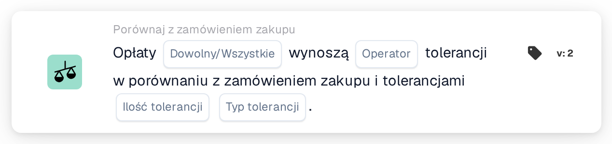
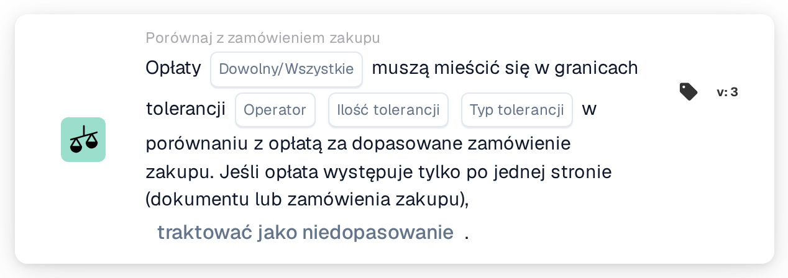
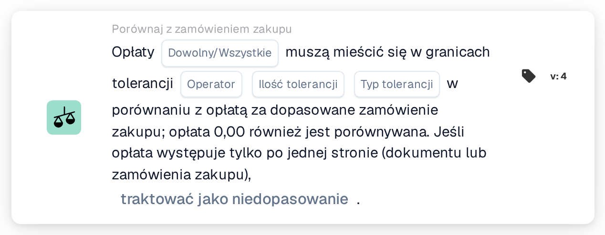

# Wszelkie/Wszystkie opłaty

<figure><figcaption>
Wersja 2
</figcaption></figure>

<figure><figcaption>
Wersja 3
</figcaption></figure>

<figure><figcaption>
Wersja 4
</figcaption></figure>

## **Cel:**

Ta karta Workflow porównuje opłaty dodatkowe dokumentu z opłatami dodatkowymi dopasowanego zamówienia zakupu, w ramach określonej tolerancji. Odpowiada na jedno pytanie: czy dokument i zamówienie zakupu są zgodne co do opłat dodatkowych? Porównywana jest każda opłata, którą dopasowanie zamówienia zakupu sparowało, dlatego na karcie nie trzeba podawać żadnej nazwy pola.

Ta karta różni się od **Porównaj całkowite opłaty**, która porównuje jedno wskazane pole dokumentu z pojedynczą opłatą określoną przez Charge ID. Użyj tej karty, gdy wszystkie sparowane opłaty dokumentu mają zostać sprawdzone naraz.

Dopasowanie zamówienia zakupu musi zostać wykonane przed tą kartą. Jeśli dokument nie ma dopasowanego zamówienia zakupu, karta zatrzymuje Workflow i zgłasza brakujące dane.

## **Elementy karty:**

1. **Dowolny/Wszystkie:**
   * **Opis**: Jak poszczególne porównania opłat są łączone w jeden wynik karty.
   * **Opcje**:
     * **Każdy**: co najmniej jedna opłata musi spełnić porównanie.
     * **Wszystko**: każda opłata musi spełnić porównanie.
2. **Operator:**
   * **Opis**: Jak kwota opłaty z dokumentu jest porównywana z kwotą zamówienia zakupu dla tej samej opłaty.
   * **Opcje**:
     * **w**: obie kwoty muszą być zgodne, z uwzględnieniem tolerancji.
     * **Poza**: obie kwoty muszą różnić się o więcej niż tolerancja.
3. **Ilość tolerancji:**
   * **Opis**: Dopuszczalne odchylenie między opłatą dokumentu a opłatą zamówienia zakupu.
4. **Typ tolerancji:**
   * **Opis**: Jak interpretowana jest ilość tolerancji.
   * **Opcje**:
     * **Procent**: procent opłaty zamówienia zakupu.
     * **Wartość**: kwota stała.
5. **Zachowanie przy brakujących danych (wersje 3 i 4):**
   * **Opis**: Co zrobić, gdy opłata istnieje tylko z jednej strony, w dokumencie albo w zamówieniu zakupu, tak że nie ma odpowiednika do porównania. Opcja znajduje się na końcu zdania.
   * **Opcje**:
     * **traktować jako niedopasowanie**: Workflow zostaje zatrzymany. To ustawienie domyślne.
     * **zignoruj to i traktuj jako dopasowanie**: Workflow jest kontynuowany, jak gdyby opłata była zgodna.

## **Funkcjonalność:**

Karta przechodzi przez następujące kroki.

1. **Wymaga dopasowanego zamówienia zakupu.** Bez dopasowanego zamówienia zakupu karta zatrzymuje się natychmiast i zgłasza brakujące dane.
2. **Odczytuje tolerancję** z **Ilość tolerancji** i **Typ tolerancji** na karcie.
3. **Wersje 3 i 4 przypisują każdą dopasowaną pozycję zamówienia zakupu** do jednej z czterech sytuacji: opłaty po obu stronach, brak opłat po obu stronach, opłaty tylko w dokumencie albo opłaty tylko w zamówieniu zakupu. Wersja 3 pyta wyłącznie, czy dana strona ma opłatę powyżej 0,00. Wersja 4 sprawdza każdą parę opłat i liczy 0,00 jako wartość; za brakującą uznawana jest tylko opłata bez żadnej kwoty. Zobacz **Różnice między wersjami** poniżej. Pozycja, której nie da się powiązać z danymi zamówienia zakupu w dokumencie, jest błędem danych i karta zatrzymuje się.
4. **Opłata obecna tylko po jednej stronie decyduje o całej karcie.** Gdy jedna dopasowana pozycja ma opłaty po jednej stronie i żadnych po drugiej, **Zachowanie przy brakujących danych** decyduje o wyniku i żadna opłata nie jest porównywana, również opłaty pozycji poprawnie sparowanych. Operator i tolerancja nie są brane pod uwagę.
5. **Jeśli żadna pozycja nie ma opłat po żadnej ze stron**, obie strony są zgodne, że nie ma opłat dodatkowych. Operator **Poza** nie jest wtedy spełniony, ponieważ nic nie odbiega poza tolerancję, i Workflow zostaje zatrzymany. Każdy inny operator uznaje zgodność za spełnioną i Workflow jest kontynuowany. **Zachowanie przy brakujących danych** nie ma tu żadnego wpływu.
6. **W przeciwnym razie każda opłata jest porównywana**, kwota dokumentu z kwotą zamówienia zakupu, przy użyciu operatora i tolerancji. Kwota opłaty, która nie jest liczbą, zatrzymuje kartę z brakującymi danymi.
7. **Porównania są zbierane i łączone jednorazowo.** Każda opłata każdej dopasowanej pozycji wchodzi do jednego zbioru wyników, który ustawienie **Dowolny/Wszystkie** redukuje do jednego wyniku karty. Zbieranie odbywa się w skali dokumentu, nie na pozycję, dlatego **Każdy** oznacza dowolną opłatę w dowolnym miejscu dokumentu. Jeśli połączony wynik jest prawdziwy, Workflow jest kontynuowany, w przeciwnym razie zatrzymuje się na niespełnionym warunku.

Przed skonfigurowaniem karty warto znać trzy konsekwencje.

* **w z tolerancją 0 wymaga dokładnej równości.** Obie kwoty muszą być zgodne co do groszy.
* **Opłata obecna tylko po jednej stronie ma pierwszeństwo nad wszystkim innym.** Ponieważ krok 4 wykonuje się przed jakimkolwiek porównaniem, **zignoruj to i traktuj jako dopasowanie** pomija także sprawdzenie kwot każdej poprawnie sparowanej opłaty w dokumencie. Zachowaj **traktować jako niedopasowanie**, jeśli kwoty mają być weryfikowane.
* **traktować jako niedopasowanie zatrzymuje Workflow jako błąd, a nie jako niespełniony warunek.** Wbrew brzmieniu karta zgłasza brakujące dane, co dziennik Workflow i test karty pokazują na czerwono, a nie na pomarańczowo jak niespełniony warunek. Workflow zatrzymuje się w obu przypadkach.

## **Instalacja i konfiguracja:**

Dodaj kartę jako warunek And po dopasowaniu zamówienia zakupu. Wybierz, czy każda opłata czy dowolna opłata musi spełnić porównanie, wybierz operator **w** albo **Poza** i wprowadź ilość oraz typ tolerancji. W wersjach 3 i 4 wybierz, co ma się stać, gdy opłaty występują tylko po jednej stronie.

Aby wypróbować konfigurację bez czekania na dokument, otwórz menu karty w Workflow Builder, wybierz **Karta testowa**, wybierz dokument, a następnie **Test na dokumencie**. Dziennik karty wymienia każdą porównaną opłatę z obiema kwotami, operatorem i użytą tolerancją, a także zapisuje, która wartość **Zachowanie przy brakujących danych** zdecydowała o wyniku, gdy opłata była obecna tylko po jednej stronie.

## **Przykładowy scenariusz:**

Potwierdzenie zamówienia zawiera opłatę transportową 100,00, a dopasowana pozycja zamówienia zakupu zawiera tę samą opłatę transportową 100,00. Przy **Wszystko**, operatorze **w** i tolerancji 0 jako wartości kwoty są równe, karta jest spełniona i Workflow jest kontynuowany.

Przy 120,00 na potwierdzeniu zamówienia wobec 100,00 w zamówieniu zakupu ta sama konfiguracja nie jest spełniona i Workflow zatrzymuje się na niespełnionym warunku.

Jeśli ani potwierdzenie zamówienia, ani zamówienie zakupu nie zawiera żadnej opłaty, operator **w** uznaje to za zgodność i Workflow jest kontynuowany, natomiast **Poza** go zatrzymuje.

Jeśli potwierdzenie zamówienia zawiera opłatę transportową, a zamówienie zakupu żadnej, operator przestaje mieć zastosowanie. Przy **traktować jako niedopasowanie** Workflow zatrzymuje się, aby ktoś mógł sprawdzić, dlaczego opłata występuje tylko po jednej stronie.

Jeśli potwierdzenie zamówienia wykazuje opłatę transportową 0,00, a zamówienie zakupu 204,00, wersja 4 porównuje obie kwoty i Workflow zatrzymuje się na niespełnionym warunku. Wersja 3 odczytałaby 0,00 jako „brak opłaty w dokumencie” i pozostawiła wynik ustawieniu **Zachowanie przy brakujących danych**.

## **Różnice między wersjami:**

Wersję 4 stosują nowe karty. Wersje 2 i 3 pozostają wspierane w istniejących Workflows.

### Wersja 4 w porównaniu z wersją 3

Obie wersje mają te same ustawienia i te same kroki. Różnią się wyłącznie sposobem traktowania opłaty 0,00:

* **Wersja 3 traktuje 0,00 jako brak opłaty.** Opłata dokumentu 0,00 sparowana z opłatą zamówienia zakupu 204,00 liczy się jako „zamówienie zakupu ma opłaty, dokument nie ma żadnych”, dlatego decyduje **Zachowanie przy brakujących danych**, a kwoty nigdy nie są porównywane. Przy **zignoruj to i traktuj jako dopasowanie** Workflow jest kontynuowany, mimo że kwoty się różnią.
* **Wersja 4 porównuje 0,00 jako kwotę.** Ta sama para jest porównywana jak każda inna: 0,00 wobec 204,00 nie mieści się w tolerancji, dlatego Workflow zatrzymuje się na niespełnionym warunku. Para z 0,00 po obu stronach również jest porównywana i jest zgodna.
* **Opłata bez kwoty pozostaje w wersji 4 brakująca.** Gdy jedna strona pary nie ma żadnej kwoty, na przykład opłaty, której zamówienie zakupu nie zawiera, decyduje **Zachowanie przy brakujących danych**, tak jak w wersji 3.

Aby uzyskać to zachowanie w istniejącym Workflow, zastąp kartę w wersji 3 kartą w wersji 4 i ustaw te same wartości.

### Wersja 2

Wersja 2 również porównuje opłatę po opłacie i łączy wyniki w skali dokumentu ustawieniem **Dowolny/Wszystkie**, ale nie ma klasyfikacji przypadków, co zmienia to, co się dzieje, gdy opłaty nie są obecne po obu stronach:

* Wersja 2 nie ma opcji **Zachowanie przy brakujących danych**. Jej zdanie kończy się po typie tolerancji.
* Wersja 2 nie klasyfikuje dopasowanych pozycji i dlatego nie rozpoznaje opłaty istniejącej tylko po jednej stronie. Porównuje obecną kwotę z 0,00 przyjętym dla brakującej strony, a decyduje operator: **w** nie jest spełniony i Workflow zatrzymuje się, **Poza** jest spełniony i Workflow jest kontynuowany. Dziennik karty pokazuje porównanie z 0,00.
* Jeśli żadna ze stron nie zawiera opłat, wersja 2 nie ma czego porównywać i zgłasza brakujące dane, zamiast uznać brak po obu stronach za zgodność.

## **Wnioski:**

Karta "Any / All Charges" automatyzuje sprawdzenie, że zafakturowane lub potwierdzone opłaty dodatkowe odpowiadają zamówionym opłatom dodatkowym. Ponieważ brak opłat po obu stronach liczy się w wersjach 3 i 4 jako zgodność, dokumenty bez opłat dodatkowych przechodzą bez ręcznej interwencji, natomiast opłaty występujące tylko po jednej stronie są wstrzymywane do weryfikacji, o ile nie zostanie to celowo dopuszczone.
