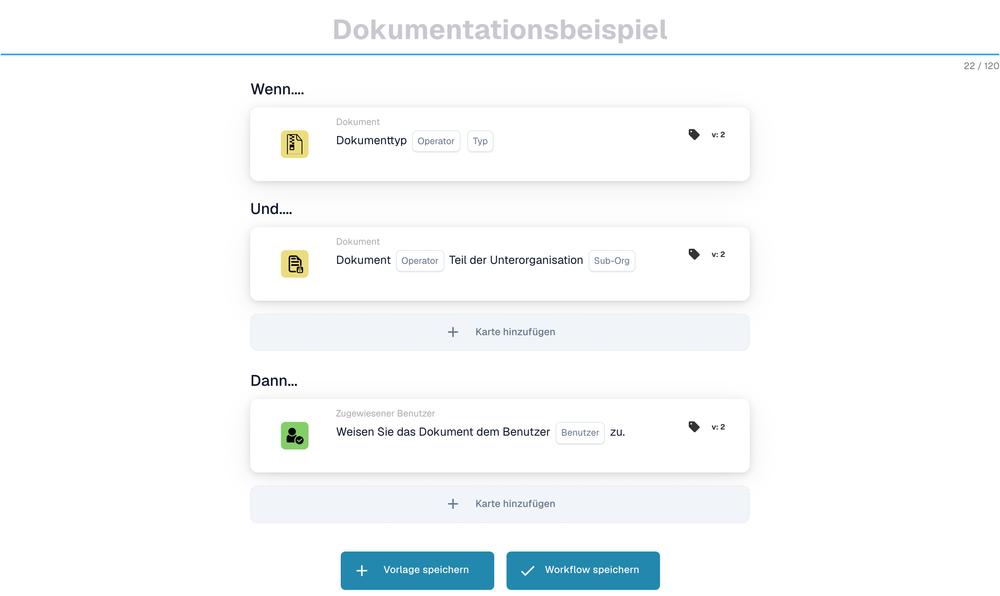
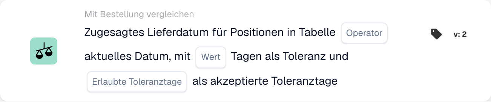
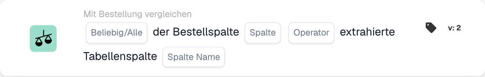
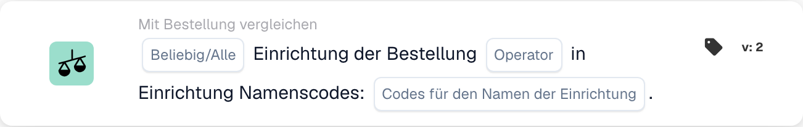
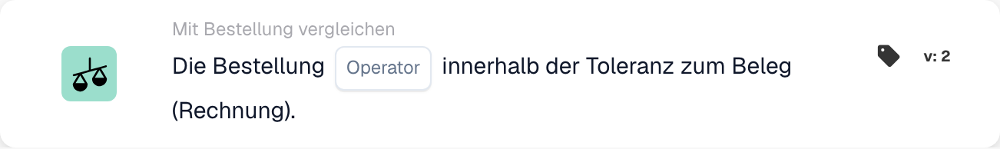
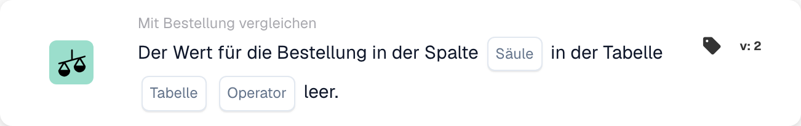
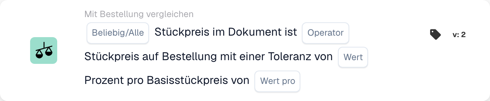
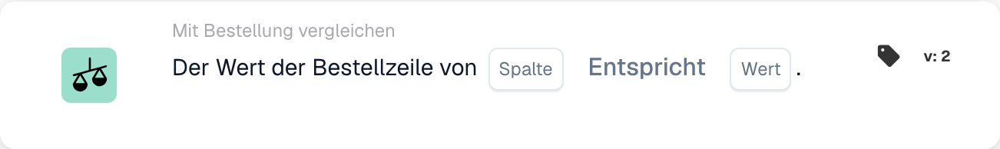

# PO-Matching-Karten – Vollständiger Leitfaden

## Passende Karten für Bestellungen (PO) – Vollständiger Leitfaden

**Status:** Deckt 15 PO-Vergleichskarten mit detaillierten Berechnungen ab

***

Die PO-Vergleichskarten auf dieser Seite gehen in die **Und**-Gruppe des Workflow Builders – sie vergleichen Rechnungsdaten mit der abgeglichenen Bestellung, bevor die Dann-Aktionen ausgeführt werden:

<figure><figcaption><p>Nicht gespeichertes Beispiel mit Wenn-, Und- und Dann-Karten. Füllen Sie alle Platzhalter vor der Ausführung aus.</p></figcaption></figure>

***

### 📌 Versionsinformationen

**Am weitesten entwickelte Karte:** CONDITION\_DOC\_TO\_PO\_UNIT\_PRICE (5 Versionen, neueste Version 5) **Andere komplexe Karten:** CONDITION\_OC\_TO\_PO\_ITEMS (Version 4), CONDITION\_LESS\_THAN\_TOLERANCE\_AS\_VALUE\_OF\_ORDERED\_QUANTITY (Version 4)

**Versionsmuster:**

* **v2 → v3+:** Hinzufügung von Toleranzparametern für eine flexible Anpassung
* **v3 → v4:** Hinzufügung von Vergleichsmodus-Parametern
* **v4 → v5:** Erweiterte Toleranz mit mehreren Einheiten (%, EUR, $ usw.)

📖 [Vollständiger Versionsverlauf](../../release.md) | [Kartenversionen und Verhalten](../../cards-overview/card-versions-guide.md)

***

### PO-Matching verstehen

Wenn Sie eine Rechnung erhalten, sollte diese mit der zuvor aufgegebenen Bestellung (PO) übereinstimmen. Bestellabgleichskarten prüfen automatisch, ob Rechnungsdaten mit Bestelldaten übereinstimmen.

**Das große Ganze:**

```
PO aufgegeben    Rechnung trifft ein    PO-Matching        Entscheidung
(€100)     →     (€103)             →   (Prüfen, ob        → Genehmigen/Ablehnen
Menge: 100       Menge: 100             innerhalb der Toleranz)
```

<figure><figcaption><p>Der Bestellpreis (€100) liegt auf der linken Schale, der Rechnungspreis (€103) auf der rechten. Die Differenz von €3 entspricht 3 % des Bestellpreises, der Zeiger bleibt also im grünen Toleranzband von ±5 %, und die Prüfung gilt als bestanden. Jenseits von ±5 % (rot) muss die Rechnung geprüft werden.</p></figcaption></figure>

***

## 1. Vollständige Übereinstimmung der Bestellung

### Zweck

Überprüft, ob die gesamte Rechnung perfekt oder innerhalb der Toleranz mit der Bestellung übereinstimmt

### Wann zu verwenden

* Bevor Sie eine Rechnung genehmigen
* Als vorläufige Qualitätskontrolle
* Um Probleme frühzeitig zu erkennen

### Wie es funktioniert

System vergleicht:

* Rechnungsmengen im Vergleich zu Bestellmengen
* Rechnungspreise vs. PO-Preise
* Rechnungspositionen vs. Bestellpositionen
* Gesamtsumme der Rechnung im Vergleich zur Gesamtsumme der Bestellung

### Ergebnis

* **TRUE** (Vollständige Übereinstimmung): Alles stimmt, fortfahren
* **FALSE** (Nichtübereinstimmung): Etwas stimmt nicht überein, muss überprüft werden

### Beispiel

```
Bestellung:
- Artikel ABC: Menge 100, Stückpreis €50 = €5000
- Artikel XYZ: Menge 50, Stückpreis €20 = €1000
- Gesamt: €6000

Rechnung:
- Artikel ABC: Menge 100, Stückpreis €50 = €5000
- Artikel XYZ: Menge 50, Stückpreis €20 = €1000
- Gesamt: €6000

Ergebnis: ✅ VOLLSTÄNDIGE ÜBEREINSTIMMUNG
```

***

## 2. Vergleich der Stückpreise (Dokument vs. Bestellung)

### Zweck

Vergleicht den Stückpreis auf der Rechnung mit dem Stückpreis auf der Bestellung

### Parameter

* **Stückpreistoleranz**: Abweichungen bis zu diesem Betrag zulassen
* **Toleranztyp**: Prozentsatz (%) oder Absolut (€/$)
* **Operator**: Ist gleich, ist größer als, ist kleiner als usw.

### So funktioniert es (prozentuale Toleranz)

**Formel:**

```
Abweichung % = |(Rechnungspreis - Bestellpreis)| / Bestellpreis × 100

Prüfung: Ist Abweichung % ≤ Toleranz %?
```

**Schritt-für-Schritt-Beispiel:**

```
Schritt 1: Preise ermitteln
  Bestell-Stückpreis: €100.00
  Rechnungs-Stückpreis: €103.00

Schritt 2: Differenz berechnen
  Differenz = |€103.00 - €100.00| = €3.00

Schritt 3: Prozentsatz berechnen
  Prozentsatz = (€3.00 / €100.00) × 100 = 3%

Schritt 4: Toleranz prüfen (5 % erlaubt)
  Ist 3% ≤ 5%? JA ✅

Ergebnis: PASS - Innerhalb der Toleranz
```

### Beispiele aus der Praxis

#### Beispiel 1: Kleine Erhöhung (akzeptiert)

```
Bestellpreis: €50.00
Rechnungspreis: €51.50
Toleranz: ±3%

Berechnung:
  Abweichung = |(€51.50 - €50.00)| / €50.00 × 100
  Abweichung = €1.50 / €50.00 × 100 = 3%

Ist 3% ≤ 3%? JA ✅ AKZEPTIEREN
```

#### Beispiel 2: Große Erhöhung (abgelehnt)

```
Bestellpreis: €50.00
Rechnungspreis: €55.00
Toleranz: ±3%

Berechnung:
  Abweichung = |(€55.00 - €50.00)| / €50.00 × 100
  Abweichung = €5.00 / €50.00 × 100 = 10%

Ist 10% ≤ 3%? NEIN ❌ ABLEHNEN - PRÜFUNG ERFORDERLICH
```

#### Beispiel 3: Rabatt (auch geprüft)

```
Bestellpreis: €100.00
Rechnungspreis: €97.00
Toleranz: ±5%

Berechnung:
  Abweichung = |(€97.00 - €100.00)| / €100.00 × 100
  Abweichung = €3.00 / €100.00 × 100 = 3%

Ist 3% ≤ 5%? JA ✅ AKZEPTIEREN (Rabatt liegt innerhalb der Toleranz)
```

#### Beispiel 4: Absolute Werttoleranz

```
Bestellpreis: €10.00
Rechnungspreis: €10.50
Toleranz: ±€1.00 (absolut, nicht %)

Berechnung:
  Abweichung = |€10.50 - €10.00| = €0.50

Ist €0.50 ≤ €1.00? JA ✅ AKZEPTIEREN
```

### Was tun mit Ergebnissen?

**Wenn PASS ✅:**

* Fahren Sie mit der nächsten Prüfung fort
* Oder Rechnung genehmigen
* Oder fahren Sie mit dem Export fort

**Wenn FAIL ❌:**

* Zur manuellen Überprüfung kennzeichnen
* Bitten Sie den Lieferanten um eine Erklärung
* Kontaktieren Sie das Beschaffungsteam
* Genehmigen Sie mit einer Notiz, wenn dies akzeptabel ist

***

## 3. Mengenvergleich

### Zweck

Prüft, ob die bestellte Menge mit der in Rechnung gestellten Menge übereinstimmt

### Parameter

* **Toleranz**: Betrag oder % dürfen abweichen
* **Operator**: Gleich, Größer als, Kleiner als
* **Mengentyp**: Bestellt, Erhalten, Offen

### Berechnungsbeispiel

**Prozent-Toleranz:**

```
Formel:
  Mengenabweichung % = |(Rechnungsmenge - Bestellmenge)| / Bestellmenge × 100

Beispiel:
  Bestellmenge: 100 Einheiten
  Rechnungsmenge: 103 Einheiten
  Toleranz: ±5%

  Abweichung = |(103 - 100)| / 100 × 100
  Abweichung = 3 / 100 × 100 = 3%

  Ist 3% ≤ 5%? JA ✅ AKZEPTIEREN
```

**Absolute Toleranz:**

```
Formel:
  Mengenabweichung = |Rechnungsmenge - Bestellmenge|

Beispiel:
  Bestellmenge: 100 Einheiten
  Rechnungsmenge: 102 Einheiten
  Toleranz: ±5 Einheiten

  Abweichung = |102 - 100| = 2 Einheiten

  Ist 2 Einheiten ≤ 5 Einheiten? JA ✅ AKZEPTIEREN
```

### Szenarien aus der realen Welt

#### Überlieferung (mehr als bestellt)

```
Bestellt: 100 Einheiten
In Rechnung gestellt: 110 Einheiten
Toleranz: ±5%

Abweichung = |(110-100)|/100 × 100 = 10%

Ist 10% ≤ 5%? NEIN ❌

Entscheidung: Lieferanten kontaktieren - mehr geliefert als bestellt
Mögliche Ursache: Fehler des Lieferanten, Teillieferung bereits erhalten
```

#### Unterlieferung (weniger als bestellt)

```
Bestellt: 100 Einheiten
In Rechnung gestellt: 95 Einheiten
Toleranz: ±5%

Abweichung = |(95-100)|/100 × 100 = 5%

Ist 5% ≤ 5%? JA ✅

Entscheidung: Akzeptieren - innerhalb der Toleranz
Mögliche Ursache: Teillieferung, Rest folgt
```

***

## 4. Kombinierter Preis der Mengendifferenz

### Zweck

Bei Mengenunterschieden wird berechnet, ob der Gesamtpreisunterschied akzeptabel ist

### Warum das wichtig ist

```
Szenario: Sie haben 100 Einheiten bestellt, aber 110 erhalten
- Die Menge liegt 10 % darüber (schlecht)
- ABER: Ihnen werden nur 10 % Mehrmenge berechnet
- Die kombinierte Wirkung kann akzeptabel sein
```

### Berechnung

**Formel:**

```
Kombinierte Abweichung = Mengenabweichung × Preisabweichung

Wenn beide innerhalb der Toleranz liegen, ist die Kombination in der Regel akzeptabel
```

**Beispiel:**

```
Bestellung:
- Stückpreis: €100
- Menge: 100
- Gesamt: €10,000

Rechnung:
- Stückpreis: €102 (2 % höher)
- Menge: 105 (5 % höher)
- Gesamt: €10,710

Analyse:
- Preisabweichung: 2% ✅
- Mengenabweichung: 5% ✅
- Kombinierte Wirkung: 1.02 × 1.05 = 1.071 = 7.1% Gesamtanstieg

Ist die kombinierte Abweichung akzeptabel? In der Regel JA ✅
```

***

## 5. Vergleich zwischen Artikel-ID und Lieferantenartikelnummer

### Zweck

Prüft, ob die Artikel in der Rechnung mit den Artikeln in der Bestellung übereinstimmen

### Wie es funktioniert

**Genaue Übereinstimmung (am einfachsten):**

```
Artikel-ID der Bestellung: ABC-123
Artikel-ID der Rechnung: ABC-123
Ergebnis: ✅ ÜBEREINSTIMMUNG
```

**Lieferantenartikelnummer (häufiger):**

```
Bestellartikel: ABC-123 (Unser interner Code)
Lieferantenartikel: SUPP-456 (Dessen Code für denselben Artikel)
Das System ordnet diese als denselben Artikel zu
Ergebnis: ✅ ÜBEREINSTIMMUNG
```

### Szenario: Was passiert, wenn es nicht übereinstimmt?

```
Bestellartikel: ABC-123 (Kupferdraht, 2 mm)
Rechnungsartikel: ABC-124 (Stahldraht, 2 mm)

Ergebnis: ❌ KEINE ÜBEREINSTIMMUNG

Maßnahmen:
1. Handelt es sich um eine Substitution? Mit dem Einkauf klären
2. Handelt es sich um einen Fehler? Lieferanten kontaktieren
3. Ist die Beschreibung ähnlich? Manuell prüfen
```

***

## 6. Überprüfung des Auftragstyps

### Zweck

Überprüft, ob der Bestelltyp korrekt ist

### Auftragsarten

* **Standardbestellung**: Regulärer Kauf
* **Eilauftrag**: Dringend, möglicherweise mit Aufpreis
* **Rahmenvereinbarung**: Langfristiger Vertrag
* **Pauschalauftrag**: Unbefristeter Vertrag
* **Einlieferung**: Sie zahlen erst bei Nutzung

### Beispielprüfung

```
Bestellart der Bestellung: Standardbestellung
Bestellart der Rechnung: Standardbestellung
Ergebnis: ✅ ÜBEREINSTIMMUNG

Bei Abweichung: Kann Konditionen, Zahlung und Preise beeinflussen
```

***

## 7. Überprüfung des Lieferdatums

### Zweck

Überprüft, ob das Lieferdatum mit dem versprochenen Datum auf der Bestellung übereinstimmt

### Berechnung

**Verspätete Lieferung:**

```
Formel:
  Tage zu spät = Lieferdatum der Rechnung - zugesagtes Bestelldatum

Beispiel:
  Bestellung zugesagt: 2025-10-15
  Tatsächliche Lieferung: 2025-10-22
  Tage zu spät = 7 Tage

Bei einer Toleranz von ±3 Tagen:
  Ist 7 ≤ 3? NEIN ❌ ZU SPÄT
```

**Frühe Lieferung:**

```
Formel:
  Tage zu früh = zugesagtes Bestelldatum - Lieferdatum der Rechnung

Beispiel:
  Bestellung zugesagt: 2025-10-15
  Tatsächliche Lieferung: 2025-10-10
  Tage zu früh = 5 Tage

Eine frühe Lieferung ist in der Regel in Ordnung ✅
Es sei denn, Sie benötigen sie zu einem bestimmten Zeitpunkt
```

### Toleranzeinstellungen

```
±3 Tage: 3 Tage zu spät oder zu früh zulassen
±5 Tage: Abweichung von bis zu 5 Tagen zulassen
0 Tage: Muss exakt übereinstimmen
```

***

## 8. Gebührenüberprüfung (Steuern, Versand usw.)

### Zweck

Prüft, ob zusätzliche Kosten (Steuern, Versand, Bearbeitung) mit der Bestellung übereinstimmen

### Typische Gebühren

```
- Versand: €50
- Bearbeitung: €10
- Verpackung: €5
- Versicherung: €15
- Steuern: €300
```

### Berechnung

**Beispiel: Versandkostenprüfung**

```
Bestellversand: €50.00
Rechnungsversand: €51.00
Toleranz: ±3%

Abweichung = |€51.00 - €50.00| / €50.00 × 100 = 2%

Ist 2% ≤ 3%? JA ✅ AKZEPTIEREN
```

**Beispiel: Mehrfachladungen**

```
Gesamtgebühren der Bestellung:
  - Versand: €50
  - Steuern: €300
  - Bearbeitung: €10
  Gesamt: €360

Gesamtgebühren der Rechnung:
  - Versand: €50
  - Steuern: €312 (11 % Steuer)
  - Bearbeitung: €10
  Gesamt: €372

Differenz: €12
Prüfen, ob innerhalb der Toleranz ✅ oder ❌
```

***

## 9. Steuerprüfung

### Zweck

Überprüft, ob die Steuerbeträge korrekt berechnet werden

### Berechnung

**Formel:**

```
Steuerbetrag = Zwischensumme × Steuersatz

Beispiel:
  Zwischensumme: €1000
  Steuersatz: 19%
  Erwartete Steuer: €1000 × 0.19 = €190

Steuer auf der Rechnung: €190
Übereinstimmung? JA ✅
```

**Häufige Probleme:**

```
1. Steuersatz geändert (regionsabhängig)
2. Steuer auf falschen Betrag angewendet (vor/nach Rabatten)
3. Mehrere Steuersätze (einige Artikel 7 %, andere 19 %)
4. Steuerbefreite Artikel (0 % Steuer)
```

**Beispiel: Mehrfachbesteuerung**

```
Artikel A: €100 @ 19% Steuer = €119
Artikel B: €100 @ 7% Steuer = €107
Artikel C: €100 @ 0% Steuer = €100
Gesamt: €326

Die Rechnung zeigt €325 (€1 Fehler)

Prüfung: Innerhalb der Toleranz oder Handlungsbedarf?
```

***

## 10. Zuordnung von Einrichtung und Kostenstelle

### Zweck

Stellt sicher, dass die Rechnung für die richtige Einrichtung/Kostenstelle ausgestellt ist

### Beispiel

```
Die Bestellung gilt für:
- Einrichtung: Werk Berlin
- Kostenstelle: CC-2025

Die Rechnung sollte enthalten:
- Einrichtung: Werk Berlin ✅
- Kostenstelle: CC-2025 ✅

Bei abweichender Einrichtung: Möglicherweise ist eine andere Freigabe erforderlich
```

***

## 11. Validierung des Lieferantenstatus

### Zweck

Prüft, ob der Lieferant noch zugelassen/aktiv ist

### Statustypen

```
✅ ACTIVE: Zugelassen, Geschäftsbeziehung möglich
⚠️ ON HOLD: Vorübergehend gesperrt
❌ INACTIVE: Keine Geschäftsbeziehung mehr
⚠️ CONDITIONAL: Nur für bestimmte Artikel
```

### Beispielprüfung

```
Lieferant: ABC Corp
Status in der Datenbank: ACTIVE
Status beim Erstellen der Bestellung: ACTIVE
Status beim Eingang der Rechnung: INACTIVE

Warnung: Der Lieferantenstatus hat sich geändert! Ursache prüfen.
```

***

## Welche Toleranz sollte ich verwenden?

### Strenge Toleranzen (geringeres Risiko, mehr manuelle Arbeit)

```
Verwenden für:
- Artikel mit hohem Wert
- Artikel, bei denen Genauigkeit wichtig ist
- Regulierte Branchen

Einstellungen:
- Stückpreis: ±1%
- Menge: ±1%
- Lieferdatum: ±1 Tag
- Gebühren: ±1%
```

### Moderate Toleranzen (ausgewogen)

```
Verwenden für:
- Die meisten Geschäftsvorgänge
- Standardartikel
- Normaler Einkauf

Einstellungen:
- Stückpreis: ±3-5%
- Menge: ±3-5%
- Lieferdatum: ±3 Tage
- Gebühren: ±5%
```

### Lockere Toleranzen (höheres Risiko, weniger manuelle Arbeit)

```
Verwenden für:
- Artikel mit geringem Wert
- Großeinkäufe
- Lieferantenvereinbarungen mit Spielraum

Einstellungen:
- Stückpreis: ±10%
- Menge: ±10%
- Lieferdatum: ±7 Tage
- Gebühren: ±10%
```

***

## Beispiel für einen PO-Matching-Workflow

```
Rechnung trifft ein
    ↓
Bedingung: „Ist der Betrag > €5000?“ → JA
    ↓
Prüfung: Vollständige Übereinstimmung? → NEIN (10 % Preisdifferenz)
    ↓
Prüfung: Stückpreis innerhalb von 5 %? → NEIN (12 % Differenz)
    ↓
Prüfung: Menge innerhalb von 5 %? → JA (2 % Differenz)
    ↓
Entscheidung: FAIL - Preisabweichung zu hoch
    ↓
Kennzeichnen für: Manuelle Prüfung / Freigabe durch den Einkäufer
    ↓
Warten auf: Kommentar des Einkäufers
    ↓
Bei Genehmigung: Weiter zum Export
Bei Ablehnung: An den Lieferanten zurücksenden
```

***

## Fehlerbehebung beim Bestellabgleich

### „Bestellung nicht gefunden“

```
Ursache: Die Bestellnummer der Rechnung existiert nicht im System
Lösung:
1. Schreibweise der Bestellnummer prüfen
2. Prüfen, ob die Bestellung angelegt wurde
3. Prüfen, ob die Bestellung in der richtigen Organisation liegt
4. Lieferanten nach der Bestellreferenz fragen
```

### „Artikel stimmen nicht überein“

```
Ursache: Die Rechnungsartikel unterscheiden sich von den Bestellartikeln
Mögliche Ursachen:
1. Substitution vom Einkauf genehmigt
2. Unterschiedliche Artikelnummern für denselben Artikel
3. Fehler des Lieferanten
Lösung: Einkauf oder Lieferanten kontaktieren
```

### „Preis höher als Bestellwert“

```
Ursache: Rechnungspreis > Bestellpreis
Mögliche Ursachen:
1. Preiserhöhung genehmigt
2. Fehler des Lieferanten
3. Währungsunterschied
4. Zusätzliche Leistungen enthalten
Lösung: Mit dem Einkauf abklären
```

### „Lieferdatum falsch“

```
Ursache: Die Rechnung ist nach der zugesagten Lieferung datiert
Mögliche Ursachen:
1. Lieferung verzögerte sich
2. Wareneingangsdatum weicht vom Rechnungsdatum ab
3. Teillieferung
Lösung: Versanddokumente prüfen oder Lieferanten kontaktieren
```

***

## Übersichtstabelle

| Karte           | Was es überprüft        | Hauptberechnung     | Übliche Toleranz |
| -------------- | --------------------- | -------------------- | ---------------- |
| Vollständige Übereinstimmung     | Alles            | Alle Prüfungen         | Variiert           |
| Stückpreis     | Preis pro Einheit        | % oder € Differenz    | ±3-5%            |
| Menge       | Bestellte Menge        | % oder Einheitsdifferenz | ±3-5%            |
| Kombipreis | Gesamt mit Mengenänderung | Menge × Preis          | ±5-10%           |
| Artikel-ID        | Richtige Artikel           | Zeichenfolgenübereinstimmung         | Genau            |
| Auftragsart     | Art des Kaufs      | Zeichenfolgenübereinstimmung         | Genau            |
| Liefertermin  | Wann geliefert         | Tagesunterschied       | ±3 Tage          |
| Gebühren        | Zusätzliche Gebühren            | % oder € Differenz    | ±5%              |
| Steuer            | Steuerbetrag            | Berechnung des Steuerprozentsatzes    | ±1%              |
| Einrichtung       | Kostenstelle           | Zeichenfolgenübereinstimmung         | Genau            |
| Lieferant       | Genehmigt?             | Statusprüfung         | Nur aktiv      |

***

## Verwandte Dokumentation

* Den vollständigen Arbeitsablauf finden Sie im Leitfaden „Rechnungsvalidierung“.
* Empfohlene Werte nach Branche finden Sie unter „Toleranzeinstellungen“.
* Informationen zum Umgang mit Fehlern finden Sie unter „Ausnahmebehandlung“.
* Kontaktieren Sie Ihr Beschaffungsteam für spezifische Toleranzrichtlinien

<!-- workflow-card-example-condition_promised_delivery_date_to_current-20261021 -->

### Zugesagter Liefertermin im Vergleich zum Referenzdatum

<figure><figcaption><p>Kartenfelder in der angezeigten Version. Die Platzhalter sind noch nicht ausgefüllt.</p></figcaption></figure>

`CONDITION_PROMISED_DELIVERY_DATE_TO_CURRENT` · Version 2

Gehen Sie von einem Referenzdatum von `2026-10-21` und einem versprochenen Positionslieferdatum von `2026-10-23` aus. Wählen Sie den Später-als-Vergleich und die Null-Tage-Toleranz aus. Das zukünftige Datum erfüllt diesen Vergleich; `2026-10-20` nicht. Konfigurieren Sie die Optionen „Alle/Alle“ und „Akzeptierter Toleranztag“ gezielt und testen Sie ein fehlendes Datum separat.

<!-- workflow-card-example-condition_po_extracted_table_column-20261021 -->

### Bestellspalte im Vergleich zu einer extrahierten Spalte

<figure><figcaption><p>Kartenfelder in der angezeigten Version. Die Platzhalter sind noch nicht ausgefüllt.</p></figcaption></figure>

`CONDITION_PO_EXTRACTED_TABLE_COLUMN` · Version 2

Vergleichen Sie die übereinstimmende Bestellartikelspalte mit der extrahierten Spalte `article_number` unter Verwendung von Gleichheit und Alle. Passende Werte `DEMO-A` bestanden; ein extrahierter Wert `DEMO-B` schlägt fehl. Wählen Sie eine Nachschlagetabelle nur aus, wenn eine dokumentierte ID-Wert-Ersetzung erforderlich ist. Überprüfen Sie diese Zuordnung vor dem Vergleich.

<!-- workflow-card-example-condition_check_facility_in_po-20261021 -->

### Zulässige Einrichtungen in der Bestellung

<figure><figcaption><p>Kartenfelder in der angezeigten Version. Die Platzhalter sind noch nicht ausgefüllt.</p></figcaption></figure>

`CONDITION_CHECK_FACILITY_IN_PO` · Version 2

Wählen Sie „Alle“, den Ist-Vergleich und den konfigurierten Anlagencode `DEMO-NORTH`. Übereinstimmende Bestellposten in diesem Einrichtungspass; eine Position mit `DEMO-SOUTH` schlägt fehl. Verwenden Sie Einrichtungscodes aus den Bestelldaten, anstatt davon auszugehen, dass es sich bei einem Anzeigeetikett um den Code handelt.

<!-- workflow-card-example-condition_purchase_order_full_match-20261021 -->

### Vollständiger Bestellabgleich

<figure><figcaption><p>Kartenfelder in der angezeigten Version. Die Platzhalter sind noch nicht ausgefüllt.</p></figcaption></figure>

`CONDITION_PURCHASE_ORDER_FULL_MATCH` · Version 2

Verwenden Sie eine vollständig abgestimmte Demo-Rechnung und Bestellung mit der Menge `2` und dem Stückpreis `100` auf beiden Seiten sowie konfigurierten Mengen-/Preistoleranzen. Wählen Sie die Bedingung „Vollständige Übereinstimmung“ aus: Sie ist erfüllt. Testen Sie dann einen Preis außerhalb der konfigurierten Toleranz. Fehlende Vergleichsdaten oder eine fehlende Bestellung stellen keinen erfolgreichen vollständigen Abgleich dar. Ein Lieferschein hat einen reinen Mengenvergleich; Gehen Sie nicht davon aus, dass die Regeln für den Rechnungspreis gelten.

<!-- workflow-card-example-condition_po_update_empty_column_check-20261021 -->

### Leere Spalte in der Bestelldatenbank

<figure><figcaption><p>Kartenfelder in der angezeigten Version. Die Platzhalter sind noch nicht ausgefüllt. Einzelne Beschriftungen dieser Kartenversion sind in der Oberfläche noch unübersetzt oder fachlich ungenau. Die Erläuterungen auf dieser Seite verwenden die passenden Begriffe.</p></figcaption></figure>

`CONDITION_PO_UPDATE_EMPTY_COLUMN_CHECK` · Version 2

Wählen Sie eine gültige PO-Tabelle und -Spalte aus, die von der Karte und dem Ist-Leer-Operator angeboten wird. Für einen vorhandenen übereinstimmenden Bestelldatensatz mit einem leeren Wert ist die Bedingung erfüllt; ein ausgefüllter Wert schlägt fehl. Überprüfen Sie zunächst die PO-Referenz und die Tabellen-/Spaltenzuordnung. Boolescher Wert `false` ist immer noch ein aktueller boolescher Wert; Ein fehlender Bestelldatensatz ist ein separater Datenfehler.

<!-- workflow-card-example-condition_compare_unit_price_percent_per-20261021 -->

### Prozentuale Toleranz pro Preisbasis

<figure><figcaption><p>Kartenfelder in der angezeigten Version. Die Platzhalter sind noch nicht ausgefüllt.</p></figcaption></figure>

`CONDITION_COMPARE_UNIT_PRICE_PERCENT_PER` · Version 2

Beispiel: Bestelleinheitspreis `200`, Grundpreis `100` und konfigurierte Toleranz `1` ergeben einen effektiven Satz von `(200 / 100) * (1 / 100) = 0.02` oder `2%`. Das Vergleichsband ist `196–204`. Gleichheit innerhalb der Toleranz akzeptiert einen Dokumentenpreis von `203` und lehnt `210` ab. Gehen Sie nicht davon aus, dass es sich bei dieser Karte um eine feste Toleranz von 1 % handelt.

<!-- workflow-card-example-condition_compare_po_line_value-20261021 -->

### Wert der Bestellposition im Vergleich zu einer Referenz

<figure><figcaption><p>Kartenfelder in der angezeigten Version. Die Platzhalter sind noch nicht ausgefüllt.</p></figcaption></figure>

`CONDITION_COMPARE_PO_LINE_VALUE` · Version 2

Wählen Sie die übereinstimmende PO-Spalte `item_number`, Gleichheit und Wert `DEMO-A` aus. Eine Position mit `DEMO-A` besteht die Prüfung; `DEMO-B` schlägt fehl. Verwenden Sie nur Operatoren, die für den ausgewählten Datentyp unterstützt werden, und testen Sie fehlende Daten der abgeglichenen Position separat.


## Aktueller Konfigurations- und Ergebnisvertrag

[P1: Toleranzen und PO-Vergleich mit eindeutiger Referenz](../../masterclass/tolerances-and-po.md)
