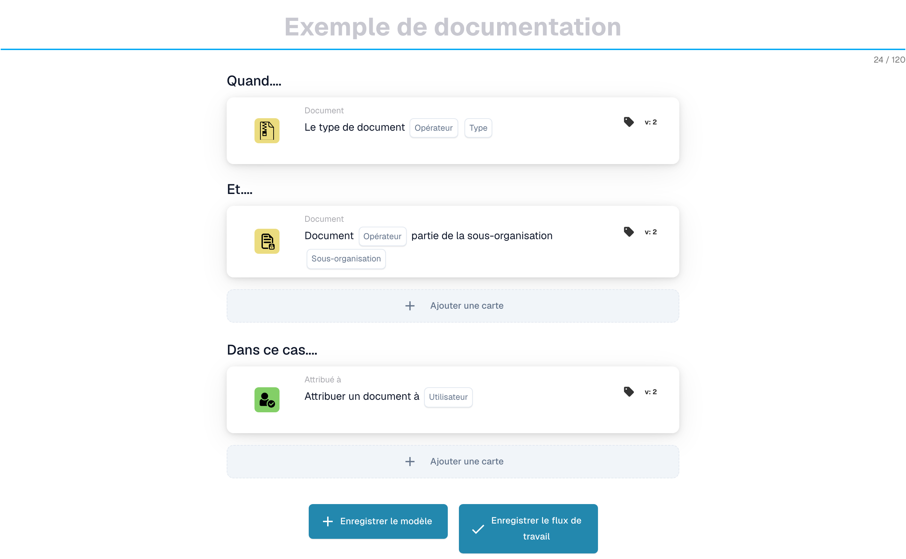
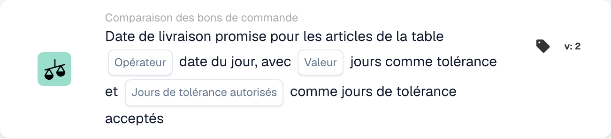
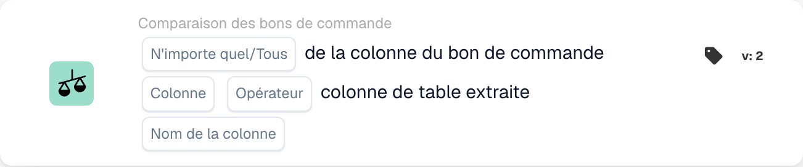
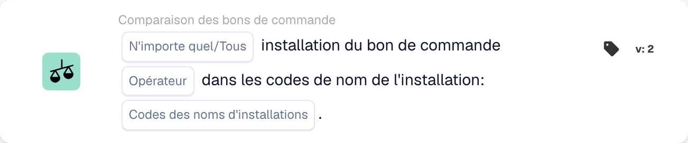
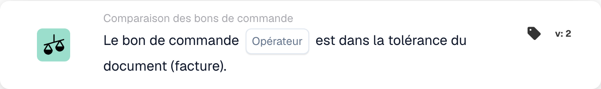
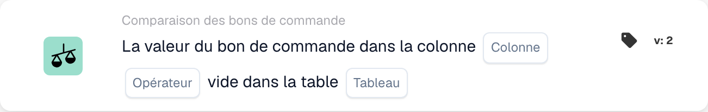
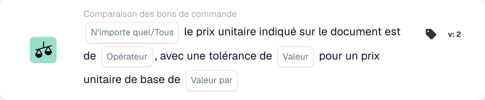
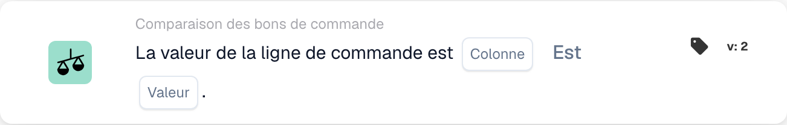

# Cartes de correspondance de bon de commande - Guide complet

## Cartes de correspondance de bon de commande (PO) - Guide complet

**Statut :** Couvre 15 cartes de comparaison de PO avec des calculs détaillés

***

Les cartes de comparaison de bons de commande sur cette page vont dans le groupe **Et** du Workflow Builder — elles comparent les données de facture avec le bon de commande correspondant avant l'exécution des actions Then :

<figure><figcaption><p>Exemple non enregistré avec les cartes Quand, Et et Alors. Renseignez tous les champs avant exécution.</p></figcaption></figure>

***

### 📌 Informations sur la version

**Carte la plus évoluée :** CONDITION\_DOC\_TO\_PO\_UNIT\_PRICE (5 versions, v5 la plus récente) **Autres cartes complexes :** CONDITION\_OC\_TO\_PO\_ITEMS (v4), CONDITION\_LESS\_THAN\_TOLERANCE\_AS\_VALUE\_OF\_ORDERED\_QUANTITY (v4)

**Modèles de touches :**

* **v2 → v3+:** Ajout de paramètres de tolérance pour une correspondance flexible
* **v3 → v4:** Ajout des paramètres du mode comparaison
* **v4 → v5:** Tolérance améliorée avec plusieurs unités (%, EUR, $, etc.)

📖 [Historique complet des versions](../../release.md) | [Versions et comportement des cartes](../../cards-overview/card-versions-guide.md)

***

### Comprendre la correspondance des bons de commande

Lorsque vous recevez une facture, elle doit correspondre au bon de commande (PO) passé précédemment. Les cartes de correspondance de bon de commande vérifient automatiquement si les données de la facture correspondent aux données du bon de commande.

**Vue d'ensemble :**

```
BC passé      Facture reçue         Rapprochement BC    Décision
(€100)    →   (€103)            →   (Vérifier si      → Approuver/Rejeter
Qté : 100     Qté : 100             dans la tolérance)
```

<figure><figcaption><p>Le prix du bon de commande (100 €) se trouve sur le plateau de gauche et le prix de la facture (103 €) sur celui de droite. L'écart de 3 € représente 3 % du prix du bon de commande : l'aiguille reste donc dans la zone verte de tolérance de ±5 % et le contrôle est réussi. Au-delà de ±5 % (en rouge), la facture doit être vérifiée.</p></figcaption></figure>

***

## 1. Correspondance complète du bon de commande

### Objectif

Vérifie si la facture entière correspond parfaitement au bon de commande ou dans les limites de tolérance

### Quand utiliser

* Avant d'approuver une facture
* Comme contrôle de qualité préliminaire
* Pour identifier les problèmes le plus tôt possible

### Comment ça marche

Le système compare :

* Quantités facturées vs quantités de bons de commande
* Prix des factures vs prix des bons de commande
* Articles de facture vs articles de bon de commande
* Total de la facture par rapport au total du bon de commande

### Résultat

* **TRUE** (Correspondance complète) : tout correspond, continuez
* **FALSE** (Incompatibilité) : quelque chose ne correspond pas, doit être révisé

### Exemple

```
Bon de commande :
- Article ABC : Qté 100, Prix unitaire €50 = €5000
- Article XYZ : Qté 50, Prix unitaire €20 = €1000
- Total : €6000

Facture :
- Article ABC : Qté 100, Prix unitaire €50 = €5000
- Article XYZ : Qté 50, Prix unitaire €20 = €1000
- Total : €6000

Résultat : ✅ CORRESPONDANCE COMPLÈTE
```

***

## 2. Comparaison des prix unitaires (document vs bon de commande)

### Objectif

Compare le prix unitaire sur la facture avec le prix unitaire sur le bon de commande

### Paramètres

* **Tolérance de prix unitaire** : Autoriser l'écart jusqu'à ce montant
* **Type de tolérance** : Pourcentage (%) ou Absolu (€/$)
* **Opérateur** : Est égal à, Est supérieur à, Est inférieur à, etc.

### Comment ça marche (tolérance en pourcentage)

**Formule :**

```
Écart % = |(Prix facture - Prix bon de commande)| / Prix bon de commande × 100

Contrôle : l'écart % est-il ≤ à la tolérance % ?
```

**Exemple étape par étape :**

```
Étape 1 : Récupérer les prix
  Prix unitaire du bon de commande : €100.00
  Prix unitaire de la facture : €103.00

Étape 2 : Calculer la différence
  Différence = |€103.00 - €100.00| = €3.00

Étape 3 : Calculer le pourcentage
  Pourcentage = (€3.00 / €100.00) × 100 = 3%

Étape 4 : Vérifier la tolérance (5 % autorisés)
  3 % ≤ 5 % ? OUI ✅

Résultat : PASS - Dans la tolérance
```

### Exemples concrets

#### Exemple 1 : petite augmentation (acceptée)

```
Prix du bon de commande : €50.00
Prix de la facture : €51.50
Tolérance : ±3%

Calcul :
  Écart = |(€51.50 - €50.00)| / €50.00 × 100
  Écart = €1.50 / €50.00 × 100 = 3%

3 % ≤ 3 % ? OUI ✅ ACCEPTER
```

#### Exemple 2 : augmentation importante (rejetée)

```
Prix du bon de commande : €50.00
Prix de la facture : €55.00
Tolérance : ±3%

Calcul :
  Écart = |(€55.00 - €50.00)| / €50.00 × 100
  Écart = €5.00 / €50.00 × 100 = 10%

10 % ≤ 3 % ? NON ❌ REJETER - RÉVISION NÉCESSAIRE
```

#### Exemple 3 : Remise (également vérifiée)

```
Prix du bon de commande : €100.00
Prix de la facture : €97.00
Tolérance : ±5%

Calcul :
  Écart = |(€97.00 - €100.00)| / €100.00 × 100
  Écart = €3.00 / €100.00 × 100 = 3%

3 % ≤ 5 % ? OUI ✅ ACCEPTER (la remise est dans la tolérance)
```

#### Exemple 4 : Tolérance de valeur absolue

```
Prix du bon de commande : €10.00
Prix de la facture : €10.50
Tolérance : ±€1.00 (absolue, pas en %)

Calcul :
  Écart = |€10.50 - €10.00| = €0.50

€0.50 ≤ €1.00 ? OUI ✅ ACCEPTER
```

### Que faire des résultats

**Si RÉUSSITE ✅:**

* Passer à la vérification suivante
* Ou approuver la facture
* Ou procéder à l'exportation

**Si ÉCHEC ❌ :**

* Signaler pour révision manuelle
* Demander des explications au fournisseur
* Contacter l'équipe d'approvisionnement
* Approuver avec note si acceptable

***

## 3. Comparaison des quantités

### Objectif

Vérifie si la quantité commandée correspond à la quantité facturée

### Paramètres

* **Tolérance** : montant ou % pouvant différer
* **Opérateur** : Égal à, Supérieur à, Inférieur à
* **Type de quantité** : Commandé, Reçu, Ouvert

### Exemple de calcul

**Pourcentage de tolérance :**

```
Formule :
  Écart de quantité % = |(Qté facture - Qté bon de commande)| / Qté bon de commande × 100

Exemple :
  Quantité du bon de commande : 100 unités
  Quantité facturée : 103 unités
  Tolérance : ±5%

  Écart = |(103 - 100)| / 100 × 100
  Écart = 3 / 100 × 100 = 3%

  3 % ≤ 5 % ? OUI ✅ ACCEPTER
```

**Tolérance absolue :**

```
Formule :
  Écart de quantité = |Qté facture - Qté bon de commande|

Exemple :
  Quantité du bon de commande : 100 unités
  Quantité facturée : 102 unités
  Tolérance : ±5 unités

  Écart = |102 - 100| = 2 unités

  2 unités ≤ 5 unités ? OUI ✅ ACCEPTER
```

### Scénarios du monde réel

#### Surlivraison (plus que commandé)

```
Commandé : 100 unités
Facturé : 110 unités
Tolérance : ±5%

Écart = |(110-100)|/100 × 100 = 10%

10 % ≤ 5 % ? NON ❌

Décision : contacter le fournisseur - livraison supérieure à la commande
Raison possible : erreur du fournisseur, livraison partielle déjà reçue
```

#### Sous-livraison (moins que commandé)

```
Commandé : 100 unités
Facturé : 95 unités
Tolérance : ±5%

Écart = |(95-100)|/100 × 100 = 5%

5 % ≤ 5 % ? OUI ✅

Décision : accepter - dans la tolérance
Raison possible : livraison partielle, le reste suivra
```

***

## 4. Prix combiné de la différence de quantité

### Objectif

Lorsque la quantité diffère, calcule si la différence de prix totale est acceptable

### Pourquoi c'est important

```
Scénario : vous avez commandé 100 unités mais en avez reçu 110
- La quantité dépasse de 10 % (mauvais)
- MAIS : seuls 10 % supplémentaires vous sont facturés
- L'effet combiné peut être acceptable
```

### Calcul

**Formule :**

```
Écart combiné = Écart de quantité × Écart de prix

Si les deux sont dans la tolérance, l'écart combiné est généralement acceptable
```

**Exemple :**

```
Bon de commande :
- Prix unitaire : €100
- Quantité : 100
- Total : €10,000

Facture :
- Prix unitaire : €102 (2 % de plus)
- Quantité : 105 (5 % de plus)
- Total : €10,710

Analyse :
- Écart de prix : 2 % ✅
- Écart de quantité : 5 % ✅
- Effet combiné : 1.02 × 1.05 = 1.071 = 7,1 % d'augmentation totale

L'écart combiné est-il acceptable ? Généralement OUI ✅
```

***

## 5. Comparaison des numéros d'article et des numéros d'article du fournisseur

### Objectif

Vérifie si les éléments de la facture correspondent aux éléments du bon de commande

### Comment ça marche

**Correspondance exacte (le plus simple) :**

```
ID d'article du bon de commande : ABC-123
ID d'article de la facture : ABC-123
Résultat : ✅ CORRESPONDANCE
```

**Numéro d'article du fournisseur (plus courant) :**

```
Article du bon de commande : ABC-123 (notre code interne)
Article du fournisseur : SUPP-456 (son code pour le même article)
Le système les associe comme étant le même article
Résultat : ✅ CORRESPONDANCE
```

### Scénario : Et si cela ne correspond pas ?

```
Article du bon de commande : ABC-123 (fil de cuivre, 2 mm)
Article de la facture : ABC-124 (fil d'acier, 2 mm)

Résultat : ❌ AUCUNE CORRESPONDANCE

Actions :
1. S'agit-il d'une substitution ? Vérifier auprès des achats
2. S'agit-il d'une erreur ? Contacter le fournisseur
3. La description est-elle similaire ? Vérifier manuellement
```

***

## 6. Vérification du type de commande

### Objectif

Vérifie que le type de bon de commande est correct

### Types de commandes

* **Commande standard** : Achat régulier
* **Commande urgente** : Urgent, peut avoir une prime
* **Contrat-cadre** : Contrat à long terme
* **Commande globale** : Contrat à durée indéterminée
* **Consignement** : Vous ne payez qu'après utilisation

### Exemple de vérification

```
Type de commande du bon de commande : commande standard
Type de commande de la facture : commande standard
Résultat : ✅ CORRESPONDANCE

En cas d'écart : peut affecter les conditions, le paiement, les prix
```

***

## 7. Vérification de la date de livraison

### Objectif

Vérifie si la date de livraison correspond à la date promise sur le bon de commande

### Calcul

**Retard de livraison :**

```
Formule :
  Jours de retard = Date de livraison facture - Date promise du bon de commande

Exemple :
  Promis (bon de commande) : 2025-10-15
  Livraison réelle : 2025-10-22
  Jours de retard = 7 jours

Si la tolérance est de ±3 jours :
  7 ≤ 3 ? NON ❌ EN RETARD
```

**Livraison anticipée :**

```
Formule :
  Jours d'avance = Date promise du bon de commande - Date de livraison facture

Exemple :
  Promis (bon de commande) : 2025-10-15
  Livraison réelle : 2025-10-10
  Jours d'avance = 5 jours

Une livraison anticipée est généralement acceptable ✅
Sauf si vous en avez besoin à un moment précis
```

### Paramètres de tolérance

```
±3 jours : autoriser 3 jours de retard ou d'avance
±5 jours : autoriser jusqu'à 5 jours d'écart
0 jour : doit correspondre exactement
```

***

## 8. Vérification des frais (taxes, expédition, etc.)

### Objectif

Vérifie si les frais supplémentaires (taxes, expédition, manutention) correspondent au bon de commande

### Frais communs

```
- Expédition : €50
- Manutention : €10
- Emballage : €5
- Assurance : €15
- Taxes : €300
```

### Calcul

**Exemple : Vérification des frais d'expédition**

```
Expédition (bon de commande) : €50.00
Expédition (facture) : €51.00
Tolérance : ±3%

Écart = |€51.00 - €50.00| / €50.00 × 100 = 2%

2 % ≤ 3 % ? OUI ✅ ACCEPTER
```

**Exemple : Charges multiples**

```
Total des frais (bon de commande) :
  - Expédition : €50
  - Taxes : €300
  - Manutention : €10
  Total : €360

Total des frais (facture) :
  - Expédition : €50
  - Taxes : €312 (taxe de 11 %)
  - Manutention : €10
  Total : €372

Différence : €12
Vérifier si dans la tolérance ✅ ou ❌
```

***

## 9. Vérification fiscale

### Objectif

Vérifie que les montants des taxes sont calculés correctement

### Calcul

**Formule :**

```
Montant de la taxe = Sous-total × Taux de taxe

Exemple :
  Sous-total : €1000
  Taux de taxe : 19 %
  Taxe attendue : €1000 × 0.19 = €190

Taxe de la facture : €190
Correspondance ? OUI ✅
```

**Problèmes courants :**

```
1. Taux de taxe modifié (selon la région)
2. Taxe appliquée au mauvais montant (avant/après remises)
3. Plusieurs taux de taxe (certains articles à 7 %, d'autres à 19 %)
4. Articles exonérés de taxe (taxe à 0 %)
```

**Exemple : Fiscalité multi-taux**

```
Article A : €100 à 19 % de taxe = €119
Article B : €100 à 7 % de taxe = €107
Article C : €100 à 0 % de taxe = €100
Total : €326

La facture indique €325 (erreur de €1)

Contrôle : dans la tolérance ou à examiner ?
```

***

## 10. Correspondance installation/centre de coûts

### Objectif

S'assure que la facture concerne le bon établissement/centre de coûts

### Exemple

```
Le bon de commande concerne :
- Établissement : usine de Berlin
- Centre de coûts : CC-2025

La facture devrait indiquer :
- Établissement : usine de Berlin ✅
- Centre de coûts : CC-2025 ✅

Si l'établissement diffère : une autre approbation peut être nécessaire
```

***

## 11. Validation du statut du fournisseur

### Objectif

Vérifie si le fournisseur est toujours approuvé/actif

### Types de statut

```
✅ ACTIVE : approuvé, les affaires sont possibles
⚠️ ON HOLD : temporairement bloqué
❌ INACTIVE : plus d'affaires en cours
⚠️ CONDITIONAL : uniquement pour certains articles
```

### Exemple de vérification

```
Fournisseur : ABC Corp
Statut dans la base de données : ACTIVE
Statut à la création du bon de commande : ACTIVE
Statut à la réception de la facture : INACTIVE

Alerte : le statut du fournisseur a changé ! Cherchez pourquoi.
```

***

## Quelle tolérance dois-je utiliser ?

### Tolérances strictes (risque moindre, travail manuel accru)

```
À utiliser pour :
- Articles de grande valeur
- Articles pour lesquels l'exactitude est essentielle
- Secteurs réglementés

Paramètres :
- Prix unitaire : ±1%
- Quantité : ±1%
- Date de livraison : ±1 jour
- Frais : ±1%
```

### Tolérances modérées (équilibrées)

```
À utiliser pour :
- La plupart des transactions commerciales
- Articles standard
- Achats courants

Paramètres :
- Prix unitaire : ±3-5%
- Quantité : ±3-5%
- Date de livraison : ±3 jours
- Frais : ±5%
```

### Tolérances lâches (risque plus élevé, moins de travail manuel)

```
À utiliser pour :
- Articles de faible valeur
- Achats en gros
- Accords fournisseurs flexibles

Paramètres :
- Prix unitaire : ±10%
- Quantité : ±10%
- Date de livraison : ±7 jours
- Frais : ±10%
```

***

## Exemple de workflow de correspondance de bons de commande

```
Facture reçue
    ↓
Condition : « Le montant est-il > €5000 ? » → OUI
    ↓
Contrôle : correspondance complète ? → NON (10 % d'écart de prix)
    ↓
Contrôle : prix unitaire à ±5 % ? → NON (12 % d'écart)
    ↓
Contrôle : quantité à ±5 % ? → OUI (2 % d'écart)
    ↓
Décision : FAIL - Écart de prix trop élevé
    ↓
Signaler pour : révision manuelle / approbation de l'acheteur
    ↓
Attendre : commentaire de l'acheteur
    ↓
Si approuvé : poursuivre vers l'exportation
Si rejeté : retour au fournisseur
```

***

## Dépannage de la correspondance des bons de commande

### "Bon de commande introuvable"

```
Cause : le numéro de bon de commande de la facture n'existe pas dans le système
Solution :
1. Vérifier l'orthographe du numéro de bon de commande
2. Vérifier si le bon de commande a été créé
3. Vérifier que le bon de commande se trouve dans la bonne organisation
4. Demander la référence du bon de commande au fournisseur
```

### "Les éléments ne correspondent pas"

```
Cause : les articles de la facture diffèrent de ceux du bon de commande
Raisons possibles :
1. Substitution approuvée par les achats
2. Numéros d'article différents pour le même article
3. Erreur du fournisseur
Solution : contacter les achats ou le fournisseur
```

### "Prix supérieur au bon de commande"

```
Cause : prix de la facture > prix du bon de commande
Raisons possibles :
1. Augmentation de prix approuvée
2. Erreur du fournisseur
3. Différence de devise
4. Services supplémentaires inclus
Solution : vérifier auprès des achats
```

### "Date de livraison erronée"

```
Cause : facture datée après la livraison promise
Raisons possibles :
1. L'expédition a été retardée
2. La date de réception diffère de la date de facture
3. Livraison partielle
Solution : vérifier les documents d'expédition ou contacter le fournisseur
```

***

## Tableau récapitulatif

| Carte           | Ce qu'il vérifie        | Calcul principal     | Tolérance commune |
| -------------- | --------------------- | -------------------- | ---------------- |
| Correspondance complète | Tout            | Tous les contrôles           | Varie           |
| Prix unitaire     | Prix par unité        | % ou € de différence    | ±3-5%            |
| Quantité       | Quantité commandée        | % ou unité de différence | ±3-5%            |
| Prix combiné | Total avec changement de quantité | Quantité × Prix          | ±5-10%           |
| Identifiant de l'article        | Articles corrects           | Correspondance de chaîne         | Exact            |
| Type de commande     | Type d'achat      | Correspondance de chaîne         | Exact            |
| Date de livraison  | Date d'arrivée          | Différence de jour       | ±3 jours          |
| Frais        | Frais supplémentaires            | % ou € de différence    | ±5%              |
| Taxe            | Montant de la taxe            | Calcul du % de taxe    | ±1%              |
| Installation       | Centre de coûts           | Correspondance de chaîne         | Exact            |
| Fournisseur       | Approuvé ?             | Vérification de l'état         | Actif uniquement      |

***

## Documentation connexe

* Voir le guide « Validation des factures » pour le flux de travail complet
* Voir « Paramètres de tolérance » pour les valeurs recommandées par secteur d'activité.
* Voir « Gestion des exceptions » pour savoir quoi faire en cas d'échec.
* Contactez votre équipe d'approvisionnement pour connaître les politiques de tolérance spécifiques

<!-- workflow-card-example-condition_promised_delivery_date_to_current-20261021 -->

### Date de livraison promise par rapport à la date de référence

<figure><figcaption><p>Champs de la carte dans la version affichée. Les champs ne sont pas encore renseignés.</p></figcaption></figure>

`CONDITION_PROMISED_DELIVERY_DATE_TO_CURRENT` · version 2

Supposons une date de référence de `2026-10-21` et une date de livraison de ligne promise de `2026-10-23`. Sélectionnez la comparaison au plus tard et la tolérance du jour zéro. La date future satisfait cette comparaison ; `2026-10-20` ne le fait pas. Configurez délibérément les options Any/All et jour de tolérance accepté, et testez une date manquante séparément.

<!-- workflow-card-example-condition_po_extracted_table_column-20261021 -->

### Colonne de bon de commande par rapport à une colonne extraite

<figure><figcaption><p>Champs de la carte dans la version affichée. Les champs ne sont pas encore renseignés.</p></figcaption></figure>

`CONDITION_PO_EXTRACTED_TABLE_COLUMN` · version 2

Comparez la colonne d'article de bon de commande correspondante avec la colonne extraite `article_number`, en utilisant l'égalité et Tout. Les valeurs correspondantes `DEMO-A` réussissent ; une valeur extraite `DEMO-B` échoue. Sélectionnez une table de recherche uniquement lorsqu'un remplacement documenté de l'ID par la valeur est nécessaire ; vérifiez ce mappage avant de comparer.

<!-- workflow-card-example-condition_check_facility_in_po-20261021 -->

### Facilités de bon de commande autorisées

<figure><figcaption><p>Champs de la carte dans la version affichée. Les champs ne sont pas encore renseignés.</p></figcaption></figure>

`CONDITION_CHECK_FACILITY_IN_PO` · version 2

Sélectionnez Tout, la comparaison est-dans et le code d'installation configuré `DEMO-NORTH`. Les lignes de commande correspondantes dans cette installation passent ; une ligne dans `DEMO-SOUTH` échoue. Utilisez les codes d'établissement à partir des données du bon de commande plutôt que de supposer qu'une étiquette d'affichage est son code.

<!-- workflow-card-example-condition_purchase_order_full_match-20261021 -->

### Correspondance complète du bon de commande

<figure><figcaption><p>Champs de la carte dans la version affichée. Les champs ne sont pas encore renseignés.</p></figcaption></figure>

`CONDITION_PURCHASE_ORDER_FULL_MATCH` · version 2

Utilisez une facture de démonstration et un bon de commande parfaitement assortis avec la quantité `2` et le prix unitaire `100` des deux côtés, et des tolérances de quantité/prix configurées. Sélectionnez la condition de correspondance complète : elle réussit. Testez ensuite un prix en dehors de la tolérance configurée. Des données de comparaison manquantes ou un bon de commande absent ne constituent pas une correspondance complète réussie. Un bon de livraison comporte une comparaison de quantité uniquement ; ne présumez pas que les règles sur le prix facturé s’y appliquent.

<!-- workflow-card-example-condition_po_update_empty_column_check-20261021 -->

### Colonne de base de données de bons de commande vide

<figure><figcaption><p>Champs de la carte dans la version affichée. Les champs ne sont pas encore renseignés.</p></figcaption></figure>

`CONDITION_PO_UPDATE_EMPTY_COLUMN_CHECK` · version 2

Sélectionnez une table et une colonne de bons de commande valides proposées par la carte et l'opérateur est vide. Pour un enregistrement de bon de commande correspondant existant avec une valeur vide, la condition est réussie ; une valeur renseignée échoue. Vérifiez d’abord la référence du bon de commande et le mappage table/colonne. La valeur booléenne `false` est toujours une valeur booléenne actuelle ; un enregistrement de bon de commande manquant est une erreur de données distincte.

<!-- workflow-card-example-condition_compare_unit_price_percent_per-20261021 -->

### Tolérance en pourcentage par base de prix

<figure><figcaption><p>Champs de la carte dans la version affichée. Les champs ne sont pas encore renseignés.</p></figcaption></figure>

`CONDITION_COMPARE_UNIT_PRICE_PERCENT_PER` · version 2

Exemple : le prix unitaire du bon de commande `200`, le prix de base `100` et la tolérance configurée `1` produisent un taux effectif de `(200 / 100) * (1 / 100) = 0.02` ou `2%`. La bande de comparaison est `196–204`. L'égalité dans la tolérance accepte un prix de document de `203` et rejette `210`. Ne présumez pas que cette carte équivaut à une tolérance fixe de 1 %.

<!-- workflow-card-example-condition_compare_po_line_value-20261021 -->

### Valeur de la ligne de bon de commande par rapport à une référence

<figure><figcaption><p>Champs de la carte dans la version affichée. Les champs ne sont pas encore renseignés.</p></figcaption></figure>

`CONDITION_COMPARE_PO_LINE_VALUE` · version 2

Sélectionnez la colonne PO correspondante `item_number`, l'égalité et la valeur `DEMO-A`. Une ligne avec `DEMO-A` passe ; `DEMO-B` échoue. Utilisez uniquement les opérateurs pris en charge pour le type de données sélectionné et testez séparément les données de ligne correspondante manquantes.
