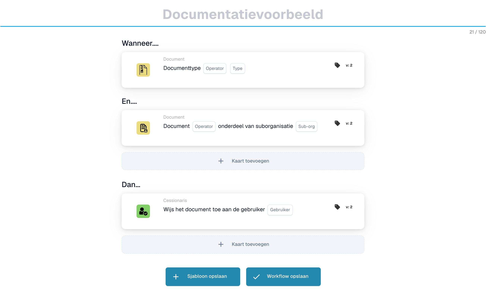
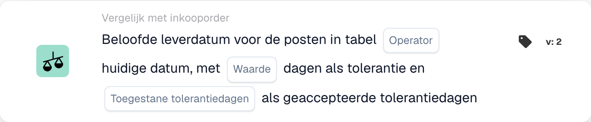
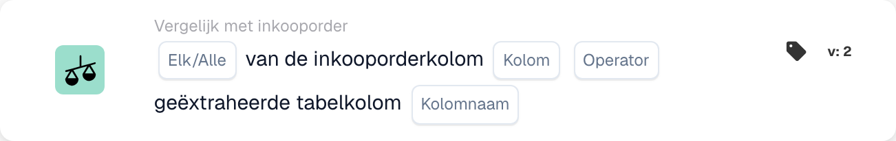
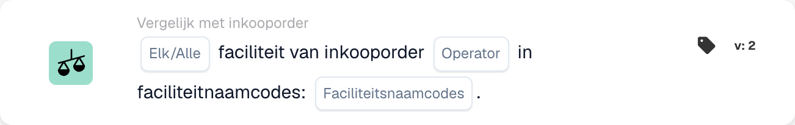
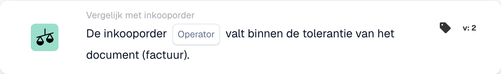
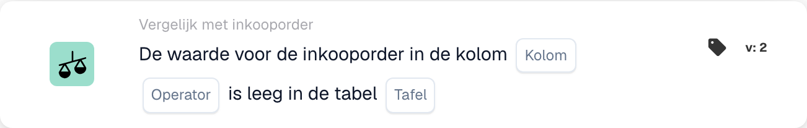
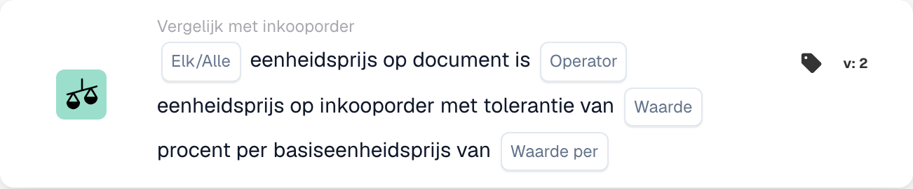
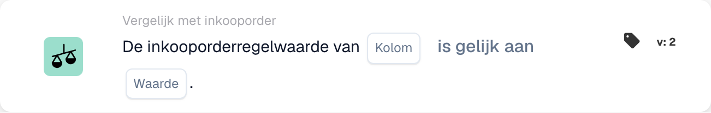

# PO-matchingkaarten - Volledige gids

## Matchingkaarten voor inkooporders (PO) - Volledige gids

**Status:** Omvat 15 PO-vergelijkingskaarten met gedetailleerde berekeningen

***

De PO-vergelijkingskaarten op deze pagina bevinden zich in de groep **En** van de Workflow Builder. Ze vergelijken factuurgegevens met de overeenkomende inkooporder voordat de acties Dan worden uitgevoerd:

<figure><figcaption><p>Niet-opgeslagen voorbeeld met Wanneer-, En- en Dan-kaarten. Vul alle velden in vóór uitvoering. Sommige labels van deze versie zijn in de interface nog niet of onjuist vertaald. De uitleg op deze pagina gebruikt de juiste termen; de afbeelding toont de werkelijke interface.</p></figcaption></figure>

***

### 📌 Versie-informatie

**Meest ontwikkelde kaart:** CONDITION\_DOC\_TO\_PO\_UNIT\_PRICE (5 versies, laatste v5) **Andere complexe kaarten:** CONDITION\_OC\_TO\_PO\_ITEMS (v4), CONDITION\_LESS\_THAN\_TOLERANCE\_AS\_VALUE\_OF\_ORDERED\_QUANTITY (v4)

**Belangrijkste patronen:**

* **v2 → v3+:** Toevoeging van tolerantieparameters voor flexibele matching
* **v3 → v4:** Toevoeging van parameters voor de vergelijkingsmodus
* **v4 → v5:** Verbeterde tolerantie met meerdere eenheden (%, EUR, $, etc.)

📖 [Volledige versiegeschiedenis](../../release.md) | [Kaartversies en gedrag](../../cards-overview/card-versions-guide.md)

***

### Inzicht in PO-matching

Wanneer u een factuur ontvangt, moet deze overeenkomen met de eerder geplaatste inkooporder (PO). PO-matchingskaarten controleren automatisch of de factuurgegevens overeenkomen met de PO-gegevens.

**Het grote plaatje:**

```
PO geplaatst    Factuur komt binnen     PO-matching       Beslissing
(€100)    →     (€103)              →   (Controleer of    → Goedkeuren/Afwijzen
Aantal: 100     Aantal: 100             binnen tolerantie)
```

<figure><figcaption><p>De PO-prijs (€100) ligt in de linkerschaal en de factuurprijs (€103) in de rechterschaal. Het verschil van €3 is 3% van de PO-prijs, dus de wijzer blijft binnen de groene tolerantieband van ±5% en de controle slaagt. Buiten ±5% (rood) moet de factuur worden beoordeeld.</p></figcaption></figure>

***

## 1. Volledige match van inkooporder

### Doel

Controleert of de gehele factuur perfect overeenkomt met de PO of binnen de tolerantie valt

### Wanneer te gebruiken

* Voordat u een factuur goedkeurt
* Als voorlopige kwaliteitscontrole
* Om problemen vroegtijdig te onderkennen

### Hoe het werkt

Systeem vergelijkt:

* Factuurhoeveelheden versus inkooporderhoeveelheden
* Factuurprijzen versus PO-prijzen
* Factuurartikelen versus PO-artikelen
* Factuurtotaal versus PO-totaal

### Resultaat

* **TRUE** (Volledige match): Alles komt overeen, ga verder
* **FALSE** (Mismatch): iets komt niet overeen, moet worden beoordeeld

### Voorbeeld

```
PO:
- Artikel ABC: Aantal 100, Eenheidsprijs €50 = €5000
- Artikel XYZ: Aantal 50, Eenheidsprijs €20 = €1000
- Totaal: €6000

Factuur:
- Artikel ABC: Aantal 100, Eenheidsprijs €50 = €5000
- Artikel XYZ: Aantal 50, Eenheidsprijs €20 = €1000
- Totaal: €6000

Resultaat: ✅ VOLLEDIGE MATCH
```

***

## 2. Vergelijking van eenheidsprijzen (document versus inkooporder)

### Doel

Vergelijkt de eenheidsprijs op de factuur met de eenheidsprijs op de inkooporder

### Parameters

* **Eenheidsprijstolerantie**: Variatie tot dit bedrag toestaan
* **Tolerantietype**: Percentage (%) of Absoluut (€/$)
* **Operator**: is gelijk aan, is groter dan, is kleiner dan, enz.

### Hoe het werkt (percentage tolerantie)

**Formule:**

```
Afwijking % = |(Factuurprijs - PO-prijs)| / PO-prijs × 100

Controle: Is afwijking % ≤ tolerantie %?
```

**Stapsgewijs voorbeeld:**

```
Stap 1: Prijzen ophalen
  PO-eenheidsprijs: €100.00
  Factuureenheidsprijs: €103.00

Stap 2: Verschil berekenen
  Verschil = |€103.00 - €100.00| = €3.00

Stap 3: Percentage berekenen
  Percentage = (€3.00 / €100.00) × 100 = 3%

Stap 4: Tolerantie controleren (5% toegestaan)
  Is 3% ≤ 5%? JA ✅

Resultaat: PASS - Binnen tolerantie
```

### Voorbeelden uit de echte wereld

#### Voorbeeld 1: Kleine verhoging (geaccepteerd)

```
PO-prijs: €50.00
Factuurprijs: €51.50
Tolerantie: ±3%

Berekening:
  Afwijking = |(€51.50 - €50.00)| / €50.00 × 100
  Afwijking = €1.50 / €50.00 × 100 = 3%

Is 3% ≤ 3%? JA ✅ ACCEPTEREN
```

#### Voorbeeld 2: Grote verhoging (afgewezen)

```
PO-prijs: €50.00
Factuurprijs: €55.00
Tolerantie: ±3%

Berekening:
  Afwijking = |(€55.00 - €50.00)| / €50.00 × 100
  Afwijking = €5.00 / €50.00 × 100 = 10%

Is 10% ≤ 3%? NEE ❌ AFWIJZEN - BEOORDELING NODIG
```

#### Voorbeeld 3: Korting (ook aangevinkt)

```
PO-prijs: €100.00
Factuurprijs: €97.00
Tolerantie: ±5%

Berekening:
  Afwijking = |(€97.00 - €100.00)| / €100.00 × 100
  Afwijking = €3.00 / €100.00 × 100 = 3%

Is 3% ≤ 5%? JA ✅ ACCEPTEREN (korting valt binnen de tolerantie)
```

#### Voorbeeld 4: Absolute waardetolerantie

```
PO-prijs: €10.00
Factuurprijs: €10.50
Tolerantie: ±€1.00 (absoluut, niet %)

Berekening:
  Afwijking = |€10.50 - €10.00| = €0.50

Is €0.50 ≤ €1.00? JA ✅ ACCEPTEREN
```

### Wat te doen met resultaten

**Als PASS ✅:**

* Ga door naar de volgende controle
* Of keur de factuur goed
* Of ga verder met exporteren

**Indien FOUT ❌:**

* Markeer voor handmatige beoordeling
* Vraag leverancier om uitleg
* Neem contact op met het inkoopteam
* Indien aanvaardbaar, met nota goedkeuren

***

## 3. Hoeveelheidsvergelijking

### Doel

Controleert of het bestelde aantal overeenkomt met het gefactureerde aantal

### Parameters

* **Tolerantie**: Bedrag of % mag afwijken
* **Operator**: gelijk aan, groter dan, kleiner dan
* **Aantaltype**: Besteld, Ontvangen, Open

### Rekenvoorbeeld

**Percentagetolerantie:**

```
Formule:
  Hoeveelheidsafwijking % = |(Factuuraantal - PO-aantal)| / PO-aantal × 100

Voorbeeld:
  PO-hoeveelheid: 100 stuks
  Factuurhoeveelheid: 103 stuks
  Tolerantie: ±5%

  Afwijking = |(103 - 100)| / 100 × 100
  Afwijking = 3 / 100 × 100 = 3%

  Is 3% ≤ 5%? JA ✅ ACCEPTEREN
```

**Absolute tolerantie:**

```
Formule:
  Hoeveelheidsafwijking = |Factuuraantal - PO-aantal|

Voorbeeld:
  PO-hoeveelheid: 100 stuks
  Factuurhoeveelheid: 102 stuks
  Tolerantie: ±5 stuks

  Afwijking = |102 - 100| = 2 stuks

  Is 2 stuks ≤ 5 stuks? JA ✅ ACCEPTEREN
```

### Scenario's uit de echte wereld

#### Overlevering (meer dan besteld)

```
Besteld: 100 stuks
Gefactureerd: 110 stuks
Tolerantie: ±5%

Afwijking = |(110-100)|/100 × 100 = 10%

Is 10% ≤ 5%? NEE ❌

Beslissing: Neem contact op met de leverancier - meer geleverd dan besteld
Mogelijke reden: Fout van de leverancier, deellevering al ontvangen
```

#### Onderlevering (minder dan besteld)

```
Besteld: 100 stuks
Gefactureerd: 95 stuks
Tolerantie: ±5%

Afwijking = |(95-100)|/100 × 100 = 5%

Is 5% ≤ 5%? JA ✅

Beslissing: Accepteren - binnen tolerantie
Mogelijke reden: Deellevering, de rest volgt
```

***

## 4. Gecombineerd verschil in prijs en hoeveelheid

### Doel

Wanneer de hoeveelheid verschilt, wordt berekend of het totale prijsverschil acceptabel is

### Waarom dit ertoe doet

```
Scenario: U bestelde 100 stuks maar ontving er 110
- De hoeveelheid is 10% te hoog (slecht)
- MAAR: er wordt slechts 10% extra in rekening gebracht
- Het gecombineerde effect kan acceptabel zijn
```

### Berekening

**Formule:**

```
Gecombineerde afwijking = Hoeveelheidsafwijking × Prijsafwijking

Als beide binnen de tolerantie vallen, is de combinatie meestal acceptabel
```

**Voorbeeld:**

```
PO:
- Eenheidsprijs: €100
- Hoeveelheid: 100
- Totaal: €10,000

Factuur:
- Eenheidsprijs: €102 (2% hoger)
- Hoeveelheid: 105 (5% hoger)
- Totaal: €10,710

Analyse:
- Prijsafwijking: 2% ✅
- Hoeveelheidsafwijking: 5% ✅
- Gecombineerd effect: 1.02 × 1.05 = 1.071 = 7.1% totale stijging

Is de gecombineerde afwijking acceptabel? Meestal JA ✅
```

***

## 5. Vergelijking artikel-ID/artikelnummer leverancier

### Doel

Controleert of de artikelen op de factuur overeenkomen met de artikelen op de inkooporder

### Hoe het werkt

**Exacte overeenkomst (eenvoudigste):**

```
PO-artikel-ID: ABC-123
Factuurartikel-ID: ABC-123
Resultaat: ✅ OVEREENKOMST
```

**Artikelnummer leverancier (vaker):**

```
PO-artikel: ABC-123 (onze interne code)
Leveranciersartikel: SUPP-456 (hun code voor hetzelfde artikel)
Het systeem koppelt deze als hetzelfde artikel
Resultaat: ✅ OVEREENKOMST
```

### Scenario: wat als het niet overeenkomt?

```
PO-artikel: ABC-123 (koperdraad, 2mm)
Factuurartikel: ABC-124 (staaldraad, 2mm)

Resultaat: ❌ GEEN OVEREENKOMST

Acties:
1. Is dit een vervanging? Controleer bij inkoop
2. Is dit een fout? Neem contact op met de leverancier
3. Is de omschrijving vergelijkbaar? Controleer handmatig
```

***

## 6. Verificatie van het ordertype

### Doel

Controleert of het type inkooporder correct is

### Besteltypen

* **Standaardbestelling**: reguliere aankoop
* **Spoedbestelling**: Dringend, mogelijk met premie
* **Raamovereenkomst**: Contract van lange duur
* **Blanket Order**: Contract van onbepaalde duur
* **Zending**: u betaalt pas als u het gebruikt

### Controleer voorbeeld

```
PO-ordertype: Standaardbestelling
Factuurordertype: Standaardbestelling
Resultaat: ✅ OVEREENKOMST

Bij afwijking: kan gevolgen hebben voor voorwaarden, betaling en prijzen
```

***

## 7. Verificatie van de leveringsdatum

### Doel

Controleert of de leverdatum overeenkomt met de beloofde datum op de inkooporder

### Berekening

**Late levering:**

```
Formule:
  Dagen te laat = Leveringsdatum factuur - Beloofde datum PO

Voorbeeld:
  PO beloofd: 2025-10-15
  Werkelijke levering: 2025-10-22
  Dagen te laat = 7 dagen

Als de tolerantie ±3 dagen is:
  Is 7 ≤ 3? NEE ❌ TE LAAT
```

**Vroege levering:**

```
Formule:
  Dagen te vroeg = Beloofde datum PO - Leveringsdatum factuur

Voorbeeld:
  PO beloofd: 2025-10-15
  Werkelijke levering: 2025-10-10
  Dagen te vroeg = 5 dagen

Vroege levering is meestal in orde ✅
Tenzij u het op een specifiek moment nodig hebt
```

### Tolerantie-instellingen

```
±3 dagen: 3 dagen te laat of te vroeg toestaan
±5 dagen: tot 5 dagen afwijking toestaan
0 dagen: moet exact overeenkomen
```

***

## 8. Verificatie van kosten (belastingen, verzendkosten, enz.)

### Doel

Controleert of extra kosten (belasting, verzending, administratie) overeenkomen met de PO

### Gemeenschappelijke kosten

```
- Verzendkosten: €50
- Afhandeling: €10
- Verpakking: €5
- Verzekering: €15
- Belastingen: €300
```

### Berekening

**Voorbeeld: controle van verzendkosten**

```
PO-verzendkosten: €50.00
Factuurverzendkosten: €51.00
Tolerantie: ±3%

Afwijking = |€51.00 - €50.00| / €50.00 × 100 = 2%

Is 2% ≤ 3%? JA ✅ ACCEPTEREN
```

**Voorbeeld: meerdere kosten**

```
Totale kosten PO:
  - Verzendkosten: €50
  - Belastingen: €300
  - Afhandeling: €10
  Totaal: €360

Totale kosten factuur:
  - Verzendkosten: €50
  - Belastingen: €312 (11% belasting)
  - Afhandeling: €10
  Totaal: €372

Verschil: €12
Controleer of binnen tolerantie ✅ of ❌
```

***

## 9. Belastingverificatie

### Doel

Controleert of de belastingbedragen correct zijn berekend

### Berekening

**Formule:**

```
Belastingbedrag = Subtotaal × Belastingtarief

Voorbeeld:
  Subtotaal: €1000
  Belastingtarief: 19%
  Verwachte belasting: €1000 × 0.19 = €190

Factuurbelasting: €190
Overeenkomst? JA ✅
```

**Veelvoorkomende problemen:**

```
1. Belastingtarief gewijzigd (afhankelijk van regio)
2. Belasting over het verkeerde bedrag berekend (vóór/na kortingen)
3. Meerdere belastingtarieven (sommige artikelen 7%, andere 19%)
4. Van belasting vrijgestelde artikelen (0% belasting)
```

**Voorbeeld: belasting met meerdere tarieven**

```
Artikel A: €100 @ 19% belasting = €119
Artikel B: €100 @ 7% belasting = €107
Artikel C: €100 @ 0% belasting = €100
Totaal: €326

Factuur toont €325 (€1 fout)

Controle: Binnen tolerantie of aandacht nodig?
```

***

## 10. Matching faciliteit/kostenplaats

### Doel

Zorgt ervoor dat de factuur voor de juiste faciliteit/kostenplaats is

### Voorbeeld

```
De PO is voor:
- Faciliteit: Fabriek Berlijn
- Kostenplaats: CC-2025

De factuur moet hebben:
- Faciliteit: Fabriek Berlijn ✅
- Kostenplaats: CC-2025 ✅

Bij een andere faciliteit: mogelijk is een andere goedkeuring nodig
```

***

## 11. Validatie van de leveranciersstatus

### Doel

Controleert of de leverancier nog goedgekeurd/actief is

### Statustypen

```
✅ ACTIVE: Goedgekeurd, zakendoen is mogelijk
⚠️ ON HOLD: Tijdelijk geblokkeerd
❌ INACTIVE: Er wordt niet langer zaken gedaan
⚠️ CONDITIONAL: Alleen voor specifieke artikelen
```

### Controleer voorbeeld

```
Leverancier: ABC Corp
Status in database: ACTIVE
Status bij het aanmaken van de PO: ACTIVE
Status bij binnenkomst van de factuur: INACTIVE

Waarschuwing: de status van de leverancier is gewijzigd! Zoek uit waarom.
```

***

## Welke tolerantie moet ik gebruiken?

### Strikte toleranties (lager risico, meer handmatig werk)

```
Gebruiken voor:
- Artikelen met een hoge waarde
- Artikelen waarbij nauwkeurigheid telt
- Gereguleerde sectoren

Instellingen:
- Eenheidsprijs: ±1%
- Hoeveelheid: ±1%
- Leveringsdatum: ±1 dag
- Kosten: ±1%
```

### Gematigde toleranties (evenwichtig)

```
Gebruiken voor:
- De meeste zakelijke transacties
- Standaardartikelen
- Normale inkoop

Instellingen:
- Eenheidsprijs: ±3-5%
- Hoeveelheid: ±3-5%
- Leveringsdatum: ±3 dagen
- Kosten: ±5%
```

### Losse toleranties (hoger risico, minder handmatig werk)

```
Gebruiken voor:
- Artikelen met een lage waarde
- Bulkaankopen
- Leveranciersafspraken met flexibiliteit

Instellingen:
- Eenheidsprijs: ±10%
- Hoeveelheid: ±10%
- Leveringsdatum: ±7 dagen
- Kosten: ±10%
```

***

## Voorbeeld van workflow voor PO-matching

```
Factuur komt binnen
    ↓
Voorwaarde: "Is het bedrag > €5000?" → JA
    ↓
Controle: Volledige match? → NEE (10% prijsverschil)
    ↓
Controle: Eenheidsprijs binnen 5%? → NEE (12% verschil)
    ↓
Controle: Hoeveelheid binnen 5%? → JA (2% verschil)
    ↓
Beslissing: FAIL - Prijsafwijking te hoog
    ↓
Markeren voor: Handmatige beoordeling / Goedkeuring door inkoper
    ↓
Wachten op: Opmerking van de inkoper
    ↓
Indien goedgekeurd: Doorgaan naar export
Indien afgewezen: Terug naar leverancier
```

***

## Problemen met PO-matching oplossen

### "PO niet gevonden"

```
Oorzaak: Het PO-nummer van de factuur bestaat niet in het systeem
Oplossing:
1. Controleer de spelling van het PO-nummer
2. Controleer of de PO is aangemaakt
3. Controleer of de PO zich in de juiste organisatie bevindt
4. Vraag de leverancier om de PO-referentie
```

### "Items komen niet overeen"

```
Oorzaak: De factuurartikelen verschillen van de PO-artikelen
Mogelijke redenen:
1. Vervanging goedgekeurd door inkoop
2. Verschillende artikelnummers voor hetzelfde artikel
3. Fout van de leverancier
Oplossing: Neem contact op met inkoop of de leverancier
```

### "Prijs hoger dan PO"

```
Oorzaak: Factuurprijs > PO-prijs
Mogelijke redenen:
1. Prijsverhoging goedgekeurd
2. Fout van de leverancier
3. Valutaverschil
4. Extra diensten inbegrepen
Oplossing: Controleer bij inkoop
```

### "Bezorgdatum verkeerd"

```
Oorzaak: Factuur gedateerd na de beloofde levering
Mogelijke redenen:
1. Levering was vertraagd
2. Ontvangstdatum wijkt af van factuurdatum
3. Deellevering
Oplossing: Controleer de verzenddocumenten of neem contact op met de leverancier
```

***

## Overzichtstabel

| Kaart           | Wat het controleert        | Hoofdberekening     | Gangbare tolerantie |
| -------------- | --------------------- | -------------------- | ---------------- |
| Volledige match         | Alles            | Alle controles         | Varieert           |
| Eenheidsprijs     | Prijs per eenheid        | % of € verschil    | ±3-5%            |
| Hoeveelheid       | Besteld bedrag        | % of eenheidsverschil | ±3-5%            |
| Gecombineerde prijs | Totaal met wijziging aantal | Aantal × prijs          | ±5-10%           |
| Artikel-ID        | Juiste artikelen           | String-match         | Exact            |
| Besteltype     | Soort aankoop      | String-match         | Exact            |
| Leveringsdatum  | Aankomstdatum           | Dag verschil       | ±3 dagen          |
| Kosten        | Extra kosten            | % of € verschil    | ±5%              |
| Belasting            | Belastingbedrag            | Belasting% berekening    | ±1%              |
| Faciliteit       | Kostenplaats           | String-match         | Exact            |
| Leverancier       | Goedgekeurd?             | Statuscontrole         | Alleen actief      |

***

## Gerelateerde documentatie

* Zie de handleiding 'Factuurvalidatie' voor de volledige workflow
* Zie "Tolerantie-instellingen" voor aanbevolen waarden per branche
* Zie "Afhandeling van uitzonderingen" voor wat u kunt doen met fouten
* Neem contact op met uw inkoopteam voor specifiek tolerantiebeleid

<!-- workflow-card-example-condition_promised_delivery_date_to_current-20261021 -->

### Beloofde leverdatum tegen de peildatum

<figure><figcaption><p>Kaartvelden in de getoonde versie. De velden zijn nog niet ingevuld.</p></figcaption></figure>

`CONDITION_PROMISED_DELIVERY_DATE_TO_CURRENT` · versie 2

Ga uit van een referentiedatum van `2026-10-21` en een beloofde lijnleveringsdatum van `2026-10-23`. Selecteer de later-dan-vergelijking en nul-dagentolerantie. De toekomstige datum voldoet aan die vergelijking; `2026-10-20` niet. Configureer de opties Alle/Alles en geaccepteerde tolerantiedagen bewust en test een ontbrekende datum afzonderlijk.

<!-- workflow-card-example-condition_po_extracted_table_column-20261021 -->

### Inkooporderkolom tegen een geëxtraheerde kolom

<figure><figcaption><p>Kaartvelden in de getoonde versie. De velden zijn nog niet ingevuld.</p></figcaption></figure>

`CONDITION_PO_EXTRACTED_TABLE_COLUMN` · versie 2

Vergelijk de overeenkomende inkooporderartikelkolom met de geëxtraheerde kolom `article_number`, met behulp van gelijkheid en Alles. Overeenkomende waarden `DEMO-A` geslaagd; een geëxtraheerde waarde `DEMO-B` mislukt. Selecteer alleen een opzoektabel als een gedocumenteerde vervanging van ID naar waarde nodig is; verifieer die mapping voordat u gaat vergelijken.

<!-- workflow-card-example-condition_check_facility_in_po-20261021 -->

### Toegestane inkooporderfaciliteiten

<figure><figcaption><p>Kaartvelden in de getoonde versie. De velden zijn nog niet ingevuld.</p></figcaption></figure>

`CONDITION_CHECK_FACILITY_IN_PO` · versie 2

Selecteer Alles, de is-in-vergelijking en de geconfigureerde faciliteitscode `DEMO-NORTH`. Overeenkomende PO-regels in die faciliteit passeren; een regel in `DEMO-SOUTH` mislukt. Gebruik faciliteitscodes uit de inkoopordergegevens in plaats van aan te nemen dat een displaylabel de code is.

<!-- workflow-card-example-condition_purchase_order_full_match-20261021 -->

### Volledige inkoopordermatch

<figure><figcaption><p>Kaartvelden in de getoonde versie. De velden zijn nog niet ingevuld.</p></figcaption></figure>

`CONDITION_PURCHASE_ORDER_FULL_MATCH` · versie 2

Gebruik een volledig overeenkomende demofactuur en inkooporder met hoeveelheid `2` en eenheidsprijs `100` aan beide zijden, en geconfigureerde hoeveelheids-/prijstoleranties. Selecteer de voorwaarde voor volledige overeenkomst: deze voldoet. Test vervolgens een prijs buiten de geconfigureerde tolerantie. Ontbrekende vergelijkingsgegevens of een afwezige PO zijn geen succesvolle volledige match. Op een leveringsbon wordt alleen een hoeveelheid vergeleken; Ga er niet van uit dat de factuurprijsregels daarop van toepassing zijn.

<!-- workflow-card-example-condition_po_update_empty_column_check-20261021 -->

### Lege databasekolom voor inkooporders

<figure><figcaption><p>Kaartvelden in de getoonde versie. De velden zijn nog niet ingevuld. Sommige labels van deze versie zijn in de interface nog niet of onjuist vertaald. De uitleg op deze pagina gebruikt de juiste termen; de afbeelding toont de werkelijke interface.</p></figcaption></figure>

`CONDITION_PO_UPDATE_EMPTY_COLUMN_CHECK` · versie 2

Selecteer een geldige PO-tabel en -kolom die wordt aangeboden door de kaart en de is-empty-operator. Voor een bestaand overeenkomend inkooporderrecord met een blanco waarde wordt aan de voorwaarde voldaan; een ingevulde waarde mislukt. Controleer eerst de inkooporderreferentie en de tabel-/kolomtoewijzing. Booleaanse waarde `false` is nog steeds een huidige Booleaanse waarde; een ontbrekend PO-record is een afzonderlijke datafout.

<!-- workflow-card-example-condition_compare_unit_price_percent_per-20261021 -->

### Percentage tolerantie per prijsbasis

<figure><figcaption><p>Kaartvelden in de getoonde versie. De velden zijn nog niet ingevuld.</p></figcaption></figure>

`CONDITION_COMPARE_UNIT_PRICE_PERCENT_PER` · versie 2

Voorbeeld: PO-eenheidsprijs `200`, basisprijs `100` en geconfigureerde tolerantie `1` resulteren in een effectief tarief van `(200 / 100) * (1 / 100) = 0.02` of `2%`. De vergelijkingsband is `196–204`. Gelijkheid binnen tolerantie accepteert een documentprijs van `203` en verwerpt `210`. Ga er niet van uit dat deze kaart hetzelfde is als een vaste tolerantie van 1%.

<!-- workflow-card-example-condition_compare_po_line_value-20261021 -->

### Waarde van de inkooporderregel ten opzichte van een referentie

<figure><figcaption><p>Kaartvelden in de getoonde versie. De velden zijn nog niet ingevuld.</p></figcaption></figure>

`CONDITION_COMPARE_PO_LINE_VALUE` · versie 2

Selecteer de overeenkomende PO-kolom `item_number`, gelijkheid en waarde `DEMO-A`. Er passeert een lijn met `DEMO-A`; `DEMO-B` mislukt. Gebruik alleen operators die worden ondersteund voor het geselecteerde gegevenstype, en test ontbrekende overeenkomende-regelgegevens afzonderlijk.
