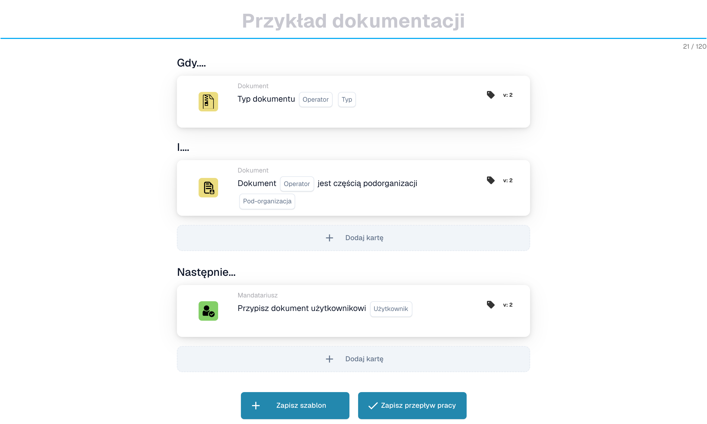
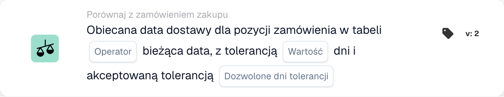
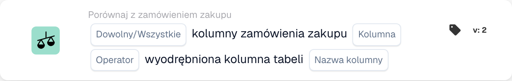
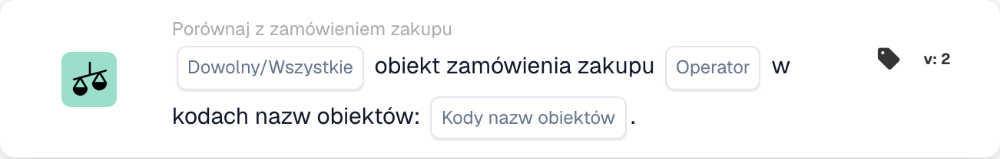
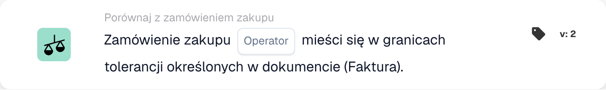
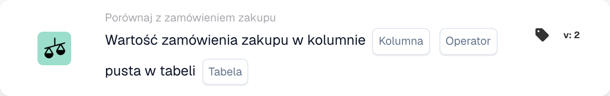
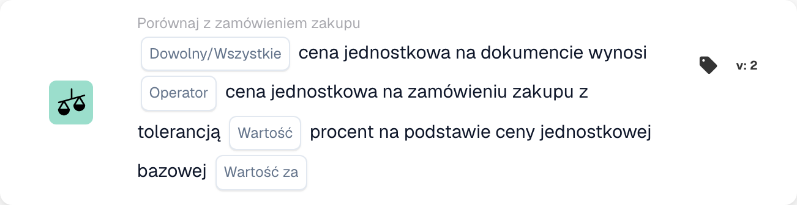
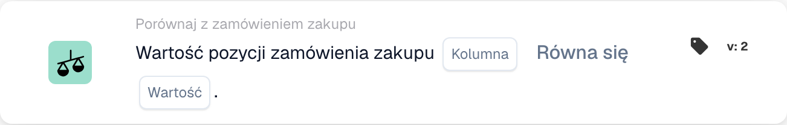

# Karty dopasowywania PO - kompletny przewodnik

## Karty dopasowania zamówienia zakupu (PO) — kompletny przewodnik

**Stan:** Obejmuje 15 kart porównawczych PO ze szczegółowymi obliczeniami

***

Karty porównania zamówień zakupu na tej stronie znajdują się w grupie **I** Kreatora przepływu pracy — porównują dane faktury z dopasowanym zamówieniem przed uruchomieniem akcji Następnie:

<figure><figcaption><p>Niezapisany przykład z kartami Kiedy, I oraz Wtedy. Uzupełnij wszystkie pola przed uruchomieniem. Niektóre etykiety tej wersji interfejsu nie są jeszcze przetłumaczone lub mają nieprawidłowe tłumaczenie. Objaśnienia na tej stronie używają właściwych terminów; obraz przedstawia rzeczywisty interfejs.</p></figcaption></figure>

***

### 📌 Informacje o wersji

**Najbardziej rozwinięta karta:** CONDITION\_DOC\_TO\_PO\_UNIT\_PRICE (5 wersji, najnowsza wersja 5) **Inne karty złożone:** CONDITION\_OC\_TO\_PO\_ITEMS (v4), CONDITION\_LESS\_THAN\_TOLERANCE\_AS\_VALUE\_OF\_ORDERED\_QUANTITY (v4)

**Kluczowe wzorce:**

* **v2 → v3+:** Dodanie parametrów tolerancji dla elastycznego dopasowania
* **v3 → v4:** Dodanie parametrów trybu porównania
* **v4 → v5:** Zwiększona tolerancja z wieloma jednostkami (%, EUR, $ itp.)

📖 [Pełna historia wersji](../../release.md) | [Wersje kart i zachowanie](../../cards-overview/card-versions-guide.md)

***

### Zrozumienie dopasowywania PO

Otrzymana faktura powinna być zgodna z wcześniej złożonym zamówieniem (PO). Karty dopasowujące PO automatycznie sprawdzają, czy dane na fakturze zgadzają się z danymi PO.

**Ogólny obraz:**

```
Zamówienie    Nadejście faktury   Dopasowanie PO  Decyzja
(€100)    →   (€103)          →   (Sprawdzenie    → Zatwierdź/Odrzuć
Ilość: 100    Ilość: 100          tolerancji)
```

<figure><figcaption><p>Cena z zamówienia (€100) leży na lewej szalce, a cena z faktury (€103) na prawej. Różnica €3 to 3 % ceny z zamówienia, więc wskazówka pozostaje w zielonym pasie tolerancji ±5 % i kontrola kończy się wynikiem pozytywnym. Powyżej ±5 % (kolor czerwony) faktura wymaga sprawdzenia.</p></figcaption></figure>

***

## 1. Pełne dopasowanie zamówienia zakupu

### Cel

Sprawdza, czy cała faktura pasuje idealnie do zamówienia lub mieści się w tolerancji

### Kiedy stosować

* Przed zatwierdzeniem faktury
* Jako wstępna kontrola jakości
* Aby wcześnie zidentyfikować problemy

### Jak to działa

System porównuje:

* Ilości na fakturze a ilości na PO
* Ceny na fakturze a ceny w PO
* Pozycje na fakturze a pozycje PO
* Suma faktury a suma zamówienia

### Wynik

* **TRUE** (Pełne dopasowanie): Wszystko pasuje, kontynuuj
* **FALSE** (Niedopasowanie): Coś nie pasuje, wymaga sprawdzenia

### Przykład

```
PO:
- Pozycja ABC: ilość 100, cena jednostkowa €50 = €5000
- Pozycja XYZ: ilość 50, cena jednostkowa €20 = €1000
- Suma: €6000

Faktura:
- Pozycja ABC: ilość 100, cena jednostkowa €50 = €5000
- Pozycja XYZ: ilość 50, cena jednostkowa €20 = €1000
- Suma: €6000

Wynik: ✅ PEŁNE DOPASOWANIE
```

***

## 2. Porównanie cen jednostkowych (dokument vs zamówienie)

### Cel

Porównuje cenę jednostkową na fakturze z ceną jednostkową na PO

### Parametry

* **Tolerancja ceny jednostkowej**: Dopuszczalna różnica do tej kwoty
* **Typ tolerancji**: Procent (%) lub bezwzględny (€/$)
* **Operator**: Jest równy, Jest większy niż, Jest mniejszy niż itp.

### Jak to działa (tolerancja procentowa)

**Wzór:**

```
Odchylenie % = |(cena z faktury - cena z PO)| / cena z PO × 100

Kontrola: Czy odchylenie % ≤ tolerancja %?
```

**Przykład krok po kroku:**

```
Krok 1: Pobierz ceny
  Cena jednostkowa z PO: €100.00
  Cena jednostkowa z faktury: €103.00

Krok 2: Oblicz różnicę
  Różnica = |€103.00 - €100.00| = €3.00

Krok 3: Oblicz wartość procentową
  Procent = (€3.00 / €100.00) × 100 = 3%

Krok 4: Sprawdź tolerancję (dozwolone 5%)
  Czy 3% ≤ 5%? TAK ✅

Wynik: PASS - w granicach tolerancji
```

### Przykłady ze świata rzeczywistego

#### Przykład 1: Mały wzrost (zaakceptowany)

```
Cena z PO: €50.00
Cena z faktury: €51.50
Tolerancja: ±3%

Obliczenia:
  Odchylenie = |(€51.50 - €50.00)| / €50.00 × 100
  Odchylenie = €1.50 / €50.00 × 100 = 3%

Czy 3% ≤ 3%? TAK ✅ AKCEPTACJA
```

#### Przykład 2: Duża podwyżka (odrzucona)

```
Cena z PO: €50.00
Cena z faktury: €55.00
Tolerancja: ±3%

Obliczenia:
  Odchylenie = |(€55.00 - €50.00)| / €50.00 × 100
  Odchylenie = €5.00 / €50.00 × 100 = 10%

Czy 10% ≤ 3%? NIE ❌ ODRZUCENIE - WYMAGA SPRAWDZENIA
```

#### Przykład 3: Rabat (również sprawdzony)

```
Cena z PO: €100.00
Cena z faktury: €97.00
Tolerancja: ±5%

Obliczenia:
  Odchylenie = |(€97.00 - €100.00)| / €100.00 × 100
  Odchylenie = €3.00 / €100.00 × 100 = 3%

Czy 3% ≤ 5%? TAK ✅ AKCEPTACJA (rabat mieści się w tolerancji)
```

#### Przykład 4: Tolerancja wartości bezwzględnej

```
Cena z PO: €10.00
Cena z faktury: €10.50
Tolerancja: ±€1.00 (wartość bezwzględna, nie %)

Obliczenia:
  Odchylenie = |€10.50 - €10.00| = €0.50

Czy €0.50 ≤ €1.00? TAK ✅ AKCEPTACJA
```

### Co zrobić z wynikami

**Jeśli PASS ✅:**

* Przejdź do następnej kontroli
* Lub zatwierdź fakturę
* Lub kontynuuj eksport

**W przypadku niepowodzenia ❌:**

* Oznacz do ręcznego sprawdzenia
* Poproś dostawcę o wyjaśnienia
* Skontaktuj się z zespołem ds. zakupów
* Zatwierdź z dopiskiem, jeśli jest to dopuszczalne

***

## 3. Porównanie ilości

### Cel

Sprawdza, czy zamówiona ilość odpowiada ilości zafakturowanej

### Parametry

* **Tolerancja**: Kwota lub %, o którą wartości mogą się różnić
* **Operator**: Równa się, Większe niż, Mniejsze niż
* **Typ ilości**: Zamówiona, Otrzymana, Otwarta

### Przykład obliczeń

**Tolerancja procentowa:**

```
Wzór:
  Odchylenie ilości % = |(ilość z faktury - ilość z PO)| / ilość z PO × 100

Przykład:
  Ilość z PO: 100 szt.
  Ilość z faktury: 103 szt.
  Tolerancja: ±5%

  Odchylenie = |(103 - 100)| / 100 × 100
  Odchylenie = 3 / 100 × 100 = 3%

  Czy 3% ≤ 5%? TAK ✅ AKCEPTACJA
```

**Tolerancja absolutna:**

```
Wzór:
  Odchylenie ilości = |ilość z faktury - ilość z PO|

Przykład:
  Ilość z PO: 100 szt.
  Ilość z faktury: 102 szt.
  Tolerancja: ±5 szt.

  Odchylenie = |102 - 100| = 2 szt.

  Czy 2 szt. ≤ 5 szt.? TAK ✅ AKCEPTACJA
```

### Scenariusze ze świata rzeczywistego

#### Nadmierna dostawa (więcej niż zamówiono)

```
Zamówiono: 100 szt.
Zafakturowano: 110 szt.
Tolerancja: ±5%

Odchylenie = |(110-100)|/100 × 100 = 10%

Czy 10% ≤ 5%? NIE ❌

Decyzja: Skontaktuj się z dostawcą - dostarczono więcej, niż zamówiono
Możliwa przyczyna: błąd dostawcy, częściowa dostawa już odebrana
```

#### Niedostarczenie (mniej niż zamówiono)

```
Zamówiono: 100 szt.
Zafakturowano: 95 szt.
Tolerancja: ±5%

Odchylenie = |(95-100)|/100 × 100 = 5%

Czy 5% ≤ 5%? TAK ✅

Decyzja: Zaakceptuj - w granicach tolerancji
Możliwa przyczyna: dostawa częściowa, reszta zostanie dosłana
```

***

## 4. Łączna cena różnicy ilościowej

### Cel

W przypadku różnic w ilościach oblicza, czy łączna różnica w cenie jest akceptowalna

### Dlaczego to ma znaczenie

```
Scenariusz: Zamówiono 100 szt., a otrzymano 110
- Ilość jest o 10% większa (źle)
- ALE: płacisz tylko za dodatkowe 10%
- Łączny efekt może być akceptowalny
```

### Obliczenia

**Wzór:**

```
Łączne odchylenie = odchylenie ilości × odchylenie ceny

Jeśli oba mieszczą się w tolerancji, łączne odchylenie jest zwykle akceptowalne
```

**Przykład:**

```
PO:
- Cena jednostkowa: €100
- Ilość: 100
- Suma: €10,000

Faktura:
- Cena jednostkowa: €102 (o 2% wyższa)
- Ilość: 105 (o 5% wyższa)
- Suma: €10,710

Analiza:
- Odchylenie ceny: 2% ✅
- Odchylenie ilości: 5% ✅
- Łączny efekt: 1.02 × 1.05 = 1.071 = 7,1% wzrostu łącznie

Czy łączne odchylenie jest akceptowalne? Zazwyczaj TAK ✅
```

***

## 5. Porównanie identyfikatora pozycji/numeru pozycji dostawcy

### Cel

Sprawdza, czy pozycje na fakturze są zgodne z pozycjami w zamówieniu zakupu

### Jak to działa

**Dokładne dopasowanie (najprostsze):**

```
Identyfikator pozycji w PO: ABC-123
Identyfikator pozycji na fakturze: ABC-123
Wynik: ✅ ZGODNE
```

**Numer pozycji dostawcy (częściej spotykany):**

```
Pozycja w PO: ABC-123 (nasz kod wewnętrzny)
Pozycja dostawcy: SUPP-456 (jego kod tej samej pozycji)
System dopasowuje je jako tę samą pozycję
Wynik: ✅ ZGODNE
```

### Scenariusz: co się stanie, jeśli nie będzie pasować?

```
Pozycja w PO: ABC-123 (drut miedziany, 2 mm)
Pozycja na fakturze: ABC-124 (drut stalowy, 2 mm)

Wynik: ❌ NIEZGODNE

Działania:
1. Czy to zamiennik? Sprawdź w dziale zakupów
2. Czy to błąd? Skontaktuj się z dostawcą
3. Czy opis jest podobny? Zweryfikuj ręcznie
```

***

## 6. Weryfikacja rodzaju zamówienia

### Cel

Sprawdza, czy typ zamówienia zakupu jest poprawny

### Typy zamówień

* **Zamówienie standardowe**: Regularny zakup
* **Zamówienie pilne**: Pilne, może wiązać się z dopłatą
* **Umowa ramowa**: Umowa długoterminowa
* **Zamówienie blankietowe**: Umowa bezterminowa
* **Konsygnacja**: Płatność dopiero po wykorzystaniu towaru

### Sprawdź przykład

```
Typ zamówienia w PO: Zamówienie standardowe
Typ zamówienia na fakturze: Zamówienie standardowe
Wynik: ✅ ZGODNE

W razie niezgodności: może wpłynąć na warunki, płatność i ceny
```

***

## 7. Weryfikacja daty dostawy

### Cel

Sprawdza, czy data dostawy jest zgodna z datą obiecaną w PO

### Obliczenia

**Opóźniona dostawa:**

```
Wzór:
  Dni opóźnienia = data dostawy z faktury - data obiecana w PO

Przykład:
  Obiecana w PO: 2025-10-15
  Faktyczna dostawa: 2025-10-22
  Dni opóźnienia = 7 dni

Jeśli tolerancja wynosi ±3 dni:
  Czy 7 ≤ 3? NIE ❌ OPÓŹNIONA
```

**Wczesna dostawa:**

```
Wzór:
  Dni wcześniej = data obiecana w PO - data dostawy z faktury

Przykład:
  Obiecana w PO: 2025-10-15
  Faktyczna dostawa: 2025-10-10
  Dni wcześniej = 5 dni

Wcześniejsza dostawa jest zwykle w porządku ✅
Chyba że towar jest potrzebny w konkretnym terminie
```

### Ustawienia tolerancji

```
±3 dni: Dopuszczalne 3 dni opóźnienia lub wcześniejszej dostawy
±5 dni: Dopuszczalne odchylenie do 5 dni
0 dni: Daty muszą być identyczne
```

***

## 8. Weryfikacja opłat (podatki, wysyłka itp.)

### Cel

Sprawdza, czy dodatkowe opłaty (podatki, wysyłka, obsługa) odpowiadają PO

### Wspólne opłaty

```
- Wysyłka: €50
- Obsługa: €10
- Pakowanie: €5
- Ubezpieczenie: €15
- Podatki: €300
```

### Obliczenia

**Przykład: Kontrola kosztów wysyłki**

```
Wysyłka w PO: €50.00
Wysyłka na fakturze: €51.00
Tolerancja: ±3%

Odchylenie = |€51.00 - €50.00| / €50.00 × 100 = 2%

Czy 2% ≤ 3%? TAK ✅ AKCEPTACJA
```

**Przykład: wielokrotne ładowanie**

```
Łączne opłaty w PO:
  - Wysyłka: €50
  - Podatki: €300
  - Obsługa: €10
  Suma: €360

Łączne opłaty na fakturze:
  - Wysyłka: €50
  - Podatki: €312 (11% podatku)
  - Obsługa: €10
  Suma: €372

Różnica: €12
Sprawdź, czy mieści się w tolerancji ✅ czy ❌
```

***

## 9. Weryfikacja podatkowa

### Cel

Sprawdza, czy kwoty podatku zostały obliczone prawidłowo

### Obliczenia

**Wzór:**

```
Kwota podatku = suma częściowa × stawka podatku

Przykład:
  Suma częściowa: €1000
  Stawka podatku: 19%
  Oczekiwany podatek: €1000 × 0.19 = €190

Podatek na fakturze: €190
Zgodne? TAK ✅
```

**Częste problemy:**

```
1. Zmieniła się stawka podatku (zależnie od regionu)
2. Podatek naliczony od niewłaściwej kwoty (przed/po rabatach)
3. Wiele stawek podatku (część pozycji 7%, reszta 19%)
4. Pozycje zwolnione z podatku (podatek 0%)
```

**Przykład: opodatkowanie wielostawkowe**

```
Pozycja A: €100 @ 19% podatku = €119
Pozycja B: €100 @ 7% podatku = €107
Pozycja C: €100 @ 0% podatku = €100
Suma: €326

Faktura wykazuje €325 (błąd €1)

Sprawdź: w granicach tolerancji czy wymaga uwagi?
```

***

## 10. Dopasowanie obiektu/centrum kosztów

### Cel

Zapewnia, że faktura dotyczy właściwego obiektu/centrum kosztów

### Przykład

```
PO dotyczy:
- Obiekt: zakład w Berlinie
- Centrum kosztów: CC-2025

Faktura powinna zawierać:
- Obiekt: zakład w Berlinie ✅
- Centrum kosztów: CC-2025 ✅

W razie innego obiektu: może być potrzebna inna akceptacja
```

***

## 11. Potwierdzenie statusu dostawcy

### Cel

Sprawdza, czy dostawca jest nadal zatwierdzony/aktywny

### Typy statusu

```
✅ ACTIVE: Zatwierdzony, można prowadzić współpracę
⚠️ ON HOLD: Tymczasowo zablokowany
❌ INACTIVE: Współpraca zakończona
⚠️ CONDITIONAL: Tylko dla określonych pozycji
```

### Sprawdź przykład

```
Dostawca: ABC Corp
Status w bazie danych: ACTIVE
Status przy tworzeniu PO: ACTIVE
Status w chwili nadejścia faktury: INACTIVE

Alert: Status dostawcy uległ zmianie! Sprawdź dlaczego.
```

***

## Którą tolerancję powinienem zastosować?

### Ścisłe tolerancje (mniejsze ryzyko, więcej pracy ręcznej)

```
Stosuj dla:
- Pozycji o wysokiej wartości
- Pozycji, w których liczy się dokładność
- Branż regulowanych

Ustawienia:
- Cena jednostkowa: ±1%
- Ilość: ±1%
- Data dostawy: ±1 dzień
- Opłaty: ±1%
```

### Umiarkowane tolerancje (zrównoważone)

```
Stosuj dla:
- Większości transakcji biznesowych
- Pozycji standardowych
- Zwykłych zakupów

Ustawienia:
- Cena jednostkowa: ±3-5%
- Ilość: ±3-5%
- Data dostawy: ±3 dni
- Opłaty: ±5%
```

### Luźne tolerancje (wyższe ryzyko, mniej pracy ręcznej)

```
Stosuj dla:
- Pozycji o niskiej wartości
- Zakupów hurtowych
- Umów z dostawcami z elastycznymi warunkami

Ustawienia:
- Cena jednostkowa: ±10%
- Ilość: ±10%
- Data dostawy: ±7 dni
- Opłaty: ±10%
```

***

## Przykład przepływu pracy dopasowywania PO

```
Nadejście faktury
    ↓
Warunek: „Czy kwota > €5000?” → TAK
    ↓
Kontrola: Pełne dopasowanie? → NIE (10% różnicy w cenie)
    ↓
Kontrola: Cena jednostkowa w granicach 5%? → NIE (12% różnicy)
    ↓
Kontrola: Ilość w granicach 5%? → TAK (2% różnicy)
    ↓
Decyzja: FAIL - zbyt duże odchylenie ceny
    ↓
Oznacz do: ręcznego sprawdzenia / akceptacji kupca
    ↓
Czekaj na: komentarz kupca
    ↓
Jeśli zatwierdzono: przejdź do eksportu
Jeśli odrzucono: zwróć dostawcy
```

***

## Rozwiązywanie problemów z dopasowaniem PO

### „Nie znaleziono PO”

```
Przyczyna: Numer PO z faktury nie istnieje w systemie
Rozwiązanie:
1. Sprawdź pisownię numeru PO
2. Sprawdź, czy PO zostało utworzone
3. Sprawdź, czy PO znajduje się we właściwej organizacji
4. Poproś dostawcę o numer referencyjny PO
```

### „Elementy nie pasują”

```
Przyczyna: Pozycje na fakturze różnią się od pozycji w PO
Możliwe powody:
1. Zamiennik zatwierdzony przez dział zakupów
2. Różne numery pozycji dla tej samej pozycji
3. Błąd dostawcy
Rozwiązanie: Skontaktuj się z działem zakupów lub dostawcą
```

### „Cena wyższa niż w PO”

```
Przyczyna: Cena na fakturze > cena w PO
Możliwe powody:
1. Zatwierdzona podwyżka ceny
2. Błąd dostawcy
3. Różnica walutowa
4. Dodatkowe usługi wliczone w cenę
Rozwiązanie: Zweryfikuj w dziale zakupów
```

### „Błędna data dostawy”

```
Przyczyna: Faktura datowana po obiecanej dacie dostawy
Możliwe powody:
1. Przesyłka została opóźniona
2. Data odbioru różni się od daty faktury
3. Dostawa częściowa
Rozwiązanie: Sprawdź dokumenty wysyłkowe lub skontaktuj się z dostawcą
```

***

## Tabela podsumowująca

| Karta           | Co sprawdza        | Główne obliczenia     | Wspólna tolerancja |
| -------------- | --------------------- | -------------------- | ---------------- |
| Pełne dopasowanie | Wszystko         | Wszystkie kontrole        | Różnie           |
| Cena jednostkowa     | Cena za jednostkę        | % lub € różnicy    | ±3-5%            |
| Ilość       | Zamówiona ilość        | % lub różnica jednostkowa | ±3-5%            |
| Łączna cena | Razem ze zmianą ilości | Ilość × cena          | ±5-10%           |
| Identyfikator pozycji | Właściwe pozycje   | Dopasowanie tekstu        | Dokładne         |
| Typ zamówienia | Rodzaj zakupu         | Dopasowanie tekstu        | Dokładne         |
| Data dostawy  | Kiedy przybył          | Różnica dnia       | ± 3 dni          |
| Opłaty        | Dodatkowe opłaty            | % lub € różnicy    | ±5%              |
| Podatek            | Kwota podatku            | Obliczanie % podatku    | ±1%              |
| Obiekt         | Centrum kosztów       | Dopasowanie tekstu        | Dokładne         |
| Dostawca       | Zatwierdzone?             | Kontrola stanu         | Tylko aktywne      |

***

## Powiązana dokumentacja

* Pełny przepływ pracy można znaleźć w przewodniku „Weryfikacja faktury”.
* Aby zapoznać się z zalecanymi wartościami według branży, zobacz „Ustawienia tolerancji”.
* Zobacz „Obsługa wyjątków”, aby dowiedzieć się, co zrobić w przypadku błędów
* Aby uzyskać szczegółowe zasady tolerancji, skontaktuj się z zespołem zaopatrzenia

<!-- workflow-card-example-condition_promised_delivery_date_to_current-20261021 -->

### Obiecana data dostawy w stosunku do daty referencyjnej

<figure><figcaption><p>Pola karty w pokazanej wersji. Pola nie są jeszcze skonfigurowane.</p></figcaption></figure>

`CONDITION_PROMISED_DELIVERY_DATE_TO_CURRENT` · wersja 2

Załóżmy, że datą referencyjną jest `2026-10-21` i obiecaną datą dostawy linii `2026-10-23`. Wybierz porównanie z datą późniejszą i tolerancję dnia zerowego. Przyszła data spełnia to porównanie; `2026-10-20` nie. Celowo skonfiguruj opcje Dowolne/Wszystkie i zaakceptowane dni tolerancji i osobno przetestuj brakującą datę.

<!-- workflow-card-example-condition_po_extracted_table_column-20261021 -->

### Kolumna zamówienia zakupu względem wyodrębnionej kolumny

<figure><figcaption><p>Pola karty w pokazanej wersji. Pola nie są jeszcze skonfigurowane.</p></figcaption></figure>

`CONDITION_PO_EXTRACTED_TABLE_COLUMN` · wersja 2

Porównaj dopasowaną kolumnę artykułu PO z wyodrębnioną kolumną `article_number`, używając równości i All. Pasujące wartości `DEMO-A` spełniają; wyodrębniona wartość `DEMO-B` kończy się niepowodzeniem. Wybierz tabelę przeglądową tylko wtedy, gdy wymagana jest udokumentowana zamiana identyfikatora na wartość; sprawdź to mapowanie przed porównaniem.

<!-- workflow-card-example-condition_check_facility_in_po-20261021 -->

### Dozwolone możliwości składania zamówień

<figure><figcaption><p>Pola karty w pokazanej wersji. Pola nie są jeszcze skonfigurowane.</p></figcaption></figure>

`CONDITION_CHECK_FACILITY_IN_PO` · wersja 2

Wybierz Wszystko, porównanie jest w trakcie i skonfigurowany kod obiektu `DEMO-NORTH`. Dopasowane linie zamówienia zakupu w tej przepustce do obiektu; linia w `DEMO-SOUTH` nie działa. Używaj kodów obiektu z danych zamówienia zakupu, zamiast zakładać, że etykieta wyświetlacza jest jego kodem.

<!-- workflow-card-example-condition_purchase_order_full_match-20261021 -->

### Kompletne dopasowanie zamówienia

<figure><figcaption><p>Pola karty w pokazanej wersji. Pola nie są jeszcze skonfigurowane.</p></figcaption></figure>

`CONDITION_PURCHASE_ORDER_FULL_MATCH` · wersja 2

Użyj całkowicie dopasowanej faktury demonstracyjnej i zamówienia zakupu z ilością `2` i ceną jednostkową `100` po obu stronach oraz skonfigurowanymi tolerancjami ilości/ceny. Wybierz warunek pełnego dopasowania: przechodzi. Następnie przetestuj cenę poza skonfigurowaną tolerancją. Brak danych porównawczych lub brak zamówienia zakupu nie oznacza udanego pełnego dopasowania. Dowód dostawy zawiera porównanie wyłącznie ilościowe; nie zakładaj, że obowiązują go zasady dotyczące cen na fakturze.

<!-- workflow-card-example-condition_po_update_empty_column_check-20261021 -->

### Pusta kolumna bazy danych zamówień

<figure><figcaption><p>Pola karty w pokazanej wersji. Pola nie są jeszcze skonfigurowane.</p></figcaption></figure>

`CONDITION_PO_UPDATE_EMPTY_COLUMN_CHECK` · wersja 2

Wybierz prawidłową tabelę i kolumnę PO oferowaną przez kartę i operatora is-pusty. W przypadku istniejącego pasującego rekordu zamówienia zakupu z pustą wartością warunek zostaje spełniony; wypełnienie wartości kończy się niepowodzeniem. Najpierw sprawdź odwołanie do zamówienia i mapowanie tabeli/kolumny. Wartość logiczna `false` jest nadal aktualną wartością logiczną; brakujący rekord zamówienia zakupu jest odrębnym błędem danych.

<!-- workflow-card-example-condition_compare_unit_price_percent_per-20261021 -->

### Procentowa tolerancja na podstawie ceny

<figure><figcaption><p>Pola karty w pokazanej wersji. Pola nie są jeszcze skonfigurowane.</p></figcaption></figure>

`CONDITION_COMPARE_UNIT_PRICE_PERCENT_PER` · wersja 2

Przykład: Cena jednostkowa PO `200`, cena bazowa `100` i skonfigurowana tolerancja `1` dają efektywną stawkę `(200 / 100) * (1 / 100) = 0.02` lub `2%`. Pasmo porównania to `196–204`. Równość w granicach tolerancji akceptuje cenę dokumentową `203` i odrzuca `210`. Nie zakładaj, że ta karta jest taka sama, jak stała tolerancja 1%.

<!-- workflow-card-example-condition_compare_po_line_value-20261021 -->

### Wartość wiersza zamówienia zakupu w odniesieniu do odniesienia

<figure><figcaption><p>Pola karty w pokazanej wersji. Pola nie są jeszcze skonfigurowane.</p></figcaption></figure>

`CONDITION_COMPARE_PO_LINE_VALUE` · wersja 2

Wybierz dopasowaną kolumnę PO `item_number`, równość i wartość `DEMO-A`. Linia z przejazdami `DEMO-A`; `DEMO-B` kończy się niepowodzeniem. Używaj tylko operatorów obsługiwanych dla wybranego typu danych i oddzielnie testuj brakujące dane dopasowanej linii.
