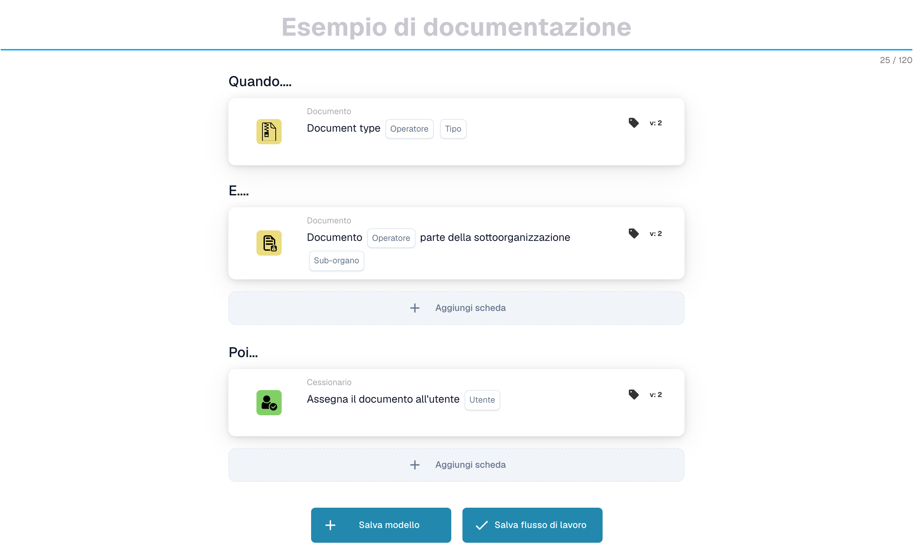
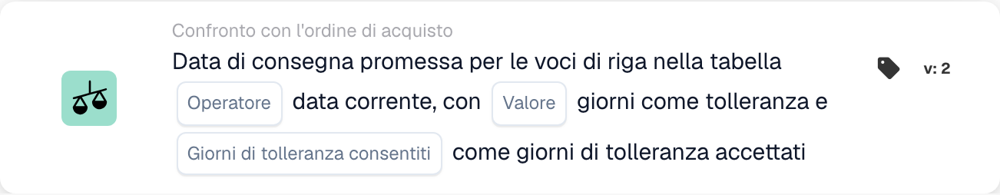
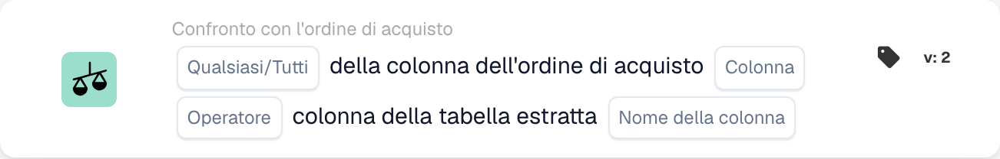
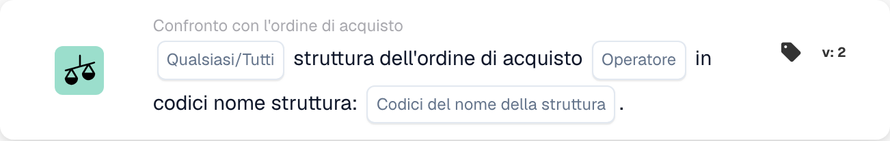
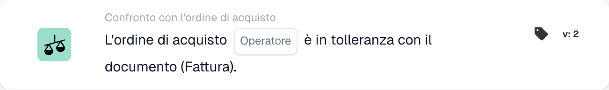
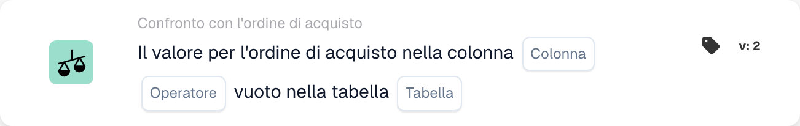
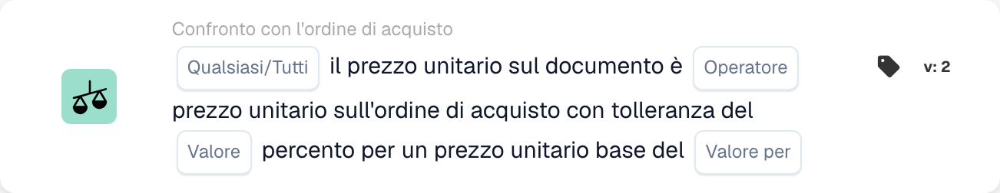
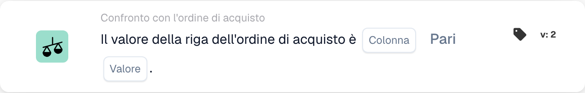

# Carte corrispondenti PO - Guida completa

## Carte corrispondenti agli ordini di acquisto (PO) - Guida completa

**Stato:** Copre 15 schede di confronto PO con calcoli dettagliati

***

Le schede di confronto degli ordini d'acquisto in questa pagina vanno nel gruppo **E** del Workflow Builder: confrontano i dati della fattura con l'ordine di acquisto abbinato prima dell'esecuzione delle azioni Quindi:

<figure><figcaption><p>Esempio non salvato con schede Quando, E e Allora. Configurare tutti i campi prima dell’esecuzione. Alcune etichette dell’interfaccia di questa versione sono ancora in inglese o tradotte in modo non corretto. Le spiegazioni di questa pagina sono tradotte; l’immagine mostra l’interfaccia reale.</p></figcaption></figure>

***

### 📌 Informazioni sulla versione

**Carta più evoluta:** CONDITION\_DOC\_TO\_PO\_UNIT\_PRICE (5 versioni, v5 più recente) **Altre carte complesse:** CONDITION\_OC\_TO\_PO\_ITEMS (v4), CONDITION\_LESS\_THAN\_TOLERANCE\_AS\_VALUE\_OF\_ORDERED\_QUANTITY (v4)

**Schemi chiave:**

* **v2 → v3+:** Aggiunta di parametri di tolleranza per un abbinamento flessibile
* **v3 → v4:** Aggiunta dei parametri della modalità confronto
* **v4 → v5:** Tolleranza migliorata con più unità (%, EUR, $, ecc.)

📖 [Cronologia completa delle versioni](../../release.md) | [Versioni e comportamento delle carte](../../cards-overview/card-versions-guide.md)

***

### Comprendere la corrispondenza PO

Quando ricevi una fattura, questa deve corrispondere all'ordine di acquisto (PO) effettuato in precedenza. Le carte di corrispondenza PO controllano automaticamente se i dati della fattura corrispondono ai dati PO.

**Il quadro generale:**

```
PO emesso     Fattura ricevuta    Corrispondenza PO   Decisione
(€100)    →   (€103)          →   (Verifica se        → Approva/Rifiuta
Qtà: 100      Qtà: 100            entro tolleranza)
```

<figure><figcaption><p>Il prezzo del PO (€100) sta sul piatto sinistro e il prezzo della fattura (€103) su quello destro. La differenza di €3 è il 3% del prezzo del PO, quindi la lancetta resta nella fascia verde di tolleranza ±5% e il controllo viene superato. Oltre ±5% (rosso) la fattura richiede una verifica.</p></figcaption></figure>

***

## 1. Corrispondenza completa dell'ordine di acquisto

### Scopo

Controlla se l'intera fattura corrisponde perfettamente all'ordine d'acquisto o entro la tolleranza

### Quando usarlo

* Prima di approvare una fattura
* Come controllo di qualità preliminare
* Per identificare tempestivamente i problemi

### Come funziona

Il sistema confronta:

* Quantità fattura e quantità ordine d'acquisto
* Prezzi delle fatture e prezzi degli ordini d'acquisto
* Elementi della fattura e elementi dell'ordine d'acquisto
* Totale fattura rispetto al totale ordine d'acquisto

### Risultato

* **TRUE** (Corrispondenza completa): tutto corrisponde, procedi
* **FALSE** (Mancata corrispondenza): qualcosa non corrisponde, necessita di revisione

### Esempio

```
PO:
- Articolo ABC: Qtà 100, Prezzo unitario €50 = €5000
- Articolo XYZ: Qtà 50, Prezzo unitario €20 = €1000
- Totale: €6000

Fattura:
- Articolo ABC: Qtà 100, Prezzo unitario €50 = €5000
- Articolo XYZ: Qtà 50, Prezzo unitario €20 = €1000
- Totale: €6000

Risultato: ✅ CORRISPONDENZA COMPLETA
```

***

## 2. Confronto dei prezzi unitari (documento vs ordine d'acquisto)

### Scopo

Confronta il prezzo unitario sulla fattura con il prezzo unitario sull'ordine d'acquisto

### Parametri

* **Tolleranza prezzo unitario**: consente la varianza fino a questo importo
* **Tipo di tolleranza**: Percentuale (%) o Assoluta (€/$)
* **Operatore**: è uguale a, è maggiore di, è minore di, ecc.

### Come funziona (tolleranza percentuale)

**Formula:**

```
Scostamento % = |(Prezzo fattura - Prezzo PO)| / Prezzo PO × 100

Verifica: lo scostamento % è ≤ tolleranza %?
```

**Esempio passo passo:**

```
Passaggio 1: ottenere i prezzi
  Prezzo unitario PO: €100.00
  Prezzo unitario fattura: €103.00

Passaggio 2: calcolare la differenza
  Differenza = |€103.00 - €100.00| = €3.00

Passaggio 3: calcolare la percentuale
  Percentuale = (€3.00 / €100.00) × 100 = 3%

Passaggio 4: verificare la tolleranza (5% consentito)
  3% ≤ 5%? SÌ ✅

Risultato: PASS - entro la tolleranza
```

### Esempi del mondo reale

#### Esempio 1: piccolo aumento (accettato)

```
Prezzo PO: €50.00
Prezzo fattura: €51.50
Tolleranza: ±3%

Calcolo:
  Scostamento = |(€51.50 - €50.00)| / €50.00 × 100
  Scostamento = €1.50 / €50.00 × 100 = 3%

3% ≤ 3%? SÌ ✅ ACCETTA
```

#### Esempio 2: aumento significativo (rifiutato)

```
Prezzo PO: €50.00
Prezzo fattura: €55.00
Tolleranza: ±3%

Calcolo:
  Scostamento = |(€55.00 - €50.00)| / €50.00 × 100
  Scostamento = €5.00 / €50.00 × 100 = 10%

10% ≤ 3%? NO ❌ RIFIUTA - RICHIEDE VERIFICA
```

#### Esempio 3: sconto (anche controllato)

```
Prezzo PO: €100.00
Prezzo fattura: €97.00
Tolleranza: ±5%

Calcolo:
  Scostamento = |(€97.00 - €100.00)| / €100.00 × 100
  Scostamento = €3.00 / €100.00 × 100 = 3%

3% ≤ 5%? SÌ ✅ ACCETTA (lo sconto rientra nella tolleranza)
```

#### Esempio 4: Tolleranza del valore assoluto

```
Prezzo PO: €10.00
Prezzo fattura: €10.50
Tolleranza: ±€1.00 (assoluta, non %)

Calcolo:
  Scostamento = |€10.50 - €10.00| = €0.50

€0.50 ≤ €1.00? SÌ ✅ ACCETTA
```

### Cosa fare con i risultati

**Se PASSATO ✅:**

* Procedi al controllo successivo
* Oppure approva la fattura
* Oppure procedi con l'esportazione

**Se FAIL ❌:**

* Contrassegna per la revisione manuale
* Chiedere spiegazioni al fornitore
* Contatta il team di approvvigionamento
* Approvare con nota se accettabile

***

## 3. Confronto delle quantità

### Scopo

Controlla se la quantità ordinata corrisponde alla quantità fatturata

### Parametri

* **Tolleranza**: importo o percentuale consentita per differire
* **Operatore**: Uguale a, Maggiore di, Minore di
* **Tipo quantità**: ordinato, ricevuto, aperto

### Esempio di calcolo

**Tolleranza percentuale:**

```
Formula:
  Scostamento quantità % = |(Qtà fattura - Qtà PO)| / Qtà PO × 100

Esempio:
  Quantità PO: 100 unità
  Quantità fattura: 103 unità
  Tolleranza: ±5%

  Scostamento = |(103 - 100)| / 100 × 100
  Scostamento = 3 / 100 × 100 = 3%

  3% ≤ 5%? SÌ ✅ ACCETTA
```

**Tolleranza assoluta:**

```
Formula:
  Scostamento quantità = |Qtà fattura - Qtà PO|

Esempio:
  Quantità PO: 100 unità
  Quantità fattura: 102 unità
  Tolleranza: ±5 unità

  Scostamento = |102 - 100| = 2 unità

  2 unità ≤ 5 unità? SÌ ✅ ACCETTA
```

### Scenari del mondo reale

#### Consegna eccessiva (più di quanto ordinato)

```
Ordinato: 100 unità
Fatturato: 110 unità
Tolleranza: ±5%

Scostamento = |(110-100)|/100 × 100 = 10%

10% ≤ 5%? NO ❌

Decisione: contattare il fornitore - consegnato più di quanto ordinato
Possibile motivo: errore del fornitore, spedizione parziale già ricevuta
```

#### Sottoconsegna (meno di quanto ordinato)

```
Ordinato: 100 unità
Fatturato: 95 unità
Tolleranza: ±5%

Scostamento = |(95-100)|/100 × 100 = 5%

5% ≤ 5%? SÌ ✅

Decisione: accettare - entro la tolleranza
Possibile motivo: spedizione parziale, il resto seguirà
```

***

## 4. Prezzo combinato della differenza di quantità

### Scopo

Quando la quantità differisce, calcola se la differenza di prezzo totale è accettabile

### Perché questo è importante

```
Scenario: avete ordinato 100 unità ma ne avete ricevute 110
- La quantità è superiore del 10% (negativo)
- MA: vi viene addebitato solo il 10% di unità in più
- L'effetto combinato potrebbe essere accettabile
```

### Calcolo

**Formula:**

```
Scostamento combinato = Scostamento quantità × Scostamento prezzo

Se entrambi rientrano nella tolleranza, l'effetto combinato di solito è accettabile
```

**Esempio:**

```
PO:
- Prezzo unitario: €100
- Quantità: 100
- Totale: €10,000

Fattura:
- Prezzo unitario: €102 (2% in più)
- Quantità: 105 (5% in più)
- Totale: €10,710

Analisi:
- Scostamento prezzo: 2% ✅
- Scostamento quantità: 5% ✅
- Effetto combinato: 1.02 × 1.05 = 1.071 = aumento totale del 7.1%

Lo scostamento combinato è accettabile? Di solito SÌ ✅
```

***

## 5. Confronto ID articolo/numero articolo fornitore

### Scopo

Controlla se gli articoli nella fattura corrispondono agli articoli nell'ordine d'acquisto

### Come funziona

**Corrispondenza esatta (più semplice):**

```
ID articolo PO: ABC-123
ID articolo fattura: ABC-123
Risultato: ✅ CORRISPONDENZA
```

**Numero articolo fornitore (più comune):**

```
Articolo PO: ABC-123 (nostro codice interno)
Articolo fornitore: SUPP-456 (il loro codice per lo stesso articolo)
Il sistema li riconosce come lo stesso articolo
Risultato: ✅ CORRISPONDENZA
```

### Scenario: cosa succede se non corrisponde?

```
Articolo PO: ABC-123 (filo di rame, 2mm)
Articolo fattura: ABC-124 (filo d'acciaio, 2mm)

Risultato: ❌ NESSUNA CORRISPONDENZA

Azioni:
1. Si tratta di una sostituzione? Verificare con gli acquisti
2. Si tratta di un errore? Contattare il fornitore
3. La descrizione è simile? Verificare manualmente
```

***

## 6. Verifica del tipo di ordine

### Scopo

Verifica che il tipo di ordine di acquisto sia corretto

### Tipi di ordine

* **Ordine standard**: acquisto regolare
* **Ordine urgente**: urgente, potrebbe avere un sovrapprezzo
* **Accordo quadro**: Contratto a lungo termine
* **Ordine Globale**: Contratto a tempo indeterminato
* **Conto deposito**: non si paga fino all'utilizzo

### Controlla l'esempio

```
Tipo di ordine PO: Ordine standard
Tipo di ordine fattura: Ordine standard
Risultato: ✅ CORRISPONDENZA

In caso di mancata corrispondenza: potrebbe influire su condizioni, pagamento, prezzi
```

***

## 7. Verifica della data di consegna

### Scopo

Controlla se la data di consegna corrisponde alla data promessa sull'ordine d'acquisto

### Calcolo

**Consegna in ritardo:**

```
Formula:
  Giorni di ritardo = Data di consegna fattura - Data promessa PO

Esempio:
  Data promessa PO: 2025-10-15
  Consegna effettiva: 2025-10-22
  Giorni di ritardo = 7 giorni

Se la tolleranza è ±3 giorni:
  7 ≤ 3? NO ❌ IN RITARDO
```

**Consegna anticipata:**

```
Formula:
  Giorni di anticipo = Data promessa PO - Data di consegna fattura

Esempio:
  Data promessa PO: 2025-10-15
  Consegna effettiva: 2025-10-10
  Giorni di anticipo = 5 giorni

La consegna anticipata di solito va bene ✅
A meno che non serva in un momento specifico
```

### Impostazioni di tolleranza

```
±3 giorni: consente 3 giorni di ritardo o anticipo
±5 giorni: consente fino a 5 giorni di scostamento
0 giorni: deve coincidere esattamente
```

***

## 8. Verifica degli addebiti (tasse, spedizione, ecc.)

### Scopo

Controlla se i costi aggiuntivi (tasse, spedizione, gestione) corrispondono all'ordine di acquisto

### Spese comuni

```
- Spedizione: €50
- Gestione: €10
- Imballaggio: €5
- Assicurazione: €15
- Imposte: €300
```

### Calcolo

**Esempio: controllo delle spese di spedizione**

```
Spedizione PO: €50.00
Spedizione fattura: €51.00
Tolleranza: ±3%

Scostamento = |€51.00 - €50.00| / €50.00 × 100 = 2%

2% ≤ 3%? SÌ ✅ ACCETTA
```

**Esempio: addebiti multipli**

```
Spese totali PO:
  - Spedizione: €50
  - Imposte: €300
  - Gestione: €10
  Totale: €360

Spese totali fattura:
  - Spedizione: €50
  - Imposte: €312 (imposta all'11%)
  - Gestione: €10
  Totale: €372

Differenza: €12
Verificare se rientra nella tolleranza ✅ o ❌
```

***

## 9. Verifica fiscale

### Scopo

Verifica che gli importi delle imposte siano calcolati correttamente

### Calcolo

**Formula:**

```
Importo imposta = Subtotale × Aliquota

Esempio:
  Subtotale: €1000
  Aliquota: 19%
  Imposta attesa: €1000 × 0.19 = €190

Imposta fattura: €190
Corrisponde? SÌ ✅
```

**Problemi comuni:**

```
1. Aliquota modificata (in base alla regione)
2. Imposta applicata all'importo sbagliato (prima/dopo gli sconti)
3. Più aliquote (alcuni articoli al 7%, altri al 19%)
4. Articoli esenti (0% di imposta)
```

**Esempio: tassazione multialiquota**

```
Articolo A: €100 @ 19% imposta = €119
Articolo B: €100 @ 7% imposta = €107
Articolo C: €100 @ 0% imposta = €100
Totale: €326

La fattura mostra €325 (errore di €1)

Verifica: entro la tolleranza o richiede attenzione?
```

***

## 10. Abbinamento struttura/centro di costo

### Scopo

Garantisce che la fattura sia per la struttura/centro di costo corretto

### Esempio

```
Il PO è per:
- Sede: stabilimento di Berlino
- Centro di costo: CC-2025

La fattura dovrebbe avere:
- Sede: stabilimento di Berlino ✅
- Centro di costo: CC-2025 ✅

Se la sede è diversa: potrebbe servire un'approvazione diversa
```

***

## 11. Convalida dello status di fornitore

### Scopo

Controlla se il fornitore è ancora approvato/attivo

### Tipi di stato

```
✅ ACTIVE: Approvato, si può operare
⚠️ ON HOLD: Temporaneamente bloccato
❌ INACTIVE: Non si opera più con il fornitore
⚠️ CONDITIONAL: Solo per articoli specifici
```

### Controlla l'esempio

```
Fornitore: ABC Corp
Stato nel database: ACTIVE
Stato alla creazione del PO: ACTIVE
Stato all'arrivo della fattura: INACTIVE

Avviso: lo stato del fornitore è cambiato! Verificare il motivo.
```

***

## Quale tolleranza dovrei usare?

### Tolleranze rigorose (rischio inferiore, più lavoro manuale)

```
Da usare per:
- Articoli di valore elevato
- Articoli in cui l'esattezza è importante
- Settori regolamentati

Impostazioni:
- Prezzo unitario: ±1%
- Quantità: ±1%
- Data di consegna: ±1 giorno
- Spese: ±1%
```

### Tolleranze moderate (bilanciate)

```
Da usare per:
- La maggior parte delle transazioni commerciali
- Articoli standard
- Acquisti normali

Impostazioni:
- Prezzo unitario: ±3-5%
- Quantità: ±3-5%
- Data di consegna: ±3 giorni
- Spese: ±5%
```

### Tolleranze allentate (rischio più elevato, meno lavoro manuale)

```
Da usare per:
- Articoli di basso valore
- Acquisti all'ingrosso
- Accordi con fornitori flessibili

Impostazioni:
- Prezzo unitario: ±10%
- Quantità: ±10%
- Data di consegna: ±7 giorni
- Spese: ±10%
```

***

## Esempio di flusso di lavoro di corrispondenza PO

```
Fattura ricevuta
    ↓
Condizione: "L'importo è > €5000?" → SÌ
    ↓
Verifica: corrispondenza completa? → NO (differenza di prezzo del 10%)
    ↓
Verifica: prezzo unitario entro il 5%? → NO (differenza del 12%)
    ↓
Verifica: quantità entro il 5%? → SÌ (differenza del 2%)
    ↓
Decisione: FAIL - scostamento di prezzo troppo alto
    ↓
Segnalare per: verifica manuale / approvazione dell'acquirente
    ↓
In attesa di: commento dell'acquirente
    ↓
Se approvata: continuare con l'esportazione
Se rifiutata: restituire al fornitore
```

***

## Risoluzione dei problemi relativi alla corrispondenza PO

### "PO non trovato"

```
Causa: il numero PO della fattura non esiste nel sistema
Soluzione:
1. Verificare l'ortografia del numero PO
2. Controllare se il PO è stato creato
3. Verificare che il PO sia nell'organizzazione corretta
4. Chiedere al fornitore il riferimento del PO
```

### "Gli articoli non corrispondono"

```
Causa: gli articoli della fattura sono diversi da quelli del PO
Possibili motivi:
1. Sostituzione approvata dagli acquisti
2. Numeri articolo diversi per lo stesso articolo
3. Errore del fornitore
Soluzione: contattare gli acquisti o il fornitore
```

### "Prezzo superiore al PO"

```
Causa: prezzo fattura > prezzo PO
Possibili motivi:
1. Aumento di prezzo approvato
2. Errore del fornitore
3. Differenza di valuta
4. Servizi aggiuntivi inclusi
Soluzione: verificare con gli acquisti
```

### "Data di consegna errata"

```
Causa: fattura datata dopo la consegna promessa
Possibili motivi:
1. La spedizione è stata ritardata
2. Data di ricezione diversa dalla data della fattura
3. Spedizione parziale
Soluzione: controllare i documenti di spedizione o contattare il fornitore
```

***

## Tabella riassuntiva

| Carta           | Cosa controlla        | Calcolo principale     | Tolleranza comune |
| -------------- | --------------------- | -------------------- | ---------------- |
| Corrispondenza completa     | Tutto            | Tutti i controlli           | Varia           |
| Prezzo unitario     | Prezzo per unità        | % o € di differenza    | ±3-5%            |
| Quantità       | Quantità ordinata        | % o differenza unitaria | ±3-5%            |
| Prezzo combinato | Totale con cambio quantità | Quantità × Prezzo          | ±5-10%           |
| ID articolo        | Articoli giusti           | Corrispondenza di stringhe         | Esatto            |
| Tipo di ordine     | Tipologia di acquisto      | Corrispondenza di stringhe         | Esatto            |
| Data di consegna  | Quando è arrivato          | Differenza in giorni       | ±3 giorni          |
| Spese        | Costi aggiuntivi            | % o € di differenza    | ±5%              |
| Imposta          | Importo fiscale            | Calcolo della % d'imposta    | ±1%              |
| Struttura       | Centro di costo           | Corrispondenza di stringhe         | Esatto            |
| Fornitore       | Approvato?             | Controllo dello stato         | Solo attivo      |

***

## Documentazione correlata

* Consulta la guida "Convalida della fattura" per il flusso di lavoro completo
* Vedere "Impostazioni di tolleranza" per i valori consigliati per settore
* Vedere "Gestione delle eccezioni" per cosa fare in caso di errori
* Contatta il tuo team di approvvigionamento per politiche di tolleranza specifiche

<!-- workflow-card-example-condition_promised_delivery_date_to_current-20261021 -->

### Data di consegna promessa rispetto alla data di riferimento

<figure><figcaption><p>Campi della scheda nella versione visualizzata. I campi non sono ancora configurati.</p></figcaption></figure>

`CONDITION_PROMISED_DELIVERY_DATE_TO_CURRENT` · versione 2

Assumere una data di riferimento di `2026-10-21` e una data di consegna della linea promessa di `2026-10-23`. Selezionare il confronto con ritardo e la tolleranza zero giorni. La data futura soddisfa questo confronto; `2026-10-20` no. Configura deliberatamente le opzioni Tutti/Tutti e i giorni di tolleranza accettati e verifica separatamente una data mancante.

<!-- workflow-card-example-condition_po_extracted_table_column-20261021 -->

### Colonna dell'ordine di acquisto rispetto a una colonna estratta

<figure><figcaption><p>Campi della scheda nella versione visualizzata. I campi non sono ancora configurati.</p></figcaption></figure>

`CONDITION_PO_EXTRACTED_TABLE_COLUMN` · versione 2

Confronta la colonna dell'articolo dell'ordine di acquisto corrispondente con la colonna estratta `article_number`, utilizzando l'uguaglianza e Tutto. Valori corrispondenti `DEMO-A` superato; un valore estratto `DEMO-B` fallisce. Selezionare una tabella di ricerca solo quando è necessaria una sostituzione documentata da ID a valore; verificare la mappatura prima del confronto.

<!-- workflow-card-example-condition_check_facility_in_po-20261021 -->

### Strutture consentite per gli ordini di acquisto

<figure><figcaption><p>Campi della scheda nella versione visualizzata. I campi non sono ancora configurati.</p></figcaption></figure>

`CONDITION_CHECK_FACILITY_IN_PO` · versione 2

Selezionare Tutto, il confronto e il codice struttura configurato `DEMO-NORTH`. Linee PO abbinate nel pass per quella struttura; una riga in `DEMO-SOUTH` fallisce. Utilizzare i codici struttura dai dati dell'ordine di acquisto anziché presupporre che il codice sia un'etichetta visualizzata.

<!-- workflow-card-example-condition_purchase_order_full_match-20261021 -->

### Completare la corrispondenza dell'ordine di acquisto

<figure><figcaption><p>Campi della scheda nella versione visualizzata. I campi non sono ancora configurati.</p></figcaption></figure>

`CONDITION_PURCHASE_ORDER_FULL_MATCH` · versione 2

Utilizza una fattura dimostrativa e un ordine d'acquisto completamente abbinati con quantità `2` e prezzo unitario `100` su entrambi i lati e tolleranze quantità/prezzo configurate. Seleziona la condizione di piena corrispondenza: passa. Quindi testa un prezzo al di fuori della tolleranza configurata. Dati di confronto mancanti o un PO assente non indicano una corrispondenza completa riuscita. Una nota di consegna prevede un confronto basato solo sulla quantità; non dare per scontato che ad esso si applichino le regole del prezzo della fattura.

<!-- workflow-card-example-condition_po_update_empty_column_check-20261021 -->

### Colonna del database degli ordini di acquisto vuota

<figure><figcaption><p>Campi della scheda nella versione visualizzata. I campi non sono ancora configurati.</p></figcaption></figure>

`CONDITION_PO_UPDATE_EMPTY_COLUMN_CHECK` · versione 2

Selezionare una tabella e una colonna PO valide offerte dalla carta e dall'operatore è vuoto. Per un record PO corrispondente esistente con un valore vuoto, la condizione passa; un valore popolato fallisce. Verificare innanzitutto il riferimento dell'ordine di acquisto e la mappatura della tabella/colonna. Boolean `false` è ancora un valore booleano attuale; un record PO mancante è un errore di dati separato.

<!-- workflow-card-example-condition_compare_unit_price_percent_per-20261021 -->

### Tolleranza percentuale per base di prezzo

<figure><figcaption><p>Campi della scheda nella versione visualizzata. I campi non sono ancora configurati.</p></figcaption></figure>

`CONDITION_COMPARE_UNIT_PRICE_PERCENT_PER` · versione 2

Esempio: il prezzo unitario PO `200`, il prezzo base `100` e la tolleranza configurata `1` producono un tasso effettivo di `(200 / 100) * (1 / 100) = 0.02` o `2%`. La banda di confronto è `196–204`. L'uguaglianza entro la tolleranza accetta un prezzo del documento di `203` e rifiuta `210`. Non dare per scontato che questa carta equivalga a una tolleranza fissa dell'1%.

<!-- workflow-card-example-condition_compare_po_line_value-20261021 -->

### Valore della riga dell'ordine di acquisto rispetto a un riferimento

<figure><figcaption><p>Campi della scheda nella versione visualizzata. I campi non sono ancora configurati.</p></figcaption></figure>

`CONDITION_COMPARE_PO_LINE_VALUE` · versione 2

Seleziona la colonna PO corrispondente `item_number`, l'uguaglianza e il valore `DEMO-A`. Passa una linea con `DEMO-A`; `DEMO-B` fallisce. Utilizza solo gli operatori supportati per il tipo di dati selezionato e verifica separatamente i dati delle righe corrispondenti mancanti.
