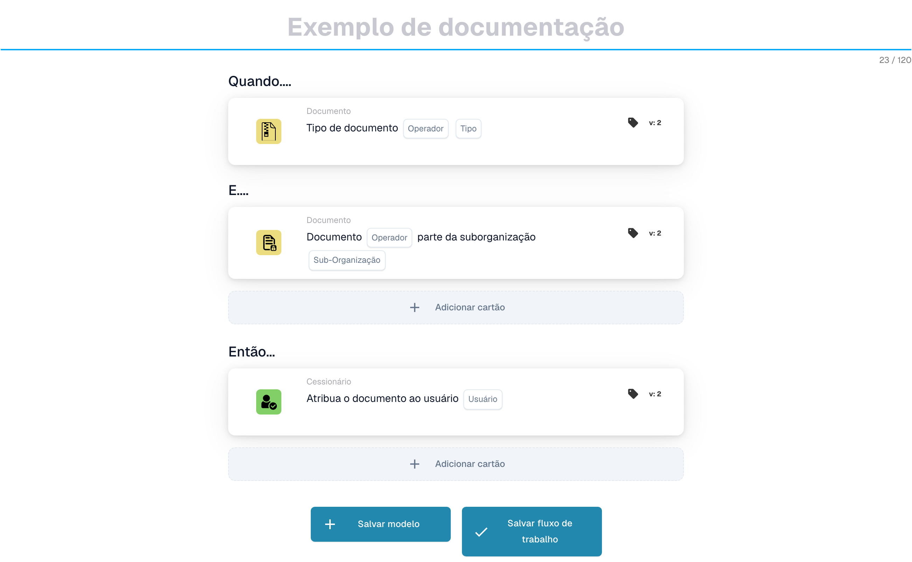

# Cartões correspondentes PO - Guia completo

## Cartões correspondentes de pedido de compra (PO) - Guia completo

**Estado:** Abrange 15 cartões de comparação de PO com cálculos detalhados

***

Os cartões de comparação de pedidos de compra nesta página vão para o grupo **E** do Workflow Builder — eles comparam os dados da fatura com o pedido de compra correspondente antes da execução das ações Então:

<figure><figcaption><p>Exemplo não guardado com cartões Quando, E e Então. Configure todos os campos antes da execução. Algumas etiquetas desta versão da interface ainda não estão traduzidas ou têm uma tradução incorreta. As explicações desta página usam os termos corretos; a imagem mostra a interface real.</p></figcaption></figure>

***

### 📌 Informações da versão

**Cartão mais evoluído:** CONDITION\_DOC\_TO\_PO\_UNIT\_PRICE (5 versões, v5 mais recente) **Outros cartões complexos:** CONDITION\_OC\_TO\_PO\_ITEMS (v4), CONDITION\_LESS\_THAN\_TOLERANCE\_AS\_VALUE\_OF\_ORDERED\_QUANTITY (v4)

**Principais padrões:**

* **v2 → v3+:** Adição de parâmetros de tolerância para correspondência flexível
* **v3 → v4:** Adição de parâmetros do modo de comparação
* **v4 → v5:** Tolerância aprimorada com múltiplas unidades (%, EUR, $, etc.)

📖 [Histórico completo da versão](../../release.md) | [Versões e comportamento dos cartões](../../cards-overview/card-versions-guide.md)

***

### Compreendendo a correspondência de PO

Quando você recebe uma fatura, ela deve corresponder ao Pedido de Compra (PO) feito anteriormente. Os cartões correspondentes do pedido de compra verificam automaticamente se os dados da fatura correspondem aos dados do pedido de compra.

**O panorama geral:**

```
PO emitido    Fatura chega        Correspondência Decisão
(€100)    →   (€103)          →   (Verificar se   → Aprovar/Rejeitar
Qtd.: 100     Qtd.: 100           está na tolerância)
```

<figure><figcaption><p>O preço do PO (€100) está no prato esquerdo e o preço da fatura (€103) no direito. A diferença de €3 corresponde a 3% do preço do PO, portanto o ponteiro permanece dentro da faixa verde de tolerância de ±5% e a verificação é aprovada. Acima de ±5% (vermelho), a fatura precisa de revisão.</p></figcaption></figure>

***

## 1. Correspondência completa do pedido de compra

### Objetivo

Verifica se toda a fatura corresponde perfeitamente ao pedido ou dentro da tolerância

### Quando usar

* Antes de aprovar uma fatura
* Como uma verificação preliminar de qualidade
* Para identificar problemas precocemente

### Como funciona

O sistema compara:

* Quantidades de fatura versus quantidades de pedido
* Preços de fatura versus preços de PO
* Itens de fatura versus itens de pedido de compra
* Total da fatura versus total do pedido

### Resultado

* **TRUE** (correspondência completa): tudo corresponde, prossiga
* **FALSE** (Incompatibilidade): Algo não corresponde, precisa de revisão

### Exemplo

```
PO:
- Artigo ABC: Qtd. 100, Preço unitário €50 = €5000
- Artigo XYZ: Qtd. 50, Preço unitário €20 = €1000
- Total: €6000

Fatura:
- Artigo ABC: Qtd. 100, Preço unitário €50 = €5000
- Artigo XYZ: Qtd. 50, Preço unitário €20 = €1000
- Total: €6000

Resultado: ✅ CORRESPONDÊNCIA COMPLETA
```

***

## 2. Comparação de preços unitários (documento vs PO)

### Objetivo

Compara o preço unitário na fatura com o preço unitário no pedido

### Parâmetros

* **Tolerância de preço unitário**: Permitir variação até este valor
* **Tipo de tolerância**: Porcentagem (%) ou Absoluta (€/$)
* **Operador**: É igual a, é maior que, é menor que, etc.

### Como funciona (tolerância percentual)

**Fórmula:**

```
Variação % = |(Preço da fatura - Preço do PO)| / Preço do PO × 100

Verificação: A variação % é ≤ tolerância %?
```

**Exemplo passo a passo:**

```
Passo 1: Obter os preços
  Preço unitário do PO: €100.00
  Preço unitário da fatura: €103.00

Passo 2: Calcular a diferença
  Diferença = |€103.00 - €100.00| = €3.00

Passo 3: Calcular a percentagem
  Porcentagem = (€3.00 / €100.00) × 100 = 3%

Passo 4: Verificar a tolerância (5% permitido)
  3% ≤ 5%? SIM ✅

Resultado: PASS - Dentro da tolerância
```

### Exemplos do mundo real

#### Exemplo 1: Pequeno Aumento (Aceito)

```
Preço do PO: €50.00
Preço da fatura: €51.50
Tolerância: ±3%

Cálculo:
  Variação = |(€51.50 - €50.00)| / €50.00 × 100
  Variação = €1.50 / €50.00 × 100 = 3%

3% ≤ 3%? SIM ✅ ACEITAR
```

#### Exemplo 2: Grande Aumento (Rejeitado)

```
Preço do PO: €50.00
Preço da fatura: €55.00
Tolerância: ±3%

Cálculo:
  Variação = |(€55.00 - €50.00)| / €50.00 × 100
  Variação = €5.00 / €50.00 × 100 = 10%

10% ≤ 3%? NÃO ❌ REJEITAR - REQUER REVISÃO
```

#### Exemplo 3: Desconto (também verificado)

```
Preço do PO: €100.00
Preço da fatura: €97.00
Tolerância: ±5%

Cálculo:
  Variação = |(€97.00 - €100.00)| / €100.00 × 100
  Variação = €3.00 / €100.00 × 100 = 3%

3% ≤ 5%? SIM ✅ ACEITAR (o desconto está dentro da tolerância)
```

#### Exemplo 4: Tolerância de Valor Absoluto

```
Preço do PO: €10.00
Preço da fatura: €10.50
Tolerância: ±€1.00 (absoluta, não %)

Cálculo:
  Variação = |€10.50 - €10.00| = €0.50

€0.50 ≤ €1.00? SIM ✅ ACEITAR
```

### O que fazer com os resultados

**Se PASSAR ✅:**

* Continuar para a próxima verificação
* Ou aprovar fatura
* Ou prossiga com a exportação

**Se FALHAR ❌:**

* Sinalizar para revisão manual
* Peça explicação ao fornecedor
* Contate a equipe de compras
* Aprove com nota se for aceitável

***

## 3. Comparação de quantidades

### Objetivo

Verifica se a quantidade solicitada corresponde à quantidade faturada

### Parâmetros

* **Tolerância**: Quantidade ou % permitida para diferir
* **Operador**: Igual, Maior que, Menor que
* **Tipo de quantidade**: Pedido, Recebido, Aberto

### Exemplo de cálculo

**Tolerância percentual:**

```
Fórmula:
  Variação de quantidade % = |(Qtd. da fatura - Qtd. do PO)| / Qtd. do PO × 100

Exemplo:
  Quantidade do PO: 100 unidades
  Quantidade da fatura: 103 unidades
  Tolerância: ±5%

  Variação = |(103 - 100)| / 100 × 100
  Variação = 3 / 100 × 100 = 3%

  3% ≤ 5%? SIM ✅ ACEITAR
```

**Tolerância absoluta:**

```
Fórmula:
  Variação de quantidade = |Qtd. da fatura - Qtd. do PO|

Exemplo:
  Quantidade do PO: 100 unidades
  Quantidade da fatura: 102 unidades
  Tolerância: ±5 unidades

  Variação = |102 - 100| = 2 unidades

  2 unidades ≤ 5 unidades? SIM ✅ ACEITAR
```

### Cenários do mundo real

#### Entrega excessiva (mais do que o pedido)

```
Pedido: 100 unidades
Faturado: 110 unidades
Tolerância: ±5%

Variação = |(110-100)|/100 × 100 = 10%

10% ≤ 5%? NÃO ❌

Decisão: Contatar o fornecedor - foi faturado mais do que o pedido
Motivo possível: Erro do fornecedor, remessa parcial já recebida
```

#### Entrega insuficiente (menos do que o pedido)

```
Pedido: 100 unidades
Faturado: 95 unidades
Tolerância: ±5%

Variação = |(95-100)|/100 × 100 = 5%

5% ≤ 5%? SIM ✅

Decisão: Aceitar - dentro da tolerância
Motivo possível: Remessa parcial, o restante será entregue depois
```

***

## 4. Preço Combinado de Diferença de Quantidade

### Objetivo

Quando a quantidade difere, calcula se a diferença total de preço é aceitável

### Por que isso é importante

```
Cenário: Você pediu 100 unidades, mas recebeu 110
- A quantidade está 10% acima (ruim)
- MAS: você só é cobrado por 10% a mais
- O efeito combinado pode ser aceitável
```

### Cálculo

**Fórmula:**

```
Variação combinada = Variação de quantidade × Variação de preço

Se ambas estiverem dentro da tolerância, a variação combinada geralmente é aceitável
```

**Exemplo:**

```
PO:
- Preço unitário: €100
- Quantidade: 100
- Total: €10,000

Fatura:
- Preço unitário: €102 (2% mais alto)
- Quantidade: 105 (5% mais alta)
- Total: €10,710

Análise:
- Variação de preço: 2% ✅
- Variação de quantidade: 5% ✅
- Efeito combinado: 1.02 × 1.05 = 1.071 = 7.1% de aumento total

A variação combinada é aceitável? Geralmente SIM ✅
```

***

## 5. Comparação de ID do item/número do item do fornecedor

### Objetivo

Verifica se os itens da fatura correspondem aos itens do pedido

### Como funciona

**Correspondência exata (mais simples):**

```
ID do artigo no PO: ABC-123
ID do artigo na fatura: ABC-123
Resultado: ✅ CORRESPONDE
```

**Número do item do fornecedor (mais comum):**

```
Artigo do PO: ABC-123 (nosso código interno)
Artigo do fornecedor: SUPP-456 (o código dele para o mesmo artigo)
O sistema os reconhece como o mesmo artigo
Resultado: ✅ CORRESPONDE
```

### Cenário: e se não corresponder?

```
Artigo do PO: ABC-123 (Fio de cobre, 2mm)
Artigo da fatura: ABC-124 (Fio de aço, 2mm)

Resultado: ❌ NÃO CORRESPONDE

Ações:
1. Trata-se de uma substituição? Verifique com o setor de compras
2. Trata-se de um erro? Contate o fornecedor
3. A descrição é semelhante? Verifique manualmente
```

***

## 6. Verificação do tipo de pedido

### Objetivo

Verifica se o tipo de pedido de compra está correto

### Tipos de pedidos

* **Pedido padrão**: Compra normal
* **Pedido urgente**: Urgente, pode ter sobretaxa
* **Acordo Quadro**: Contrato de longo prazo
* **Pedido geral**: Contrato sem termo
* **Consignação**: Você não paga até usar

### Verifique o exemplo

```
Tipo de pedido do PO: Pedido padrão
Tipo de pedido da fatura: Pedido padrão
Resultado: ✅ CORRESPONDE

Se não corresponder: pode afetar condições, pagamento e preços
```

***

## 7. Verificação da data de entrega

### Objetivo

Verifica se a data de entrega corresponde à data prometida no pedido

### Cálculo

**Entrega atrasada:**

```
Fórmula:
  Dias de atraso = Data de entrega da fatura - Data prometida no PO

Exemplo:
  Prometido no PO: 2025-10-15
  Entrega efetiva: 2025-10-22
  Dias de atraso = 7 dias

Se a tolerância for ±3 dias:
  7 ≤ 3? NÃO ❌ ATRASADO
```

**Entrega antecipada:**

```
Fórmula:
  Dias de antecedência = Data prometida no PO - Data de entrega da fatura

Exemplo:
  Prometido no PO: 2025-10-15
  Entrega efetiva: 2025-10-10
  Dias de antecedência = 5 dias

Entrega antecipada geralmente é aceitável ✅
A menos que seja necessária em um momento específico
```

### Configurações de tolerância

```
±3 dias: Permite 3 dias de atraso ou antecipação
±5 dias: Permite até 5 dias de variação
0 dias: Deve corresponder exatamente
```

***

## 8. Verificação de cobrança (impostos, frete, etc.)

### Objetivo

Verifica se os encargos adicionais (impostos, frete, manuseio) correspondem ao pedido

### Encargos Comuns

```
- Frete: €50
- Manuseio: €10
- Embalagem: €5
- Seguro: €15
- Impostos: €300
```

### Cálculo

**Exemplo: Verificação de taxa de envio**

```
Frete do PO: €50.00
Frete da fatura: €51.00
Tolerância: ±3%

Variação = |€51.00 - €50.00| / €50.00 × 100 = 2%

2% ≤ 3%? SIM ✅ ACEITAR
```

**Exemplo: Múltiplas Cargas**

```
Total de encargos do PO:
  - Frete: €50
  - Impostos: €300
  - Manuseio: €10
  Total: €360

Total de encargos da fatura:
  - Frete: €50
  - Impostos: €312 (11% de imposto)
  - Manuseio: €10
  Total: €372

Diferença: €12
Verificar se está dentro da tolerância ✅ ou ❌
```

***

## 9. Verificação Fiscal

### Objetivo

Verifica se os valores dos impostos foram calculados corretamente

### Cálculo

**Fórmula:**

```
Valor do imposto = Subtotal × Taxa de imposto

Exemplo:
  Subtotal: €1000
  Taxa de imposto: 19%
  Imposto esperado: €1000 × 0.19 = €190

Imposto da fatura: €190
Corresponde? SIM ✅
```

**Problemas Comuns:**

```
1. A taxa de imposto mudou (por região)
2. Imposto aplicado sobre o valor errado (antes/depois dos descontos)
3. Várias taxas de imposto (alguns artigos a 7%, outros a 19%)
4. Artigos isentos de imposto (0% de imposto)
```

**Exemplo: Tributação Multitaxa**

```
Artigo A: €100 @ 19% de imposto = €119
Artigo B: €100 @ 7% de imposto = €107
Artigo C: €100 @ 0% de imposto = €100
Total: €326

A fatura mostra €325 (erro de €1)

Verificação: Dentro da tolerância ou requer atenção?
```

***

## 10. Correspondência de instalação/centro de custo

### Objetivo

Garante que a fatura seja para a instalação/centro de custo correto

### Exemplo

```
O PO é para:
- Instalação: Berlin Plant
- Centro de custo: CC-2025

A fatura deve ter:
- Instalação: Berlin Plant ✅
- Centro de custo: CC-2025 ✅

Se a instalação for diferente: pode ser necessária outra aprovação
```

***

## 11. Validação do status do fornecedor

### Objetivo

Verifica se o fornecedor ainda está aprovado/ativo

### Tipos de status

```
✅ ACTIVE: Aprovado, pode fazer negócios
⚠️ ON HOLD: Bloqueado temporariamente
❌ INACTIVE: Não se fazem mais negócios
⚠️ CONDITIONAL: Apenas para artigos específicos
```

### Verifique o exemplo

```
Fornecedor: ABC Corp
Estado no banco de dados: ACTIVE
Estado ao criar o PO: ACTIVE
Estado quando a fatura chega: INACTIVE

Alerta: O estado do fornecedor mudou! Investigue o motivo.
```

***

## Qual tolerância devo usar?

### Tolerâncias rigorosas (menor risco, mais trabalho manual)

```
Usar para:
- Artigos de alto valor
- Artigos em que a exatidão é importante
- Setores regulamentados

Configurações:
- Preço unitário: ±1%
- Quantidade: ±1%
- Data de entrega: ±1 dia
- Encargos: ±1%
```

### Tolerâncias moderadas (equilibradas)

```
Usar para:
- A maioria das transações comerciais
- Artigos padrão
- Compras normais

Configurações:
- Preço unitário: ±3-5%
- Quantidade: ±3-5%
- Data de entrega: ±3 dias
- Encargos: ±5%
```

### Tolerâncias flexíveis (maior risco, menos trabalho manual)

```
Usar para:
- Artigos de baixo valor
- Compras em grande quantidade
- Acordos com fornecedores com flexibilidade

Configurações:
- Preço unitário: ±10%
- Quantidade: ±10%
- Data de entrega: ±7 dias
- Encargos: ±10%
```

***

## Exemplo de fluxo de trabalho de correspondência de pedido de compra

```
Fatura chega
    ↓
Condição: "O valor é > €5000?" → SIM
    ↓
Verificação: Correspondência completa? → NÃO (10% de diferença de preço)
    ↓
Verificação: Preço unitário dentro de 5%? → NÃO (12% de diferença)
    ↓
Verificação: Quantidade dentro de 5%? → SIM (2% de diferença)
    ↓
Decisão: FAIL - Variação de preço demasiado alta
    ↓
Sinalizar para: Revisão manual / Aprovação do comprador
    ↓
Aguardar: Comentário do comprador
    ↓
Se aprovado: Continuar para a exportação
Se rejeitado: Devolver ao fornecedor
```

***

## Solução de problemas de correspondência de pedido de compra

### "PO não encontrado"

```
Causa: O número do PO da fatura não existe no sistema
Correção:
1. Verifique a grafia do número do PO
2. Verifique se o PO foi criado
3. Verifique se o PO está na organização correta
4. Peça ao fornecedor a referência do PO
```

### "Itens não correspondem"

```
Causa: Os artigos da fatura são diferentes dos artigos do PO
Motivos possíveis:
1. Substituição aprovada pelo setor de compras
2. Números de artigo diferentes para o mesmo artigo
3. Erro do fornecedor
Correção: Contate o setor de compras ou o fornecedor
```

### "Preço superior ao PO"

```
Causa: Preço da fatura > preço do PO
Motivos possíveis:
1. Aumento de preço aprovado
2. Erro do fornecedor
3. Diferença de moeda
4. Serviços adicionais incluídos
Correção: Verifique com o setor de compras
```

### "Data de entrega errada"

```
Causa: Fatura datada após a entrega prometida
Motivos possíveis:
1. A remessa sofreu atraso
2. A data de recebimento é diferente da data da fatura
3. Remessa parcial
Correção: Verifique os documentos de envio ou contate o fornecedor
```

***

## Tabela Resumo

| Cartão           | O que verifica        | Cálculo Principal     | Tolerância Comum |
| -------------- | --------------------- | -------------------- | ---------------- |
| Partida completa     | Tudo            | Todas as verificações           | Varia           |
| Preço unitário     | Preço por unidade        | % ou € diferença    | ±3-5%            |
| Quantidade       | Quantidade encomendada        | % ou diferença unitária | ±3-5%            |
| Preço Combinado | Total com alteração de quantidade | Quantidade × Preço          | ±5-10%           |
| ID do item        | Itens certos           | Correspondência de strings         | Exato            |
| Tipo de pedido     | Tipo de compra      | Correspondência de strings         | Exato            |
| Data de entrega  | Quando chegou          | Diferença do dia       | ±3 dias          |
| Encargos        | Taxas extras            | % ou € diferença    | ±5%              |
| Imposto            | Valor do imposto            | Cálculo de % de imposto    | ±1%              |
| Instalação       | Centro de custo           | Correspondência de strings         | Exato            |
| Fornecedor       | Aprovado?             | Verificação de status         | Somente ativo      |

***

## Documentação Relacionada

* Consulte o guia "Validação de fatura" para obter o fluxo de trabalho completo
* Consulte "Configurações de tolerância" para valores recomendados por setor
* Consulte "Tratamento de exceções" para saber o que fazer com falhas
* Entre em contato com sua equipe de compras para políticas de tolerância específicas

<!-- workflow-card-example-condition_promised_delivery_date_to_current-20261021 -->

### Data de entrega prometida em relação à data de referência

<figure><figcaption><p>Campos do cartão na versão apresentada. Os campos ainda não estão configurados.</p></figcaption></figure>

`CONDITION_PROMISED_DELIVERY_DATE_TO_CURRENT` · versão 2

Suponha uma data de referência de `2026-10-21` e uma data prometida de entrega da linha de `2026-10-23`. Selecione a comparação posterior e a tolerância de dia zero. A data futura satisfaz essa comparação; `2026-10-20` não. Configure deliberadamente as opções Qualquer/Todos e dias de tolerância aceitos e teste uma data ausente separadamente.

<!-- workflow-card-example-condition_po_extracted_table_column-20261021 -->

### Coluna de pedido de compra em relação a uma coluna extraída

<figure><figcaption><p>Campos do cartão na versão apresentada. Os campos ainda não estão configurados.</p></figcaption></figure>

`CONDITION_PO_EXTRACTED_TABLE_COLUMN` · versão 2

Compare a coluna do artigo PO correspondente com a coluna extraída `article_number`, usando igualdade e Todos. Valores correspondentes `DEMO-A` aprovados; um valor extraído `DEMO-B` falha. Selecione uma tabela de consulta somente quando for necessária uma substituição documentada de ID por valor; verifique esse mapeamento antes de comparar.

<!-- workflow-card-example-condition_check_facility_in_po-20261021 -->

### Facilidades de ordem de compra permitidas

<figure><figcaption><p>Campos do cartão na versão apresentada. Os campos ainda não estão configurados.</p></figcaption></figure>

`CONDITION_CHECK_FACILITY_IN_PO` · versão 2

Selecione Tudo, a comparação está em uso e o código de recurso configurado `DEMO-NORTH`. Linhas PO correspondentes nessa instalação passam; uma linha em `DEMO-SOUTH` falha. Use códigos de instalação dos dados do pedido de compra em vez de assumir que um rótulo de exibição é o seu código.

<!-- workflow-card-example-condition_purchase_order_full_match-20261021 -->

### Concluir correspondência do pedido de compra

<figure><figcaption><p>Campos do cartão na versão apresentada. Os campos ainda não estão configurados.</p></figcaption></figure>

`CONDITION_PURCHASE_ORDER_FULL_MATCH` · versão 2

Use uma fatura de demonstração e um pedido de compra totalmente combinados com quantidade `2` e preço unitário `100` em ambos os lados e tolerâncias de quantidade/preço configuradas. Selecione a condição de correspondência completa: ela é aprovada. Depois teste um preço fora da tolerância configurada. Dados de comparação ausentes ou um pedido de compra ausente não representam uma correspondência completa bem-sucedida. Uma nota de entrega tem uma comparação apenas de quantidade; não presuma que as regras de preço da fatura se aplicam a ele.

<!-- workflow-card-example-condition_po_update_empty_column_check-20261021 -->

### Coluna vazia do banco de dados de pedidos de compra

<figure><figcaption><p>Campos do cartão na versão apresentada. Os campos ainda não estão configurados. Algumas etiquetas desta versão da interface ainda não estão traduzidas ou têm uma tradução incorreta. As explicações desta página usam os termos corretos; a imagem mostra a interface real.</p></figcaption></figure>

`CONDITION_PO_UPDATE_EMPTY_COLUMN_CHECK` · versão 2

Selecione uma tabela e coluna de PO válida oferecida pelo cartão e pelo operador está vazio. Para um registro de pedido de compra correspondente existente com um valor em branco, a condição é aprovada; um valor preenchido falha. Verifique primeiro a referência do pedido de compra e o mapeamento de tabela/coluna. O booleano `false` ainda é um valor booleano atual; um registro de pedido de compra ausente é um erro de dados separado.

<!-- workflow-card-example-condition_compare_unit_price_percent_per-20261021 -->

### Tolerância percentual por base de preço

<figure><figcaption><p>Campos do cartão na versão apresentada. Os campos ainda não estão configurados.</p></figcaption></figure>

`CONDITION_COMPARE_UNIT_PRICE_PERCENT_PER` · versão 2

Exemplo: preço unitário do pedido `200`, preço base `100` e tolerância configurada `1` produzem uma taxa efetiva de `(200 / 100) * (1 / 100) = 0.02` ou `2%`. A banda de comparação é `196–204`. A igualdade dentro da tolerância aceita um preço de documento de `203` e rejeita `210`. Não presuma que este cartão equivale a uma tolerância fixa de 1%.

<!-- workflow-card-example-condition_compare_po_line_value-20261021 -->

### Valor da linha da ordem de compra em relação a uma referência

<figure><figcaption><p>Campos do cartão na versão apresentada. Os campos ainda não estão configurados.</p></figcaption></figure>

`CONDITION_COMPARE_PO_LINE_VALUE` · versão 2

Selecione a coluna PO correspondente `item_number`, igualdade e valor `DEMO-A`. Uma linha com `DEMO-A` passa; `DEMO-B` falha. Use apenas operadores suportados para o tipo de dados selecionado e teste os dados de linhas correspondentes ausentes separadamente.
