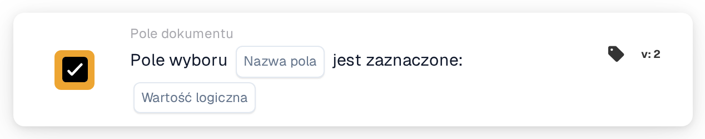

# Pole wyboru jest zaznaczone

<figure><figcaption>
Wersja 2
</figcaption></figure>



**Film:** Karta: Pole wyboru jest zaznaczone · 0:45 · [Napisy (WebVTT)](https://docbits-videos.fra1.cdn.digitaloceanspaces.com/settings-assistant/card-checkbox/v1/pl.vtt)

Transkrypcja

**Pole wyboru jest zaznaczone** · [0:00](https://docbits-videos.fra1.cdn.digitaloceanspaces.com/settings-assistant/card-checkbox/v1/pl.mp4#t=0.25)

Karta Pole wyboru sprawdza pole wyboru w dokumencie. Wybierz pole, na przykład Special handling, i czy ma być zaznaczone, czy niezaznaczone.

**Puste znaczy niezaznaczone** · [0:17](https://docbits-videos.fra1.cdn.digitaloceanspaces.com/settings-assistant/card-checkbox/v1/pl.mp4#t=17.55)

Puste pole wyboru liczy się jako niezaznaczone. Jeśli dokument nie ma takiego pola, karta idzie swoją ścieżką błędu.

**Przykład: zaznaczenie Special handling** · [0:30](https://docbits-videos.fra1.cdn.digitaloceanspaces.com/settings-assistant/card-checkbox/v1/pl.mp4#t=30.783)

Na przykład walidator zaznacza Special handling, a Workflow wysyła dokument do zespołu logistyki. Dokumenty bez zaznaczenia idą zwykłą ścieżką.

## Cel:

Ta karta przepływu pracy sprawdza, czy pole wyboru w dokumencie jest zaznaczone, czy niezaznaczone. Może być używana do tego, aby przepływ pracy był kontynuowany dopiero po ustawieniu znacznika w dokumencie, na przykład znacznika weryfikacji.

## Film administratora:



[Otwórz film z polskimi napisami](https://docbits-videos.fra1.cdn.digitaloceanspaces.com/settings-assistant/workflow-card-checkbox-admin/v2/pl-theme-v4.html)

## Komponenty karty:

1. **Nazwa pola**
   * **Opis:** Techniczna nazwa pola wyboru w dokumencie.
   * **Szczegóły:** Pole powinno być polem wyboru (logicznym) danego typu dokumentu.
2. **Wartość logiczna**
   * **Opis:** Stan, jaki powinno mieć pole wyboru.
   * **Opcje:**
     * **PRAWDA:** Pole wyboru powinno być zaznaczone.
     * **FAŁSZ:** Pole wyboru powinno być niezaznaczone.

## Funkcjonalność:

* **Ocena warunku:** Gdy przepływ pracy dociera do karty, karta odczytuje bieżącą wartość pola w dokumencie i porównuje ją z ustawieniem **Wartość logiczna**. Karta nie obserwuje pola w czasie i go nie zmienia.
  * Pusta wartość pola wyboru jest uznawana za niezaznaczoną.
  * Jeśli nie wybrano żadnej wartości w **Wartość logiczna**, karta sprawdza, czy pole wyboru jest niezaznaczone.
  * Jeśli pole nie jest polem wyboru, karta odnotowuje to w dzienniku przepływu pracy i mimo to porównuje jego wartość.
* **Wykonanie akcji:**
  * **Warunek prawdziwy:**\
    Jeśli stan pola wyboru odpowiada ustawieniu **Wartość logiczna**, przepływ pracy jest kontynuowany kolejnymi kartami.
  * **Warunek fałszywy:**\
    Jeśli nie odpowiada, przepływ pracy zatrzymuje się z niespełnionym warunkiem.
* **Brakujące dane:** Jeśli pole nie istnieje w dokumencie, karta nie ocenia warunku. Zgłasza, że pola nie znaleziono w dokumencie, co jest innym wynikiem niż niezaznaczone pole wyboru.

## Instalacja i konfiguracja:

* Kartę można dodać jako warunek And z kategorii **Pole dokumentu**. Następnie w polu **Nazwa pola** wpisuje się techniczną nazwę pola wyboru i wybiera **PRAWDA** lub **FAŁSZ**.
* Za pomocą opcji **Karta testowa** w menu karty w Workflow Builder można sprawdzić konfigurację na dokumencie z zaznaczonym polem wyboru, na dokumencie z niezaznaczonym polem wyboru i na dokumencie bez tego pola.

## Podsumowanie:

Karta przepływu pracy „Checkbox is checked” zamienia pole wyboru w dokumencie w warunek przepływu pracy. Dzięki temu przepływ pracy może poczekać na krok ręczny, taki jak zakończona weryfikacja, zanim zostaną wykonane kolejne akcje.
