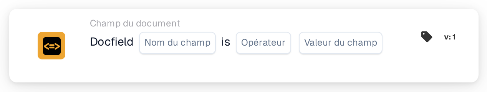

# Comparer un champ de document à une valeur de référence

<figure><figcaption>
Version 1
</figcaption></figure>

<figure><figcaption>
Version 2
</figcaption></figure>



**Vidéo:** Carte: Champ du document comparé à une valeur · 0:48 · [Sous-titres (WebVTT)](https://docbits-videos.fra1.cdn.digitaloceanspaces.com/settings-assistant/card-doc-field-value/v1/fr.vtt)

Transcription

**Champ du document comparé à une valeur** · [0:00](https://docbits-videos.fra1.cdn.digitaloceanspaces.com/settings-assistant/card-doc-field-value/v1/fr.mp4#t=0.25)

La carte Champ du document compare un champ du document avec une valeur que vous saisissez. Choisissez le champ, par exemple Montant total, puis l'opérateur, ici Supérieur à, et la valeur, dix mille.

**Texte, nombres, dates** · [0:19](https://docbits-videos.fra1.cdn.digitaloceanspaces.com/settings-assistant/card-doc-field-value/v1/fr.mp4#t=19.616)

Les champs texte peuvent seulement être égaux ou différents, et les majuscules ne comptent pas. Les nombres et les dates peuvent aussi être supérieurs ou inférieurs à la valeur. Si le champ n'est pas sur le document, la carte prend son chemin d'erreur.

**Exemple : les grosses factures exigent une deuxième approbation** · [0:35](https://docbits-videos.fra1.cdn.digitaloceanspaces.com/settings-assistant/card-doc-field-value/v1/fr.mp4#t=35.35)

Par exemple, une deuxième approbation des grosses factures : Montant total supérieur à dix mille, puis la carte d'attribution pour la finance. Les factures petites n'atteignent pas cette étape.

## **Objectif :**

Cette carte compare un champ du document avec une valeur que vous saisissez sur la carte. Utilisez-la pour envoyer les documents sur des chemins différents selon la valeur d'un champ, par exemple une deuxième approbation pour les grosses factures ou un chemin spécial pour quelques fournisseurs.

La carte se lit : **Champ du document** [Field Name] [Operator] [Field Value].

## **Composants de la carte :**

1. **Nom du champ**
   * Le champ du document à vérifier, choisi parmi les champs du type de document.
2. **Opérateur**
   * La manière dont la valeur du champ est comparée à la **Field Value**. Les opérateurs pertinents dépendent du type du champ, voir **Opérateurs** ci-dessous.
3. **Field Value**
   * La valeur de comparaison. Selon l'opérateur, il s'agit d'une valeur unique, d'une liste séparée par des virgules ou d'une expression régulière.

## **Opérateurs :**

| Opérateur | Satisfait lorsque | Types de champ |
| --- | --- | --- |
| **Est** (=) | la valeur du champ est égale à la Field Value | texte, nombre, montant, date |
| **Pas égaux** (≠) | la valeur du champ diffère de la Field Value | texte, nombre, montant, date |
| **Supérieur à** (>) | la valeur du champ est supérieure à la Field Value | nombre, montant, date |
| **Plus grand ou égal** (≥) | la valeur du champ est supérieure ou égale à la Field Value | nombre, montant, date |
| **Inférieur à** (<) | la valeur du champ est inférieure à la Field Value | nombre, montant, date |
| **Inférieur ou égal** (≤) | la valeur du champ est inférieure ou égale à la Field Value | nombre, montant, date |
| **Est l'un de** | la valeur du champ est égale à un élément d'une liste séparée par des virgules | texte |
| **N'est aucun de** | la valeur du champ n'est égale à aucun des éléments de la liste | texte |
| **Correspond à la regex** | l'expression régulière est trouvée dans la valeur du champ | texte, nombre, montant, date |
| **Ne correspond pas à la regex** | l'expression régulière n'est pas trouvée dans la valeur du champ | texte, nombre, montant, date |

Les champs booléens (cases à cocher) ne sont pas pris en charge par cette carte. Utilisez pour eux **Checkbox is checked**.

### Est et Pas égaux sur les champs texte

Le texte est comparé sans tenir compte des majuscules, et une espace compte comme un trait de soulignement : `Acme Freight` est égal à `acme_freight`. Les espaces au début et à la fin sont ignorées.

### Est l'un de et N'est aucun de

Utilisez ces opérateurs pour vérifier un champ texte par rapport à plusieurs valeurs à la fois, par exemple une liste d'identifiants de fournisseurs.

* Saisissez les valeurs sous forme de liste séparée par des virgules : `40321,40322,40388`.
* La valeur du champ doit être exactement égale à un élément. Une valeur partielle ne correspond pas : `4032` ne fait pas partie de `40321,40322,40388`, pas plus qu'une valeur plus longue comme `403210`.
* Les majuscules ne comptent pas, et une espace compte comme un trait de soulignement. Les espaces autour des éléments sont ignorées, et les éléments vides, comme celui de `a,,b`, sont ignorés.
* Pour utiliser une virgule à l'intérieur d'une valeur, écrivez-la `\,`. `Acme Freight\, LLC,Riverside Supply` est une liste de deux éléments : `Acme Freight, LLC` et `Riverside Supply`.
* Une valeur de champ vide ne figure dans aucune liste. **Est l'un de** n'est alors pas satisfait, et **N'est aucun de** est satisfait.
* Ces opérateurs fonctionnent uniquement sur les champs texte. Sur un champ nombre, montant ou date, ou avec une liste qui ne contient aucun élément (par exemple uniquement des virgules), la carte se termine par une erreur.

### Correspond à la regex et Ne correspond pas à la regex

Utilisez ces opérateurs lorsqu'un motif décide, par exemple « commence par » ou « se compose uniquement de chiffres ».

* La **Field Value** est une expression régulière en syntaxe Python. Elle est recherchée n'importe où dans la valeur du champ : `Freight` correspond à `Acme Freight, LLC`.
* Utilisez `^` et `$` pour vérifier la valeur entière : `^33` signifie « commence par 33 », et `^(40321|40322|40388)$` signifie « exactement l'une de ces valeurs ».
* Le motif est sensible à la casse. Commencez-le par `(?i)` pour ignorer les majuscules : `(?i)freight` correspond aussi à `Acme Freight, LLC`.
* `^` et `$` se rapportent à la valeur entière du champ. Commencez le motif par `(?m)` pour les appliquer à chaque ligne d'une valeur de plusieurs lignes.
* Le motif est utilisé exactement tel que vous le saisissez. Il n'est pas raccourci et les majuscules sont conservées, de sorte que `\D` (tout caractère qui n'est pas un chiffre) garde sa signification, et qu'un motif composé d'une seule espace recherche une espace.
* Les caractères qui ont une signification particulière dans les expressions régulières doivent être échappés pour être trouvés tels quels : `\(copy\)` correspond au texte `(copy)`, tandis que `(copy)` est un groupe qui trouve le mot `copy`.
* Les nombres, montants et dates sont comparés sous la forme du texte dans lequel ils sont enregistrés : un montant de 997.60 correspond à `^997\.60$`.
* Une valeur de champ vide est traitée comme un texte vide, donc `^$` y correspond.
* Un motif invalide, par exemple `(20` avec une parenthèse manquante, termine la carte par une erreur. Il en va de même lorsqu'un motif prend trop de temps sur une valeur (plus de 0,05 seconde), ce qui n'arrive qu'avec des motifs mal construits comme `(a|aa)+$`. Dans les deux cas, la carte n'est ni satisfaite ni non satisfaite, de sorte que **Ne correspond pas à la regex** ne passe jamais à cause d'un motif défectueux.

## **Fonctionnement de la carte :**

* **Champ absent du document :** si le document n'a pas de champ portant le nom choisi, la carte s'arrête et signale que le champ est introuvable, quel que soit l'opérateur.
* **Condition satisfaite :** le Workflow continue avec la carte suivante (dans l'Advanced Workflow, par la sortie de succès).
* **Condition non satisfaite :** le Workflow s'arrête à cette carte (dans l'Advanced Workflow, il prend la sortie prévue pour une condition non satisfaite).
* **Erreur :** un opérateur qui ne convient pas au type du champ, une Field Value manquante, une liste vide ou un motif inutilisable terminent la carte par une erreur. Le journal de la carte en indique la raison.

## **Mise en place et configuration :**

Choisissez le champ dans **Nom du champ**, l'opérateur dans **Opérateur** et saisissez la valeur dans **Field Value**. Pour les nombres et les montants, saisissez la valeur sans symbole monétaire et avec un point décimal, par exemple `1000.50`.

Pour essayer une configuration sans attendre un document, ouvrez le menu de la carte dans le Workflow Builder, choisissez **Test Card**, sélectionnez un document puis **Test on Document**. Le journal de la carte affiche la valeur du champ, l'opérateur et le résultat.

## **Exemples :**

| Objectif | Nom du champ | Opérateur | Field Value | Valeur du champ sur le document | Résultat |
| --- | --- | --- | --- | --- | --- |
| Deuxième approbation pour les grosses factures | Montant total | Supérieur à | `10000` | 12500.00 | satisfait |
| Orienter quelques fournisseurs | ID fournisseur | Est l'un de | `40321,40322,40388` | 40322 | satisfait |
| | | | | 4032 | non satisfait |
| Exclure un fournisseur dont le nom contient une virgule | Nom du fournisseur | N'est aucun de | `Acme Freight\, LLC` | Acme Freight, LLC | non satisfait |
| Numéros de commande commençant par 33 | Numéro de commande | Correspond à la regex | `^33` | 33012 | satisfait |
| | | | | 13301 | non satisfait |
| Référence avec des lettres | Référence | Correspond à la regex | `\D` | AB-1204 | satisfait |
| Copies de factures | Numéro de facture | Ne correspond pas à la regex | `\(copy\)` | INV-1204 (copy) | non satisfait |

## **Conclusion :**

La carte vérifie un seul champ du document par rapport à une valeur, une liste ou un motif. Utilisez **Est l'un de** pour des listes fixes de valeurs et **Correspond à la regex** pour des motifs tels que des préfixes ou des formats.

<!-- workflow-card-practical-example-20261021 -->

## Exemple pratique

**Quand utiliser :** Examinez les factures supérieures à un montant défini.

**Configuration :** Sélectionnez le champ numérique `total_amount`, l'opérateur `>` et la valeur de référence `1000`.

**Résultat attendu et contre-exemple :** Une valeur de `1200` satisfait la condition. Les valeurs `1000` et `900` ne la satisfont pas : l’opérateur `>` exige une valeur strictement supérieure à `1000`.

Il s’agit d’une configuration illustrative et du résultat attendu. Utilisez les champs, utilisateurs et groupes configurés dans votre organisation de test ; cela ne veut pas dire que cet exemple a été exécuté.
