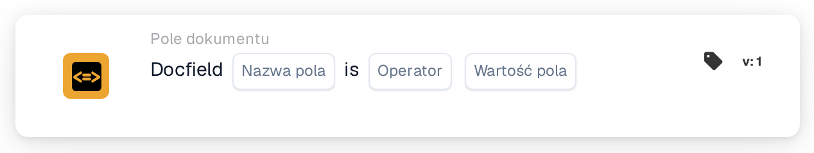
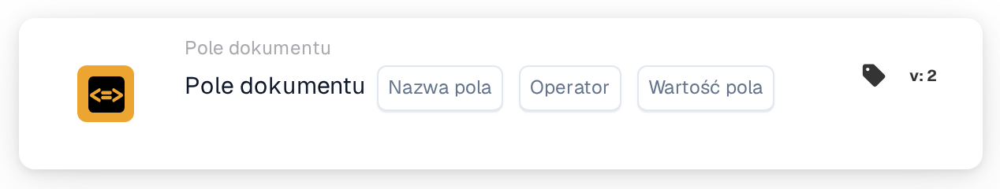

# Porównanie pola dokumentu z wartością odniesienia

<figure><figcaption>
Wersja 1
</figcaption></figure>

<figure><figcaption>
Wersja 2
</figcaption></figure>



**Film:** Karta: Pole dokumentu porównane z wartością · 1:00 · [Napisy (WebVTT)](https://docbits-videos.fra1.cdn.digitaloceanspaces.com/settings-assistant/card-doc-field-value/v1/pl.vtt)

Transkrypcja

**Pole dokumentu porównane z wartością** · [0:00](https://docbits-videos.fra1.cdn.digitaloceanspaces.com/settings-assistant/card-doc-field-value/v1/pl.mp4#t=0.25)

Karta Pole dokumentu porównuje jedno pole dokumentu z wartością, którą wpisujesz. Wybierz pole, na przykład Całkowita kwota, potem operator, tutaj Większy niż, i wartość, dziesięć tysięcy.

**Tekst, liczby, daty** · [0:21](https://docbits-videos.fra1.cdn.digitaloceanspaces.com/settings-assistant/card-doc-field-value/v1/pl.mp4#t=21.916)

Pola tekstowe mogą być tylko równe lub różne, a wielkość liter nie ma znaczenia. Liczby i daty mogą też być większe lub mniejsze od wartości. Jeśli pola nie ma w dokumencie, karta idzie swoją ścieżką błędu.

**Przykład: duże faktury wymagają drugiego zatwierdzenia** · [0:41](https://docbits-videos.fra1.cdn.digitaloceanspaces.com/settings-assistant/card-doc-field-value/v1/pl.mp4#t=41.95)

Na przykład drugie zatwierdzenie dla dużych faktur: Całkowita kwota większa niż dziesięć tysięcy, potem karta przypisania dla działu finansów. Mniejsze faktury nie docierają do tego kroku.

## **Cel:**

Ta karta porównuje jedno pole dokumentu z wartością, którą wpisujesz na karcie. Użyj jej, aby kierować dokumenty różnymi ścieżkami w zależności od wartości pola, na przykład drugie zatwierdzenie dla dużych faktur albo osobna ścieżka dla kilku dostawców.

Karta brzmi: **Pole dokumentu** [Nazwa pola] [Operator] [Field Value].

## **Komponenty karty:**

1. **Nazwa pola**
   * Pole dokumentu, które ma zostać sprawdzone, wybierane spośród pól typu dokumentu.
2. **Operator**
   * Sposób porównania wartości pola z **Field Value**. To, które operatory mają sens, zależy od typu pola, zobacz **Operatory** poniżej.
3. **Field Value**
   * Wartość, z którą następuje porównanie. W zależności od operatora jest to pojedyncza wartość, lista rozdzielona przecinkami lub wyrażenie regularne.

## **Operatory:**

| Operator | Spełniony, gdy | Typy pól |
| --- | --- | --- |
| **Równa się** (=) | wartość pola jest równa Field Value | tekst, liczba, kwota, data |
| **Nie równe** (≠) | wartość pola różni się od Field Value | tekst, liczba, kwota, data |
| **Większy niż** (>) | wartość pola jest większa niż Field Value | liczba, kwota, data |
| **Większy lub równy** (≥) | wartość pola jest większa lub równa Field Value | liczba, kwota, data |
| **Mniej niż** (<) | wartość pola jest mniejsza niż Field Value | liczba, kwota, data |
| **Mniej lub Równe** (≤) | wartość pola jest mniejsza lub równa Field Value | liczba, kwota, data |
| **Jest jednym z** | wartość pola jest równa jednemu elementowi listy rozdzielonej przecinkami | tekst |
| **Nie jest żadnym z** | wartość pola nie jest równa żadnemu elementowi listy | tekst |
| **Pasuje do regex** | wyrażenie regularne zostaje znalezione w wartości pola | tekst, liczba, kwota, data |
| **Nie pasuje do regex** | wyrażenie regularne nie zostaje znalezione w wartości pola | tekst, liczba, kwota, data |

Pola logiczne (pola wyboru) nie są obsługiwane przez tę kartę. Do nich użyj karty **Pole wyboru jest zaznaczone**.

### Równa się i Nie równe w polach tekstowych

Tekst jest porównywany bez uwzględniania wielkości liter, a spacja jest traktowana tak samo jak podkreślenie: `Acme Freight` jest równe `acme_freight`. Spacje na początku i na końcu są ignorowane.

### Jest jednym z i Nie jest żadnym z

Użyj tych operatorów, aby sprawdzić pole tekstowe jednocześnie względem kilku wartości, na przykład listy identyfikatorów dostawców.

* Wpisz wartości jako listę rozdzieloną przecinkami: `40321,40322,40388`.
* Wartość pola musi być dokładnie równa jednemu elementowi. Wartość częściowa nie jest dopasowaniem: `4032` nie należy do `40321,40322,40388`, podobnie jak dłuższa wartość, taka jak `403210`.
* Wielkość liter nie ma znaczenia, a spacja jest traktowana tak samo jak podkreślenie. Spacje wokół elementów są ignorowane, a puste elementy, takie jak ten w `a,,b`, są pomijane.
* Aby użyć przecinka wewnątrz wartości, zapisz go jako `\,`. `Acme Freight\, LLC,Riverside Supply` to lista dwóch elementów: `Acme Freight, LLC` i `Riverside Supply`.
* Pusta wartość pola nie należy do żadnej listy. **Jest jednym z** nie jest wtedy spełniony, a **Nie jest żadnym z** jest spełniony.
* Te operatory działają tylko w polach tekstowych. W polu liczbowym, kwotowym lub z datą albo z listą, która nie ma żadnych elementów (na przykład same przecinki), karta kończy się błędem.

### Pasuje do regex i Nie pasuje do regex

Użyj tych operatorów, gdy decyduje wzorzec, na przykład „zaczyna się od” albo „składa się tylko z cyfr”.

* **Field Value** to wyrażenie regularne w składni Pythona. Jest wyszukiwane w dowolnym miejscu wartości pola: `Freight` pasuje do `Acme Freight, LLC`.
* Użyj `^` i `$`, aby sprawdzić całą wartość: `^33` oznacza „zaczyna się od 33”, a `^(40321|40322|40388)$` oznacza „dokładnie jedna z tych wartości”.
* Wzorzec uwzględnia wielkość liter. Rozpocznij go od `(?i)`, aby ją ignorować: `(?i)freight` również pasuje do `Acme Freight, LLC`.
* `^` i `$` odnoszą się do całej wartości pola. Rozpocznij wzorzec od `(?m)`, aby stosować je do każdego wiersza wartości składającej się z kilku wierszy.
* Wzorzec jest używany dokładnie tak, jak go wpiszesz. Nie jest przycinany, a wielkość liter zostaje zachowana, więc `\D` (dowolny znak, który nie jest cyfrą) zachowuje swoje znaczenie, a wzorzec składający się z jednej spacji wyszukuje spację.
* Znaki o specjalnym znaczeniu w wyrażeniach regularnych trzeba poprzedzić znakiem ucieczki, aby były dopasowywane dosłownie: `\(copy\)` pasuje do tekstu `(copy)`, natomiast `(copy)` to grupa, która znajduje słowo `copy`.
* Liczby, kwoty i daty są dopasowywane jako tekst, w postaci, w jakiej są zapisane: kwota 997.60 pasuje do `^997\.60$`.
* Pusta wartość pola jest dopasowywana jako pusty tekst, więc pasuje do niej `^$`.
* Niepoprawny wzorzec, na przykład `(20` z brakującym nawiasem, kończy kartę błędem. To samo dzieje się, gdy wzorzec działa na wartości zbyt długo (ponad 0,05 sekundy), co zdarza się tylko przy źle zbudowanych wzorcach, takich jak `(a|aa)+$`. W obu przypadkach karta nie jest ani spełniona, ani niespełniona, więc **Nie pasuje do regex** nigdy nie przechodzi z powodu uszkodzonego wzorca.

## **Jak działa karta:**

* **Pola nie ma w dokumencie:** jeśli dokument nie ma pola o wybranej nazwie, karta zatrzymuje się i zgłasza, że pole nie zostało znalezione, niezależnie od operatora.
* **Warunek spełniony:** Workflow jest kontynuowany następną kartą (w Advanced Workflow przez wyjście sukcesu).
* **Warunek niespełniony:** Workflow zatrzymuje się na tej karcie (w Advanced Workflow wybiera wyjście dla niespełnionego warunku).
* **Błąd:** operator niepasujący do typu pola, brakująca Field Value, pusta lista lub nieużyteczny wzorzec kończą kartę błędem. Log karty pokazuje przyczynę.

## **Konfiguracja:**

Wybierz pole w **Nazwa pola**, operator w **Operator** i wpisz wartość w **Field Value**. W przypadku liczb i kwot wpisz wartość bez symbolu waluty i z kropką dziesiętną, na przykład `1000.50`.

Aby wypróbować konfigurację bez czekania na dokument, otwórz menu karty w Workflow Builder, wybierz **Testuj kartę**, wskaż dokument i wybierz **Testuj na dokumencie**. Log karty pokazuje wartość pola, operator i wynik.

## **Przykłady:**

| Cel | Nazwa pola | Operator | Field Value | Wartość pola w dokumencie | Wynik |
| --- | --- | --- | --- | --- | --- |
| Drugie zatwierdzenie dla dużych faktur | Całkowita kwota | Większy niż | `10000` | 12500.00 | spełniony |
| Osobna ścieżka dla kilku dostawców | ID dostawcy | Jest jednym z | `40321,40322,40388` | 40322 | spełniony |
| | | | | 4032 | niespełniony |
| Pominięcie dostawcy z przecinkiem w nazwie | Nazwa dostawcy | Nie jest żadnym z | `Acme Freight\, LLC` | Acme Freight, LLC | niespełniony |
| Numery zamówień zaczynające się od 33 | Numer zamówienia | Pasuje do regex | `^33` | 33012 | spełniony |
| | | | | 13301 | niespełniony |
| Referencja zawierająca litery | Referencja | Pasuje do regex | `\D` | AB-1204 | spełniony |
| Kopie faktur | Numer faktury | Nie pasuje do regex | `\(copy\)` | INV-1204 (copy) | niespełniony |

## **Podsumowanie:**

Karta sprawdza pojedyncze pole dokumentu względem wartości, listy lub wzorca. Użyj **Jest jednym z** dla stałych list wartości, a **Pasuje do regex** dla wzorców, takich jak prefiksy lub formaty.

<!-- workflow-card-practical-example-20261021 -->

## Praktyczny przykład

**Kiedy używać:** Przeglądanie faktur powyżej określonej kwoty.

**Konfiguracja:** Wybierz pole numeryczne `total_amount`, operator `>` i wartość referencyjną `1000`.

**Oczekiwany wynik i kontrprzykład:** Wartość `1200` spełnia warunek. Wartości `1000` i `900` go nie spełniają: operator `>` wymaga wartości większej niż `1000`.

To jest ilustracyjna konfiguracja i oczekiwany wynik. Korzystaj z pól, użytkowników i grup skonfigurowanych w Twojej organizacji testowej; nie jest to twierdzenie, że ten przykład został wykonany.
