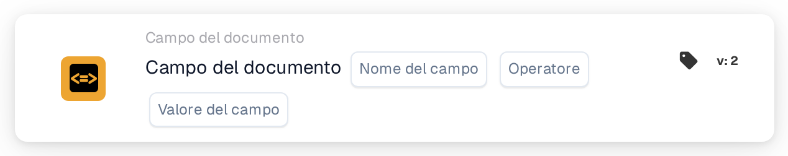

# Confrontare un campo documento con un valore di riferimento

<figure><figcaption>
Versione 1
</figcaption></figure>

<figure><figcaption>
Versione 2
</figcaption></figure>



**Video:** Scheda: Campo del documento confrontato con un valore · 0:48 · [Sottotitoli (WebVTT)](https://docbits-videos.fra1.cdn.digitaloceanspaces.com/settings-assistant/card-doc-field-value/v1/it.vtt)

Trascrizione

**Campo del documento confrontato con un valore** · [0:00](https://docbits-videos.fra1.cdn.digitaloceanspaces.com/settings-assistant/card-doc-field-value/v1/it.mp4#t=0.25)

La scheda Campo del documento confronta un campo del documento con un valore che inserisci. Scegli il campo, per esempio Importo totale, poi l'operatore, qui Maggiore di, e il valore, diecimila.

**Testo, numeri, date** · [0:19](https://docbits-videos.fra1.cdn.digitaloceanspaces.com/settings-assistant/card-doc-field-value/v1/it.mp4#t=19.25)

I campi di testo possono solo essere uguali o diversi, e le maiuscole non contano. Numeri e date possono anche essere maggiori o minori del valore. Se il campo non è nel documento, la scheda prende il suo percorso di errore.

**Esempio: le fatture grandi richiedono una seconda approvazione** · [0:34](https://docbits-videos.fra1.cdn.digitaloceanspaces.com/settings-assistant/card-doc-field-value/v1/it.mp4#t=34.183)

Per esempio, una seconda approvazione per fatture grandi: Importo totale maggiore di diecimila, poi la scheda di assegnazione per l'ufficio finanze. Le fatture minori non arrivano a questo passo.

## **Scopo:**

Questa scheda confronta un campo del documento con un valore che inserisci nella scheda. Usala per indirizzare i documenti su percorsi diversi in base al valore di un campo, per esempio una seconda approvazione per le fatture grandi o un percorso speciale per alcuni fornitori.

La scheda si legge: **Campo del documento** [Field Name] [Operator] [Field Value].

## **Componenti della scheda:**

1. **Nome campo**
   * Il campo del documento da controllare, scelto tra i campi del tipo di documento.
2. **Operatore**
   * Come il valore del campo viene confrontato con il **Field Value**. Gli operatori sensati dipendono dal tipo del campo, vedi **Operatori** più sotto.
3. **Field Value**
   * Il valore con cui confrontare. A seconda dell'operatore è un singolo valore, un elenco separato da virgole o un'espressione regolare.

## **Operatori:**

| Operatore | Soddisfatto quando | Tipi di campo |
| --- | --- | --- |
| **Pari** (=) | il valore del campo è uguale al Field Value | testo, numero, importo, data |
| **Non uguali** (≠) | il valore del campo è diverso dal Field Value | testo, numero, importo, data |
| **Maggiore di** (>) | il valore del campo è maggiore del Field Value | numero, importo, data |
| **Maggiore o uguale** (≥) | il valore del campo è maggiore o uguale al Field Value | numero, importo, data |
| **Meno di** (<) | il valore del campo è minore del Field Value | numero, importo, data |
| **Meno o uguale** (≤) | il valore del campo è minore o uguale al Field Value | numero, importo, data |
| **È uno tra** | il valore del campo è uguale a un elemento di un elenco separato da virgole | testo |
| **Non è uno tra** | il valore del campo non è uguale a nessun elemento dell'elenco | testo |
| **Corrisponde alla regex** | l'espressione regolare viene trovata nel valore del campo | testo, numero, importo, data |
| **Non corrisponde alla regex** | l'espressione regolare non viene trovata nel valore del campo | testo, numero, importo, data |

I campi booleani (caselle di controllo) non sono supportati da questa scheda. Per questi usa **Checkbox is checked**.

### Pari e Non uguali sui campi di testo

Il testo viene confrontato senza tenere conto delle maiuscole, e uno spazio vale quanto un trattino basso: `Acme Freight` è uguale a `acme_freight`. Gli spazi all'inizio e alla fine vengono ignorati.

### È uno tra e Non è uno tra

Usa questi operatori per confrontare un campo di testo con più valori in una volta, per esempio un elenco di ID fornitore.

* Inserisci i valori come elenco separato da virgole: `40321,40322,40388`.
* Il valore del campo deve essere esattamente uguale a un elemento. Un valore parziale non corrisponde: `4032` non è uno di `40321,40322,40388`, e neppure un valore più lungo come `403210`.
* Le maiuscole non contano, e uno spazio vale quanto un trattino basso. Gli spazi intorno agli elementi vengono ignorati, e gli elementi vuoti, come quello in `a,,b`, vengono saltati.
* Per usare una virgola all'interno di un valore, scrivila come `\,`. `Acme Freight\, LLC,Riverside Supply` è un elenco di due elementi: `Acme Freight, LLC` e `Riverside Supply`.
* Un valore del campo vuoto non è in nessun elenco. **È uno tra** non è quindi soddisfatto, mentre **Non è uno tra** è soddisfatto.
* Questi operatori funzionano solo sui campi di testo. Su un campo numero, importo o data, oppure con un elenco senza alcun elemento (per esempio solo virgole), la scheda termina con un errore.

### Corrisponde alla regex e Non corrisponde alla regex

Usa questi operatori quando decide un modello, per esempio "inizia con" oppure "è composto solo da cifre".

* Il **Field Value** è un'espressione regolare con sintassi Python. Viene cercata in qualsiasi punto del valore del campo: `Freight` corrisponde a `Acme Freight, LLC`.
* Usa `^` e `$` per controllare l'intero valore: `^33` significa "inizia con 33", e `^(40321|40322|40388)$` significa "esattamente uno di questi valori".
* Il modello distingue tra maiuscole e minuscole. Inizialo con `(?i)` per ignorare le maiuscole: `(?i)freight` corrisponde anche a `Acme Freight, LLC`.
* `^` e `$` si riferiscono all'intero valore del campo. Inizia il modello con `(?m)` per applicarli a ogni riga di un valore composto da più righe.
* Il modello viene usato esattamente come lo scrivi. Non viene accorciato e le maiuscole restano invariate, quindi `\D` (qualsiasi carattere che non è una cifra) mantiene il suo significato, e un modello composto da un solo spazio cerca uno spazio.
* I caratteri con un significato speciale nelle espressioni regolari vanno preceduti da una barra rovesciata per essere trovati letteralmente: `\(copy\)` corrisponde al testo `(copy)`, mentre `(copy)` è un gruppo che trova la parola `copy`.
* Numeri, importi e date vengono confrontati come il testo in cui sono memorizzati: un importo di 997.60 corrisponde a `^997\.60$`.
* Un valore del campo vuoto viene confrontato come testo vuoto, quindi `^$` vi corrisponde.
* Un modello non valido, per esempio `(20` con una parentesi mancante, termina la scheda con un errore. Lo stesso accade quando un modello impiega troppo tempo su un valore (più di 0,05 secondi), cosa che succede solo con modelli costruiti male come `(a|aa)+$`. In entrambi i casi la condizione della scheda non risulta né soddisfatta né non soddisfatta, quindi **Non corrisponde alla regex** non passa mai a causa di un modello difettoso.

## **Come funziona la scheda:**

* **Campo non presente nel documento:** se il documento non ha un campo con il nome scelto, la scheda si ferma e segnala che il campo non è stato trovato, qualunque sia l'operatore.
* **Condizione soddisfatta:** il Workflow prosegue con la scheda successiva (nell'Advanced Workflow, tramite l'uscita di successo).
* **Condizione non soddisfatta:** il Workflow si ferma a questa scheda (nell'Advanced Workflow, prende l'uscita per una condizione non soddisfatta).
* **Errore:** un operatore non adatto al tipo di campo, un Field Value mancante, un elenco vuoto o un modello inutilizzabile terminano la scheda con un errore. Il log della scheda mostra il motivo.

## **Configurazione e impostazione:**

Scegli il campo in **Nome campo**, l'operatore in **Operatore** e inserisci il valore in **Field Value**. Per numeri e importi inserisci il valore senza simbolo di valuta e con il punto decimale, per esempio `1000.50`.

Per provare una configurazione senza attendere un documento, apri il menu della scheda nel Workflow Builder, scegli **Test Card**, seleziona un documento e scegli **Test on Document**. Il log della scheda mostra il valore del campo, l'operatore e il risultato.

## **Esempi:**

| Obiettivo | Nome campo | Operatore | Field Value | Valore del campo nel documento | Risultato |
| --- | --- | --- | --- | --- | --- |
| Seconda approvazione per fatture grandi | Importo totale | Maggiore di | `10000` | 12500.00 | soddisfatta |
| Indirizzare alcuni fornitori | ID fornitore | È uno tra | `40321,40322,40388` | 40322 | soddisfatta |
| | | | | 4032 | non soddisfatta |
| Escludere un fornitore con una virgola nel nome | Nome fornitore | Non è uno tra | `Acme Freight\, LLC` | Acme Freight, LLC | non soddisfatta |
| Numeri d'ordine che iniziano con 33 | Numero d'ordine | Corrisponde alla regex | `^33` | 33012 | soddisfatta |
| | | | | 13301 | non soddisfatta |
| Riferimento con lettere | Riferimento | Corrisponde alla regex | `\D` | AB-1204 | soddisfatta |
| Copie di fatture | Numero fattura | Non corrisponde alla regex | `\(copy\)` | INV-1204 (copy) | non soddisfatta |

## **Conclusione:**

La scheda confronta un singolo campo del documento con un valore, un elenco o un modello. Usa **È uno tra** per elenchi fissi di valori e **Corrisponde alla regex** per modelli come prefissi o formati.

<!-- workflow-card-practical-example-20261021 -->

## Esempio pratico

**Quando utilizzarlo:** Revisione delle fatture superiori a un importo definito.

**Configurazione:** Selezionare il campo numerico `total_amount`, l'operatore `>` e il valore di riferimento `1000`.

**Risultato atteso e controesempio:** Il valore `1200` soddisfa la condizione. I valori `1000` e `900` non la soddisfano: l'operatore `>` richiede un valore strettamente maggiore di `1000`.

Questa è una configurazione illustrativa e il risultato atteso. Utilizza campi, utenti e gruppi configurati nella tua organizzazione di test; non si afferma che questo esempio sia stato eseguito.
