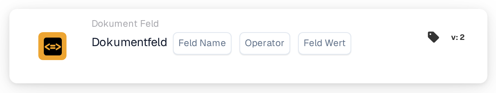

# Dokumentfeld mit Referenzwert vergleichen

<figure><figcaption>
Version 1
</figcaption></figure>

<figure><figcaption>
Version 2
</figcaption></figure>



**Video:** Karte: Dokumentfeld mit einem Wert verglichen · 0:47 · [Untertitel (WebVTT)](https://docbits-videos.fra1.cdn.digitaloceanspaces.com/settings-assistant/card-doc-field-value/v1/de.vtt)

Transkript

**Dokumentfeld mit einem Wert verglichen** · [0:00](https://docbits-videos.fra1.cdn.digitaloceanspaces.com/settings-assistant/card-doc-field-value/v1/de.mp4#t=0.25)

Die Karte Dokumentfeld vergleicht ein Feld des Dokuments mit einem Wert, den Sie eingeben. Wählen Sie das Feld, zum Beispiel Gesamtbetrag, dann den Operator, hier Größer als, und den Wert, zehntausend.

**Text, Zahlen, Datumswerte** · [0:19](https://docbits-videos.fra1.cdn.digitaloceanspaces.com/settings-assistant/card-doc-field-value/v1/de.mp4#t=19.016)

Textfelder können nur gleich oder ungleich sein, und Groß- und Kleinschreibung spielt keine Rolle. Zahlen und Datumswerte können auch größer oder kleiner als der Wert sein. Fehlt das Feld im Dokument, nimmt die Karte ihren Fehlerpfad.

**Beispiel: große Rechnungen brauchen eine zweite Freigabe** · [0:34](https://docbits-videos.fra1.cdn.digitaloceanspaces.com/settings-assistant/card-doc-field-value/v1/de.mp4#t=34.35)

Zum Beispiel eine zweite Freigabe für große Rechnungen: Gesamtbetrag größer als zehntausend, dann die Zuweisungskarte für die Finanzabteilung. Kleinere Rechnungen erreichen diesen Schritt nicht.

## **Zweck:**

Diese Karte vergleicht ein Feld des Dokuments mit einem Wert, den Sie auf der Karte eingeben. Verwenden Sie sie, um Dokumente je nach Feldwert auf unterschiedliche Wege zu schicken, zum Beispiel für eine zweite Freigabe bei großen Rechnungen oder einen eigenen Weg für einige wenige Lieferanten.

Die Karte lautet: **Dokumentfeld** [Field Name] [Operator] [Field Value].

## **Bestandteile der Karte:**

1. **Field Name**
   * Das zu prüfende Dokumentfeld, ausgewählt aus den Feldern des Dokumenttyps.
2. **Operator**
   * Wie der Feldwert mit dem **Field Value** verglichen wird. Welche Operatoren sinnvoll sind, hängt vom Typ des Feldes ab, siehe **Operatoren** weiter unten.
3. **Field Value**
   * Der Vergleichswert. Je nach Operator ist das ein einzelner Wert, eine kommagetrennte Liste oder ein regulärer Ausdruck.

## **Operatoren:**

| Operator | Erfüllt, wenn | Feldtypen |
| --- | --- | --- |
| **Entspricht** (=) | der Feldwert gleich dem Field Value ist | Text, Zahl, Betrag, Datum |
| **Ungleich** (≠) | der Feldwert sich vom Field Value unterscheidet | Text, Zahl, Betrag, Datum |
| **Größer als** (>) | der Feldwert größer als der Field Value ist | Zahl, Betrag, Datum |
| **Größer oder gleich** (≥) | der Feldwert größer als der Field Value oder gleich ist | Zahl, Betrag, Datum |
| **Weniger als** (<) | der Feldwert kleiner als der Field Value ist | Zahl, Betrag, Datum |
| **Weniger oder gleich** (≤) | der Feldwert kleiner als der Field Value oder gleich ist | Zahl, Betrag, Datum |
| **Ist einer von** | der Feldwert gleich einem Eintrag einer kommagetrennten Liste ist | Text |
| **Ist keiner von** | der Feldwert keinem Eintrag der Liste entspricht | Text |
| **Entspricht Regex** | der reguläre Ausdruck im Feldwert gefunden wird | Text, Zahl, Betrag, Datum |
| **Entspricht nicht Regex** | der reguläre Ausdruck im Feldwert nicht gefunden wird | Text, Zahl, Betrag, Datum |

Boolesche Felder (Checkboxen) werden von dieser Karte nicht unterstützt. Verwenden Sie für sie **Checkbox is checked**.

### Entspricht und Ungleich bei Textfeldern

Text wird ohne Rücksicht auf Groß- und Kleinschreibung verglichen, und ein Leerzeichen zählt wie ein Unterstrich: `Acme Freight` entspricht `acme_freight`. Leerzeichen am Anfang und am Ende werden ignoriert.

### Ist einer von und Ist keiner von

Mit diesen Operatoren prüfen Sie ein Textfeld gegen mehrere Werte auf einmal, zum Beispiel gegen eine Liste von Lieferanten-IDs.

* Geben Sie die Werte als kommagetrennte Liste ein: `40321,40322,40388`.
* Der Feldwert muss einem Eintrag genau entsprechen. Ein Teilwert ist kein Treffer: `4032` ist nicht in `40321,40322,40388` enthalten, ebenso wenig ein längerer Wert wie `403210`.
* Groß- und Kleinschreibung spielt keine Rolle, und ein Leerzeichen zählt wie ein Unterstrich. Leerzeichen um die Einträge werden ignoriert, und leere Einträge wie der in `a,,b` werden übersprungen.
* Für ein Komma innerhalb eines Wertes schreiben Sie `\,`. `Acme Freight\, LLC,Riverside Supply` ist eine Liste mit zwei Einträgen: `Acme Freight, LLC` und `Riverside Supply`.
* Ein leerer Feldwert steht in keiner Liste. **Ist einer von** ist dann nicht erfüllt, **Ist keiner von** ist erfüllt.
* Diese Operatoren funktionieren nur bei Textfeldern. Bei einem Zahlen-, Betrags- oder Datumsfeld oder bei einer Liste ganz ohne Einträge (zum Beispiel nur Kommas) endet die Karte mit einem Fehler.

### Entspricht Regex und Entspricht nicht Regex

Verwenden Sie diese Operatoren, wenn ein Muster entscheidet, zum Beispiel "beginnt mit" oder "besteht nur aus Ziffern".

* Der **Field Value** ist ein regulärer Ausdruck in Python-Syntax. Er wird an beliebiger Stelle im Feldwert gesucht: `Freight` passt auf `Acme Freight, LLC`.
* Mit `^` und `$` prüfen Sie den ganzen Wert: `^33` bedeutet "beginnt mit 33", und `^(40321|40322|40388)$` bedeutet "genau einer dieser Werte".
* Das Muster unterscheidet Groß- und Kleinschreibung. Beginnen Sie es mit `(?i)`, um sie zu ignorieren: `(?i)freight` passt auch auf `Acme Freight, LLC`.
* `^` und `$` beziehen sich auf den ganzen Feldwert. Beginnen Sie das Muster mit `(?m)`, damit sie für jede Zeile eines mehrzeiligen Wertes gelten.
* Das Muster wird genau so verwendet, wie Sie es eingeben. Es wird weder gekürzt noch in Kleinbuchstaben umgewandelt, sodass `\D` (jedes Zeichen, das keine Ziffer ist) seine Bedeutung behält und ein Muster aus einem einzigen Leerzeichen nach einem Leerzeichen sucht.
* Zeichen mit besonderer Bedeutung in regulären Ausdrücken müssen maskiert werden, damit sie wörtlich gefunden werden: `\(copy\)` passt auf den Text `(copy)`, während `(copy)` eine Gruppe ist, die das Wort `copy` findet.
* Zahlen, Beträge und Datumswerte werden als der Text verglichen, als der sie gespeichert sind: ein Betrag von 997.60 passt auf `^997\.60$`.
* Ein leerer Feldwert wird als leerer Text verglichen, daher passt `^$` darauf.
* Ein ungültiges Muster, zum Beispiel `(20` mit fehlender Klammer, beendet die Karte mit einem Fehler. Dasselbe passiert, wenn ein Muster für einen Wert zu lange braucht (mehr als 0,05 Sekunden), was nur bei schlecht gebauten Mustern wie `(a|aa)+$` vorkommt. In beiden Fällen ist die Karte weder erfüllt noch nicht erfüllt, sodass **Entspricht nicht Regex** nie wegen eines fehlerhaften Musters durchläuft.

## **So arbeitet die Karte:**

* **Feld nicht im Dokument:** Hat das Dokument kein Feld mit dem gewählten Namen, stoppt die Karte und meldet unabhängig vom Operator, dass das Feld nicht gefunden wurde.
* **Bedingung erfüllt:** Der Workflow wird mit der nächsten Karte fortgesetzt (im Advanced Workflow über den Erfolgsausgang).
* **Bedingung nicht erfüllt:** Der Workflow stoppt an dieser Karte (im Advanced Workflow nimmt er den Ausgang für eine nicht erfüllte Bedingung).
* **Fehler:** Ein Operator, der nicht zum Feldtyp passt, ein fehlender Field Value, eine leere Liste oder ein unbrauchbares Muster beenden die Karte mit einem Fehler. Das Kartenprotokoll zeigt den Grund.

## **Einrichtung und Konfiguration:**

Wählen Sie das Feld unter **Field Name** und den Operator unter **Operator** und geben Sie den Wert unter **Field Value** ein. Geben Sie Zahlen und Beträge ohne Währungssymbol und mit Dezimalpunkt ein, zum Beispiel `1000.50`.

Um eine Konfiguration zu testen, ohne auf ein Dokument zu warten, öffnen Sie im Workflow Builder das Kartenmenü, wählen **Test Card**, suchen ein Dokument aus und klicken auf **Test on Document**. Das Kartenprotokoll zeigt den Feldwert, den Operator und das Ergebnis.

## **Beispiele:**

| Ziel | Field Name | Operator | Field Value | Feldwert im Dokument | Ergebnis |
| --- | --- | --- | --- | --- | --- |
| Zweite Freigabe für große Rechnungen | Gesamtbetrag | **Größer als** | `10000` | 12500.00 | erfüllt |
| Einige Lieferanten umleiten | Lieferanten-ID | **Ist einer von** | `40321,40322,40388` | 40322 | erfüllt |
| | | | | 4032 | nicht erfüllt |
| Einen Lieferanten mit Komma im Namen auslassen | Lieferantenname | **Ist keiner von** | `Acme Freight\, LLC` | Acme Freight, LLC | nicht erfüllt |
| Bestellnummern, die mit 33 beginnen | Bestellnummer | **Entspricht Regex** | `^33` | 33012 | erfüllt |
| | | | | 13301 | nicht erfüllt |
| Referenz mit Buchstaben | Referenz | **Entspricht Regex** | `\D` | AB-1204 | erfüllt |
| Rechnungskopien | Rechnungsnummer | **Entspricht nicht Regex** | `\(copy\)` | INV-1204 (copy) | nicht erfüllt |

## **Fazit:**

Die Karte prüft ein einzelnes Dokumentfeld gegen einen Wert, eine Liste oder ein Muster. Verwenden Sie **Ist einer von** für feste Wertelisten und **Entspricht Regex** für Muster wie Präfixe oder Formate.

<!-- workflow-card-practical-example-20261021 -->

## Praxisbeispiel

**Wann zu verwenden:** Überprüfen Sie Rechnungen über einem definierten Betrag.

**Konfiguration:** Wählen Sie das numerische Feld „Gesamtbetrag“ (`total_amount`), den Operator „Größer als“ (`gt`) und den Referenzwert `1000`.

**Erwartetes Ergebnis und Gegenbeispiel:** Ein Wert von `1200` erfüllt die Bedingung. `1000` und `900` erfüllen sie nicht. „Größer als“ schließt den Grenzwert `1000` selbst aus.

Dies ist eine beispielhafte Konfiguration und ein erwartetes Ergebnis. Verwenden Sie in Ihrer Testorganisation konfigurierte Felder, Benutzer und Gruppen. Es wird nicht behauptet, dass dieses Beispiel ausgeführt wurde.

## Admin-Beispielvideo

Die Rechenergebnisse sind erwartete Beispiele; ein Workflow wurde nicht ausgeführt.



[Video mit deutschen Untertiteln öffnen](https://docbits-videos.fra1.cdn.digitaloceanspaces.com/settings-assistant/workflow-card-numeric-comparison-admin/v2/de-theme-v4.html)

[Transkript lesen](https://docbits-videos.fra1.cdn.digitaloceanspaces.com/settings-assistant/workflow-card-numeric-comparison-admin/v2/de.txt)
