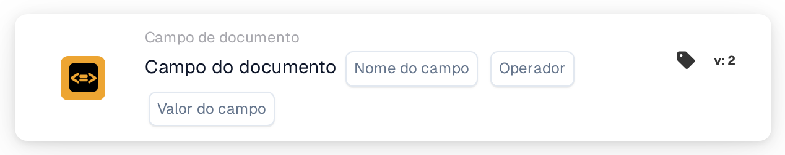

# Comparar um campo do documento com um valor de referência

<figure><figcaption>
Versão 1
</figcaption></figure>

<figure><figcaption>
Versão 2
</figcaption></figure>



**Vídeo:** Cartão: Campo do documento comparado com um valor · 0:43 · [Legendas (WebVTT)](https://docbits-videos.fra1.cdn.digitaloceanspaces.com/settings-assistant/card-doc-field-value/v1/pt.vtt)

Transcrição

**Campo do documento comparado com um valor** · [0:00](https://docbits-videos.fra1.cdn.digitaloceanspaces.com/settings-assistant/card-doc-field-value/v1/pt.mp4#t=0.25)

O cartão Campo do documento compara um campo do documento com um valor que você digita. Escolha o campo, por exemplo Montante total, depois o operador, aqui Maior que, e o valor, dez mil.

**Texto, números, datas** · [0:18](https://docbits-videos.fra1.cdn.digitaloceanspaces.com/settings-assistant/card-doc-field-value/v1/pt.mp4#t=18.916)

Campos de texto só podem ser iguais ou diferentes, e maiúsculas não importam. Números e datas também podem ser maiores ou menores que o valor. Se o campo não estiver no documento, o cartão segue o seu caminho de erro.

**Exemplo: faturas grandes precisam de uma segunda aprovação** · [0:32](https://docbits-videos.fra1.cdn.digitaloceanspaces.com/settings-assistant/card-doc-field-value/v1/pt.mp4#t=32.883)

Por exemplo, uma segunda aprovação para faturas grandes: Montante total maior que dez mil, depois o cartão de atribuição para o financeiro. Faturas menores não chegam a esta etapa.

## **Propósito:**

Este cartão compara um campo do documento com um valor que introduz no cartão. Utilize-o para encaminhar documentos por caminhos diferentes consoante o valor de um campo, por exemplo uma segunda aprovação para faturas de valor elevado ou um percurso especial para alguns fornecedores.

O cartão lê-se: **Campo do documento** [Nome do campo] [Operador] [Valor do campo].

## **Componentes do cartão:**

1. **Nome do campo**
   * O campo do documento a verificar, escolhido entre os campos do tipo de documento.
2. **Operador**
   * A forma como o valor do campo é comparado com o **Valor do campo**. Os operadores adequados dependem do tipo do campo, consulte **Operadores** abaixo.
3. **Valor do campo**
   * O valor com que se compara. Consoante o operador, é um valor único, uma lista separada por vírgulas ou uma expressão regular.

## **Operadores:**

| Operador | Cumprido quando | Tipos de campo |
| --- | --- | --- |
| **É igual a** (=) | o valor do campo é igual ao Valor do campo | texto, número, montante, data |
| **Não é igual a** (≠) | o valor do campo é diferente do Valor do campo | texto, número, montante, data |
| **Maior que** (>) | o valor do campo é maior do que o Valor do campo | número, montante, data |
| **Maior ou igual** (≥) | o valor do campo é maior ou igual ao Valor do campo | número, montante, data |
| **Menor que** (<) | o valor do campo é menor do que o Valor do campo | número, montante, data |
| **Menor ou igual** (≤) | o valor do campo é menor ou igual ao Valor do campo | número, montante, data |
| **É um de** | o valor do campo é igual a um elemento de uma lista separada por vírgulas | texto |
| **Não é nenhum de** | o valor do campo não é igual a nenhum elemento da lista | texto |
| **Corresponde à regex** | a expressão regular é encontrada no valor do campo | texto, número, montante, data |
| **Não corresponde à regex** | a expressão regular não é encontrada no valor do campo | texto, número, montante, data |

Os campos booleanos (caixas de verificação) não são suportados por este cartão. Para eles, utilize **Checkbox is checked**.

### É igual a e Não é igual a em campos de texto

O texto é comparado sem distinguir maiúsculas de minúsculas, e um espaço conta o mesmo que um sublinhado: `Acme Freight` é igual a `acme_freight`. Os espaços no início e no fim são ignorados.

### É um de e Não é nenhum de

Utilize estes operadores para verificar um campo de texto em relação a vários valores de uma só vez, por exemplo uma lista de IDs de fornecedor.

* Introduza os valores como uma lista separada por vírgulas: `40321,40322,40388`.
* O valor do campo tem de ser exatamente igual a um elemento. Um valor parcial não corresponde: `4032` não pertence a `40321,40322,40388`, nem um valor mais longo como `403210`.
* As maiúsculas não importam, e um espaço conta o mesmo que um sublinhado. Os espaços à volta dos elementos são ignorados, e os elementos vazios, como o de `a,,b`, são saltados.
* Para usar uma vírgula dentro de um valor, escreva-a como `\,`. `Acme Freight\, LLC,Riverside Supply` é uma lista de dois elementos: `Acme Freight, LLC` e `Riverside Supply`.
* Um valor de campo vazio não pertence a nenhuma lista. Nesse caso, **É um de** não é cumprido e **Não é nenhum de** é cumprido.
* Estes operadores funcionam apenas em campos de texto. Num campo de número, montante ou data, ou com uma lista sem nenhum elemento (por exemplo, apenas vírgulas), o cartão termina com um erro.

### Corresponde à regex e Não corresponde à regex

Utilize estes operadores quando é um padrão que decide, por exemplo «começa por» ou «é composto apenas por dígitos».

* O **Valor do campo** é uma expressão regular com sintaxe Python. É procurada em qualquer posição do valor do campo: `Freight` corresponde a `Acme Freight, LLC`.
* Utilize `^` e `$` para verificar o valor completo: `^33` significa «começa por 33», e `^(40321|40322|40388)$` significa «exatamente um destes valores».
* O padrão distingue maiúsculas de minúsculas. Comece-o com `(?i)` para ignorar as maiúsculas: `(?i)freight` também corresponde a `Acme Freight, LLC`.
* `^` e `$` referem-se ao valor do campo completo. Comece o padrão com `(?m)` para os aplicar a cada linha de um valor com várias linhas.
* O padrão é usado exatamente como o escreve. Não é aparado e as maiúsculas são mantidas, pelo que `\D` (qualquer carácter que não seja um dígito) mantém o seu significado, e um padrão composto por um único espaço procura um espaço.
* Os caracteres com significado especial em expressões regulares têm de ser escapados para corresponderem literalmente: `\(copy\)` corresponde ao texto `(copy)`, enquanto `(copy)` é um grupo que encontra a palavra `copy`.
* Os números, montantes e datas são comparados como o texto com que estão guardados: um montante de 997.60 corresponde a `^997\.60$`.
* Um valor de campo vazio é tratado como texto vazio, pelo que `^$` lhe corresponde.
* Um padrão inválido, por exemplo `(20` com um parêntese em falta, termina o cartão com um erro. O mesmo acontece quando um padrão demora demasiado tempo num valor (mais de 0,05 segundos), o que só ocorre com padrões mal construídos como `(a|aa)+$`. Em ambos os casos, a condição não é considerada nem cumprida nem não cumprida, pelo que **Não corresponde à regex** nunca passa por causa de um padrão defeituoso.

## **Como funciona o cartão:**

* **Campo não existe no documento:** se o documento não tiver nenhum campo com o nome escolhido, o cartão para e indica que o campo não foi encontrado, seja qual for o operador.
* **Condição cumprida:** o Workflow continua com o cartão seguinte (no Advanced Workflow, pela saída de sucesso).
* **Condição não cumprida:** o Workflow para neste cartão (no Advanced Workflow, segue pela saída de condição não cumprida).
* **Erro:** um operador que não se adequa ao tipo de campo, um Valor do campo em falta, uma lista vazia ou um padrão inutilizável terminam o cartão com um erro. O registo do cartão mostra o motivo.

## **Configuração:**

Escolha o campo em **Nome do campo**, o operador em **Operador** e introduza o valor em **Valor do campo**. Para números e montantes, introduza o valor sem símbolo monetário e com ponto decimal, por exemplo `1000.50`.

Para experimentar uma configuração sem esperar por um documento, abra o menu do cartão no Workflow Builder, escolha **Test Card**, selecione um documento e escolha **Test on Document**. O registo do cartão mostra o valor do campo, o operador e o resultado.

## **Exemplos:**

| Objetivo | Nome do campo | Operador | Valor do campo | Valor do campo no documento | Resultado |
| --- | --- | --- | --- | --- | --- |
| Segunda aprovação para faturas de valor elevado | Montante total | Maior que | `10000` | 12500.00 | cumprida |
| Encaminhar alguns fornecedores | ID do fornecedor | É um de | `40321,40322,40388` | 40322 | cumprida |
| | | | | 4032 | não cumprida |
| Excluir um fornecedor com uma vírgula no nome | Nome do fornecedor | Não é nenhum de | `Acme Freight\, LLC` | Acme Freight, LLC | não cumprida |
| Números de encomenda que começam por 33 | Número de encomenda | Corresponde à regex | `^33` | 33012 | cumprida |
| | | | | 13301 | não cumprida |
| Referência com letras | Referência | Corresponde à regex | `\D` | AB-1204 | cumprida |
| Cópias de faturas | Número da fatura | Não corresponde à regex | `\(copy\)` | INV-1204 (copy) | não cumprida |

## **Conclusão:**

O cartão verifica um único campo do documento em relação a um valor, uma lista ou um padrão. Utilize **É um de** para listas fixas de valores e **Corresponde à regex** para padrões como prefixos ou formatos.

<!-- workflow-card-practical-example-20261021 -->

## Exemplo prático

**Quando usar:** Revise faturas acima de um valor definido.

**Configuração:** Selecione o campo numérico `total_amount`, operador `>` e valor de referência `1000`.

**Resultado esperado e contra-exemplo:** Um valor de `1200` satisfaz a condição. Os valores `1000` e `900` não a satisfazem: o operador `>` exige um valor superior a `1000`.

Esta é uma configuração ilustrativa e resultado esperado. Utilize campos, usuários e grupos configurados em sua organização de teste; não é uma afirmação de que este exemplo foi executado.
