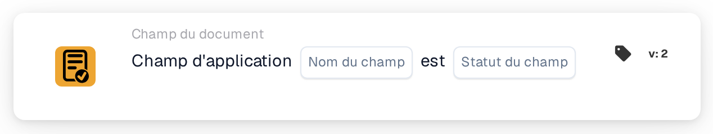

# Vérifier la présence et le contenu d’un champ

<figure><figcaption>
Version 1
</figcaption></figure>

<figure><figcaption>
Version 2
</figcaption></figure>



**Vidéo:** Carte: Champ vide ou non · 0:47 · [Sous-titres (WebVTT)](https://docbits-videos.fra1.cdn.digitaloceanspaces.com/settings-assistant/card-docfield-status/v1/fr.vtt)

Transcription

**Champ vide ou non** · [0:00](https://docbits-videos.fra1.cdn.digitaloceanspaces.com/settings-assistant/card-docfield-status/v1/fr.mp4#t=0.25)

La carte Le champ est vérifie si un champ du document est vide. Choisissez le champ, par exemple Bon de commande, et le statut : vide ou absent du document, ou présent dans le document et non vide.

**Absent compte comme vide** · [0:18](https://docbits-videos.fra1.cdn.digitaloceanspaces.com/settings-assistant/card-docfield-status/v1/fr.mp4#t=18.716)

Un champ compte comme vide s'il n'a pas de valeur, seulement des espaces, une case non cochée ou une liste vide. Un champ absent du document compte aussi comme vide. Si le statut correspond, la carte est vraie. Sinon, elle est fausse.

**Exemple : pas de bon de commande** · [0:34](https://docbits-videos.fra1.cdn.digitaloceanspaces.com/settings-assistant/card-docfield-status/v1/fr.mp4#t=34.45)

Par exemple, une facture sans bon de commande va à l'approbateur des factures sans commande. Les factures avec un bon de commande prennent l'autre chemin, par exemple le rapprochement de commande.

## Quand l’utiliser

Utilisez cette carte pour vérifier si un champ du document est vide ou absent, par exemple lorsqu’une facture sans numéro nécessite un contrôle supplémentaire. Il s’agit d’une condition ; configurez séparément l’action suivante.

**Emplacement :** Workflow standard → conditions supplémentaires (AND) → Champ du document.

## Configuration — version 2

| Paramètre | Valeur de l’exemple |
| --- | --- |
| Champ | `invoice_id` — numéro de facture |
| État du champ | Vide ou absent (`field_empty`) |

Sélectionnez un champ réellement configuré dans votre organisation. L’option `field_not_empty` vérifie si le champ contient une valeur.

<!-- workflow-card-practical-example-20261021 -->

## Exemple pratique

| Valeur de l’exemple | Résultat attendu pour `field_empty` |
| --- | --- |
| Champ vide ou absent | Condition satisfaite |
| `DEMO-001` | Condition non satisfaite |
| Numéro présent mais incorrect | Condition non satisfaite — le champ contient toujours une valeur |

Ces exemples présentent les résultats attendus. Pour vérifier la validité du numéro lui-même, ajoutez une condition adaptée à son contenu ; cette carte vérifie l’état du champ. Dans la version 2, les espaces en début et en fin de texte sont supprimés avant de vérifier si le champ est vide.

## Vidéo d’exemple avec un administrateur

Quand j’utilise cette carte, où la trouver et comment repérer les numéros de facture manquants. Les exemples présentent les résultats attendus.



[Ouvrir la vidéo avec les sous-titres français](https://docbits-videos.fra1.cdn.digitaloceanspaces.com/settings-assistant/workflow-card-field-status-admin/v1/fr-theme-v4.html)

[Lire la transcription](https://docbits-videos.fra1.cdn.digitaloceanspaces.com/settings-assistant/workflow-card-field-status-admin/v1/fr.txt)
