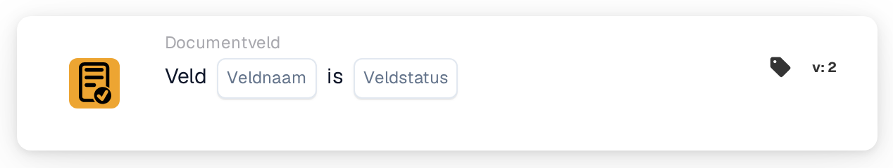

# Aanwezigheid en inhoud van een documentveld controleren

<figure><figcaption>
Versie 1
</figcaption></figure>

<figure><figcaption>
Versie 2
</figcaption></figure>



**Video:** Kaart: Veld leeg of niet · 0:45 · [Ondertitels (WebVTT)](https://docbits-videos.fra1.cdn.digitaloceanspaces.com/settings-assistant/card-docfield-status/v1/nl.vtt)

Transcriptie

**Veld leeg of niet** · [0:00](https://docbits-videos.fra1.cdn.digitaloceanspaces.com/settings-assistant/card-docfield-status/v1/nl.mp4#t=0.25)

De kaart Veld is controleert of een veld van het document leeg is. Kies het veld, bijvoorbeeld Inkooporder, en de status: leeg of niet in het document, of in het document en niet leeg.

**Ontbrekend telt als leeg** · [0:18](https://docbits-videos.fra1.cdn.digitaloceanspaces.com/settings-assistant/card-docfield-status/v1/nl.mp4#t=18.716)

Een veld telt als leeg als het geen waarde heeft, alleen spaties, een niet aangevinkt selectievakje of een lege lijst. Een veld dat niet in het document staat, telt ook als leeg. Klopt de status, dan is de kaart waar. Anders is ze onwaar.

**Voorbeeld: geen inkooporder** · [0:33](https://docbits-videos.fra1.cdn.digitaloceanspaces.com/settings-assistant/card-docfield-status/v1/nl.mp4#t=33.816)

Een factuur zonder inkooporder gaat bijvoorbeeld naar de goedkeurder voor facturen zonder order. Facturen met een inkooporder nemen het andere pad, bijvoorbeeld de ordermatch.

## Wanneer gebruiken

Gebruik deze kaart om te controleren of een documentveld leeg is of ontbreekt, bijvoorbeeld wanneer een factuur zonder factuurnummer extra controle nodig heeft. Dit is een voorwaarde; stel de daaropvolgende actie afzonderlijk in.

**Locatie:** Standaardworkflow → aanvullende voorwaarden (AND) → Documentveld.

## Configuratie — versie 2

| Instelling | Voorbeeldwaarde |
| --- | --- |
| Veld | `invoice_id` — factuurnummer |
| Veldstatus | Leeg of ontbrekend (`field_empty`) |

Selecteer een veld dat daadwerkelijk in uw organisatie is geconfigureerd. De optie `field_not_empty` controleert of het veld een waarde bevat.

<!-- workflow-card-practical-example-20261021 -->

## Praktisch voorbeeld

| Voorbeeldwaarde | Verwacht resultaat voor `field_empty` |
| --- | --- |
| Leeg of ontbrekend veld | Voorwaarde vervuld |
| `DEMO-001` | Voorwaarde niet vervuld |
| Nummer aanwezig maar onjuist | Voorwaarde niet vervuld — het veld bevat nog steeds een waarde |

Dit zijn voorbeelden van verwachte resultaten. Voeg een passende inhoudsvoorwaarde toe om het nummer zelf te controleren; deze kaart controleert de veldstatus. In versie 2 worden spaties aan het begin en einde van tekst verwijderd voordat wordt gecontroleerd of het veld leeg is.

## Voorbeeldvideo met een beheerder

Wanneer ik deze kaart gebruik, waar deze staat en hoe ik ontbrekende factuurnummers vind. De voorbeelden tonen verwachte resultaten.



[Video met Nederlandse ondertitels openen](https://docbits-videos.fra1.cdn.digitaloceanspaces.com/settings-assistant/workflow-card-field-status-admin/v1/nl-theme-v4.html)

[Transcript lezen](https://docbits-videos.fra1.cdn.digitaloceanspaces.com/settings-assistant/workflow-card-field-status-admin/v1/nl.txt)
