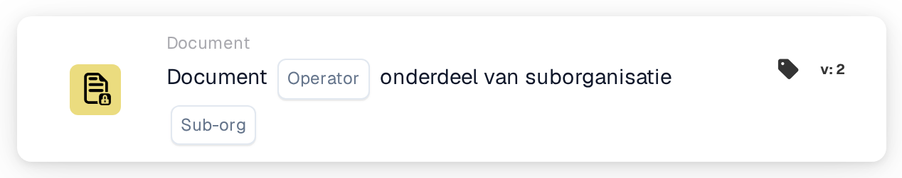

# Documentoperator voor suborganisaties

<figure><figcaption>
Versie 2
</figcaption></figure>



**Video:** Kaart: Document onderdeel van een suborganisatie · 0:44 · [Ondertitels (WebVTT)](https://docbits-videos.fra1.cdn.digitaloceanspaces.com/settings-assistant/card-sub-org/v1/nl.vtt)

Transcriptie

**Document onderdeel van een suborganisatie** · [0:00](https://docbits-videos.fra1.cdn.digitaloceanspaces.com/settings-assistant/card-sub-org/v1/nl.mp4#t=0.25)

De kaart Document onderdeel van suborganisatie controleert bij welke suborganisatie een document hoort. Kies Is of Is niet en dan de suborganisatie, bijvoorbeeld Munich plant.

**Precies één suborganisatie** · [0:16](https://docbits-videos.fra1.cdn.digitaloceanspaces.com/settings-assistant/card-sub-org/v1/nl.mp4#t=16.583)

De kaart vergelijkt precies deze suborganisatie. Heeft het document geen suborganisatie, dan neemt de kaart het foutpad. Om meerdere suborganisaties tegelijk te controleren, gebruikt u de kaart in een van de volgende suborganisaties.

**Voorbeeld: facturen van één vestiging** · [0:33](https://docbits-videos.fra1.cdn.digitaloceanspaces.com/settings-assistant/card-sub-org/v1/nl.mp4#t=33.416)

Bijvoorbeeld: facturen van Munich plant gaan naar het boekhoudteam in München. Documenten van andere suborganisaties bereiken deze stap niet.

## Doel:

Deze workflow-kaart evalueert of een document deel uitmaakt van een specifieke suborganisatie. Op basis van deze evaluatie kan de workflow doorgaan of verschillende acties triggeren, afhankelijk van de vraag of het document al dan niet aan de opgegeven suborganisatie is gekoppeld.

## Onderdelen van de kaart:

1. **Exploitant**
   * **Beschrijving:** Definieert of het document wel of niet deel moet uitmaken van de opgegeven suborganisatie.
   * **Opties:**
     * **Is:** Het document moet deel uitmaken van de opgegeven suborganisatie om de voorwaarde true te maken.
     * **Is niet:** Het document mag geen deel uitmaken van de opgegeven suborganisatie om de voorwaarde true te maken.
2. **Sub-org**
   * **Beschrijving:** Geeft de suborganisatie op waarmee het document wordt vergeleken.
   * **Details:** Dit moet overeenkomen met de identifier van de suborganisatie. De vergelijking controleert of het document tot de opgegeven suborganisatie behoort.

## Functionaliteit:

* **Voorwaarde-evaluatie:** Het systeem evalueert of het document deel uitmaakt van de opgegeven suborganisatie. Bij deze evaluatie wordt de suborganisatie van het document vergeleken met die welke door de gebruiker is opgegeven.
* **Actie-uitvoering:**
  * **True-voorwaarde:**\
    Als het document deel uitmaakt van de opgegeven suborganisatie, gaat de workflow verder met de true-voorwaarde. Dit kan verdere acties triggeren, zoals het omleiden van het document naar een specifieke afdeling, het toepassen van suborganisatiespecifieke regels of het inschakelen van functies die op die suborganisatie zijn afgestemd.
  * **False-voorwaarde:**\
    Als het document geen deel uitmaakt van de opgegeven suborganisatie, gaat de workflow verder met de false-voorwaarde. Hiermee kunnen alternatieve acties worden uitgevoerd, zoals het verzenden van meldingen, het stoppen van de workflow of het toepassen van algemene regels buiten het bereik van de suborganisatie.

## Opzet en configuratie:

* Gebruikers configureren de kaart door het documentveld met het document te selecteren en de suborganisatie op te geven waarmee wordt vergeleken. De operator wordt vervolgens uit een dropdownlijst gekozen om te definiëren of het document wel of niet deel moet uitmaken van de opgegeven suborganisatie. Ten slotte stellen gebruikers de doorgaan-voorwaarde (true of false) in, die de volgende stap in de workflow bepaalt.

## Conclusie:

De workflow-kaart "Document in Sub-organization" is een handig hulpmiddel voor het automatiseren van acties op basis van de vraag of een document tot een bepaalde suborganisatie behoort. Door ervoor te zorgen dat documenten volgens suborganisatiespecifieke regels worden verwerkt, verbetert deze kaart de workflow-efficiëntie en zorgt hij ervoor dat acties binnen de juiste organisatorische context worden uitgevoerd.

<!-- workflow-card-practical-example-20261021 -->

## Praktisch voorbeeld

**Wanneer gebruiken:** Documenten routeren die tot één bedrijfseenheid behoren.

**Configuratie:** Selecteer suborganisatie `Demo North` en de gelijk-operator.

**Verwacht resultaat en tegenvoorbeeld:** Een document in `Demo North` is geslaagd. Een document in `Demo South` mislukt.

Dit is een illustratieve configuratie en een verwacht resultaat. Gebruik velden, gebruikers en groepen die in uw testorganisatie zijn geconfigureerd; het is geen bewering dat dit voorbeeld is uitgevoerd.
