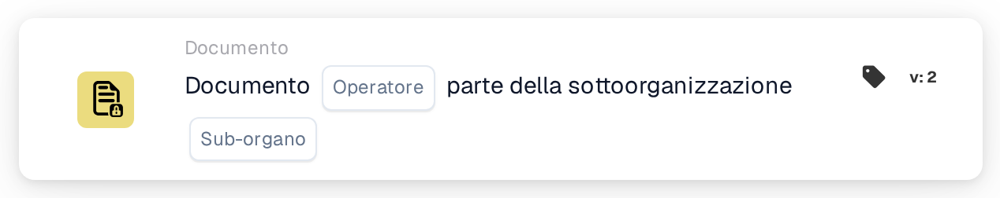

# Operatore documentale per le sotto-organizzazioni

<figure><figcaption>
Versione 2
</figcaption></figure>



**Video:** Scheda: Documento parte di una sotto-organizzazione · 0:44 · [Sottotitoli (WebVTT)](https://docbits-videos.fra1.cdn.digitaloceanspaces.com/settings-assistant/card-sub-org/v1/it.vtt)

Trascrizione

**Documento parte di una sotto-organizzazione** · [0:00](https://docbits-videos.fra1.cdn.digitaloceanspaces.com/settings-assistant/card-sub-org/v1/it.mp4#t=0.25)

La scheda Documento parte della sottoorganizzazione controlla a quale sotto-organizzazione appartiene un documento. Scegli È o Non è e poi la sotto-organizzazione, per esempio Munich plant.

**Esattamente una sotto-organizzazione** · [0:16](https://docbits-videos.fra1.cdn.digitaloceanspaces.com/settings-assistant/card-sub-org/v1/it.mp4#t=16.916)

La scheda confronta esattamente questa sotto-organizzazione. Se il documento non ha una sotto-organizzazione, la scheda prende il suo percorso di errore. Per controllare più sotto-organizzazioni insieme, usa la scheda in una delle seguenti sotto-organizzazioni.

**Esempio: le fatture di uno stabilimento** · [0:33](https://docbits-videos.fra1.cdn.digitaloceanspaces.com/settings-assistant/card-sub-org/v1/it.mp4#t=33.616)

Per esempio, le fatture di Munich plant vanno al team contabilità di Monaco. I documenti di altre sotto-organizzazioni non arrivano a questo passo.

## Scopo:

Questa scheda di workflow valuta se un documento fa parte di una specifica sotto-organizzazione. In base a questa valutazione, il workflow può proseguire o attivare azioni diverse a seconda che il documento sia associato o meno alla sotto-organizzazione specificata.

## Componenti della scheda:

1. **Operatore**
   * **Descrizione:** Definisce se il documento deve far parte o meno della sotto-organizzazione specificata.
   * **Opzioni:**
     * **Is:** Il documento deve far parte della sotto-organizzazione specificata affinché la condizione sia vera.
     * **Non è:** Il documento non deve far parte della sotto-organizzazione specificata affinché la condizione sia vera.
2. **Sotto-organizzazione**
   * **Descrizione:** Specifica la sotto-organizzazione con cui il documento deve essere confrontato.
   * **Dettaglio:** Deve corrispondere all'identificatore della sotto-organizzazione. Il confronto verifica se il documento appartiene alla sotto-organizzazione specificata.

## Funzionalità:

* **Valutazione della condizione:** Il sistema valuta se il documento fa parte della sotto-organizzazione specificata. Questa valutazione confronta la sotto-organizzazione del documento con quella fornita dall'utente.
* **Esecuzione dell'azione:**
  * **Condizione vera:**\
    Se il documento fa parte della sotto-organizzazione specificata, il workflow prosegue con la condizione vera. Ciò potrebbe attivare ulteriori azioni, come l'instradamento del documento a un reparto specifico, l'applicazione di regole specifiche della sotto-organizzazione o l'abilitazione di funzionalità su misura per tale sotto-organizzazione.
  * **Condizione falsa:**\
    Se il documento non fa parte della sotto-organizzazione specificata, il workflow prosegue con la condizione falsa. Ciò consente di eseguire azioni alternative, come l'invio di notifiche, l'arresto del workflow o l'applicazione di regole generali al di fuori dell'ambito della sotto-organizzazione.

## Configurazione e impostazione:

* Gli utenti configurano la scheda selezionando il campo del documento che contiene il documento e specificando la sotto-organizzazione con cui effettuare il confronto. L'operatore viene quindi scelto da un menu a discesa per definire se il documento debba o meno far parte della sotto-organizzazione specificata. Infine, gli utenti impostano la condizione di continuazione (vera o falsa), che determina il passaggio successivo nel workflow.

## Conclusione:

La scheda di workflow "Document in Sub-organization" è uno strumento utile per automatizzare le azioni in base al fatto che un documento appartenga o meno a una particolare sotto-organizzazione. Garantendo che i documenti vengano elaborati secondo le regole specifiche della sotto-organizzazione, questa scheda migliora l'efficienza del workflow e assicura che le azioni vengano eseguite nel corretto contesto organizzativo.

<!-- workflow-card-practical-example-20261021 -->

## Esempio pratico

**Quando utilizzarlo:** Instradare i documenti appartenenti ad una business unit.

**Configurazione:** Seleziona la sottoorganizzazione `Demo North` e l'operatore uguale.

**Risultato atteso e controesempio:** Un documento in `Demo North` passa. Un documento in `Demo South` fallisce.

Questa è una configurazione illustrativa e il risultato atteso. Utilizza campi, utenti e gruppi configurati nella tua organizzazione di test; non si afferma che questo esempio sia stato eseguito.
