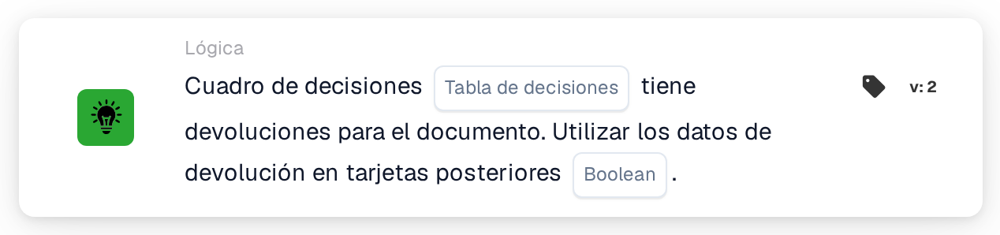
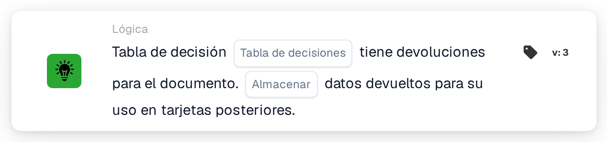

# La tabla de decisiones devuelve resultados

<figure><figcaption>
Versión 2
</figcaption></figure>

<figure><figcaption>
Versión 3
</figcaption></figure>



**Vídeo:** Tarjeta: Tabla de decisión devuelve resultados · 0:45 · [Subtítulos (WebVTT)](https://docbits-videos.fra1.cdn.digitaloceanspaces.com/settings-assistant/card-decision-table/v1/es.vtt)

Transcripción

**Tabla de decisión devuelve resultados** · [0:00](https://docbits-videos.fra1.cdn.digitaloceanspaces.com/settings-assistant/card-decision-table/v1/es.mp4#t=0.25)

La tarjeta Tabla de decisión devuelve resultados ejecuta una tabla de decisión para el documento. Elija la tabla, por ejemplo Example approvers, y si sus datos devueltos se almacenan para las siguientes tarjetas.

**Una fila que coincide significa verdadero** · [0:16](https://docbits-videos.fra1.cdn.digitaloceanspaces.com/settings-assistant/card-decision-table/v1/es.mp4#t=16.75)

Si una fila de la tabla coincide con el documento, la tarjeta es verdadera. Si ninguna fila coincide, es falsa. Los datos almacenados los usan tarjetas posteriores, como las de asignación. Un Workflow guarda solo el último resultado almacenado.

**Ejemplo: aprobadores desde una tabla** · [0:31](https://docbits-videos.fra1.cdn.digitaloceanspaces.com/settings-assistant/card-decision-table/v1/es.mp4#t=31.983)

Por ejemplo, la tabla encuentra los aprobadores para el importe de la factura y los almacena, y la siguiente tarjeta les asigna la factura. Si la tabla no encuentra a nadie, la tarjeta es falsa y la asignación no se ejecuta.

## **Propósito:**

Esta tarjeta de DocBits comprueba si una tabla de decisión especificada tiene valores de retorno para un documento dado y determina si los datos devueltos deben utilizarse en los pasos posteriores del flujo de trabajo. Garantiza que los flujos de trabajo puedan adaptarse dinámicamente según los resultados de la tabla de decisión.

## **Funcionalidad:**

* **Validación de la tabla de decisión:** Esta tarjeta verifica si la tabla de decisión seleccionada proporciona valores de retorno para el documento que se está procesando.
* **Selección de la tabla de decisión:** Los usuarios especifican el nombre de la tabla de decisión que se comprobará.
* **Usar los datos de retorno:** Los usuarios pueden especificar si utilizar los datos de retorno en tarjetas posteriores con una configuración **Booleano**:
  * **True:** Los datos de retorno están disponibles y se utilizarán en los pasos posteriores del flujo de trabajo.
  * **False:** Los datos de retorno no se utilizarán y el flujo de trabajo continúa sin ellos.

## **Uso:**

Esta tarjeta es ideal para flujos de trabajo que implican lógica condicional o toma de decisiones basada en reglas predefinidas en una tabla de decisión. Garantiza una integración fluida de los resultados de la tabla de decisión en los procesos del flujo de trabajo.

## **Ejemplo de escenario:**

* Un usuario configura la tarjeta para comprobar la tabla de decisión **"Reglas de procesamiento de facturas"** en busca de valores de retorno. El **Booleano** se establece en **True**, lo que indica que los datos de retorno (p. ej., requisitos de aprobación) se utilizarán en tarjetas posteriores para guiar las decisiones del flujo de trabajo.

Al usar la tarjeta "Decision Table Check", las organizaciones pueden mejorar la flexibilidad del flujo de trabajo, agilizar el procesamiento basado en reglas y garantizar la coherencia en la toma de decisiones en los flujos de trabajo automatizados.
