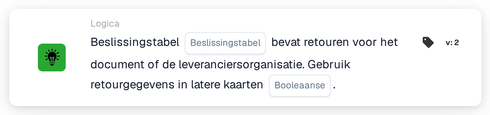
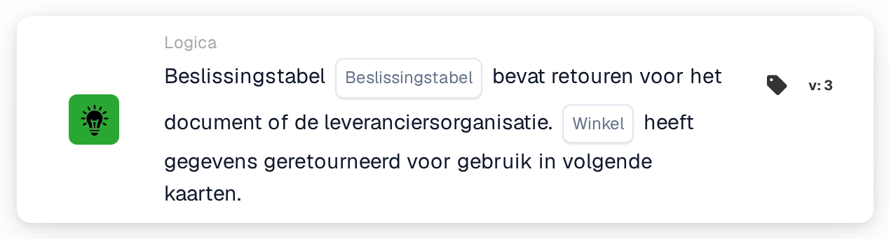

# Beslissingstabel geeft resultaten terug

<figure><figcaption>
Versie 2
</figcaption></figure>

<figure><figcaption>
Versie 3
</figcaption></figure>



**Video:** Kaart: Beslissingstabel bevat resultaten · 0:46 · [Ondertitels (WebVTT)](https://docbits-videos.fra1.cdn.digitaloceanspaces.com/settings-assistant/card-decision-table/v1/nl.vtt)

Transcriptie

**Beslissingstabel bevat resultaten** · [0:00](https://docbits-videos.fra1.cdn.digitaloceanspaces.com/settings-assistant/card-decision-table/v1/nl.mp4#t=0.25)

De kaart Beslissingstabel bevat resultaten voert een beslissingstabel uit voor het document. Kies de tabel, bijvoorbeeld Example approvers, en of de geretourneerde gegevens voor de volgende kaarten worden bewaard.

**Een passende rij betekent waar** · [0:17](https://docbits-videos.fra1.cdn.digitaloceanspaces.com/settings-assistant/card-decision-table/v1/nl.mp4#t=17.883)

Past een rij van de tabel bij het document, dan is de kaart waar. Past geen rij, dan is ze onwaar. Bewaarde gegevens gebruiken latere kaarten, zoals de toewijzingskaarten. Een Workflow houdt alleen het laatst bewaarde resultaat.

**Voorbeeld: goedkeurders uit een tabel** · [0:32](https://docbits-videos.fra1.cdn.digitaloceanspaces.com/settings-assistant/card-decision-table/v1/nl.mp4#t=32.483)

Bijvoorbeeld: de tabel vindt de goedkeurders voor het factuurbedrag en bewaart ze, en de volgende kaart wijst hun de factuur toe. Vindt de tabel niemand, dan is de kaart onwaar en draait de toewijzing niet.

## **Doel:**

Deze DocBits-kaart controleert of een opgegeven beslistabel retourwaarden voor een bepaald document heeft en bepaalt of de geretourneerde gegevens in volgende workflow-stappen moeten worden gebruikt. Hij zorgt ervoor dat workflows zich dynamisch kunnen aanpassen op basis van de uitkomsten van de beslistabel.

## **Functionaliteit:**

* **Beslistabelvalidatie:** Deze kaart verifieert of de geselecteerde beslistabel retourwaarden levert voor het document dat wordt verwerkt.
* **Beslistabelselectie:** Gebruikers geven de naam op van de te controleren beslistabel.
* **Retourgegevens gebruiken:** Gebruikers kunnen met een **Booleaans**-instelling opgeven of de retourgegevens in latere kaarten moeten worden gebruikt:
  * **True:** De retourgegevens zijn beschikbaar en worden in volgende workflow-stappen gebruikt.
  * **False:** De retourgegevens worden niet gebruikt en de workflow gaat er zonder verder.

## **Gebruik:**

Deze kaart is ideaal voor workflows met voorwaardelijke logica of besluitvorming op basis van vooraf gedefinieerde regels in een beslistabel. Hij zorgt voor naadloze integratie van de uitvoer van de beslistabel in workflowprocessen.

## **Voorbeeldscenario:**

* Een gebruiker configureert de kaart om de beslistabel **"Regels voor factuurverwerking"** op retourwaarden te controleren. De **Booleaans** is ingesteld op **True**, wat aangeeft dat de retourgegevens (bijv. goedkeuringsvereisten) in latere kaarten worden gebruikt om workflow-beslissingen te sturen.

Door de kaart "Decision Table Check" te gebruiken, kunnen organisaties de workflow-flexibiliteit verbeteren, regelgebaseerde verwerking stroomlijnen en consistentie in de besluitvorming over geautomatiseerde workflows heen waarborgen.
