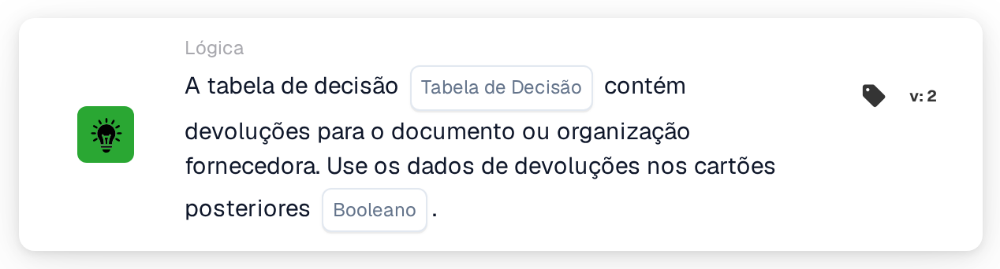
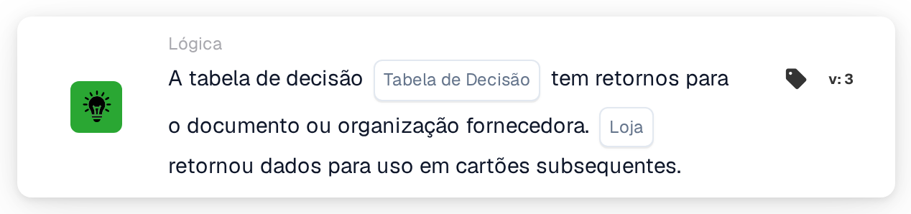

# A tabela de decisão devolve resultados

<figure><figcaption>
Versão 2
</figcaption></figure>

<figure><figcaption>
Versão 3
</figcaption></figure>



**Vídeo:** Cartão: Tabela de decisão tem valores de retorno · 0:46 · [Legendas (WebVTT)](https://docbits-videos.fra1.cdn.digitaloceanspaces.com/settings-assistant/card-decision-table/v1/pt.vtt)

Transcrição

**Tabela de decisão tem valores de retorno** · [0:00](https://docbits-videos.fra1.cdn.digitaloceanspaces.com/settings-assistant/card-decision-table/v1/pt.mp4#t=0.25)

O cartão Tabela de decisão tem valores de retorno executa a tabela para o documento. Escolha a tabela, por exemplo Example approvers, e se os dados retornados ficam guardados para os próximos cartões.

**Uma linha correspondente significa verdadeiro** · [0:16](https://docbits-videos.fra1.cdn.digitaloceanspaces.com/settings-assistant/card-decision-table/v1/pt.mp4#t=16.983)

Se uma linha da tabela corresponde ao documento, o cartão é verdadeiro. Se nenhuma linha corresponde, é falso. Os dados armazenados são usados por cartões posteriores, como os de atribuição. Um Workflow guarda só o último resultado armazenado.

**Exemplo: aprovadores de uma tabela** · [0:32](https://docbits-videos.fra1.cdn.digitaloceanspaces.com/settings-assistant/card-decision-table/v1/pt.mp4#t=32.783)

Por exemplo, a tabela encontra os aprovadores para o valor da fatura e os armazena, e o próximo cartão atribui a fatura a eles. Se a tabela não encontra ninguém, o cartão é falso e a atribuição não é executada.

## **Propósito:**

Este cartão DocBits verifica se uma tabela de decisão especificada tem valores de retorno para um determinado documento e determina se os dados retornados devem ser utilizados nos passos subsequentes do fluxo de trabalho. Assegura que os fluxos de trabalho se podem adaptar dinamicamente com base nos resultados da tabela de decisão.

## **Funcionalidade:**

* **Validação da tabela de decisão:** Este cartão verifica se a tabela de decisão selecionada fornece valores de retorno para o documento que está a ser processado.
* **Seleção da tabela de decisão:** Os utilizadores especificam o nome da tabela de decisão a verificar.
* **Utilizar dados de retorno:** Os utilizadores podem especificar se devem utilizar os dados de retorno em cartões posteriores através de uma definição **Booleano**:
  * **True:** Os dados de retorno estão disponíveis e serão utilizados nos passos subsequentes do fluxo de trabalho.
  * **False:** Os dados de retorno não serão utilizados e o fluxo de trabalho prossegue sem eles.

## **Utilização:**

Este cartão é ideal para fluxos de trabalho que envolvem lógica condicional ou tomada de decisões com base em regras predefinidas numa tabela de decisão. Assegura uma integração transparente dos resultados da tabela de decisão nos processos de fluxo de trabalho.

## **Exemplo de cenário:**

* Um utilizador configura o cartão para verificar a tabela de decisão **"Regras de processamento de faturas"** quanto a valores de retorno. O **Booleano** está definido como **True**, indicando que os dados de retorno (por exemplo, requisitos de aprovação) serão utilizados em cartões posteriores para orientar as decisões do fluxo de trabalho.

Ao utilizar o cartão "Decision Table Check", as organizações podem melhorar a flexibilidade do fluxo de trabalho, simplificar o processamento baseado em regras e assegurar consistência na tomada de decisões ao longo dos fluxos de trabalho automatizados.
