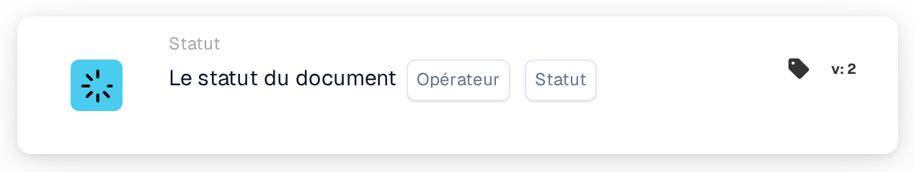

# Condition de statut de document unique

<figure><figcaption>
Version 2
</figcaption></figure>

**Objectif**

Cette carte de workflow est conçue pour gérer les opérations sur les documents en fonction d'un seul statut de document spécifié. En simplifiant la condition à un seul statut, la carte se concentre sur des déclencheurs de workflow très précis, ce qui la rend idéale pour des activités ciblées de traitement de documents au sein d'un système ERP.

**Composants de la carte**

1. **Opérateur**
   * **Descriptif** : spécifie la méthode d'évaluation du statut du document par rapport à la condition sélectionnée.
   * **Possibilités** :
     * **Est** : déclenche l'opération si le statut actuel du document correspond au statut sélectionné.
     * **N'est pas** : déclenche l'opération si le statut actuel du document ne correspond pas au statut sélectionné.
2. **Statut**
   * **Descriptif** : permet de sélectionner un seul statut de document pour définir la condition.
   * **Statuts disponibles** : Erreur, Erreur d'exportation, Terminé, Rejeté, Prêt pour la révision, Prêt pour la validation, Validé en attente d'approbation, Approuvé en attente de deuxième approbation, Exporté et TVA VERTEX REJETÉE.
   * **Détail** : les utilisateurs choisissent un statut dans une liste déroulante ou un ensemble de boutons radio. Ce statut sert ensuite de critère pour le fonctionnement de la carte.

**Fonctionnalité**

* **Identification du statut du document** : identifie le statut actuel d'un document à mesure qu'il est traité dans le système ERP.
* **Évaluation de la condition** :
  * En fonction de l'opérateur sélectionné (**Est** ou **N'est pas**), la carte vérifie si le statut actuel du document correspond au critère de statut choisi.
* **Exécution de l'action** :
  * **Condition vraie** : si le statut correspond (ou ne correspond pas, selon l'opérateur), l'action correspondante est lancée. Il peut s'agir d'un acheminement pour un traitement complémentaire, de la génération de notifications ou d'autres workflows prédéfinis.
  * **Condition fausse** : si la condition n'est pas satisfaite, aucune action n'est effectuée, ou un chemin alternatif est déclenché.
* **Intégration avec d'autres workflows** : bien qu'elle soit conçue pour l'évaluation d'un seul statut, cette carte peut être intégrée efficacement dans des séquences de workflow plus larges pour garantir un traitement précis des documents.

**Interactions utilisateur**

* **Mise en place et configuration** : les utilisateurs configurent la carte en sélectionnant un opérateur, puis en choisissant un statut parmi les options disponibles. Ce processus de sélection est simple et conçu pour éviter toute confusion.
* **Surveillance et reporting** : permet la surveillance via des rapports ou des tableaux de bord générés par le système qui suivent le traitement des documents en fonction de leur statut, aidant à superviser l'efficacité des workflows mis en œuvre.
* **Gestion des erreurs et notifications** : configurable pour alerter les utilisateurs en cas d'anomalies de traitement ou pour signaler les documents qui ne satisfont pas les conditions définies, garantissant une attention et une résolution rapides.

#### Conclusion

La carte de workflow « Single Document Status Condition » simplifie la gestion des documents en se concentrant sur des conditions de statut individuelles. Cette spécification est utile lorsqu'un contrôle précis des flux de documents est nécessaire, en particulier dans des environnements aux critères de traitement stricts. Documenter clairement cette version de la carte garantira que les utilisateurs comprennent pleinement son application et peuvent l'intégrer efficacement dans leurs opérations quotidiennes, améliorant à la fois la conformité et l'efficacité du traitement des documents.

<!-- workflow-card-complete-example-20261021 condition_doc_status_is_isnot -->

### Exemple de statut unique

**Configuration :** Choisissez l'opérateur **Est** et le statut **Validé en attente d'approbation**. Ajoutez une action de révision suivante appropriée pour ce statut.

**Résultat attendu et contre-exemple :** La condition est vraie pour un document actuellement **Validé en attente d'approbation** ; elle est fausse pour un document de statut **Prêt pour la validation**. Utilisez le statut actuellement sélectionné dans votre version. Changer un statut n’exporte pas en soi le document.

Il s'agit d'une configuration de test illustrative et du résultat attendu ; il n'a pas été exécuté. Utilisez les données et les destinataires configurés dans votre organisation de test.
