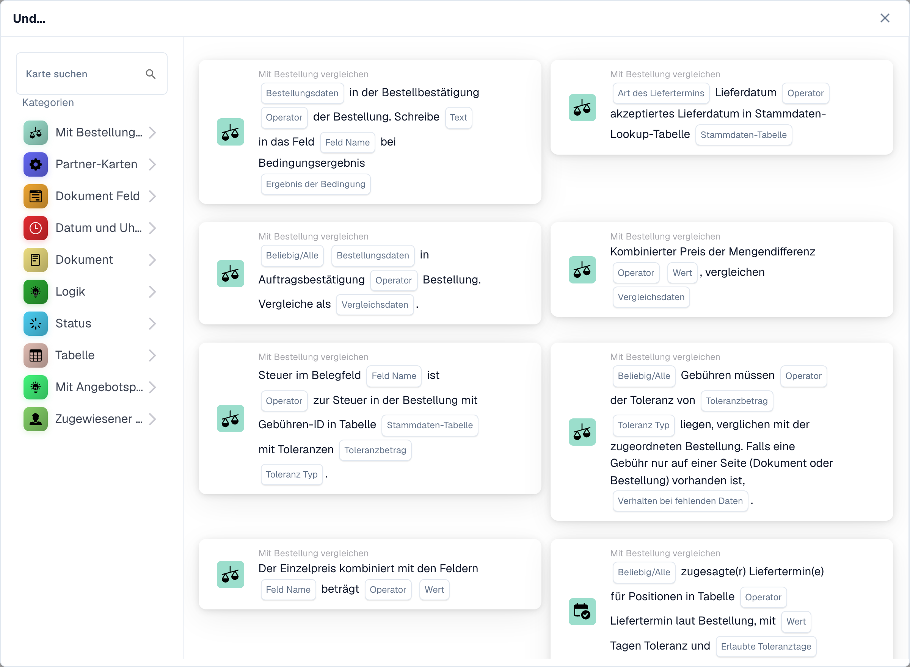

# Karten

Karten sind die Bausteine jedes Arbeitsablaufs. Sie kombinieren sie in den Gruppen **Wann / Und / Dann**, um zu beschreiben, wann ein Workflow ausgeführt wird und was er tut. In diesem Abschnitt werden die verfügbaren Karten und ihre Funktionen erläutert.

<figure><figcaption>
Verfügbare Karten der ausgewählten Kategorie. Füllen Sie die Platzhalter vor der Verwendung aus. Einzelne Beschriftungen dieser Kartenversion sind in der Oberfläche noch unübersetzt oder fachlich ungenau. Die Erläuterungen auf dieser Seite verwenden die passenden Begriffe.
</figcaption></figure>



**Video:** Karten finden: Suche und Kategorien · 0:46 · [Untertitel (WebVTT)](https://docbits-videos.fra1.cdn.digitaloceanspaces.com/settings-assistant/workflow-card-search/v1/de.vtt)

Transkript

**Die Kartenauswahl** · [0:00](https://docbits-videos.fra1.cdn.digitaloceanspaces.com/settings-assistant/workflow-card-search/v1/de.mp4#t=0.25)

Jede Karte kommt aus der Kartenauswahl. Klicken Sie auf Hinzufügen und wählen Sie die Art der Karte, hier Und. Die Auswahl zeigt alle Karten dieser Art.

**Kategorien: nur die Karten einer Art** · [0:12](https://docbits-videos.fra1.cdn.digitaloceanspaces.com/settings-assistant/workflow-card-search/v1/de.mp4#t=12.05)

Die Kategorien links ordnen die Karten danach, womit sie arbeiten: Dokumentfelder, Daten, Status, Tabellen und mehr. Klicken Sie auf eine Kategorie, um nur ihre Karten zu sehen. Klicken Sie erneut, um alle Karten zu sehen.

**Karte suchen: ein Wort aus dem Kartentext** · [0:28](https://docbits-videos.fra1.cdn.digitaloceanspaces.com/settings-assistant/workflow-card-search/v1/de.mp4#t=28.016)

Um eine Karte über ein Wort zu finden, tippen Sie es in Karte suchen. Die Suche prüft den Kartentext in Ihrer Sprache, über alle Kategorien.

**Suche in einer Kategorie** · [0:37](https://docbits-videos.fra1.cdn.digitaloceanspaces.com/settings-assistant/workflow-card-search/v1/de.mp4#t=37.75)

Ist eine Kategorie gewählt, sucht die Suche nur in dieser Kategorie. Klicken Sie auf eine Karte, um sie auf die Arbeitsfläche zu setzen.

## Kartengruppen

* **Wann** – die Auslöserkarten, die einen Workflow starten (z. B. Dokumenttyp, Dokumenttyp einer von).
* **Und** – Bedingungskarten, die ebenfalls erfüllt sein müssen, bevor die Aktionen ausgeführt werden. Dazu gehören _Vergleich mit Bestellung_ (PO-Abgleich), _Dokumentenfeldvergleiche, _Datum und Uhrzeit_, _Logik_, _Status_, _Tabelle_ und _Zuständiger_-Bedingungen.
* **Dann** – Aktionskarten, die die Arbeit erledigen: Felder festlegen, genehmigen/ablehnen, Status ändern, exportieren, Aufgaben erstellen, Dokumente zuweisen, Tabellen bearbeiten und Aktionen ausführen (API aufrufen, HTTPS-Anfrage senden, Workflow ausführen, KI-Berechnungen).

## Kartenreferenzhandbücher

Eine vollständige Referenz zu jeder Karte und ihren Optionen finden Sie auf den _vollständigen Anleitungsseiten_ in diesem Abschnitt (Bedingungskarten, PO-Zuordnungskarten, Zuweisungs- und Benutzerkarten, Aufgabenkarten, Feld- und Tischkarten sowie die Aktionskarten).

## Karten kombinieren

Um bewährte Kartenkombinationen zur Lösung gängiger Geschäftsszenarien zu sehen, lesen Sie die **Leitfäden für Workflow-Muster**.

[Logikkarten: vollständige Referenz](cards-overview/logic-cards-guide.md).
