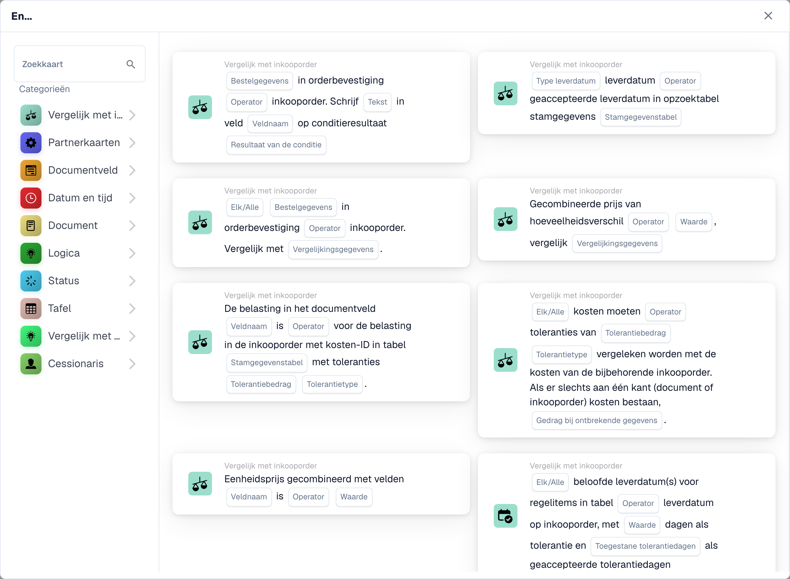

# Kaarten

Kaarten zijn de bouwstenen van elke workflow. Je combineert ze in de groepen **Wanneer / En / Dan** om te beschrijven wanneer een workflow wordt uitgevoerd en wat deze doet. In dit gedeelte worden de beschikbare kaarten uitgelegd en wat elke kaart doet.

<figure><figcaption>
Beschikbare kaarten in de geselecteerde categorie. Vul de velden vóór gebruik in. Sommige labels van deze versie zijn in de interface nog niet of onjuist vertaald. De uitleg op deze pagina gebruikt de juiste termen; de afbeelding toont de werkelijke interface.
</figcaption></figure>



**Video:** Kaarten vinden: zoeken en categorieën · 0:45 · [Ondertitels (WebVTT)](https://docbits-videos.fra1.cdn.digitaloceanspaces.com/settings-assistant/workflow-card-search/v1/nl.vtt)

Transcriptie

**De kaartkiezer** · [0:00](https://docbits-videos.fra1.cdn.digitaloceanspaces.com/settings-assistant/workflow-card-search/v1/nl.mp4#t=0.25)

Elke kaart komt uit de kaartkiezer. Klik op Toevoegen en kies het soort kaart, hier En. De kiezer toont alle kaarten van dat soort.

**Categorieën: alleen kaarten van één soort** · [0:10](https://docbits-videos.fra1.cdn.digitaloceanspaces.com/settings-assistant/workflow-card-search/v1/nl.mp4#t=10.55)

De categorieën links ordenen de kaarten naar waarmee ze werken: documentvelden, datums, status, tabellen en meer. Klik op een categorie om alleen haar kaarten te zien. Klik nog eens om alle kaarten te zien.

**Kaart zoeken: een woord uit de kaarttekst** · [0:25](https://docbits-videos.fra1.cdn.digitaloceanspaces.com/settings-assistant/workflow-card-search/v1/nl.mp4#t=25.783)

Om een kaart via een woord te vinden, typ je het in Kaart zoeken. De zoekfunctie kijkt naar de kaarttekst in jouw taal, in alle categorieën.

**Zoeken binnen een categorie** · [0:36](https://docbits-videos.fra1.cdn.digitaloceanspaces.com/settings-assistant/workflow-card-search/v1/nl.mp4#t=36.216)

Met een gekozen categorie blijft de zoekfunctie binnen die categorie. Klik op een kaart om hem op het canvas te zetten.

## Kaartgroepen

* **Wanneer** — de triggerkaarten die een workflow starten (bijvoorbeeld documenttype, documenttype één van).
* **En** — voorwaardekaarten die ook waar moeten zijn voordat de acties worden uitgevoerd. Deze omvatten _Vergelijken met inkooporder_ (PO-matching), _Documentveld_-vergelijkingen, _Datum en tijd_, _Logic_, _Status_, _Table_ en _Assignee_ voorwaarden.
* **Dan** — actiekaarten die het werk doen: velden instellen, goedkeuren/afwijzen, status wijzigen, exporteren, taken maken, documenten toewijzen, tabellen manipuleren en acties uitvoeren (API aanroepen, HTTPS-verzoek verzenden, workflow uitvoeren, AI-berekeningen).

## Kaartreferentiegidsen

Voor een volledige referentie van elke kaart en zijn opties, zie de _complete gids_ pagina's in deze sectie (Conditiekaarten, PO-overeenkomende kaarten, Toewijzings- en gebruikerskaarten, Taakkaarten, Veld- en tafelkaarten en de actiekaarten).

## Kaarten combineren

Om beproefde combinaties van kaarten te zien die veelvoorkomende bedrijfsscenario's oplossen, raadpleegt u de **Workflowpatroongidsen**.

[Logische kaarten: volledige referentie](cards-overview/logic-cards-guide.md).
