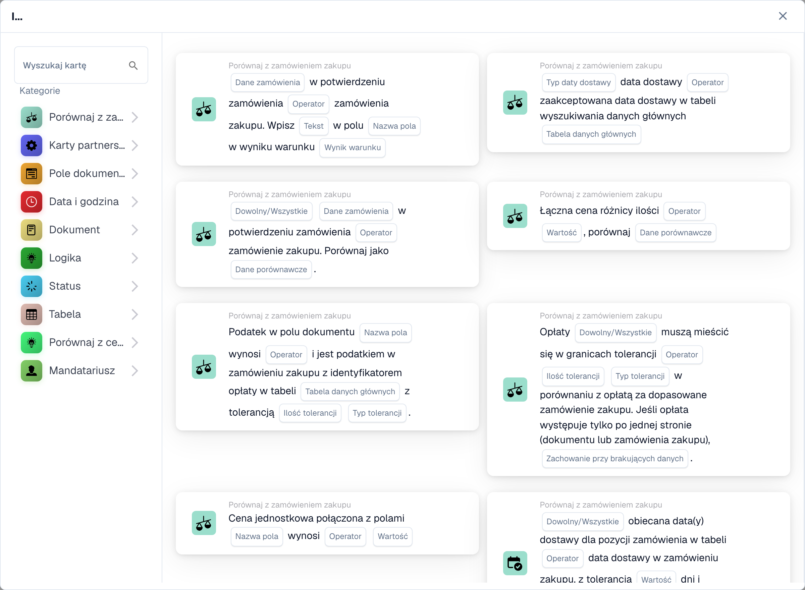

# Karty

Karty to elementy składowe każdego przepływu pracy. Łączysz je w grupach **Kiedy / I / Wtedy**, aby opisać, kiedy przepływ pracy jest uruchamiany i co robi. W tej sekcji opisano dostępne karty i ich działanie.

<figure><figcaption>
Karty dostępne w wybranej kategorii. Uzupełnij pola przed użyciem. Niektóre etykiety tej wersji interfejsu nie są jeszcze przetłumaczone lub mają nieprawidłowe tłumaczenie. Objaśnienia na tej stronie używają właściwych terminów; obraz przedstawia rzeczywisty interfejs.
</figcaption></figure>



**Film:** Wyszukiwanie kart: wyszukiwarka i kategorie · 1:01 · [Napisy (WebVTT)](https://docbits-videos.fra1.cdn.digitaloceanspaces.com/settings-assistant/workflow-card-search/v1/pl.vtt)

Transkrypcja

**Wybór kart** · [0:00](https://docbits-videos.fra1.cdn.digitaloceanspaces.com/settings-assistant/workflow-card-search/v1/pl.mp4#t=0.25)

Każda karta pochodzi z wyboru kart. Kliknij Dodaj i wybierz rodzaj karty, tutaj I. Wybór pokazuje wszystkie karty tego rodzaju.

**Kategorie: tylko karty jednego rodzaju** · [0:13](https://docbits-videos.fra1.cdn.digitaloceanspaces.com/settings-assistant/workflow-card-search/v1/pl.mp4#t=13.583)

Kategorie po lewej porządkują karty według tego, z czym pracują: pola dokumentu, daty, status, tabele i więcej. Kliknij kategorię, aby zobaczyć tylko jej karty. Kliknij ponownie, aby zobaczyć wszystkie.

**Wyszukaj kartę: słowo z tekstu karty** · [0:33](https://docbits-videos.fra1.cdn.digitaloceanspaces.com/settings-assistant/workflow-card-search/v1/pl.mp4#t=33.883)

Aby znaleźć kartę po słowie, wpisz je w Wyszukaj kartę. Wyszukiwanie sprawdza tekst karty w twoim języku, we wszystkich kategoriach.

**Wyszukiwanie w kategorii** · [0:48](https://docbits-videos.fra1.cdn.digitaloceanspaces.com/settings-assistant/workflow-card-search/v1/pl.mp4#t=48.183)

Gdy wybrana jest kategoria, wyszukiwanie zostaje w tej kategorii. Kliknij kartę, aby dodać ją do kanwy.

## Grupy kart

* **Kiedy** — karty wyzwalające rozpoczynające przepływ pracy (np. typ dokumentu, typ dokumentu jeden z).
* **I** — karty warunków, które również muszą być spełnione przed wykonaniem akcji. Należą do nich warunki _Porównaj z zamówieniem_ (dopasowanie PO), _Porównania pól dokumentu_, _Data i godzina_, _Logika_, _Status_, _Tabela_ i _Cesjonariusz_.
* **Wtedy** — karty akcji, które wykonują pracę: ustawiają pola, zatwierdzają/odrzucają, zmieniają status, eksportują, tworzą zadania, przypisują dokumenty, manipulują tabelami i uruchamiają akcje (wywołaj API, wyślij żądanie HTTPS, uruchom przepływ pracy, obliczenia AI).

## Przewodniki po kartach

Pełne informacje na temat każdej karty i jej opcji można znaleźć na stronach _pełnego przewodnika_ w tej sekcji (Karty Warunków, Karty Dopasowania PO, Karty Przydziałów i Użytkowników, Karty Zadań, Karty pól i tabel oraz karty Akcji).

## Łączenie kart

Aby zobaczyć sprawdzone kombinacje kart, które rozwiązują typowe scenariusze biznesowe, zobacz **Przewodniki po wzorcach przepływu pracy**.

[Karty logiczne: pełne odniesienie ](cards-overview/logic-cards-guide.md).
