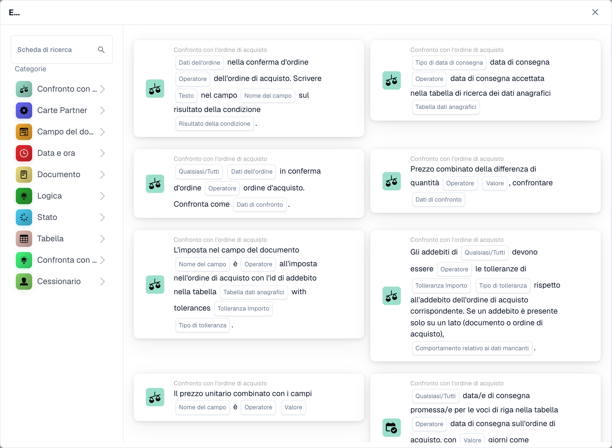

# Carte

Le carte sono gli elementi costitutivi di ogni flusso di lavoro. Li combini nei gruppi **Quando/E/Allora** per descrivere quando viene eseguito un flusso di lavoro e cosa fa. Questa sezione spiega le carte disponibili e cosa fa ciascuna.

<figure><figcaption>
Schede disponibili nella categoria selezionata. Configurare i campi prima dell’uso. Alcune etichette dell’interfaccia di questa versione sono ancora in inglese o tradotte in modo non corretto. Le spiegazioni di questa pagina sono tradotte; l’immagine mostra l’interfaccia reale.
</figcaption></figure>



**Video:** Trovare le schede: ricerca e categorie · 0:44 · [Sottotitoli (WebVTT)](https://docbits-videos.fra1.cdn.digitaloceanspaces.com/settings-assistant/workflow-card-search/v1/it.vtt)

Trascrizione

**Il selettore delle schede** · [0:00](https://docbits-videos.fra1.cdn.digitaloceanspaces.com/settings-assistant/workflow-card-search/v1/it.mp4#t=0.25)

Ogni scheda viene dal selettore delle schede. Fai clic su Aggiungi e scegli il tipo di scheda, qui E. Il selettore mostra tutte le schede di quel tipo.

**Categorie: solo le schede di un tipo** · [0:10](https://docbits-videos.fra1.cdn.digitaloceanspaces.com/settings-assistant/workflow-card-search/v1/it.mp4#t=10.783)

Le categorie a sinistra ordinano le schede in base a ciò con cui lavorano: campi del documento, date, stato, tabelle e altro. Fai clic su una categoria per vedere solo le sue schede. Fai di nuovo clic per vederle tutte.

**Cerca scheda: una parola del testo** · [0:25](https://docbits-videos.fra1.cdn.digitaloceanspaces.com/settings-assistant/workflow-card-search/v1/it.mp4#t=25.55)

Per trovare una scheda con una parola, scrivila in Cerca scheda. La ricerca guarda il testo della scheda nella tua lingua, in tutte le categorie.

**Cercare in una categoria** · [0:35](https://docbits-videos.fra1.cdn.digitaloceanspaces.com/settings-assistant/workflow-card-search/v1/it.mp4#t=35.216)

Con una categoria scelta, la ricerca resta in quella categoria. Fai clic su una scheda per aggiungerla all'area di lavoro.

## Gruppi di carte

* **Quando** — le carte trigger che avviano un flusso di lavoro (ad esempio tipo di documento, tipo di documento uno di).
* **E**: carte condizione che devono essere vere prima che le azioni vengano eseguite. Questi includono il _Confronto con l'ordine d'acquisto_ (corrispondenza dell'ordine d'acquisto), i confronti del _Campo documento_, le condizioni di _Data e ora_, _Logica_, _Stato_, _Tabella_ e _Assegnatario_.
* **Poi**: schede azione che eseguono il lavoro: imposta campi, approva/rifiuta, modifica stato, esporta, crea attività, assegna documenti, manipola tabelle ed esegue azioni (Chiama API, Invia richiesta HTTPS, Esegui flusso di lavoro, calcoli AI).

## Guide di riferimento delle carte

Per un riferimento completo su ciascuna carta e le sue opzioni, vedere le pagine della _guida completa_ in questa sezione (Carte Condizione, Carte abbinamento PO, Carte Assegnazione e Utente, Carte Compito, Carte Campi e Tabelle e carte Azione).

## Combinazione di carte

Per vedere combinazioni collaudate di schede che risolvono scenari aziendali comuni, consulta le **Guide ai modelli di flusso di lavoro**.

[Carte logiche: riferimento completo](cards-overview/logic-cards-guide.md).
