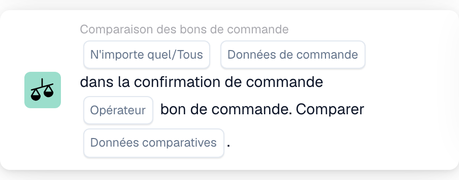

# Cartes

Les cartes sont les éléments constitutifs de chaque flux de travail. Vous les combinez dans les groupes **Quand.... / Et.... / Dans ce cas....** pour décrire quand un workflow s'exécute et ce qu'il fait. Cette section explique les cartes disponibles et ce que chacune fait.

La vue partielle ci-dessous montre un exemple de carte de condition de la catégorie **Comparaison des bons de commande**. Elle compare des données de confirmation de commande et de bon de commande. Les paramètres sont encore à renseigner : cette carte est affichée dans la bibliothèque, avant son ajout au workflow.

<figure><figcaption>
Carte de la catégorie « Comparaison des bons de commande » affichée dans la bibliothèque, avant sa sélection et sa configuration. Les paramètres de comparaison restent à renseigner.
</figcaption></figure>



**Vidéo:** Trouver des cartes : recherche et catégories · 0:46 · [Sous-titres (WebVTT)](https://docbits-videos.fra1.cdn.digitaloceanspaces.com/settings-assistant/workflow-card-search/v1/fr.vtt)

Transcription

**Le sélecteur de cartes** · [0:00](https://docbits-videos.fra1.cdn.digitaloceanspaces.com/settings-assistant/workflow-card-search/v1/fr.mp4#t=0.25)

Chaque carte vient du sélecteur de cartes. Cliquez sur Ajouter et choisissez le type de carte, ici Et. Le sélecteur affiche toutes les cartes de ce type.

**Catégories : les cartes d'un seul type** · [0:11](https://docbits-videos.fra1.cdn.digitaloceanspaces.com/settings-assistant/workflow-card-search/v1/fr.mp4#t=11.483)

Les catégories à gauche classent les cartes selon ce qu'elles traitent : champs du document, dates, statut, tableaux et plus. Cliquez sur une catégorie pour ne voir que ses cartes. Cliquez à nouveau pour toutes les voir.

**Rechercher une carte : un mot du texte** · [0:26](https://docbits-videos.fra1.cdn.digitaloceanspaces.com/settings-assistant/workflow-card-search/v1/fr.mp4#t=26.25)

Pour trouver une carte par un mot, tapez-le dans Rechercher une carte. La recherche porte sur le texte des cartes dans votre langue, dans toutes les catégories.

**Rechercher dans une catégorie** · [0:37](https://docbits-videos.fra1.cdn.digitaloceanspaces.com/settings-assistant/workflow-card-search/v1/fr.mp4#t=37.183)

Quand une catégorie est choisie, la recherche reste dans cette catégorie. Cliquez sur une carte pour l'ajouter au canevas.

## Groupes de cartes

* **Quand....** — les cartes de déclenchement qui démarrent un workflow, par exemple selon un type de document ou plusieurs types de document.
* **Et....** — les cartes de condition qui doivent également être vraies avant l’exécution des actions. Elles comprennent les comparaisons avec les bons de commande, les conditions sur les champs du document, la date et l’heure, la logique, le statut, les tableaux et l’affectation.
* **Dans ce cas....** — les cartes d’action qui définissent les champs, approuvent ou rejettent un document, modifient son statut, exportent, créent des tâches, affectent des documents, manipulent des tableaux ou exécutent d’autres actions : appeler une API, envoyer une requête HTTPS, exécuter un workflow ou effectuer des calculs avec l’IA.

## Guides de référence des cartes

Pour une référence complète de chaque carte et de ses options, consultez les pages du _guide complet_ dans cette section (cartes de condition, cartes de correspondance de bon de commande, cartes d'affectation et d'utilisateur, cartes de tâches, cartes de champs et de tableaux et cartes d'action).

## Combiner des cartes

Pour voir des combinaisons éprouvées de cartes qui résolvent des scénarios commerciaux courants, consultez les **Guides des modèles de flux de travail**.

[Cartes logiques : référence complète](cards-overview/logic-cards-guide.md).
