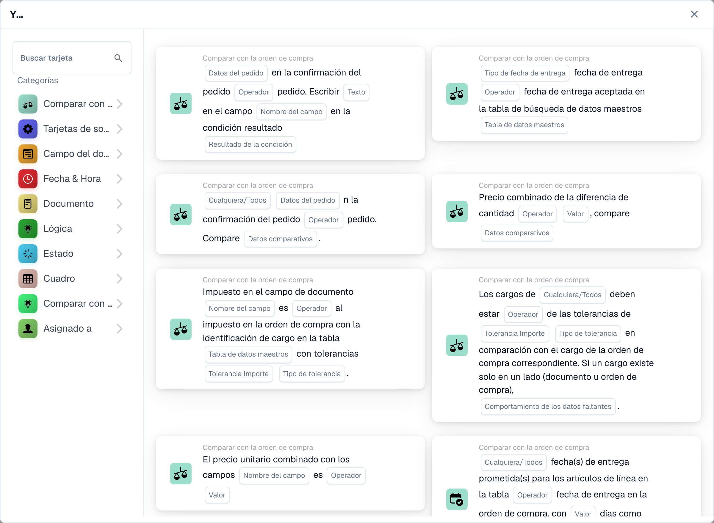

# Tarjetas

Las tarjetas son los componentes básicos de todo flujo de trabajo. Los combina en los grupos **Cuando/Y/Entonces** para describir cuándo se ejecuta un flujo de trabajo y qué hace. Esta sección explica las tarjetas disponibles y lo que hace cada una.

<figure><figcaption>
Tarjetas disponibles en la categoría seleccionada. Configure los campos antes de utilizarlas. Algunas etiquetas de esta versión de la tarjeta todavía tienen una traducción incompleta o incorrecta en la interfaz. Las explicaciones de esta página utilizan los términos correctos.
</figcaption></figure>



**Vídeo:** Encontrar tarjetas: búsqueda y categorías · 0:41 · [Subtítulos (WebVTT)](https://docbits-videos.fra1.cdn.digitaloceanspaces.com/settings-assistant/workflow-card-search/v1/es.vtt)

Transcripción

**El selector de tarjetas** · [0:00](https://docbits-videos.fra1.cdn.digitaloceanspaces.com/settings-assistant/workflow-card-search/v1/es.mp4#t=0.25)

Cada tarjeta sale del selector de tarjetas. Haga clic en Agregar y elija el tipo de tarjeta, aquí Y. El selector muestra todas las tarjetas de ese tipo.

**Categorías: solo las tarjetas de un tipo** · [0:10](https://docbits-videos.fra1.cdn.digitaloceanspaces.com/settings-assistant/workflow-card-search/v1/es.mp4#t=10.616)

Las categorías de la izquierda ordenan las tarjetas según con qué trabajan: campos del documento, fechas, estado, tablas y más. Haga clic en una categoría para ver solo sus tarjetas. Vuelva a hacer clic para verlas todas.

**Buscar tarjeta: una palabra del texto** · [0:24](https://docbits-videos.fra1.cdn.digitaloceanspaces.com/settings-assistant/workflow-card-search/v1/es.mp4#t=24.75)

Para encontrar una tarjeta por una palabra, escríbala en Buscar tarjeta. La búsqueda mira el texto de la tarjeta en su idioma, en todas las categorías.

**Buscar dentro de una categoría** · [0:33](https://docbits-videos.fra1.cdn.digitaloceanspaces.com/settings-assistant/workflow-card-search/v1/es.mp4#t=33.85)

Con una categoría elegida, la búsqueda se queda en esa categoría. Haga clic en una tarjeta para añadirla al lienzo.

## Grupos de tarjetas

* **Cuando**: las tarjetas desencadenantes que inician un flujo de trabajo (por ejemplo, tipo de documento, tipo de documento uno de).
* **Y**: tarjetas de condición que también deben cumplirse antes de que se ejecuten las acciones. Estas incluyen _Comparar con orden de compra_ (coincidencia de PO), comparaciones de _Campos de documento_, _Fecha y hora_, _Lógica_, _Estado_, _Tabla_ y condiciones de _Asignado_.
* **Luego**: tarjetas de acción que hacen el trabajo: establecer campos, aprobar/rechazar, cambiar estado, exportar, crear tareas, asignar documentos, manipular tablas y ejecutar acciones (llamar API, enviar solicitud HTTPS, ejecutar flujo de trabajo, cálculos de IA).

## Guías de referencia de tarjetas

Para obtener una referencia completa de cada tarjeta y sus opciones, consulte las páginas de la _guía completa_ en esta sección (Tarjetas de condición, Tarjetas de coincidencia de PO, Tarjetas de asignación y usuario, Tarjetas de tarea, Tarjetas de campo y tabla, y tarjetas de Acción).

## Combinando cartas

Para ver combinaciones comprobadas de tarjetas que resuelven escenarios comerciales comunes, consulte las **Guías de patrones de flujo de trabajo**.

[Tarjetas lógicas: referencia completa](cards-overview/logic-cards-guide.md).
