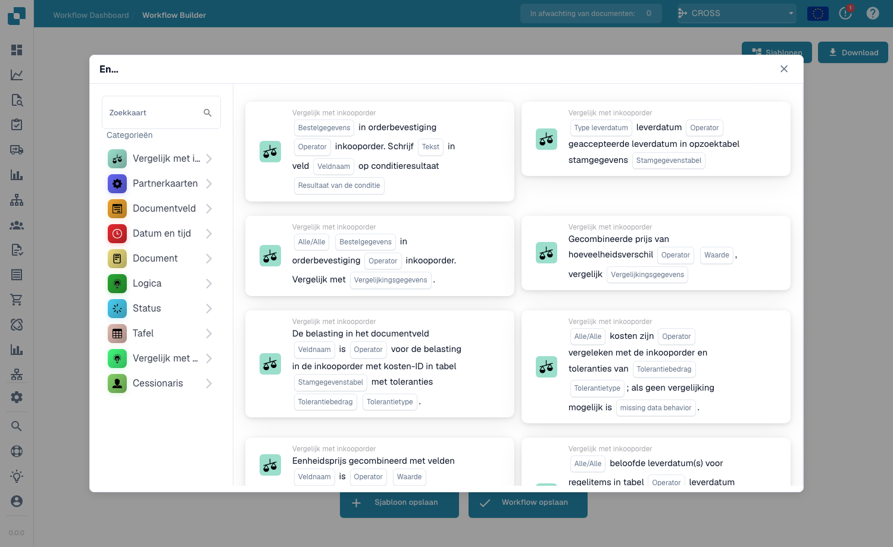

# Cards

Cards are the building blocks of every workflow. You combine them in the **When / And / Then** groups to describe when a workflow runs and what it does. This section explains the available cards and what each one does.

<figure><figcaption>
The <strong>Add Card</strong> library — cards are grouped by category.
</figcaption></figure>

## Card groups



**Video:** Finding cards: search and categories · 0:46 · [Captions (WebVTT)](https://docbits-videos.fra1.cdn.digitaloceanspaces.com/settings-assistant/workflow-card-search/v1/en.vtt)

Transcript

**The card picker** · [0:00](https://docbits-videos.fra1.cdn.digitaloceanspaces.com/settings-assistant/workflow-card-search/v1/en.mp4#t=0.25)

Every card comes from the card picker. Click Add and choose the kind of card, here And. The picker lists every card of that kind.

**Categories: only the cards of one kind** · [0:11](https://docbits-videos.fra1.cdn.digitaloceanspaces.com/settings-assistant/workflow-card-search/v1/en.mp4#t=11.816)

The categories on the left sort the cards by what they work with: document fields, dates, status, tables and more. Click a category to see only its cards. Click it again to see all cards.

**Search Card: a word from the card text** · [0:27](https://docbits-videos.fra1.cdn.digitaloceanspaces.com/settings-assistant/workflow-card-search/v1/en.mp4#t=27.216)

To find a card by a word, type it into Search Card. The search looks at the card text in your language, across all categories.

**Search inside a category** · [0:36](https://docbits-videos.fra1.cdn.digitaloceanspaces.com/settings-assistant/workflow-card-search/v1/en.mp4#t=36.75)

With a category selected, the search stays inside that category. Click a card to add it to the canvas.

* **When** — the trigger cards that start a workflow (e.g. document type, document type one of).
* **And** — condition cards that must also be true before the actions run. These include _Compare with Purchase Order_ (PO matching), _Document Field_ comparisons, _Date & Time_, _Logic_, _Status_, _Table_ and _Assignee_ conditions.
* **Then** — action cards that do the work: set fields, approve/reject, change status, export, create tasks, assign documents, manipulate tables, and run actions (Call API, Send HTTPS request, Run Workflow, AI calculations).

## Card reference guides

For a complete reference of each card and its options, see the _complete guide_ pages in this section (Condition Cards, PO Matching Cards, Assignment & User Cards, Task Cards, Field & Table Cards, and the Action cards).

## Combining cards

To see proven combinations of cards that solve common business scenarios, see the **Workflow Pattern Guides**.

[Logic cards: full reference](logic-cards-guide.md).
