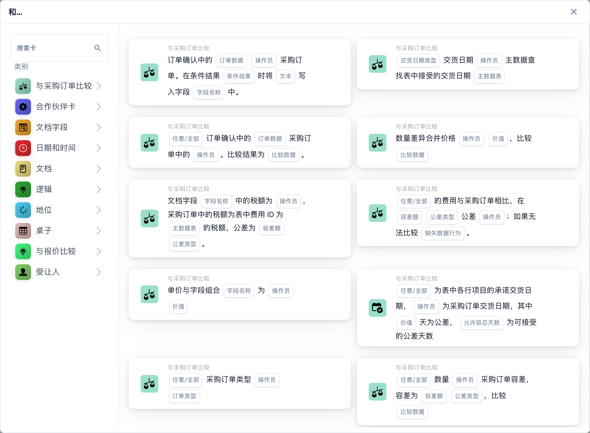

# 卡片

卡片是每个工作流程的构建块。您可以将它们组合在 **当/和/然后** 组中，以描述工作流何时运行及其执行的操作。本节介绍可用的卡以及每张卡的用途。

<figure><figcaption>
所选类别中的可用卡片。使用前请填写所需字段。 此版本界面的部分标签尚未翻译或翻译不准确。本页说明使用正确术语；图片保留了实际界面。
</figcaption></figure>



**视频:** 查找卡片：搜索和类别 · 0:38 · [字幕 (WebVTT)](https://docbits-videos.fra1.cdn.digitaloceanspaces.com/settings-assistant/workflow-card-search/v1/zh.vtt)

文字稿

**卡片选择器** · [0:00](https://docbits-videos.fra1.cdn.digitaloceanspaces.com/settings-assistant/workflow-card-search/v1/zh.mp4#t=0.25)

每张卡片都来自卡片选择器。点击添加，选择卡片类型，这里是和。选择器会列出该类型的所有卡片。

**类别：只看一种卡片** · [0:09](https://docbits-videos.fra1.cdn.digitaloceanspaces.com/settings-assistant/workflow-card-search/v1/zh.mp4#t=9.983)

左侧的类别按卡片处理的内容分类：文档字段、日期、状态、表格等。点击一个类别只看它的卡片，再次点击即可看到全部卡片。

**搜索卡：卡片文字中的词语** · [0:20](https://docbits-videos.fra1.cdn.digitaloceanspaces.com/settings-assistant/workflow-card-search/v1/zh.mp4#t=20.983)

要按词语查找卡片，请在搜索卡中输入。搜索会在所有类别中查找您所用语言的卡片文字。

**在类别内搜索** · [0:30](https://docbits-videos.fra1.cdn.digitaloceanspaces.com/settings-assistant/workflow-card-search/v1/zh.mp4#t=30.15)

选中类别后，搜索只在该类别中进行。点击一张卡片即可把它添加到画布上。

## 卡组

* **当** — 启动工作流程的触发卡（例如文档类型、文档类型之一）。
* **且** — 在操作运行之前也必须为 true 的条件卡。其中包括_与采购订单比较_（采购订单匹配）、_文档字段_比较、_日期和时间_、_逻辑_、_状态_、_表格_和_分配对象_条件。
* **则** — 执行以下工作的操作卡：设置字段、批准/拒绝、更改状态、导出、创建任务、分配文档、操作表和运行操作（调用 API、发送 HTTPS 请求、运行工作流程、AI 计算）。

## 卡片参考指南

有关每张卡及其选项的完整参考，请参阅本节中的_完整指南_页面（条件卡、PO 匹配卡、分配和用户卡、任务卡、字段和表卡以及操作卡）。

## 组合卡牌

要查看解决常见业务场景的经过验证的卡组合，请参阅**工作流程模式指南**。

[逻辑卡：完整参考](logic-cards-guide.md)。
