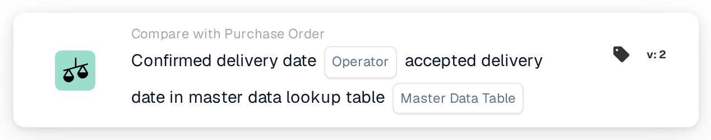
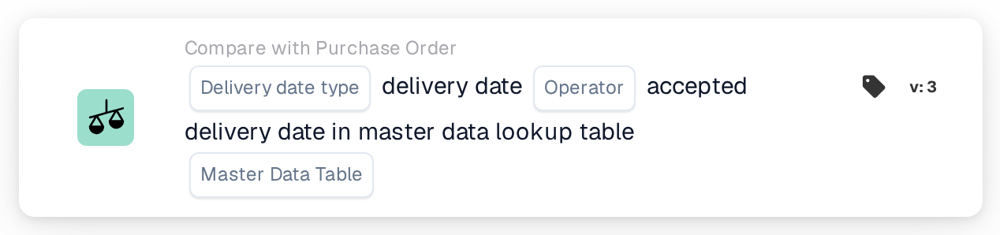

# Confirmed Delivery Date

<figure><figcaption>
Version 2
</figcaption></figure>

<figure><figcaption>
Version 3
</figcaption></figure>

## **Purpose**

This card compares confirmed delivery dates on invoices or shipping documents with the accepted delivery dates in a master data lookup table.

## **Components of the Card**

1. **Operator**
   * **Description:** Defines the condition for comparing the confirmed delivery date to the accepted delivery date.
   * **Options:**
     * **Is:** Confirms that the delivery date matches the accepted delivery date in the master data.
     * **Is Not:** Ensures that the delivery date does not match the accepted delivery date in the master data.
2. **Master Data Table Lookup**
   * **Description:** Specifies the reference table containing accepted delivery dates for comparison.
   * **Detail:** The table is defined by the **Master Data Table** parameter and may include additional metadata such as order numbers or delivery regions.

## **Functionality**

* **Date Comparison:** The system compares the confirmed delivery date from the invoice or shipping document to the accepted delivery date in the specified master data lookup table.
* **Action Execution:** Based on the comparison result, the card can trigger follow-up actions such as notifications.

## **Setup and Configuration**

* To configure this card, users select the field representing the confirmed delivery date in the document and specify the master data lookup table containing the accepted delivery dates. An operator is then chosen to define how the two dates should be compared (e.g., **Is** or **Is Not**).

## **Example Scenario**

* An invoice lists a confirmed delivery date of June 10th, while the master data lookup table specifies an accepted delivery date of June 15th. Using the **Is Not** operator, the card flags the discrepancy for review, allowing the logistics team to investigate the cause and adjust schedules accordingly.
