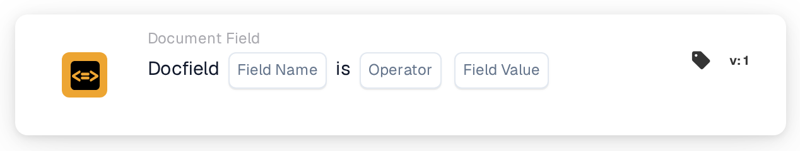

# Docfield is

<figure><figcaption>
Version 1
</figcaption></figure>

<figure><figcaption>
Version 2
</figcaption></figure>



**Video:** Card: Document field compared with a value · 0:47 · [Captions (WebVTT)](https://docbits-videos.fra1.cdn.digitaloceanspaces.com/settings-assistant/card-doc-field-value/v1/en.vtt)

Transcript

**Document field compared with a value** · [0:00](https://docbits-videos.fra1.cdn.digitaloceanspaces.com/settings-assistant/card-doc-field-value/v1/en.mp4#t=0.25)

The card Document field compares one field of the document with a value you enter. Choose the field, for example Total amount, then the operator, here Greater than, and the value, ten thousand.

**Text, numbers, dates** · [0:19](https://docbits-videos.fra1.cdn.digitaloceanspaces.com/settings-assistant/card-doc-field-value/v1/en.mp4#t=19.816)

Text fields can only be equal or not equal, and capital letters do not matter. Numbers and dates can also be greater or less than the value. If the field is not on the document, the card takes its error exit.

**Example: large invoices need a second approval** · [0:33](https://docbits-videos.fra1.cdn.digitaloceanspaces.com/settings-assistant/card-doc-field-value/v1/en.mp4#t=33.95)

For example, a second approval for large invoices: Total amount greater than ten thousand, then the assign card for finance. Smaller invoices do not reach this step.

## **Purpose:**

This workflow card is designed to automate actions by comparing a specified document field's value with a reference value or condition. It ensures dynamic and accurate decision-making in workflows based on document data validation.

## **Components of the Card:**

1. **Field Name**
   * **Description:** Specifies the name of the document field to be evaluated.
   * **Detail:** This must match the exact identifier of the field within the document.
2. **Operators**
   * **Description:** Defines the type of comparison to be performed between the field value and the reference value.
   * **Options:**
     * **Equals (=):** Checks if the field value matches the reference value.
     * **Not Equals (≠):** Ensures the field value differs from the reference value.
     * **Greater Than (>):** Confirms the field value is greater than the reference value.
     * **Greater or Equals (≥):** Validates the field value is equal to or greater than the reference value.
     * **Lesser Than (<):** Checks if the field value is less than the reference value.
     * **Less or Equals (≤):** Ensures the field value is less than or equal to the reference value.

## **Functionality:**

* **Condition Evaluation:** The system checks whether the document field's value, in relation to its associated column, satisfies the comparison condition specified by the operator and reference value.
* **Action Execution:**
  * **True Condition:**\
    If the document field's value meets the specified condition (e.g., equals the reference value), the system triggers the associated actions. These could include updating records, progressing the workflow, or generating notifications.
  * **False Condition:**\
    If the document field's value does not meet the specified condition, alternative actions or no actions are executed, based on the workflow configuration.

## **Setup and Configuration:**

* The user selects the field name of the relevant document and chooses the operator from the drop-down menu. The user then specifies the reference field value to complete the configuration.

## **Conclusion:**

The "DocField Comparison Validation" workflow card is a robust tool for dynamic document processing. By automating actions based on field comparisons, this card streamlines workflows, enhances accuracy, and supports data-driven decision-making.

<!-- workflow-card-practical-example-20261021 -->

## Practical example

**When to use:** Review invoices above a defined amount.

**Configuration:** Select numeric field `total_amount`, operator `>` and reference value `1000`.

**Expected result and counterexample:** A value of `1200` satisfies the condition. `1000` and `900` do not: the `>` operator requires a value strictly greater than `1000`.

This is an illustrative configuration and expected outcome. Use fields, users and groups configured in your test organization; it is not a claim that this example was executed.
