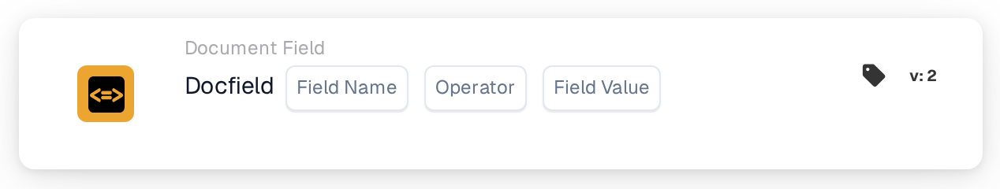

# Docfield is

<figure><figcaption>
Version 1
</figcaption></figure>

<figure><figcaption>
Version 2
</figcaption></figure>



**Video:** Card: Document field compared with a value · 0:47 · [Captions (WebVTT)](https://docbits-videos.fra1.cdn.digitaloceanspaces.com/settings-assistant/card-doc-field-value/v1/en.vtt)

Transcript

**Document field compared with a value** · [0:00](https://docbits-videos.fra1.cdn.digitaloceanspaces.com/settings-assistant/card-doc-field-value/v1/en.mp4#t=0.25)

The card Document field compares one field of the document with a value you enter. Choose the field, for example Total amount, then the operator, here Greater than, and the value, ten thousand.

**Text, numbers, dates** · [0:19](https://docbits-videos.fra1.cdn.digitaloceanspaces.com/settings-assistant/card-doc-field-value/v1/en.mp4#t=19.816)

Text fields can only be equal or not equal, and capital letters do not matter. Numbers and dates can also be greater or less than the value. If the field is not on the document, the card takes its error exit.

**Example: large invoices need a second approval** · [0:33](https://docbits-videos.fra1.cdn.digitaloceanspaces.com/settings-assistant/card-doc-field-value/v1/en.mp4#t=33.95)

For example, a second approval for large invoices: Total amount greater than ten thousand, then the assign card for finance. Smaller invoices do not reach this step.

## **Purpose:**

This card compares one field of the document with a value you enter on the card. Use it to send documents down different paths depending on a field value, for example a second approval for large invoices, or a special route for a few suppliers.

The card reads: **Docfield** [Field Name] [Operator] [Field Value].

## **Components of the Card:**

1. **Field Name**
   * The document field to check, chosen from the fields of the document type.
2. **Operator**
   * How the field value is compared with the **Field Value**. Which operators make sense depends on the type of the field, see **Operators** below.
3. **Field Value**
   * The value to compare with. Depending on the operator this is a single value, a comma-separated list or a regular expression.

## **Operators:**

| Operator | Met when | Field types |
| --- | --- | --- |
| **Equals** | the field value equals the Field Value | text, number, amount, date |
| **Not Equals** | the field value differs from the Field Value | text, number, amount, date |
| **Greater Than** | the field value is greater than the Field Value | number, amount, date |
| **Greater or Equals** | the field value is greater than or equal to the Field Value | number, amount, date |
| **Less Than** | the field value is less than the Field Value | number, amount, date |
| **Less or Equals** | the field value is less than or equal to the Field Value | number, amount, date |
| **Is One Of** | the field value equals one item of a comma-separated list | text |
| **Is Not One Of** | the field value equals none of the items of the list | text |
| **Matches Regex** | the regular expression is found in the field value | text, number, amount, date |
| **Does Not Match Regex** | the regular expression is not found in the field value | text, number, amount, date |

Boolean fields (checkboxes) are not supported by this card. Use **Checkbox is checked** for them.

### Equals and Not Equals on text fields

Text is compared without regard to capital letters, and a space counts the same as an underscore: `Acme Freight` equals `acme_freight`. Spaces at the start and end are ignored.

### Is One Of and Is Not One Of

Use these operators to check a text field against several values at once, for example a list of supplier IDs.

* Enter the values as a comma-separated list: `40321,40322,40388`.
* The field value has to equal one item exactly. A partial value is no match: `4032` is not one of `40321,40322,40388`, and neither is a longer value such as `403210`.
* Capital letters do not matter, and a space counts the same as an underscore. Spaces around the items are ignored, and empty items such as the one in `a,,b` are skipped.
* To use a comma inside a value, write it as `\,`. `Acme Freight\, LLC,Riverside Supply` is a list of two items: `Acme Freight, LLC` and `Riverside Supply`.
* An empty field value is in no list. **Is One Of** is then not met, and **Is Not One Of** is met.
* These operators work on text fields only. On a number, amount or date field, or with a list that has no items at all (for example only commas), the card ends with an error.

### Matches Regex and Does Not Match Regex

Use these operators when a pattern decides, for example "starts with" or "consists of digits only".

* The **Field Value** is a regular expression in Python syntax. It is searched anywhere in the field value: `Freight` matches `Acme Freight, LLC`.
* Use `^` and `$` to check the whole value: `^33` means "starts with 33", and `^(40321|40322|40388)$` means "exactly one of these values".
* The pattern is case-sensitive. Start it with `(?i)` to ignore capital letters: `(?i)freight` also matches `Acme Freight, LLC`.
* `^` and `$` refer to the whole field value. Start the pattern with `(?m)` to apply them to each line of a value with several lines.
* The pattern is used exactly as you type it. It is not trimmed and capital letters are kept, so `\D` (any character that is not a digit) keeps its meaning, and a pattern that consists of one space searches for a space.
* Characters with a special meaning in regular expressions have to be escaped to be matched literally: `\(copy\)` matches the text `(copy)`, while `(copy)` is a group that finds the word `copy`.
* Numbers, amounts and dates are matched as the text they are stored as: an amount of 997.60 matches `^997\.60$`.
* An empty field value is matched as empty text, so `^$` matches it.
* An invalid pattern, for example `(20` with a missing bracket, ends the card with an error. The same happens when a pattern takes too long on a value (more than 0.05 seconds), which only occurs with badly built patterns such as `(a|aa)+$`. In both cases the card is neither met nor not met, so **Does Not Match Regex** never passes because of a broken pattern.

## **How the card works:**

* **Field not on the document:** if the document has no field with the chosen name, the card stops and reports that the field was not found, whatever the operator.
* **Condition met:** the Workflow continues with the next card (in the Advanced Workflow, through the success exit).
* **Condition not met:** the Workflow stops at this card (in the Advanced Workflow, it takes the exit for an unmet condition).
* **Error:** an operator that does not fit the field type, a missing Field Value, an empty list or an unusable pattern end the card with an error. The card log shows the reason.

## **Setup and Configuration:**

Choose the field in **Field Name**, the operator in **Operator** and enter the value in **Field Value**. For numbers and amounts enter the value without a currency symbol and with a decimal point, for example `1000.50`.

To try a configuration without waiting for a document, open the card menu in the Workflow Builder, choose **Test Card**, pick a document and select **Test on Document**. The card log shows the field value, the operator and the result.

## **Examples:**

| Goal | Field Name | Operator | Field Value | Field value on the document | Result |
| --- | --- | --- | --- | --- | --- |
| Second approval for large invoices | Total amount | Greater Than | `10000` | 12500.00 | met |
| Route a few suppliers | Supplier ID | Is One Of | `40321,40322,40388` | 40322 | met |
| | | | | 4032 | not met |
| Skip a supplier with a comma in its name | Supplier name | Is Not One Of | `Acme Freight\, LLC` | Acme Freight, LLC | not met |
| Order numbers starting with 33 | Order number | Matches Regex | `^33` | 33012 | met |
| | | | | 13301 | not met |
| Reference with letters | Reference | Matches Regex | `\D` | AB-1204 | met |
| Copies of invoices | Invoice number | Does Not Match Regex | `\(copy\)` | INV-1204 (copy) | not met |

## **Conclusion:**

The card checks a single document field against a value, a list or a pattern. Use **Is One Of** for fixed lists of values and **Matches Regex** for patterns such as prefixes or formats.

<!-- workflow-card-practical-example-20261021 -->

## Practical example

**When to use:** Review invoices above a defined amount.

**Configuration:** Select numeric field `total_amount`, operator `>` and reference value `1000`.

**Expected result and counterexample:** A value of `1200` satisfies the condition. `1000` and `900` do not: the `>` operator requires a value strictly greater than `1000`.

This is an illustrative configuration and expected outcome. Use fields, users and groups configured in your test organization; it is not a claim that this example was executed.
