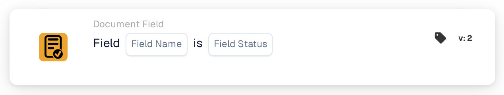

# Field is

<figure><figcaption>
Version 1
</figcaption></figure>

<figure><figcaption>
Version 2
</figcaption></figure>



**Video:** Card: Field is empty or not · 0:48 · [Captions (WebVTT)](https://docbits-videos.fra1.cdn.digitaloceanspaces.com/settings-assistant/card-docfield-status/v1/en.vtt)

Transcript

**Field is empty or not** · [0:00](https://docbits-videos.fra1.cdn.digitaloceanspaces.com/settings-assistant/card-docfield-status/v1/en.mp4#t=0.25)

The card Field is checks whether a field of the document is empty. Choose the field, for example Purchase Order, and the status: Empty or not in document, or In document and not empty.

**Missing counts as empty** · [0:18](https://docbits-videos.fra1.cdn.digitaloceanspaces.com/settings-assistant/card-docfield-status/v1/en.mp4#t=18.716)

A field counts as empty when it has no value, only spaces, an unticked checkbox, or an empty list. A field that is not on the document counts as empty, too. If the status matches, the card is true. Otherwise it is false.

**Example: no purchase order** · [0:35](https://docbits-videos.fra1.cdn.digitaloceanspaces.com/settings-assistant/card-docfield-status/v1/en.mp4#t=35.316)

For example, an invoice without a purchase order goes to the approver for invoices without an order. Invoices with a purchase order take the other path, for example the order match.

## When to use it

Use this card to check whether a document field is empty or missing, for example when an invoice has no invoice number and needs an additional check. This is a condition; configure the subsequent action separately.

**Where:** Standard workflow → additional conditions (AND) → Document Field.

## Configuration — version 2

| Setting | Example value |
| --- | --- |
| Field | `invoice_id` — invoice number |
| Field status | Empty or missing (`field_empty`) |

Select an actual field configured in your organization. The `field_not_empty` option checks whether the field contains a value.

<!-- workflow-card-practical-example-20261021 -->

## Practical example

| Example value | Expected result for `field_empty` |
| --- | --- |
| Empty or missing field | Condition met |
| `DEMO-001` | Condition not met |
| Number present but incorrect | Condition not met — the field still contains a value |

These are expected-result examples. Add an appropriate content condition to validate the number itself; this card checks the field state. In version 2, leading and trailing spaces are removed from text before checking whether the field is empty.

## Administrator example video

When I use the card, where to find it and how to detect missing invoice numbers. The examples show expected results.



[Open video with English captions](https://docbits-videos.fra1.cdn.digitaloceanspaces.com/settings-assistant/workflow-card-field-status-admin/v1/en-theme-v4.html)

[Read transcript](https://docbits-videos.fra1.cdn.digitaloceanspaces.com/settings-assistant/workflow-card-field-status-admin/v1/en.txt)
