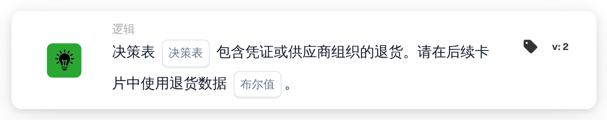
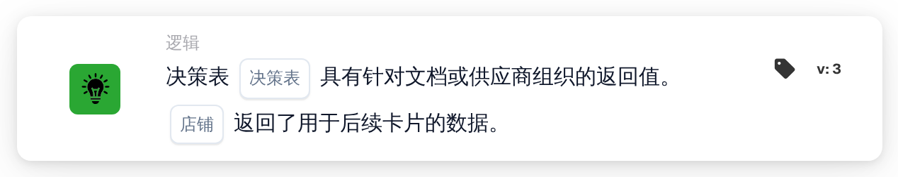

# 决策表有返回值

<figure><figcaption>
版本 2
</figcaption></figure>

<figure><figcaption>
版本 3
</figcaption></figure>



**视频:** 卡片: 决策表具有返回值 · 0:40 · [字幕 (WebVTT)](https://docbits-videos.fra1.cdn.digitaloceanspaces.com/settings-assistant/card-decision-table/v1/zh.vtt)

文字稿

**决策表具有返回值** · [0:00](https://docbits-videos.fra1.cdn.digitaloceanspaces.com/settings-assistant/card-decision-table/v1/zh.mp4#t=0.25)

决策表具有返回值卡为文档运行决策表。选择决策表，例如 Example approvers，以及是否为后续卡片存储返回数据。

**有匹配行即为真** · [0:16](https://docbits-videos.fra1.cdn.digitaloceanspaces.com/settings-assistant/card-decision-table/v1/zh.mp4#t=16.65)

有一行与文档匹配时，卡片为真；没有行匹配时，为假。存储的数据供后续卡片使用，例如分配卡。Workflow 只保留最后存储的结果。

**示例：来自决策表的审批人** · [0:28](https://docbits-videos.fra1.cdn.digitaloceanspaces.com/settings-assistant/card-decision-table/v1/zh.mp4#t=28.15)

例如，决策表按发票金额找到审批人并存储，下一张卡把发票分配给他们。如果决策表找不到任何人，卡片为假，分配不会执行。

## **用途：**

此 DocBits 卡片用于检查指定的决策表是否针对给定文档返回值，并确定是否应在后续工作流步骤中使用返回的数据。它可确保工作流能够根据决策表的结果动态调整。

## **功能：**

* **决策表验证：**此卡片会验证所选决策表是否为正在处理的文档提供返回值。
* **选择决策表：**用户指定要检查的决策表名称。
* **使用返回数据：**用户可以通过 **布尔值** 设置，指定是否在后续卡片中使用返回数据：
  * **真实情况：**返回数据可用，并将在后续工作流步骤中使用。
  * **False：**不使用返回数据，工作流将不依赖该数据继续运行。

## **用法：**

此卡片适用于涉及条件逻辑或基于决策表中预定义规则进行决策的工作流。它可确保决策表输出与工作流流程无缝集成。

## **示例场景：**

* 用户配置此卡片，以检查 **《发票处理规则》** 决策表是否有返回值。**布尔值** 设置为 **True**，表示返回数据（例如审批要求）将在后续卡片中用于指导工作流决策。

使用“Decision Table Check”卡片，组织可以提高工作流的灵活性，简化基于规则的处理，并确保自动化工作流中的决策保持一致。
