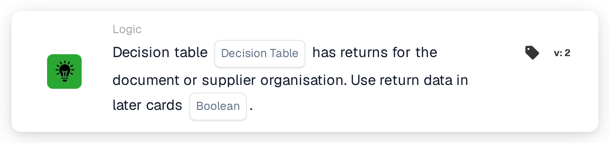
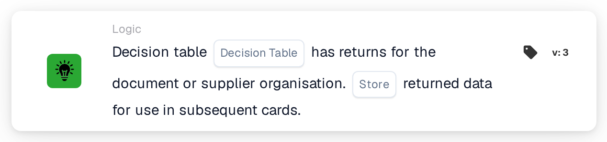

# Decision Table has Returns

<figure><figcaption>
Version 2
</figcaption></figure>

<figure><figcaption>
Version 3
</figcaption></figure>



**Video:** Card: Decision table has returns · 0:48 · [Captions (WebVTT)](https://docbits-videos.fra1.cdn.digitaloceanspaces.com/settings-assistant/card-decision-table/v1/en.vtt)

Transcript

**Decision table has returns** · [0:00](https://docbits-videos.fra1.cdn.digitaloceanspaces.com/settings-assistant/card-decision-table/v1/en.mp4#t=0.25)

The card Decision table has returns runs a decision table for the document. Choose the table, for example Example approvers, and whether its returned data is stored for the next cards.

**A matching row means true** · [0:17](https://docbits-videos.fra1.cdn.digitaloceanspaces.com/settings-assistant/card-decision-table/v1/en.mp4#t=17.283)

If a row of the table matches the document, the card is true. If no row matches, it is false. Stored data is used by later cards, such as the assign cards. A workflow keeps only the last stored result.

**Example: approvers from a table** · [0:33](https://docbits-videos.fra1.cdn.digitaloceanspaces.com/settings-assistant/card-decision-table/v1/en.mp4#t=33.183)

For example, the table finds the approvers for the invoice amount and stores them, and the next card assigns the invoice to them. If the table finds nobody, the card is false and the assignment does not run.

## **Purpose:**

This DocBits card checks whether a specified decision table has return values for a given document and determines if the returned data should be used in subsequent workflow steps. It ensures that workflows can dynamically adapt based on decision table outcomes.

## **Functionality:**

* **Decision Table Validation:** This card verifies if the selected decision table provides return values for the document being processed.
* **Decision Table Selection:** Users specify the name of the decision table to be checked.
* **Use Return Data:** Users can specify whether to use the return data in later cards with a **Boolean** setting:
  * **True:** The return data is available and will be used in subsequent workflow steps.
  * **False:** The return data will not be used, and the workflow proceeds without it.

## **Usage:**

This card is ideal for workflows involving conditional logic or decision-making based on predefined rules in a decision table. It ensures seamless integration of decision table outputs into workflow processes.

## **Example Scenario:**

* A user configures the card to check the **"Invoice Processing Rules"** decision table for return values. The **Boolean** is set to **True**, indicating that the return data (e.g. approval requirements) will be utilized in later cards to guide workflow decisions.

By using the "Decision Table Check" card, organizations can enhance workflow flexibility, streamline rule-based processing, and ensure consistency in decision-making across automated workflows.
