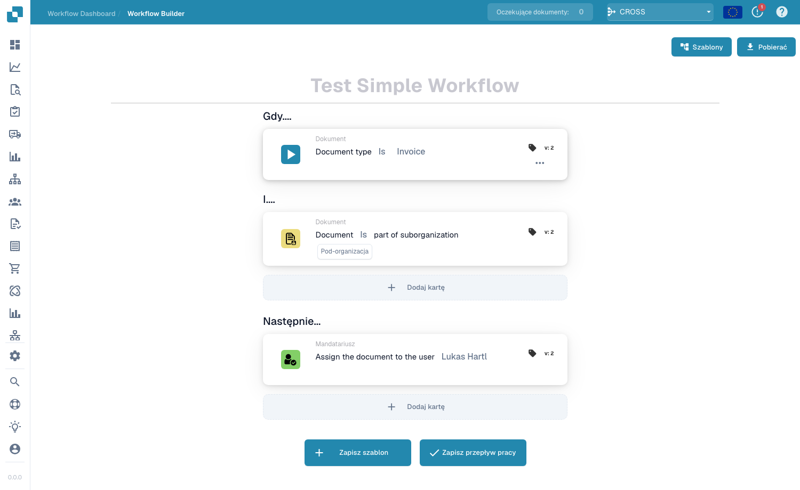
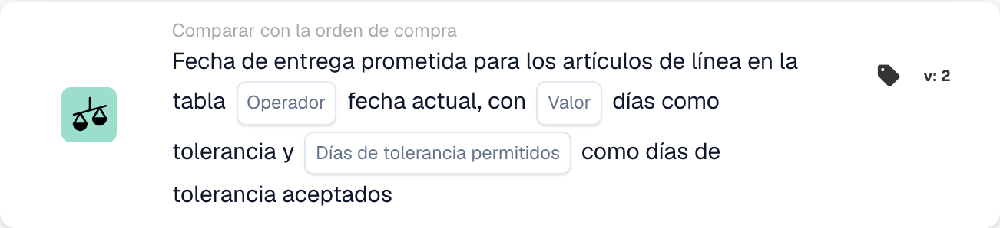
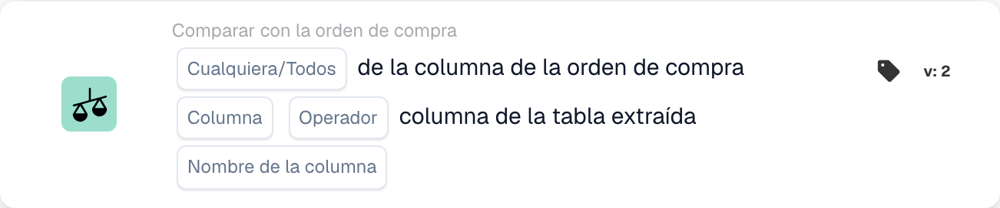
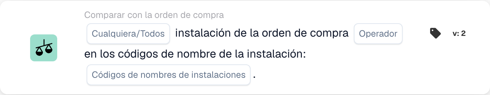
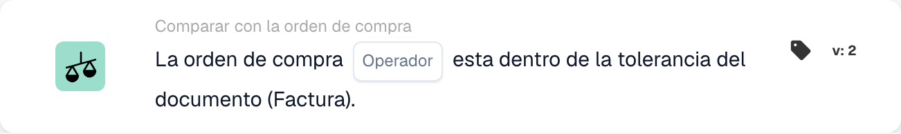
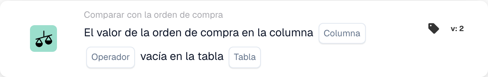
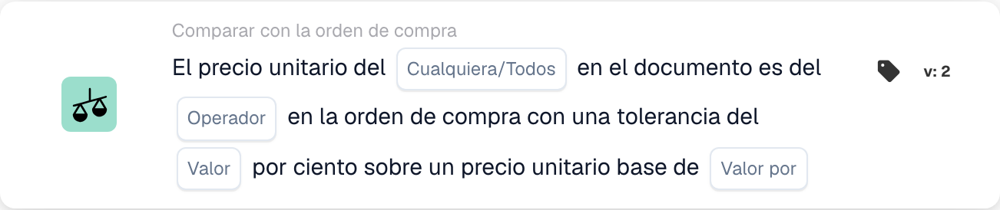
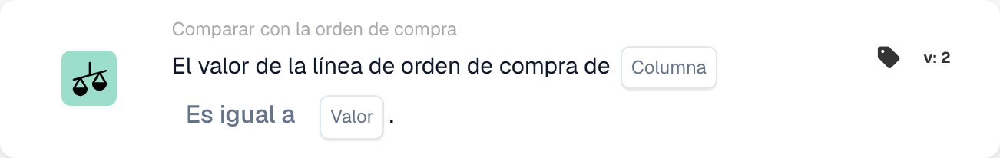

# Tarjetas coincidentes de PO: guía completa

## Tarjetas coincidentes de orden de compra (PO): guía completa

**Estado:** Cubre 15 tarjetas de comparación de PO con cálculos detallados

***

Las tarjetas de comparación de órdenes de compra en esta página van en el grupo **And** del Generador de flujo de trabajo: comparan los datos de la factura con la orden de compra coincidente antes de que se ejecuten las acciones **Then**:

<figure><figcaption><p>Las tarjetas de comparación de PO se añaden al grupo <strong>And</strong> mediante <strong>Add Card</strong>.</p></figcaption></figure>

***

### 📌 Información de versión

**Tarjeta más evolucionada:** CONDITION\_DOC\_TO\_PO\_UNIT\_PRICE (5 versiones, v5 más reciente) **Otras tarjetas complejas:** CONDITION\_OC\_TO\_PO\_ITEMS (v4), CONDITION\_LESS\_THAN\_TOLERANCE\_AS\_VALUE\_OF\_ORDERED\_QUANTITY (v4)

**Patrones clave:**

* **v2 → v3+:** Adición de parámetros de tolerancia para una coincidencia flexible
* **v3 → v4:** Adición de parámetros del modo de comparación
* **v4 → v5:** Tolerancia mejorada con múltiples unidades (%, EUR, $, etc.)

📖 [Historial de versiones completo](../release.md) | [Versiones de tarjetas y comportamiento](card-versions-guide.md)

***

### Comprender la coincidencia de órdenes de compra

Cuando reciba una factura, debe coincidir con la Orden de compra (PO) realizada anteriormente. Las tarjetas de coincidencia de órdenes de compra verifican automáticamente si los datos de la factura coinciden con los datos de la orden de compra.

**El panorama general:**

```
OC emitida    Llega la factura    Coincidencia    Decisión
(€100)    →   (€103)          →   (Verificar si   → Aprobar/Rechazar
Cant.: 100    Cant.: 100          está dentro de la tolerancia)
```

<figure><figcaption><p>El precio de la OC (100 €) está en el platillo izquierdo y el de la factura (103 €) en el derecho. La diferencia de 3 € es el 3 % del precio de la OC, así que la aguja permanece dentro de la banda verde de tolerancia de ±5 % y la comprobación se supera. Por encima de ±5 % (rojo) la factura requiere revisión.</p></figcaption></figure>

***

## 1. Coincidencia total de la orden de compra

### Propósito

Comprueba si toda la factura coincide con la orden de compra perfectamente o dentro de la tolerancia

### Cuándo usar

* Antes de aprobar una factura
* Como control de calidad preliminar
* Para identificar problemas tempranamente

### Cómo funciona

El sistema compara:

* Cantidades de factura versus cantidades de orden de compra
* Precios de factura frente a precios de pedido
* Artículos de factura frente a artículos de orden de compra
* Total de factura versus total de orden de compra

### Resultado

* **TRUE** (Coincidencia completa): Todo coincide, continúa
* **FALSE** (No coincide): Algo no coincide, necesita revisión

### Ejemplo

```
OC:
- Artículo ABC: Cant. 100, Precio unitario €50 = €5000
- Artículo XYZ: Cant. 50, Precio unitario €20 = €1000
- Total: €6000

Factura:
- Artículo ABC: Cant. 100, Precio unitario €50 = €5000
- Artículo XYZ: Cant. 50, Precio unitario €20 = €1000
- Total: €6000

Resultado: ✅ COINCIDENCIA TOTAL
```

***

## 2. Comparación de precios unitarios (documento frente a orden de compra)

### Propósito

Compara el precio unitario en la factura con el precio unitario en la orden de compra

### Parámetros

* **Tolerancia de precio unitario**: permite una variación hasta este monto
* **Tipo de tolerancia**: Porcentaje (%) o Absoluta (€/$)
* **Operador**: Es igual a, Es mayor que, Es menor que, etc.

### Cómo funciona (tolerancia porcentual)

**Fórmula:**

```
Desviación % = |(Precio de factura - Precio de OC)| / Precio de OC × 100

Comprobación: ¿Desviación % ≤ Tolerancia %?
```

**Ejemplo paso a paso:**

```
Paso 1: Obtener los precios
  Precio unitario de OC: €100.00
  Precio unitario de factura: €103.00

Paso 2: Calcular la diferencia
  Diferencia = |€103.00 - €100.00| = €3.00

Paso 3: Calcular el porcentaje
  Porcentaje = (€3.00 / €100.00) × 100 = 3%

Paso 4: Comprobar la tolerancia (5 % permitido)
  ¿3% ≤ 5%? SÍ ✅

Resultado: PASS - Dentro de la tolerancia
```

### Ejemplos del mundo real

#### Ejemplo 1: Pequeño aumento (aceptado)

```
Precio de OC: €50.00
Precio de factura: €51.50
Tolerancia: ±3%

Cálculo:
  Desviación = |(€51.50 - €50.00)| / €50.00 × 100
  Desviación = €1.50 / €50.00 × 100 = 3%

¿3% ≤ 3%? SÍ ✅ ACEPTAR
```

#### Ejemplo 2: Aumento grande (rechazado)

```
Precio de OC: €50.00
Precio de factura: €55.00
Tolerancia: ±3%

Cálculo:
  Desviación = |(€55.00 - €50.00)| / €50.00 × 100
  Desviación = €5.00 / €50.00 × 100 = 10%

¿10% ≤ 3%? NO ❌ RECHAZAR - REQUIERE REVISIÓN
```

#### Ejemplo 3: Descuento (también marcado)

```
Precio de OC: €100.00
Precio de factura: €97.00
Tolerancia: ±5%

Cálculo:
  Desviación = |(€97.00 - €100.00)| / €100.00 × 100
  Desviación = €3.00 / €100.00 × 100 = 3%

¿3% ≤ 5%? SÍ ✅ ACEPTAR (el descuento está dentro de la tolerancia)
```

#### Ejemplo 4: Tolerancia de valor absoluto

```
Precio de OC: €10.00
Precio de factura: €10.50
Tolerancia: ±€1.00 (absoluta, no %)

Cálculo:
  Desviación = |€10.50 - €10.00| = €0.50

¿€0.50 ≤ €1.00? SÍ ✅ ACEPTAR
```

### Qué hacer con los resultados

**Si PASA ✅:**

* Continuar con la siguiente comprobación
* O aprobar factura
* O continuar con la exportación

**Si FALLA ❌:**

* Marcar para revisión manual
* Solicite explicación al proveedor
* Contactar al equipo de adquisiciones
* Aprobar con nota si es aceptable

***

## 3. Comparación de cantidades

### Propósito

Comprueba si la cantidad pedida coincide con la cantidad facturada

### Parámetros

* **Tolerancia**: Cantidad o % permitido para diferir
* **Operador**: Igual, Mayor que, Menor que
* **Tipo de cantidad**: Pedido, Recibido, Abierto

### Ejemplo de cálculo

**Tolerancia porcentual:**

```
Fórmula:
  Desviación de cantidad % = |(Cant. de factura - Cant. de OC)| / Cant. de OC × 100

Ejemplo:
  Cantidad de OC: 100 unidades
  Cantidad de factura: 103 unidades
  Tolerancia: ±5%

  Desviación = |(103 - 100)| / 100 × 100
  Desviación = 3 / 100 × 100 = 3%

  ¿3% ≤ 5%? SÍ ✅ ACEPTAR
```

**Tolerancia absoluta:**

```
Fórmula:
  Desviación de cantidad = |Cant. de factura - Cant. de OC|

Ejemplo:
  Cantidad de OC: 100 unidades
  Cantidad de factura: 102 unidades
  Tolerancia: ±5 unidades

  Desviación = |102 - 100| = 2 unidades

  ¿2 unidades ≤ 5 unidades? SÍ ✅ ACEPTAR
```

### Escenarios del mundo real

#### Sobreentrega (más de lo pedido)

```
Pedido: 100 unidades
Facturado: 110 unidades
Tolerancia: ±5%

Desviación = |(110-100)|/100 × 100 = 10%

¿10% ≤ 5%? NO ❌

Decisión: Contactar al proveedor - se entregó más de lo pedido
Posible motivo: Error del proveedor, envío parcial ya recibido
```

#### Entrega insuficiente (menos de lo pedido)

```
Pedido: 100 unidades
Facturado: 95 unidades
Tolerancia: ±5%

Desviación = |(95-100)|/100 × 100 = 5%

¿5% ≤ 5%? SÍ ✅

Decisión: Aceptar - dentro de la tolerancia
Posible motivo: Envío parcial, el resto llegará después
```

***

## 4. Precio combinado de diferencia de cantidad

### Propósito

Cuando la cantidad difiere, calcula si la diferencia de precio total es aceptable

### Por qué esto importa

```
Escenario: Pidió 100 unidades pero recibió 110
- La cantidad excede en un 10% (malo)
- PERO: solo se le cobra ese 10% adicional
- El efecto combinado podría ser aceptable
```

### Cálculo

**Fórmula:**

```
Desviación combinada = Desviación de cantidad × Desviación de precio

Si ambas están dentro de la tolerancia, la combinada suele ser aceptable
```

**Ejemplo:**

```
OC:
- Precio unitario: €100
- Cantidad: 100
- Total: €10,000

Factura:
- Precio unitario: €102 (2% más alto)
- Cantidad: 105 (5% más alta)
- Total: €10,710

Análisis:
- Desviación de precio: 2% ✅
- Desviación de cantidad: 5% ✅
- Efecto combinado: 1.02 × 1.05 = 1.071 = 7.1% de aumento total

¿Es aceptable la desviación combinada? Normalmente SÍ ✅
```

***

## 5. Comparación de ID de artículo/número de artículo de proveedor

### Propósito

Comprueba si los artículos de la factura coinciden con los artículos de la orden de compra

### Cómo funciona

**Coincidencia exacta (más simple):**

```
ID de artículo de OC: ABC-123
ID de artículo de factura: ABC-123
Resultado: ✅ COINCIDE
```

**Número de artículo del proveedor (más común):**

```
Artículo de OC: ABC-123 (nuestro código interno)
Artículo del proveedor: SUPP-456 (su código para el mismo artículo)
El sistema los reconoce como el mismo artículo
Resultado: ✅ COINCIDE
```

### Escenario: ¿Qué pasa si no coincide?

```
Artículo de OC: ABC-123 (cable de cobre, 2 mm)
Artículo de factura: ABC-124 (cable de acero, 2 mm)

Resultado: ❌ NO COINCIDE

Acciones:
1. ¿Es una sustitución? Consulte con compras
2. ¿Es un error? Contacte al proveedor
3. ¿La descripción es similar? Verifique manualmente
```

***

## 6. Verificación del tipo de pedido

### Propósito

Verifica que el tipo de orden de compra sea correcto

### Tipos de orden

* **Pedido estándar**: Compra regular
* **Pedido urgente**: Urgente, puede tener prima
* **Acuerdo Marco**: Contrato a largo plazo
* **Pedido general**: Contrato indefinido
* **Consignación**: No se paga hasta usarlo

### Ejemplo de verificación

```
Tipo de pedido de OC: Pedido estándar
Tipo de pedido de factura: Pedido estándar
Resultado: ✅ COINCIDE

Si no coincide: podría afectar a las condiciones, el pago y los precios
```

***

## 7. Verificación de la fecha de entrega

### Propósito

Comprueba si la fecha de entrega coincide con la fecha prometida en la orden de compra

### Cálculo

**Entrega tardía:**

```
Fórmula:
  Días de retraso = Fecha de entrega de la factura - Fecha prometida de la OC

Ejemplo:
  Prometido en la OC: 2025-10-15
  Entrega real: 2025-10-22
  Días de retraso = 7 días

Si la tolerancia es de ±3 días:
  ¿7 ≤ 3? NO ❌ TARDÍA
```

**Entrega anticipada:**

```
Fórmula:
  Días de adelanto = Fecha prometida de la OC - Fecha de entrega de la factura

Ejemplo:
  Prometido en la OC: 2025-10-15
  Entrega real: 2025-10-10
  Días de adelanto = 5 días

La entrega anticipada suele estar bien ✅
A menos que la necesite en un momento concreto
```

### Configuración de tolerancia

```
±3 días: permite 3 días de retraso o de adelanto
±5 días: permite hasta 5 días de desviación
0 días: debe coincidir exactamente
```

***

## 8. Verificación de Cargos (Impuestos, Envíos, Etc.)

### Propósito

Comprueba si los cargos adicionales (impuestos, envío, manipulación) coinciden con el pedido.

### Cargos comunes

```
- Envío: €50
- Manipulación: €10
- Embalaje: €5
- Seguro: €15
- Impuestos: €300
```

### Cálculo

**Ejemplo: Verificación de cargo de envío**

```
Envío de OC: €50.00
Envío de factura: €51.00
Tolerancia: ±3%

Desviación = |€51.00 - €50.00| / €50.00 × 100 = 2%

¿2% ≤ 3%? SÍ ✅ ACEPTAR
```

**Ejemplo: Múltiples Cargos**

```
Cargos totales de la OC:
  - Envío: €50
  - Impuestos: €300
  - Manipulación: €10
  Total: €360

Cargos totales de la factura:
  - Envío: €50
  - Impuestos: €312 (11% de impuesto)
  - Manipulación: €10
  Total: €372

Diferencia: €12
Comprobar si está dentro de la tolerancia ✅ o ❌
```

***

## 9. Verificación Fiscal

### Propósito

Verifica que los montos de impuestos se calculen correctamente

### Cálculo

**Fórmula:**

```
Importe del impuesto = Subtotal × Tipo impositivo

Ejemplo:
  Subtotal: €1000
  Tipo impositivo: 19%
  Impuesto esperado: €1000 × 0.19 = €190

Impuesto de la factura: €190
¿Coincide? SÍ ✅
```

**Problemas comunes:**

```
1. El tipo impositivo cambió (según la región)
2. Impuesto aplicado sobre un importe incorrecto (antes/después de descuentos)
3. Varios tipos impositivos (algunos artículos al 7%, otros al 19%)
4. Artículos exentos de impuestos (0% de impuesto)
```

**Ejemplo: Impuestos con varios tipos**

```
Artículo A: €100 @ 19% de impuesto = €119
Artículo B: €100 @ 7% de impuesto = €107
Artículo C: €100 @ 0% de impuesto = €100
Total: €326

La factura muestra €325 (error de €1)

Comprobación: ¿dentro de la tolerancia o requiere atención?
```

***

## 10. Emparejamiento entre instalaciones y centros de costos

### Propósito

Garantiza que la factura sea para la instalación/centro de costos correcto

### Ejemplo

```
La OC corresponde a:
- Instalación: Planta de Berlín
- Cost Center: CC-2025

La factura debe tener:
- Instalación: Planta de Berlín ✅
- Cost Center: CC-2025 ✅

Si la instalación es distinta: puede requerir otra aprobación
```

***

## 11. Validación del estado del proveedor

### Propósito

Comprueba si el proveedor todavía está aprobado/activo

### Tipos de estado

```
✅ ACTIVE: Aprobado, se puede operar
⚠️ ON HOLD: Bloqueado temporalmente
❌ INACTIVE: Ya no se opera con él
⚠️ CONDITIONAL: Solo para artículos específicos
```

### Ejemplo de verificación

```
Proveedor: ABC Corp
Estado en la base de datos: ACTIVE
Estado al crear la OC: ACTIVE
Estado al llegar la factura: INACTIVE

Alerta: ¡el estado del proveedor cambió! Investigue por qué.
```

***

## ¿Qué tolerancia debo utilizar?

### Tolerancias estrictas (menor riesgo, más trabajo manual)

```
Usar para:
- Artículos de alto valor
- Artículos donde importa la exactitud
- Sectores regulados

Configuración:
- Precio unitario: ±1%
- Cantidad: ±1%
- Fecha de entrega: ±1 día
- Cargos: ±1%
```

### Tolerancias moderadas (equilibradas)

```
Usar para:
- La mayoría de las transacciones comerciales
- Artículos estándar
- Compras habituales

Configuración:
- Precio unitario: ±3-5%
- Cantidad: ±3-5%
- Fecha de entrega: ±3 días
- Cargos: ±5%
```

### Tolerancias flexibles (mayor riesgo, menos trabajo manual)

```
Usar para:
- Artículos de bajo valor
- Compras al por mayor
- Acuerdos con proveedores que admiten flexibilidad

Configuración:
- Precio unitario: ±10%
- Cantidad: ±10%
- Fecha de entrega: ±7 días
- Cargos: ±10%
```

***

## Ejemplo de flujo de trabajo de coincidencia de órdenes de compra

```
Llega la factura
    ↓
Condición: "¿El importe es > €5000?" → SÍ
    ↓
Comprobar: ¿Coincidencia total? → NO (10% de diferencia de precio)
    ↓
Comprobar: ¿Precio unitario dentro del 5%? → NO (12% de diferencia)
    ↓
Comprobar: ¿Cantidad dentro del 5%? → SÍ (2% de diferencia)
    ↓
Decisión: FAIL - Desviación de precio demasiado alta
    ↓
Marcar para: Revisión manual / Aprobación del comprador
    ↓
Esperar: Comentario del comprador
    ↓
Si se aprueba: Continuar con la exportación
Si se rechaza: Devolver al proveedor
```

***

## Solución de problemas de coincidencia de órdenes de compra

### "Orden de compra no encontrada"

```
Causa: El número de OC de la factura no existe en el sistema
Solución:
1. Verifique la ortografía del número de OC
2. Compruebe si la OC fue creada
3. Verifique que la OC esté en la organización correcta
4. Solicite al proveedor la referencia de la OC
```

### "Los elementos no coinciden"

```
Causa: Los artículos de la factura son distintos de los de la OC
Posibles motivos:
1. Sustitución aprobada por compras
2. Números de artículo distintos para el mismo artículo
3. Error del proveedor
Solución: Contacte a compras o al proveedor
```

### "Precio superior al pedido"

```
Causa: Precio de la factura > precio de la OC
Posibles motivos:
1. Aumento de precio aprobado
2. Error del proveedor
3. Diferencia de moneda
4. Servicios adicionales incluidos
Solución: Verifique con compras
```

### "Fecha de entrega incorrecta"

```
Causa: Factura fechada después de la entrega prometida
Posibles motivos:
1. El envío se retrasó
2. La fecha de recepción difiere de la fecha de la factura
3. Envío parcial
Solución: Revise los documentos de envío o contacte al proveedor
```

***

## Tabla resumen

| Tarjeta           | Qué comprueba           | Cálculo principal     | Tolerancia común |
| -------------- | --------------------- | -------------------- | ---------------- |
| Coincidencia total   | Todo            | Todas las comprobaciones    | Varía           |
| Precio unitario     | Precio por unidad        | % o € de diferencia    | ±3-5%            |
| Cantidad       | Cantidad pedida        | % o diferencia unitaria | ±3-5%            |
| Precio combinado | Total con cambio de cantidad | Cantidad × Precio          | ±5-10%           |
| ID del artículo        | Artículos correctos           | Coincidencia de cadenas         | Exacto            |
| Tipo de orden     | Tipo de compra      | Coincidencia de cadenas         | Exacto            |
| Fecha de entrega  | Cuándo llegó          | Diferencia de días      | ±3 días          |
| Cargos        | Tarifas adicionales            | % o € de diferencia    | ±5%              |
| Impuesto            | Monto del impuesto            | Cálculo del porcentaje de impuestos    | ±1%              |
| Instalación       | Centro de costos           | Coincidencia de cadenas         | Exacto            |
| Proveedor       | ¿Aprobado?             | Verificación de estado         | Solo activo      |

***

## Documentación relacionada

* Consulte la guía "Validación de facturas" para conocer el flujo de trabajo completo
* Consulte "Configuración de tolerancia" para conocer los valores recomendados por industria.
* Consulte "Manejo de excepciones" para saber qué hacer con las fallas.
* Comuníquese con su equipo de adquisiciones para conocer las políticas de tolerancia específicas.

<!-- workflow-card-example-condition_promised_delivery_date_to_current-20261021 -->

### Fecha de entrega prometida frente a la fecha de referencia

<figure><figcaption><p>Campos de la tarjeta en la versión mostrada. Los campos aún no están configurados.</p></figcaption></figure>

`CONDITION_PROMISED_DELIVERY_DATE_TO_CURRENT` · versión 2

Suponga una fecha de referencia de `2026-10-21` y una fecha de entrega de línea prometida de `2026-10-23`. Seleccione la comparación «posterior a» y la tolerancia de cero días. La fecha futura satisface esa comparación; `2026-10-20` no lo hace. Configure deliberadamente las opciones Cualquiera/Todos y los días de tolerancia aceptados y pruebe una fecha faltante por separado.

<!-- workflow-card-example-condition_po_extracted_table_column-20261021 -->

### Columna de orden de compra frente a una columna extraída

<figure><figcaption><p>Campos de la tarjeta en la versión mostrada. Los campos aún no están configurados.</p></figcaption></figure>

`CONDITION_PO_EXTRACTED_TABLE_COLUMN` · versión 2

Compare la columna del artículo de orden de compra coincidente con la columna extraída `article_number`, usando igualdad y Todo. Los valores coincidentes `DEMO-A` pasan; un valor extraído `DEMO-B` falla. Seleccione una tabla de búsqueda solo cuando sea necesario un reemplazo documentado de ID por valor; verifique ese mapeo antes de comparar.

<!-- workflow-card-example-condition_check_facility_in_po-20261021 -->

### Instalaciones permitidas en la orden de compra

<figure><figcaption><p>Campos de la tarjeta en la versión mostrada. Los campos aún no están configurados.</p></figcaption></figure>

`CONDITION_CHECK_FACILITY_IN_PO` · versión 2

Seleccione Todo, la comparación de entrada y el código de instalación configurado `DEMO-NORTH`. Las líneas de orden de compra coincidentes con esa instalación pasan; una línea en `DEMO-SOUTH` falla. Utilice códigos de instalación de los datos de la orden de compra en lugar de asumir que una etiqueta de visualización es su código.

<!-- workflow-card-example-condition_purchase_order_full_match-20261021 -->

### Completar la conciliación de la orden de compra

<figure><figcaption><p>Campos de la tarjeta en la versión mostrada. Los campos aún no están configurados.</p></figcaption></figure>

`CONDITION_PURCHASE_ORDER_FULL_MATCH` · versión 2

Utilice una factura de demostración y una orden de compra completamente coincidentes con la cantidad `2` y el precio unitario `100` en ambos lados, y tolerancias configuradas de cantidad/precio. Seleccione la condición de coincidencia total: pasa. Luego pruebe un precio fuera de la tolerancia configurada. La falta de datos de comparación o la ausencia de una orden de compra no constituyen una coincidencia completa exitosa. Un albarán de entrega tiene una comparación solo de cantidad; no asuma que se le aplican las reglas de precios de factura.

<!-- workflow-card-example-condition_po_update_empty_column_check-20261021 -->

### Columna vacía de la base de datos de órdenes de compra

<figure><figcaption><p>Campos de la tarjeta en la versión mostrada. Los campos aún no están configurados.</p></figcaption></figure>

`CONDITION_PO_UPDATE_EMPTY_COLUMN_CHECK` · versión 2

Seleccione una tabla y columna de PO válidas ofrecidas por la tarjeta y el operador está vacía. Para un registro de orden de compra coincidente existente con un valor en blanco, la condición se cumple; un valor poblado falla. Primero verifique la referencia de orden de compra y la asignación de tabla/columna. El booleano `false` sigue siendo un valor booleano presente; un registro de orden de compra faltante es un error de datos separado.

<!-- workflow-card-example-condition_compare_unit_price_percent_per-20261021 -->

### Tolerancia porcentual por precio

<figure><figcaption><p>Campos de la tarjeta en la versión mostrada. Los campos aún no están configurados.</p></figcaption></figure>

`CONDITION_COMPARE_UNIT_PRICE_PERCENT_PER` · versión 2

Ejemplo: el precio unitario de PO `200`, el precio base `100` y la tolerancia configurada `1` producen una tasa efectiva de `(200 / 100) * (1 / 100) = 0.02` o `2%`. La banda de comparación es `196–204`. La igualdad dentro de la tolerancia acepta un precio de documento de `203` y rechaza `210`. No asuma que esta tarjeta es lo mismo que una tolerancia fija del 1%.

<!-- workflow-card-example-condition_compare_po_line_value-20261021 -->

### Valor de línea de orden de compra frente a una referencia

<figure><figcaption><p>Campos de la tarjeta en la versión mostrada. Los campos aún no están configurados.</p></figcaption></figure>

`CONDITION_COMPARE_PO_LINE_VALUE` · versión 2

Seleccione la columna de orden de compra coincidente `item_number`, igualdad y valor `DEMO-A`. Pasa una línea con `DEMO-A`; `DEMO-B` falla. Utilice únicamente operadores admitidos para el tipo de datos seleccionado y pruebe por separado los datos de líneas coincidentes que faltan.
