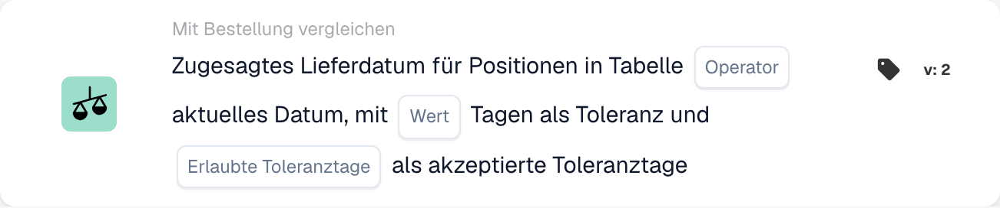
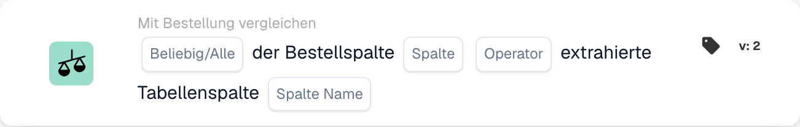
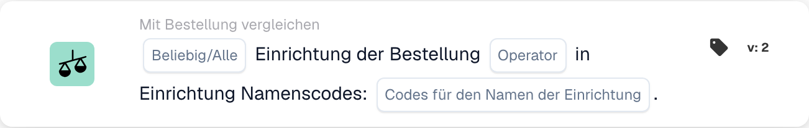
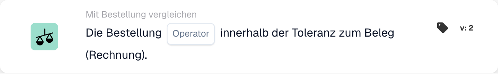
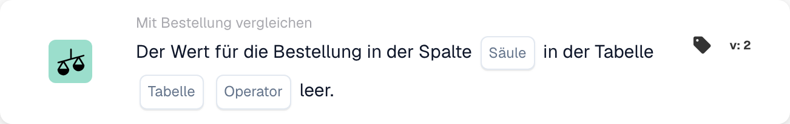
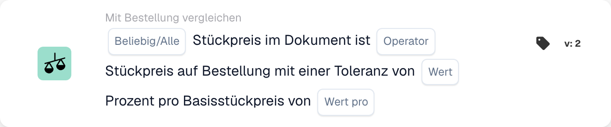
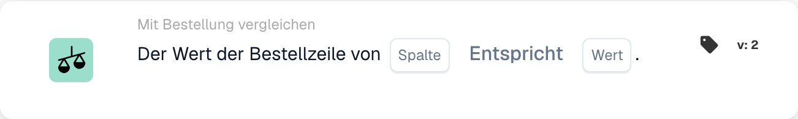

# PO-Matching-Karten – vollständiger Leitfaden

## Bestellabgleich-Karten (PO Matching) – vollständiger Leitfaden

Die PO-Abgleichskarten auf dieser Seite gehören in die **And**-Gruppe des Workflow Builders – sie vergleichen die Rechnungsdaten mit der zugeordneten Bestellung, bevor die Then-Aktionen laufen:

<figure><figcaption><p>PO-Abgleichskarten werden über <strong>Add Card</strong> zur <strong>And</strong>-Gruppe hinzugefügt.</p></figcaption></figure>


DocBits PO Matching Tutorial: Auto/Manual Line Matching, Tolerances & Mismatch Indicators


**Status:** Covers 15 PO comparison cards with detailed calculations

***

### 📌 Versionsinformationen

**Most Evolved Card:** CONDITION\_DOC\_TO\_PO\_UNIT\_PRICE (5 versions, v5 latest) **Other Complex Cards:** CONDITION\_OC\_TO\_PO\_ITEMS (v4), CONDITION\_LESS\_THAN\_TOLERANCE\_AS\_VALUE\_OF\_ORDERED\_QUANTITY (v4)

**Key Patterns:**

* **v2 → v3+:** Addition of tolerance parameters for flexible matching
* **v3 → v4:** Addition of comparison mode parameters
* **v4 → v5:** Enhanced tolerance with multiple units (%, EUR, $, etc.)

📖 [Vollständige Versionsgeschichte](../release.md) | [Kartenversionen und Verhalten](card-versions-guide.md)

***

### Bestellabgleich verstehen

Wenn Sie eine Rechnung erhalten, sollte sie zur zuvor aufgegebenen Bestellung (Purchase Order, PO) passen. PO-Matching-Karten prüfen automatisch, ob die Rechnungsdaten zu den Bestelldaten passen.

**Das Gesamtbild:**

```
PO Placed     Invoice Arrives     PO Matching     Decision
(€100)    →   (€103)          →   (Check if       → Approve/Reject
Qty: 100      Qty: 100            within tolerance)
```

<figure><figcaption><p>Der Bestellpreis (100 €) liegt auf der linken Waagschale, der Rechnungspreis (103 €) auf der rechten. Die Differenz von 3 € sind 3 % des Bestellpreises, der Zeiger bleibt daher im grünen Toleranzband von ±5 % und die Prüfung besteht. Jenseits von ±5 % (rot) muss die Rechnung geprüft werden.</p></figcaption></figure>

***

## 1. Vollständiger Bestellabgleich

### Zweck

Checks if the entire invoice matches the PO perfectly or within tolerance

### Wann verwenden

* Before approving an invoice
* As a preliminary quality check
* To identify problems early

### So funktioniert es

System compares:

* Invoice quantities vs PO quantities
* Invoice prices vs PO prices
* Invoice items vs PO items
* Invoice total vs PO total

### Ergebnis

* **TRUE** (Full Match): Everything matches, proceed
* **FALSE** (Mismatch): Something doesn't match, needs review

### Beispiel

```
PO:
- Item ABC: Qty 100, Unit Price €50 = €5000
- Item XYZ: Qty 50, Unit Price €20 = €1000
- Total: €6000

Invoice:
- Item ABC: Qty 100, Unit Price €50 = €5000
- Item XYZ: Qty 50, Unit Price €20 = €1000
- Total: €6000

Result: ✅ FULL MATCH
```

***

## 2. Stückpreisvergleich (Dokument gegenüber Bestellung)

### Zweck

Vergleicht den Stückpreis auf der Rechnung mit dem Stückpreis der Bestellung

### Parameter

* **Unit Price Tolerance**: Allow variance up to this amount
* **Tolerance Type**: Percentage (%) or Absolute (€/$)
* **Operator**: Is Equal to, Is Greater than, Is Less than, etc.

### So funktioniert es (prozentuale Toleranz)

**Formula:**

```
Variance % = |(Invoice Price - PO Price)| / PO Price × 100

Check: Is Variance % ≤ Tolerance %?
```

**Step-by-Step Example:**

```
Step 1: Get prices
  PO Unit Price: €100.00
  Invoice Unit Price: €103.00

Step 2: Calculate difference
  Difference = |€103.00 - €100.00| = €3.00

Step 3: Calculate percentage
  Percentage = (€3.00 / €100.00) × 100 = 3%

Step 4: Check tolerance (5% allowed)
  Is 3% ≤ 5%? YES ✅

Result: PASS - Within tolerance
```

### Beispiele aus der Praxis

#### Beispiel 1: geringe Erhöhung (akzeptiert)

```
PO Price: €50.00
Invoice Price: €51.50
Tolerance: ±3%

Calculation:
  Variance = |(€51.50 - €50.00)| / €50.00 × 100
  Variance = €1.50 / €50.00 × 100 = 3%

Is 3% ≤ 3%? YES ✅ ACCEPT
```

#### Beispiel 2: große Erhöhung (abgelehnt)

```
PO Price: €50.00
Invoice Price: €55.00
Tolerance: ±3%

Calculation:
  Variance = |(€55.00 - €50.00)| / €50.00 × 100
  Variance = €5.00 / €50.00 × 100 = 10%

Is 10% ≤ 3%? NO ❌ REJECT - NEEDS REVIEW
```

#### Beispiel 3: Rabatt (ebenfalls geprüft)

```
PO Price: €100.00
Invoice Price: €97.00
Tolerance: ±5%

Calculation:
  Variance = |(€97.00 - €100.00)| / €100.00 × 100
  Variance = €3.00 / €100.00 × 100 = 3%

Is 3% ≤ 5%? YES ✅ ACCEPT (Discount is within tolerance)
```

#### Beispiel 4: absolute Werttoleranz

```
PO Price: €10.00
Invoice Price: €10.50
Tolerance: ±€1.00 (absolute, not %)

Calculation:
  Variance = |€10.50 - €10.00| = €0.50

Is €0.50 ≤ €1.00? YES ✅ ACCEPT
```

### Was mit den Ergebnissen tun

**If PASS ✅:**

* Continue to next check
* Or approve invoice
* Or proceed with export

**If FAIL ❌:**

* Flag for manual review
* Ask supplier for explanation
* Contact procurement team
* Approve with note if acceptable

***

## 3. Mengenvergleich

### Zweck

Checks if the quantity ordered matches the quantity invoiced

### Parameter

* **Tolerance**: Amount or % allowed to differ
* **Operator**: Equals, Greater than, Less than
* **Quantity Type**: Ordered, Received, Open

### Berechnungsbeispiel

**Percentage Tolerance:**

```
Formula:
  Quantity Variance % = |(Invoice Qty - PO Qty)| / PO Qty × 100

Example:
  PO Quantity: 100 units
  Invoice Quantity: 103 units
  Tolerance: ±5%

  Variance = |(103 - 100)| / 100 × 100
  Variance = 3 / 100 × 100 = 3%

  Is 3% ≤ 5%? YES ✅ ACCEPT
```

**Absolute Tolerance:**

```
Formula:
  Quantity Variance = |Invoice Qty - PO Qty|

Example:
  PO Quantity: 100 units
  Invoice Quantity: 102 units
  Tolerance: ±5 units

  Variance = |102 - 100| = 2 units

  Is 2 units ≤ 5 units? YES ✅ ACCEPT
```

### Szenarien aus der Praxis

#### Überlieferung (mehr als bestellt)

```
Ordered: 100 units
Invoiced: 110 units
Tolerance: ±5%

Variance = |(110-100)|/100 × 100 = 10%

Is 10% ≤ 5%? NO ❌

Decision: Contact supplier - more delivered than ordered
Possible reason: Error by supplier, partial shipment already received
```

#### Unterlieferung (weniger als bestellt)

```
Ordered: 100 units
Invoiced: 95 units
Tolerance: ±5%

Variance = |(95-100)|/100 × 100 = 5%

Is 5% ≤ 5%? YES ✅

Decision: Accept - within tolerance
Possible reason: Partial shipment, rest to follow
```

***

## 4. Kombinierter Preis der Mengenabweichung

### Zweck

When quantity differs, calculates if the total price difference is acceptable

### Warum das wichtig ist

```
Scenario: You ordered 100 units but received 110
- Quantity is 10% over (bad)
- BUT: You're only charged for 10% extra
- Combined effect might be acceptable
```

### Berechnung

**Formula:**

```
Combined Variance = Quantity Variance × Price Variance

If both are within tolerance, combined is usually acceptable
```

**Example:**

```
PO:
- Unit Price: €100
- Quantity: 100
- Total: €10,000

Invoice:
- Unit Price: €102 (2% higher)
- Quantity: 105 (5% higher)
- Total: €10,710

Analysis:
- Price variance: 2% ✅
- Quantity variance: 5% ✅
- Combined effect: 1.02 × 1.05 = 1.071 = 7.1% total increase

Is combined variance acceptable? Usually YES ✅
```

***

## 5. Vergleich von Artikel-ID und Lieferanten-Artikelnummer

### Zweck

Prüft, ob die Positionen der Rechnung zu den Positionen der Bestellung passen

### So funktioniert es

**Exact Match (Simplest):**

```
PO Item ID: ABC-123
Invoice Item ID: ABC-123
Result: ✅ MATCH
```

**Supplier Item Number (More Common):**

```
PO Item: ABC-123 (Our internal code)
Supplier Item: SUPP-456 (Their code for same item)
System matches these as same item
Result: ✅ MATCH
```

### Scenario: What If It Doesn't Match?

```
PO Item: ABC-123 (Copper Wire, 2mm)
Invoice Item: ABC-124 (Steel Wire, 2mm)

Result: ❌ NO MATCH

Actions:
1. Is this a substitution? Check with procurement
2. Is this an error? Contact supplier
3. Is the description similar? Verify manually
```

***

## 6. Prüfung des Bestelltyps

### Zweck

Verifies the purchase order type is correct

### Bestelltypen

* **Standard Order**: Regular purchase
* **Rush Order**: Urgent, may have premium
* **Frame Agreement**: Long-term contract
* **Blanket Order**: Open-ended contract
* **Consignment**: You don't pay until used

### Prüfbeispiel

```
PO Order Type: Standard Order
Invoice Order Type: Standard Order
Result: ✅ MATCH

If mismatch: Could affect terms, payment, pricing
```

***

## 7. Prüfung des Liefertermins

### Zweck

Checks if delivery date matches the promised date on the PO

### Berechnung

**Late Delivery:**

```
Formula:
  Days Late = Invoice Delivery Date - PO Promised Date

Example:
  PO Promised: 2025-10-15
  Actual Delivery: 2025-10-22
  Days Late = 7 days

If tolerance is ±3 days:
  Is 7 ≤ 3? NO ❌ LATE
```

**Early Delivery:**

```
Formula:
  Days Early = PO Promised Date - Invoice Delivery Date

Example:
  PO Promised: 2025-10-15
  Actual Delivery: 2025-10-10
  Days Early = 5 days

Early delivery is usually OK ✅
Unless you need it at specific time
```

### Toleranzeinstellungen

```
±3 days: Allow 3 days late or early
±5 days: Allow up to 5 days variance
0 days: Must match exactly
```

***

## 8. Prüfung von Zuschlägen (Steuern, Versand usw.)

### Zweck

Checks if additional charges (taxes, shipping, handling) match PO

### Häufige Zuschläge

```
- Shipping: €50
- Handling: €10
- Packaging: €5
- Insurance: €15
- Taxes: €300
```

### Berechnung

**Example: Shipping Charge Check**

```
PO Shipping: €50.00
Invoice Shipping: €51.00
Tolerance: ±3%

Variance = |€51.00 - €50.00| / €50.00 × 100 = 2%

Is 2% ≤ 3%? YES ✅ ACCEPT
```

**Example: Multiple Charges**

```
PO Total Charges:
  - Shipping: €50
  - Taxes: €300
  - Handling: €10
  Total: €360

Invoice Total Charges:
  - Shipping: €50
  - Taxes: €312 (11% tax)
  - Handling: €10
  Total: €372

Difference: €12
Check if within tolerance ✅ or ❌
```

***

## 9. Steuerprüfung

### Zweck

Verifies tax amounts are calculated correctly

### Berechnung

**Formula:**

```
Tax Amount = Subtotal × Tax Rate

Example:
  Subtotal: €1000
  Tax Rate: 19%
  Expected Tax: €1000 × 0.19 = €190

Invoice Tax: €190
Match? YES ✅
```

**Common Issues:**

```
1. Tax rate changed (region-based)
2. Tax applied to wrong amount (before/after discounts)
3. Multiple tax rates (some items 7%, others 19%)
4. Tax exempt items (0% tax)
```

**Example: Multi-Rate Taxation**

```
Item A: €100 @ 19% tax = €119
Item B: €100 @ 7% tax = €107
Item C: €100 @ 0% tax = €100
Total: €326

Invoice shows €325 (€1 error)

Check: Within tolerance or needs attention?
```

***

## 10. Abgleich von Einrichtung und Kostenstelle

### Zweck

Stellt sicher, dass die Rechnung zur richtigen Einrichtung bzw. Kostenstelle gehört

### Beispiel

```
PO is for:
- Facility: Berlin Plant
- Cost Center: CC-2025

Invoice should have:
- Facility: Berlin Plant ✅
- Cost Center: CC-2025 ✅

If different facility: May need different approval
```

***

## 11. Prüfung des Lieferantenstatus

### Zweck

Checks if the supplier is still approved/active

### Statustypen

```
✅ ACTIVE: Approved, can do business
⚠️ ON HOLD: Temporarily blocked
❌ INACTIVE: No longer doing business
⚠️ CONDITIONAL: Only for specific items
```

### Prüfbeispiel

```
Supplier: ABC Corp
Status in Database: ACTIVE
Status when creating PO: ACTIVE
Status when invoice arrives: INACTIVE

Alert: Supplier status changed! Investigate why.
```

***

## Welche Toleranz sollte ich verwenden?

### Strenge Toleranzen (geringeres Risiko, mehr manuelle Arbeit)

```
Use for:
- High-value items
- Items where exactness matters
- Regulated industries

Settings:
- Unit Price: ±1%
- Quantity: ±1%
- Delivery Date: ±1 day
- Charges: ±1%
```

### Moderate Toleranzen (ausgewogen)

```
Use for:
- Most business transactions
- Standard items
- Normal purchasing

Settings:
- Unit Price: ±3-5%
- Quantity: ±3-5%
- Delivery Date: ±3 days
- Charges: ±5%
```

### Lockere Toleranzen (höheres Risiko, weniger manuelle Arbeit)

```
Use for:
- Low-value items
- Bulk purchases
- Supplier agreements with flexibility

Settings:
- Unit Price: ±10%
- Quantity: ±10%
- Delivery Date: ±7 days
- Charges: ±10%
```

***

## Beispiel für einen PO-Matching-Workflow

```
Invoice Arrives
    ↓
Condition: "Is amount > €5000?" → YES
    ↓
Check: Full Match? → NO (10% price difference)
    ↓
Check: Unit Price within 5%? → NO (12% difference)
    ↓
Check: Quantity within 5%? → YES (2% difference)
    ↓
Decision: FAIL - Price variance too high
    ↓
Flag for: Manual review / Buyer approval
    ↓
Wait for: Buyer comment
    ↓
If Approved: Continue to Export
If Rejected: Return to Supplier
```

***

## Fehlerbehebung beim Bestellabgleich

### „Bestellung nicht gefunden“

```
Cause: Invoice PO number doesn't exist in system
Fix:
1. Verify PO number spelling
2. Check if PO was created
3. Verify PO is in correct organization
4. Ask supplier for PO reference
```

### „Positionen stimmen nicht überein“

```
Cause: Invoice items are different from PO items
Possible Reasons:
1. Substitution approved by procurement
2. Different item numbers for same item
3. Error by supplier
Fix: Contact procurement or supplier
```

### „Preis höher als in der Bestellung“

```
Cause: Invoice price > PO price
Possible Reasons:
1. Price increase approved
2. Supplier error
3. Currency difference
4. Additional services included
Fix: Verify with procurement
```

### „Liefertermin falsch“

```
Cause: Invoice dated after promised delivery
Possible Reasons:
1. Shipment was delayed
2. Receiving date different from invoice date
3. Partial shipment
Fix: Check shipping documents or contact supplier
```

***

## Übersichtstabelle

| Card           | What It Checks        | Main Calculation     | Common Tolerance |
| -------------- | --------------------- | -------------------- | ---------------- |
| Full Match     | Everything            | All checks           | Varies           |
| Unit Price     | Price per unit        | % or € difference    | ±3-5%            |
| Quantity       | Amount ordered        | % or unit difference | ±3-5%            |
| Combined Price | Total with qty change | Qty × Price          | ±5-10%           |
| Item ID        | Right items           | String match         | Exact            |
| Order Type     | Type of purchase      | String match         | Exact            |
| Delivery Date  | When arrived          | Day difference       | ±3 days          |
| Charges        | Extra fees            | % or € difference    | ±5%              |
| Tax            | Tax amount            | Tax % calculation    | ±1%              |
| Facility       | Cost center           | String match         | Exact            |
| Supplier       | Approved?             | Status check         | Active only      |

***

## Weiterführende Dokumentation

* See "Invoice Validation" guide for complete workflow
* See "Tolerance Settings" for recommended values by industry
* See "Exception Handling" for what to do with failures
* Contact your procurement team for specific tolerance policies

<!-- workflow-card-example-condition_promised_delivery_date_to_current-20261021 -->

### Zugesagter Liefertermin gegenüber dem Referenzdatum

<figure><figcaption><p>Kartenfelder in der angezeigten Version. Die Platzhalter sind nicht konfiguriert.</p></figcaption></figure>

`CONDITION_PROMISED_DELIVERY_DATE_TO_CURRENT` · version 2

Gehen Sie von einem Referenzdatum von `2026-10-21` und einem zugesagten Liefertermin der Position von `2026-10-23` aus. Wählen Sie den Vergleich „später als“ und eine Toleranz von null Tagen. Das zukünftige Datum erfüllt diesen Vergleich, `2026-10-20` nicht. Konfigurieren Sie die Optionen Any/All und die akzeptierten Toleranztage bewusst und testen Sie ein fehlendes Datum separat.

<!-- workflow-card-example-condition_po_extracted_table_column-20261021 -->

### Bestellspalte gegenüber einer ausgelesenen Spalte

<figure><figcaption><p>Kartenfelder in der angezeigten Version. Die Platzhalter sind nicht konfiguriert.</p></figcaption></figure>

`CONDITION_PO_EXTRACTED_TABLE_COLUMN` · version 2

Vergleichen Sie die übereinstimmende Artikelspalte der Bestellung mit der ausgelesenen Spalte `article_number`, mit Gleichheit und All. Übereinstimmende Werte `DEMO-A` bestehen die Prüfung; ein ausgelesener Wert `DEMO-B` scheitert. Wählen Sie nur dann eine Lookup-Tabelle, wenn eine dokumentierte Ersetzung von ID zu Wert nötig ist; prüfen Sie diese Zuordnung vor dem Vergleich.

<!-- workflow-card-example-condition_check_facility_in_po-20261021 -->

### Zulässige Einrichtungen der Bestellung

<figure><figcaption><p>Kartenfelder in der angezeigten Version. Die Platzhalter sind nicht konfiguriert.</p></figcaption></figure>

`CONDITION_CHECK_FACILITY_IN_PO` · version 2

Wählen Sie All, den Vergleich „ist enthalten in“ und den konfigurierten Einrichtungscode `DEMO-NORTH`. Übereinstimmende Bestellpositionen dieser Einrichtung bestehen die Prüfung; eine Position in `DEMO-SOUTH` scheitert. Verwenden Sie Einrichtungscodes aus den Bestelldaten, statt anzunehmen, eine Anzeigebezeichnung sei der Code.

<!-- workflow-card-example-condition_purchase_order_full_match-20261021 -->

### Vollständiger Bestellabgleich

<figure><figcaption><p>Kartenfelder in der angezeigten Version. Die Platzhalter sind nicht konfiguriert.</p></figcaption></figure>

`CONDITION_PURCHASE_ORDER_FULL_MATCH` · version 2

Verwenden Sie eine vollständig übereinstimmende Demo-Rechnung und Bestellung mit der Menge `2` und dem Stückpreis `100` auf beiden Seiten sowie konfigurierten Mengen- und Preistoleranzen. Wählen Sie die Bedingung für den vollständigen Abgleich: Sie besteht die Prüfung. Testen Sie anschließend einen Preis außerhalb der konfigurierten Toleranz. Fehlende Vergleichsdaten oder eine fehlende Bestellung sind kein erfolgreicher vollständiger Abgleich. Ein Lieferschein hat einen reinen Mengenvergleich; gehen Sie nicht davon aus, dass die Preisregeln der Rechnung dafür gelten.

<!-- workflow-card-example-condition_po_update_empty_column_check-20261021 -->

### Leere Spalte in der Bestelldatenbank

<figure><figcaption><p>Kartenfelder in der angezeigten Version. Die Platzhalter sind nicht konfiguriert.</p></figcaption></figure>

`CONDITION_PO_UPDATE_EMPTY_COLUMN_CHECK` · version 2

Wählen Sie eine gültige, von der Karte angebotene Tabelle und Spalte der Bestellung sowie den Operator „ist leer“. Bei einem vorhandenen übereinstimmenden Bestelldatensatz mit leerem Wert besteht die Bedingung die Prüfung; ein gefüllter Wert scheitert. Prüfen Sie zuerst die Bestellreferenz und die Zuordnung von Tabelle und Spalte. Der boolesche Wert `false` ist weiterhin ein vorhandener boolescher Wert; ein fehlender Bestelldatensatz ist ein eigener Datenfehler.

<!-- workflow-card-example-condition_compare_unit_price_percent_per-20261021 -->

### Prozentuale Toleranz je Preisbasis

<figure><figcaption><p>Kartenfelder in der angezeigten Version. Die Platzhalter sind nicht konfiguriert.</p></figcaption></figure>

`CONDITION_COMPARE_UNIT_PRICE_PERCENT_PER` · version 2

Beispiel: Bestell-Stückpreis `200`, Grundpreis `100` und konfigurierte Toleranz `1` ergeben einen wirksamen Satz von `(200 / 100) * (1 / 100) = 0.02`, also `2%`. Das Vergleichsband ist `196–204`. Gleichheit innerhalb der Toleranz akzeptiert einen Dokumentpreis von `203` und lehnt `210` ab. Gehen Sie nicht davon aus, dass diese Karte einer festen Toleranz von 1 % entspricht.

<!-- workflow-card-example-condition_compare_po_line_value-20261021 -->

### Wert der Bestellposition gegenüber einer Referenz

<figure><figcaption><p>Kartenfelder in der angezeigten Version. Die Platzhalter sind nicht konfiguriert.</p></figcaption></figure>

`CONDITION_COMPARE_PO_LINE_VALUE` · version 2

Wählen Sie die übereinstimmende Spalte der Bestellung `item_number`, Gleichheit und den Wert `DEMO-A`. Eine Position mit `DEMO-A` besteht die Prüfung; `DEMO-B` scheitert. Verwenden Sie nur Operatoren, die für den ausgewählten Datentyp unterstützt werden, und testen Sie fehlende Daten der abgeglichenen Position separat.

## Aktueller Konfigurations- und Ergebnisvertrag

[P1: Toleranzen und PO-Vergleich mit eindeutiger Referenz](../masterclass/tolerances-and-po.md)
