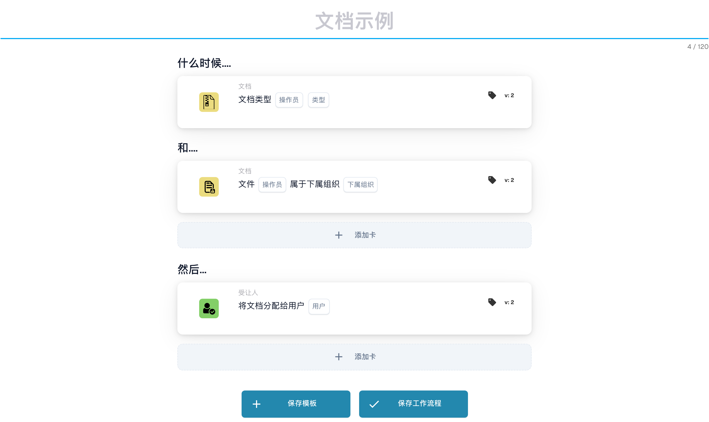
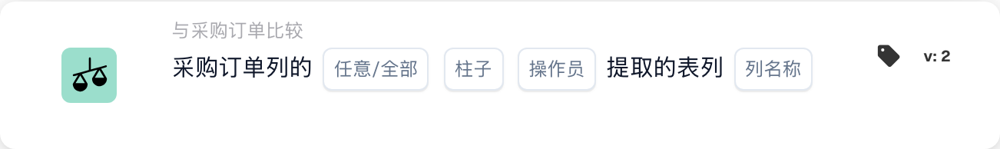
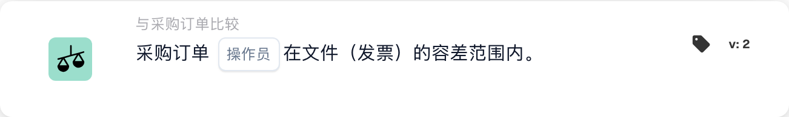
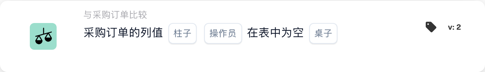
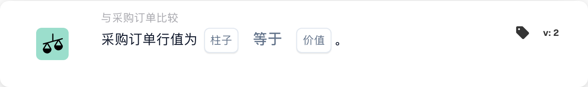

# PO 匹配卡 - 完整指南

## 采购订单 (PO) 匹配卡 - 完整指南

**状态：**涵盖15张PO比较卡，并有详细的计算

***

此页面上的 PO 比较卡位于工作流程生成器的 **且** 组中 — 它们在运行“Then”操作之前将发票数据与匹配的采购订单进行比较：

<figure><figcaption><p>包含“当”“且”和“则”卡片的未保存示例。执行前请配置所有占位字段。 此版本界面的部分标签尚未翻译或翻译不准确。本页说明使用正确术语；图片保留了实际界面。</p></figcaption></figure>

***

### 📌 版本信息

**进化最多的卡牌：**CONDITION\_DOC\_TO\_PO\_UNIT\_PRICE（5个版本，最新v5）**其他复杂卡牌：**CONDITION\_OC\_TO\_PO\_ITEMS（v4），CONDITION\_LESS\_THAN\_TOLERANCE\_AS\_VALUE\_OF\_ORDERED\_QUANTITY（v4）

**关键模式：**

* **v2 → v3+:** 增加公差参数，灵活匹配
* **v3 → v4:** 增加比较模式参数
* **v4 → v5:** 增强了多个单位的容差（%、欧元、美元等）

📖【完整版本历史](../release.md) | [卡牌版本和行为](card-versions-guide.md)

***

### 了解采购订单匹配

当您收到发票时，它应该与之前下达的采购订单 (PO) 相符。 PO 匹配卡会自动检查发票数据是否与 PO 数据匹配。

**大图：**

```
已下达 PO     收到发票          PO 匹配           决定
(€100)    →   (€103)        →   (检查是否在   → 批准/拒绝
数量：100     数量：100          容差范围内)
```

<figure><figcaption><p>PO 价格（€100）在左盘，发票价格（€103）在右盘。€3 的差额是 PO 价格的 3%，因此指针停在绿色的 ±5% 容差区域内，检查通过。超出 ±5%（红色）时，发票需要审核。</p></figcaption></figure>

***

## 1. 采购订单全匹配

### 目的

检查整个发票是否与 PO 完全匹配或在容差范围内

### 何时使用

* 批准发票之前
* 作为初步质量检查
* 及早发现问题

### 它是如何运作的

系统比较：

* 发票数量与采购订单数量
* 发票价格与 PO 价格
* 发票项目与 PO 项目
* 发票总额与采购订单总额

### 结果

* **TRUE**（完全匹配）：一切匹配，继续
* **FALSE**（不匹配）：有些内容不匹配，需要审核

### 示例

```
PO：
- 商品 ABC：数量 100，单价 €50 = €5000
- 商品 XYZ：数量 50，单价 €20 = €1000
- 合计：€6000

发票：
- 商品 ABC：数量 100，单价 €50 = €5000
- 商品 XYZ：数量 50，单价 €20 = €1000
- 合计：€6000

结果：✅ 完全匹配
```

***

## 2. 单价比较（文件与 PO）

### 目的

将发票上的单价与采购订单上的单价进行比较

### 参数

* **单价容差**：允许差异达到此金额
* **公差类型**：百分比 (%) 或绝对值 (€/$)
* **运算符**：等于、大于、小于等。

### 工作原理（百分比公差）

**公式：**

```
差异 % = |(发票价格 - PO 价格)| / PO 价格 × 100

检查：差异 % ≤ 容差 %？
```

**逐步示例：**

```
步骤 1：获取价格
  PO 单价：€100.00
  发票单价：€103.00

步骤 2：计算差额
  差额 = |€103.00 - €100.00| = €3.00

步骤 3：计算百分比
  百分比 = (€3.00 / €100.00) × 100 = 3%

步骤 4：检查容差（允许 5%）
  3% ≤ 5%？是 ✅

结果：通过 - 在容差范围内
```

### 现实世界的例子

#### 示例 1：小幅增加（已接受）

```
PO 价格：€50.00
发票价格：€51.50
容差：±3%

计算：
  差异 = |(€51.50 - €50.00)| / €50.00 × 100
  差异 = €1.50 / €50.00 × 100 = 3%

3% ≤ 3%？是 ✅ 接受
```

#### 示例2：大幅度增加（拒绝）

```
PO 价格：€50.00
发票价格：€55.00
容差：±3%

计算：
  差异 = |(€55.00 - €50.00)| / €50.00 × 100
  差异 = €5.00 / €50.00 × 100 = 10%

10% ≤ 3%？否 ❌ 拒绝 - 需要审核
```

#### 示例 3：折扣（也选中）

```
PO 价格：€100.00
发票价格：€97.00
容差：±5%

计算：
  差异 = |(€97.00 - €100.00)| / €100.00 × 100
  差异 = €3.00 / €100.00 × 100 = 3%

3% ≤ 5%？是 ✅ 接受（折扣在容差范围内）
```

#### 示例 4：绝对值容差

```
PO 价格：€10.00
发票价格：€10.50
容差：±€1.00（绝对值，非 %）

计算：
  差异 = |€10.50 - €10.00| = €0.50

€0.50 ≤ €1.00？是 ✅ 接受
```

### 如何处理结果

**如果通过 ✅:**

* 继续下一步检查
* 或批准发票
* 或者继续导出

**如果失败❌:**

* 手动审核标记
* 要求供应商解释
* 联系采购团队
* 如果可以接受，请批准并注明

***

## 3. 数量比较

### 目的

检查订购数量是否与发票数量相符

### 参数

* **公差**：允许不同的量或百分比
* **运算符**：等于、大于、小于
* **数量类型**：已订购、已收到、未结

### 计算示例

**百分比公差：**

```
公式：
  数量差异 % = |(发票数量 - PO 数量)| / PO 数量 × 100

示例：
  PO 数量：100 件
  发票数量：103 件
  容差：±5%

  差异 = |(103 - 100)| / 100 × 100
  差异 = 3 / 100 × 100 = 3%

  3% ≤ 5%？是 ✅ 接受
```

**绝对公差：**

```
公式：
  数量差异 = |发票数量 - PO 数量|

示例：
  PO 数量：100 件
  发票数量：102 件
  容差：±5 件

  差异 = |102 - 100| = 2 件

  2 件 ≤ 5 件？是 ✅ 接受
```

### 真实场景

#### 超额交付（超过订单数量）

```
已订购：100 件
已开票：110 件
容差：±5%

差异 = |(110-100)|/100 × 100 = 10%

10% ≤ 5%？否 ❌

决定：联系供应商 - 交付数量多于订购数量
可能原因：供应商出错，或已收到部分发货
```

#### 交货不足（少于订单）

```
已订购：100 件
已开票：95 件
容差：±5%

差异 = |(95-100)|/100 × 100 = 5%

5% ≤ 5%？是 ✅

决定：接受 - 在容差范围内
可能原因：部分发货，其余稍后发出
```

***

## 4. 数量差价合并价

### 目的

当数量不同时，计算总价差是否可以接受

### 为什么这很重要

```
场景：您订购了 100 件，但收到 110 件
- 数量超出 10%（不好）
- 但是：您只需为多出的 10% 付款
- 综合影响可能是可以接受的
```

### 计算

**公式：**

```
综合差异 = 数量差异 × 价格差异

如果两者都在容差范围内，综合结果通常可以接受
```

**示例：**

```
PO：
- 单价：€100
- 数量：100
- 合计：€10,000

发票：
- 单价：€102（高 2%）
- 数量：105（高 5%）
- 合计：€10,710

分析：
- 价格差异：2% ✅
- 数量差异：5% ✅
- 综合影响：1.02 × 1.05 = 1.071 = 总计增加 7.1%

综合差异是否可接受？通常是 ✅
```

***

## 5. 商品 ID/供应商商品编号比较

### 目的

检查发票中的项目是否与 PO 中的项目匹配

### 它是如何运作的

**精确匹配（最简单）：**

```
PO 商品 ID：ABC-123
发票商品 ID：ABC-123
结果：✅ 匹配
```

**供应商货品编号（较常见）：**

```
PO 商品：ABC-123（我方内部编码）
供应商商品：SUPP-456（供应商对同一商品的编码）
系统将两者识别为同一商品
结果：✅ 匹配
```

### 场景：如果不匹配怎么办？

```
PO 商品：ABC-123（铜线，2mm）
发票商品：ABC-124（钢线，2mm）

结果：❌ 不匹配

处理措施：
1. 这是替代品吗？请向采购部门确认
2. 这是错误吗？请联系供应商
3. 描述是否相似？请手动核实
```

***

## 6. 订单类型验证

### 目的

验证采购订单类型是否正确

### 订单类型

* **标准订单**：常规购买
* **Rush Order**：紧急，可能有溢价
* **框架协议**：长期合同
* **一揽子订单**：开放式合同
* **寄售**：使用后才付款

### 检查示例

```
PO 订单类型：标准订单
发票订单类型：标准订单
结果：✅ 匹配

如果不匹配：可能影响条款、付款和价格
```

***

## 7. 交货日期验证

### 目的

检查交货日期是否与采购订单上承诺的日期相符

### 计算

**延迟交货：**

```
公式：
  延迟天数 = 发票交货日期 - PO 承诺日期

示例：
  PO 承诺日期：2025-10-15
  实际交货：2025-10-22
  延迟天数 = 7 天

如果容差为 ±3 天：
  7 ≤ 3？否 ❌ 延迟
```

**提早交付：**

```
公式：
  提前天数 = PO 承诺日期 - 发票交货日期

示例：
  PO 承诺日期：2025-10-15
  实际交货：2025-10-10
  提前天数 = 5 天

提前交货通常没有问题 ✅
除非您需要在特定时间收货
```

### 公差设置

```
±3 天：允许延迟或提前 3 天
±5 天：允许最多 5 天的差异
0 天：必须完全一致
```

***

## 8. 费用验证（税费、运费等）

### 目的

检查附加费用（税费、运费、手续费）是否与 PO 相符

### 常见收费

```
- 运费：€50
- 手续费：€10
- 包装费：€5
- 保险费：€15
- 税费：€300
```

### 计算

**示例：运费检查**

```
PO 运费：€50.00
发票运费：€51.00
容差：±3%

差异 = |€51.00 - €50.00| / €50.00 × 100 = 2%

2% ≤ 3%？是 ✅ 接受
```

**示例：多次收费**

```
PO 费用合计：
  - 运费：€50
  - 税费：€300
  - 手续费：€10
  合计：€360

发票费用合计：
  - 运费：€50
  - 税费：€312（11% 税率）
  - 手续费：€10
  合计：€372

差额：€12
检查是否在容差范围内 ✅ 或 ❌
```

***

## 9. 税务核实

### 目的

验证税额计算是否正确

### 计算

**公式：**

```
税额 = 小计 × 税率

示例：
  小计：€1000
  税率：19%
  预期税额：€1000 × 0.19 = €190

发票税额：€190
是否匹配？是 ✅
```

**常见问题：**

```
1. 税率变更（按地区）
2. 税额基数错误（折扣前/折扣后）
3. 多种税率（部分商品 7%，其他 19%）
4. 免税商品（0% 税率）
```

**示例：多重税率**

```
商品 A：€100 @ 19% 税 = €119
商品 B：€100 @ 7% 税 = €107
商品 C：€100 @ 0% 税 = €100
合计：€326

发票显示 €325（相差 €1）

检查：在容差范围内还是需要处理？
```

***

## 10. 设施/成本中心匹配

### 目的

确保发票适用于正确的设施/成本中心

### 示例

```
PO 对应：
- 工厂：柏林工厂
- 成本中心：CC-2025

发票应包含：
- 工厂：柏林工厂 ✅
- 成本中心：CC-2025 ✅

如果工厂不同：可能需要不同的审批
```

***

## 11. 供应商状态验证

### 目的

检查供应商是否仍然获得批准/活跃

### 状态类型

```
✅ 活跃：已批准，可以开展业务
⚠️ 暂停：暂时被阻止
❌ 停用：不再有业务往来
⚠️ 有条件：仅限特定商品
```

### 检查示例

```
供应商：ABC Corp
数据库中的状态：活跃
创建 PO 时的状态：活跃
收到发票时的状态：停用

提醒：供应商状态已变更！请调查原因。
```

***

## 我应该使用哪种公差？

### 严格的公差（更低的风险，更多的手工工作）

```
适用于：
- 高价值商品
- 对精确度要求高的商品
- 受监管行业

设置：
- 单价：±1%
- 数量：±1%
- 交货日期：±1 天
- 费用：±1%
```

### 中等公差（平衡）

```
适用于：
- 大多数业务交易
- 标准商品
- 常规采购

设置：
- 单价：±3-5%
- 数量：±3-5%
- 交货日期：±3 天
- 费用：±5%
```

### 宽松的公差（风险更高，体力工作更少）

```
适用于：
- 低价值商品
- 批量采购
- 条款灵活的供应商协议

设置：
- 单价：±10%
- 数量：±10%
- 交货日期：±7 天
- 费用：±10%
```

***

## PO 匹配工作流程示例

```
收到发票
    ↓
条件：“金额是否 > €5000？” → 是
    ↓
检查：完全匹配？ → 否（价格相差 10%）
    ↓
检查：单价是否在 5% 以内？ → 否（相差 12%）
    ↓
检查：数量是否在 5% 以内？ → 是（相差 2%）
    ↓
决定：失败 - 价格差异过大
    ↓
标记为：人工审核 / 采购员审批
    ↓
等待：采购员备注
    ↓
如果批准：继续导出
如果拒绝：退回供应商
```

***

## PO 匹配故障排除

### “未找到订单”

```
原因：发票上的 PO 编号在系统中不存在
解决方法：
1. 核对 PO 编号拼写
2. 检查 PO 是否已创建
3. 确认 PO 位于正确的组织
4. 向供应商索取 PO 参考号
```

### “物品不匹配”

```
原因：发票上的商品与 PO 中的商品不同
可能的原因：
1. 采购部门已批准替代品
2. 同一商品使用了不同的商品编号
3. 供应商出错
解决方法：联系采购部门或供应商
```

### “价格高于 PO”

```
原因：发票价格 > PO 价格
可能的原因：
1. 已批准涨价
2. 供应商出错
3. 货币不同
4. 包含额外服务
解决方法：向采购部门核实
```

### “交货日期错误”

```
原因：发票日期晚于承诺的交货日期
可能的原因：
1. 发货延迟
2. 收货日期与发票日期不同
3. 部分发货
解决方法：检查发货单据或联系供应商
```

***

## 汇总表

| 卡           | 它检查什么        | 主要计算     | 通用公差 |
| -------------- | --------------------- | -------------------- | ---------------- |
| 完整比赛     | 一切            | 所有检查           | 各不相同           |
| 单价     | 每单位价格        | % 或 € 差异    | ±3-5%            |
| 数量       | 订购数量        | %或单位差异 | ±3-5%            |
| 综合价格 | 数量变化总计 | 数量×价格          | ±5-10%           |
| 商品编号        | 正确的项目           | 字符串匹配         | 准确            |
| 订单类型     | 购买类型      | 字符串匹配         | 准确            |
| 交货日期  | 到达时          | 日差       | ±3天          |
| 收费        | 额外费用            | % 或 € 差异    | ±5%              |
| 税            | 税额            | 税%计算    | ±1%              |
| 设施       | 成本中心           | 字符串匹配         | 准确            |
| 供应商       | 批准了吗？             | 状态检查         | 仅活动      |

***

## 相关文档

* 请参阅“发票验证”指南了解完整的工作流程
* 有关行业推荐值，请参阅“公差设置”
* 请参阅“异常处理”了解如何处理失败
* 请联系您的采购团队了解具体的容忍政策

<!-- workflow-card-example-condition_promised_delivery_date_to_current-20261021 -->

### 承诺交货日期与参考日期

<figure><figcaption><p>所示版本的卡片字段。占位字段尚未配置。 此版本界面的部分标签尚未翻译或翻译不准确。本页说明使用正确术语；图片保留了实际界面。</p></figcaption></figure>

`CONDITION_PROMISED_DELIVERY_DATE_TO_CURRENT`·版本2

假设参考日期为`2026-10-21`，承诺的线路交付日期为`2026-10-23`。选择稍后比较和零日容差。未来的日期满足该比较； `2026-10-20` 没有。有意配置“任何/全部”和“可接受的容忍天”选项，并单独测试缺失的日期。

<!-- workflow-card-example-condition_po_extracted_table_column-20261021 -->

### 采购订单列与提取列的对比

<figure><figcaption><p>所示版本的卡片字段。占位字段尚未配置。 此版本界面的部分标签尚未翻译或翻译不准确。本页说明使用正确术语；图片保留了实际界面。</p></figcaption></figure>

`CONDITION_PO_EXTRACTED_TABLE_COLUMN`·版本2

使用相等和全部将匹配的 PO 文章列与提取的列 `article_number` 进行比较。匹配值`DEMO-A`通过；提取的值`DEMO-B`失败。仅当需要记录的 ID 到值替换时才选择查找表；在比较之前验证该映射。

<!-- workflow-card-example-condition_check_facility_in_po-20261021 -->

### 允许的采购订单设施

<figure><figcaption><p>所示版本的卡片字段。占位字段尚未配置。 此版本界面的部分标签尚未翻译或翻译不准确。本页说明使用正确术语；图片保留了实际界面。</p></figcaption></figure>

`CONDITION_CHECK_FACILITY_IN_PO`·版本2

选择全部、正在比较和配置的设施代码`DEMO-NORTH`。该设施通行证中匹配的采购订单行； `DEMO-SOUTH` 中的一行失败。使用 PO 数据中的设施代码，而不是假设显示标签就是其代码。

<!-- workflow-card-example-condition_purchase_order_full_match-20261021 -->

### 完成采购订单匹配

<figure><figcaption><p>所示版本的卡片字段。占位字段尚未配置。 此版本界面的部分标签尚未翻译或翻译不准确。本页说明使用正确术语；图片保留了实际界面。</p></figcaption></figure>

`CONDITION_PURCHASE_ORDER_FULL_MATCH`·版本2

使用完全匹配的演示发票和采购订单，双方数量为`2`，单价为`100`，并配置数量/价格容差。选择完全匹配条件：通过。然后测试超出配置容差的价格。缺少比较数据或缺少 PO 并不是成功的完全匹配。交货单仅进行数量比较；不要假设发票价格规则适用于它。

<!-- workflow-card-example-condition_po_update_empty_column_check-20261021 -->

### 采购订单数据库列为空

<figure><figcaption><p>所示版本的卡片字段。占位字段尚未配置。 此版本界面的部分标签尚未翻译或翻译不准确。本页说明使用正确术语；图片保留了实际界面。</p></figcaption></figure>

`CONDITION_PO_UPDATE_EMPTY_COLUMN_CHECK`·版本2

选择卡和 is-empty 运营商提供的有效 PO 表和列。对于具有空白值的现有匹配 PO 记录，条件通过；填充值失败。首先验证 PO 引用和表/列映射。布尔`false`仍然是当前布尔值；缺少 PO 记录是一个单独的数据错误。

<!-- workflow-card-example-condition_compare_unit_price_percent_per-20261021 -->

### 每个价格基础的百分比容差

<figure><figcaption><p>所示版本的卡片字段。占位字段尚未配置。 此版本界面的部分标签尚未翻译或翻译不准确。本页说明使用正确术语；图片保留了实际界面。</p></figcaption></figure>

`CONDITION_COMPARE_UNIT_PRICE_PERCENT_PER`·版本2

示例：PO 单价 `200`、基本价格 `100` 和配置的容差 `1` 产生有效费率 `(200 / 100) * (1 / 100) = 0.02` 或 `2%`。比较波段是`196–204`。公差范围内的平等接受`203`的单据价格并拒绝`210`。不要假设此卡与固定的 1% 容差相同。

<!-- workflow-card-example-condition_compare_po_line_value-20261021 -->

### 相对于参考的采购订单行值

<figure><figcaption><p>所示版本的卡片字段。占位字段尚未配置。 此版本界面的部分标签尚未翻译或翻译不准确。本页说明使用正确术语；图片保留了实际界面。</p></figcaption></figure>

`CONDITION_COMPARE_PO_LINE_VALUE`·版本2

选择匹配的 PO 列 `item_number`、等式和值 `DEMO-A`。 `DEMO-A` 的线通过； `DEMO-B` 失败。仅使用所选数据类型支持的运算符，并单独测试缺失的匹配行数据。
