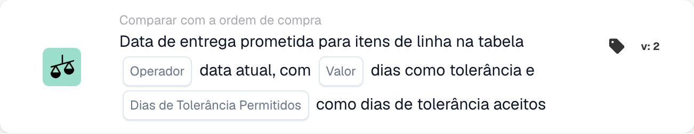
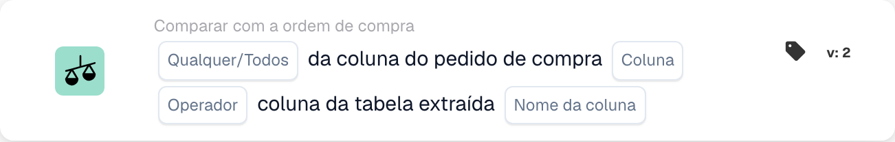
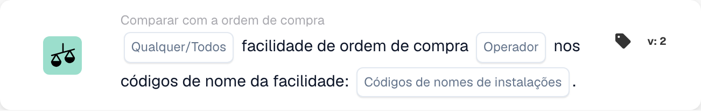
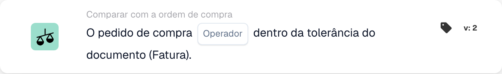
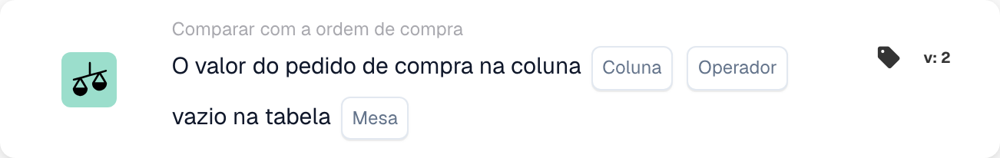
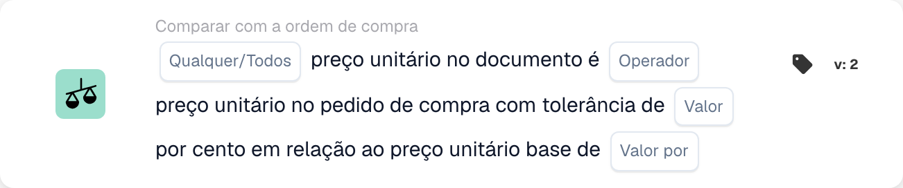
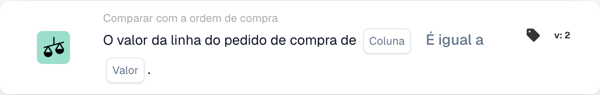

# Cartões de Correspondência de PO - Guia Completo

## Cartões de correspondência de pedido de compra (PO) - Guia completo

**Status:** cobre 15 cartões de comparação de PO com cálculos detalhados

***

Os cartões de comparação de PO nesta página vão no grupo **And** do Workflow Builder — eles comparam os dados da fatura com o pedido de compra correspondido antes de as ações Then serem executadas:

<figure><figcaption><p>Os cartões de comparação de PO são adicionados ao grupo <strong>And</strong> por meio de <strong>Add Card</strong>.</p></figcaption></figure>

***

### 📌 Informações de versão

**Cartão mais evoluído:** CONDITION\_DOC\_TO\_PO\_UNIT\_PRICE (5 versões, v5 é a mais recente) **Outros cartões complexos:** CONDITION\_OC\_TO\_PO\_ITEMS (v4), CONDITION\_LESS\_THAN\_TOLERANCE\_AS\_VALUE\_OF\_ORDERED\_QUANTITY (v4)

**Padrões principais:**

* **v2 para v3+:** adição de parâmetros de tolerância para uma correspondência flexível
* **v3 para v4:** adição de parâmetros de modo de comparação
* **v4 para v5:** tolerância aprimorada com várias unidades (%, EUR, $, etc.)

📖 [Histórico completo de versões](../release.md) | [Versões e comportamento dos cartões](card-versions-guide.md)

***

### Entendendo a correspondência de PO

Quando você recebe uma fatura, ela deve corresponder ao pedido de compra (PO) feito anteriormente. Os cartões de correspondência de PO verificam automaticamente se os dados da fatura correspondem aos dados do PO.

**O panorama geral:**

```
PO Placed     Invoice Arrives     PO Matching     Decision
(€100)    →   (€103)          →   (Check if       → Approve/Reject
Qty: 100      Qty: 100            within tolerance)
```

<figure><figcaption><p>O preço do PO (€100) fica no prato esquerdo e o preço da fatura (€103) no direito. A diferença de €3 é 3% do preço do PO, por isso o ponteiro permanece dentro da faixa verde de tolerância de ±5% e a verificação passa. Acima de ±5% (vermelho) a fatura precisa de revisão.</p></figcaption></figure>

***

## 1. Correspondência total do pedido de compra

### Objetivo

Verifica se a fatura inteira corresponde ao PO perfeitamente ou dentro da tolerância

### Quando usar

* Antes de aprovar uma fatura
* Como verificação preliminar de qualidade
* Para identificar problemas cedo

### Como funciona

O sistema compara:

* Quantidades da fatura vs. quantidades do PO
* Preços da fatura vs. preços do PO
* Itens da fatura vs. itens do PO
* Total da fatura vs. total do PO

### Resultado

* **TRUE** (correspondência total): tudo corresponde, prossiga
* **FALSE** (divergência): algo não corresponde, precisa de revisão

### Exemplo

```
PO:
- Item ABC: Qty 100, Unit Price €50 = €5000
- Item XYZ: Qty 50, Unit Price €20 = €1000
- Total: €6000

Invoice:
- Item ABC: Qty 100, Unit Price €50 = €5000
- Item XYZ: Qty 50, Unit Price €20 = €1000
- Total: €6000

Result: ✅ FULL MATCH
```

***

## 2. Comparação de preço unitário (documento vs. PO)

### Objetivo

Compara o preço unitário da fatura com o preço unitário do PO

### Parâmetros

* **Unit Price Tolerance**: permite uma variação de até esse valor
* **Tolerance Type**: percentual (%) ou absoluto (€/$)
* **Operator**: is equal to, is greater than, is less than, etc.

### Como funciona (tolerância percentual)

**Fórmula:**

```
Variance % = |(Invoice Price - PO Price)| / PO Price × 100

Check: Is Variance % ≤ Tolerance %?
```

**Exemplo passo a passo:**

```
Step 1: Get prices
  PO Unit Price: €100.00
  Invoice Unit Price: €103.00

Step 2: Calculate difference
  Difference = |€103.00 - €100.00| = €3.00

Step 3: Calculate percentage
  Percentage = (€3.00 / €100.00) × 100 = 3%

Step 4: Check tolerance (5% allowed)
  Is 3% ≤ 5%? YES ✅

Result: PASS - Within tolerance
```

### Exemplos reais

#### Exemplo 1: pequeno aumento (aceito)

```
PO Price: €50.00
Invoice Price: €51.50
Tolerance: ±3%

Calculation:
  Variance = |(€51.50 - €50.00)| / €50.00 × 100
  Variance = €1.50 / €50.00 × 100 = 3%

Is 3% ≤ 3%? YES ✅ ACCEPT
```

#### Exemplo 2: grande aumento (rejeitado)

```
PO Price: €50.00
Invoice Price: €55.00
Tolerance: ±3%

Calculation:
  Variance = |(€55.00 - €50.00)| / €50.00 × 100
  Variance = €5.00 / €50.00 × 100 = 10%

Is 10% ≤ 3%? NO ❌ REJECT - NEEDS REVIEW
```

#### Exemplo 3: desconto (também verificado)

```
PO Price: €100.00
Invoice Price: €97.00
Tolerance: ±5%

Calculation:
  Variance = |(€97.00 - €100.00)| / €100.00 × 100
  Variance = €3.00 / €100.00 × 100 = 3%

Is 3% ≤ 5%? YES ✅ ACCEPT (Discount is within tolerance)
```

#### Exemplo 4: tolerância em valor absoluto

```
PO Price: €10.00
Invoice Price: €10.50
Tolerance: ±€1.00 (absolute, not %)

Calculation:
  Variance = |€10.50 - €10.00| = €0.50

Is €0.50 ≤ €1.00? YES ✅ ACCEPT
```

### O que fazer com os resultados

**Se PASS ✅:**

* Continuar para a próxima verificação
* Ou aprovar a fatura
* Ou prosseguir com a exportação

**Se FAIL ❌:**

* Sinalizar para revisão manual
* Pedir uma explicação ao fornecedor
* Contactar a equipe de compras
* Aprovar com nota, se for aceitável

***

## 3. Comparação de quantidade

### Objetivo

Verifica se a quantidade encomendada corresponde à quantidade faturada

### Parâmetros

* **Tolerance**: quantidade ou % que pode diferir
* **Operator**: igual, maior que, menor que
* **Quantity Type**: encomendada, recebida, aberta

### Exemplo de cálculo

**Tolerância percentual:**

```
Formula:
  Quantity Variance % = |(Invoice Qty - PO Qty)| / PO Qty × 100

Example:
  PO Quantity: 100 units
  Invoice Quantity: 103 units
  Tolerance: ±5%

  Variance = |(103 - 100)| / 100 × 100
  Variance = 3 / 100 × 100 = 3%

  Is 3% ≤ 5%? YES ✅ ACCEPT
```

**Tolerância absoluta:**

```
Formula:
  Quantity Variance = |Invoice Qty - PO Qty|

Example:
  PO Quantity: 100 units
  Invoice Quantity: 102 units
  Tolerance: ±5 units

  Variance = |102 - 100| = 2 units

  Is 2 units ≤ 5 units? YES ✅ ACCEPT
```

### Cenários reais

#### Entrega em excesso (mais do que o encomendado)

```
Ordered: 100 units
Invoiced: 110 units
Tolerance: ±5%

Variance = |(110-100)|/100 × 100 = 10%

Is 10% ≤ 5%? NO ❌

Decision: Contact supplier - more delivered than ordered
Possible reason: Error by supplier, partial shipment already received
```

#### Entrega em falta (menos do que o encomendado)

```
Ordered: 100 units
Invoiced: 95 units
Tolerance: ±5%

Variance = |(95-100)|/100 × 100 = 5%

Is 5% ≤ 5%? YES ✅

Decision: Accept - within tolerance
Possible reason: Partial shipment, rest to follow
```

***

## 4. Preço combinado da diferença de quantidade

### Objetivo

Quando a quantidade difere, calcula se a diferença total de preço é aceitável

### Por que isso importa

```
Scenario: You ordered 100 units but received 110
- Quantity is 10% over (bad)
- BUT: You're only charged for 10% extra
- Combined effect might be acceptable
```

### Cálculo

**Fórmula:**

```
Combined Variance = Quantity Variance × Price Variance

If both are within tolerance, combined is usually acceptable
```

**Exemplo:**

```
PO:
- Unit Price: €100
- Quantity: 100
- Total: €10,000

Invoice:
- Unit Price: €102 (2% higher)
- Quantity: 105 (5% higher)
- Total: €10,710

Analysis:
- Price variance: 2% ✅
- Quantity variance: 5% ✅
- Combined effect: 1.02 × 1.05 = 1.071 = 7.1% total increase

Is combined variance acceptable? Usually YES ✅
```

***

## 5. Comparação de ID do item / número de item do fornecedor

### Objetivo

Verifica se os itens da fatura correspondem aos itens do PO

### Como funciona

**Correspondência exata (a mais simples):**

```
PO Item ID: ABC-123
Invoice Item ID: ABC-123
Result: ✅ MATCH
```

**Número de item do fornecedor (mais comum):**

```
PO Item: ABC-123 (Our internal code)
Supplier Item: SUPP-456 (Their code for same item)
System matches these as same item
Result: ✅ MATCH
```

### Cenário: e se não corresponder?

```
PO Item: ABC-123 (Copper Wire, 2mm)
Invoice Item: ABC-124 (Steel Wire, 2mm)

Result: ❌ NO MATCH

Actions:
1. Is this a substitution? Check with procurement
2. Is this an error? Contact supplier
3. Is the description similar? Verify manually
```

***

## 6. Verificação do tipo de pedido

### Objetivo

Verifica se o tipo do pedido de compra está correto

### Tipos de pedido

* **Standard Order**: compra normal
* **Rush Order**: urgente, pode ter acréscimo
* **Frame Agreement**: contrato de longo prazo
* **Blanket Order**: contrato sem prazo fixo
* **Consignment**: você só paga quando usa

### Exemplo de verificação

```
PO Order Type: Standard Order
Invoice Order Type: Standard Order
Result: ✅ MATCH

If mismatch: Could affect terms, payment, pricing
```

***

## 7. Verificação da data de entrega

### Objetivo

Verifica se a data de entrega corresponde à data prometida no PO

### Cálculo

**Entrega atrasada:**

```
Formula:
  Days Late = Invoice Delivery Date - PO Promised Date

Example:
  PO Promised: 2025-10-15
  Actual Delivery: 2025-10-22
  Days Late = 7 days

If tolerance is ±3 days:
  Is 7 ≤ 3? NO ❌ LATE
```

**Entrega antecipada:**

```
Formula:
  Days Early = PO Promised Date - Invoice Delivery Date

Example:
  PO Promised: 2025-10-15
  Actual Delivery: 2025-10-10
  Days Early = 5 days

Early delivery is usually OK ✅
Unless you need it at specific time
```

### Configurações de tolerância

```
±3 days: Allow 3 days late or early
±5 days: Allow up to 5 days variance
0 days: Must match exactly
```

***

## 8. Verificação de encargos (impostos, frete, etc.)

### Objetivo

Verifica se os encargos adicionais (impostos, frete, manuseio) correspondem ao PO

### Encargos comuns

```
- Shipping: €50
- Handling: €10
- Packaging: €5
- Insurance: €15
- Taxes: €300
```

### Cálculo

**Exemplo: verificação do encargo de frete**

```
PO Shipping: €50.00
Invoice Shipping: €51.00
Tolerance: ±3%

Variance = |€51.00 - €50.00| / €50.00 × 100 = 2%

Is 2% ≤ 3%? YES ✅ ACCEPT
```

**Exemplo: vários encargos**

```
PO Total Charges:
  - Shipping: €50
  - Taxes: €300
  - Handling: €10
  Total: €360

Invoice Total Charges:
  - Shipping: €50
  - Taxes: €312 (11% tax)
  - Handling: €10
  Total: €372

Difference: €12
Check if within tolerance ✅ or ❌
```

***

## 9. Verificação de impostos

### Objetivo

Verifica se os valores de imposto são calculados corretamente

### Cálculo

**Fórmula:**

```
Tax Amount = Subtotal × Tax Rate

Example:
  Subtotal: €1000
  Tax Rate: 19%
  Expected Tax: €1000 × 0.19 = €190

Invoice Tax: €190
Match? YES ✅
```

**Problemas comuns:**

```
1. Tax rate changed (region-based)
2. Tax applied to wrong amount (before/after discounts)
3. Multiple tax rates (some items 7%, others 19%)
4. Tax exempt items (0% tax)
```

**Exemplo: tributação com várias alíquotas**

```
Item A: €100 @ 19% tax = €119
Item B: €100 @ 7% tax = €107
Item C: €100 @ 0% tax = €100
Total: €326

Invoice shows €325 (€1 error)

Check: Within tolerance or needs attention?
```

***

## 10. Correspondência de instalação/centro de custo

### Objetivo

Garante que a fatura é para a instalação/centro de custo corretos

### Exemplo

```
PO is for:
- Facility: Berlin Plant
- Cost Center: CC-2025

Invoice should have:
- Facility: Berlin Plant ✅
- Cost Center: CC-2025 ✅

If different facility: May need different approval
```

***

## 11. Validação do status do fornecedor

### Objetivo

Verifica se o fornecedor ainda está aprovado/ativo

### Tipos de status

```
✅ ACTIVE: Approved, can do business
⚠️ ON HOLD: Temporarily blocked
❌ INACTIVE: No longer doing business
⚠️ CONDITIONAL: Only for specific items
```

### Exemplo de verificação

```
Supplier: ABC Corp
Status in Database: ACTIVE
Status when creating PO: ACTIVE
Status when invoice arrives: INACTIVE

Alert: Supplier status changed! Investigate why.
```

***

## Qual tolerância devo usar?

### Tolerâncias estritas (menos risco, mais trabalho manual)

```
Use for:
- High-value items
- Items where exactness matters
- Regulated industries

Settings:
- Unit Price: ±1%
- Quantity: ±1%
- Delivery Date: ±1 day
- Charges: ±1%
```

### Tolerâncias moderadas (equilibradas)

```
Use for:
- Most business transactions
- Standard items
- Normal purchasing

Settings:
- Unit Price: ±3-5%
- Quantity: ±3-5%
- Delivery Date: ±3 days
- Charges: ±5%
```

### Tolerâncias flexíveis (mais risco, menos trabalho manual)

```
Use for:
- Low-value items
- Bulk purchases
- Supplier agreements with flexibility

Settings:
- Unit Price: ±10%
- Quantity: ±10%
- Delivery Date: ±7 days
- Charges: ±10%
```

***

## Exemplo de Workflow de correspondência de PO

```
Invoice Arrives
    ↓
Condition: "Is amount > €5000?" → YES
    ↓
Check: Full Match? → NO (10% price difference)
    ↓
Check: Unit Price within 5%? → NO (12% difference)
    ↓
Check: Quantity within 5%? → YES (2% difference)
    ↓
Decision: FAIL - Price variance too high
    ↓
Flag for: Manual review / Buyer approval
    ↓
Wait for: Buyer comment
    ↓
If Approved: Continue to Export
If Rejected: Return to Supplier
```

***

## Solução de problemas de correspondência de PO

### "PO Not Found"

```
Cause: Invoice PO number doesn't exist in system
Fix:
1. Verify PO number spelling
2. Check if PO was created
3. Verify PO is in correct organization
4. Ask supplier for PO reference
```

### "Items Don't Match"

```
Cause: Invoice items are different from PO items
Possible Reasons:
1. Substitution approved by procurement
2. Different item numbers for same item
3. Error by supplier
Fix: Contact procurement or supplier
```

### "Price Higher Than PO"

```
Cause: Invoice price > PO price
Possible Reasons:
1. Price increase approved
2. Supplier error
3. Currency difference
4. Additional services included
Fix: Verify with procurement
```

### "Delivery Date Wrong"

```
Cause: Invoice dated after promised delivery
Possible Reasons:
1. Shipment was delayed
2. Receiving date different from invoice date
3. Partial shipment
Fix: Check shipping documents or contact supplier
```

***

## Tabela resumo

| Cartão         | O que verifica        | Cálculo principal    | Tolerância comum |
| -------------- | --------------------- | -------------------- | ---------------- |
| Full Match     | Tudo                  | Todas as verificações | Varia           |
| Unit Price     | Preço por unidade     | Diferença em % ou €  | ±3-5%            |
| Quantity       | Quantidade encomendada | Diferença em % ou unidades | ±3-5%     |
| Combined Price | Total com variação de quantidade | Qtd × Preço | ±5-10%     |
| Item ID        | Itens certos          | Correspondência de texto | Exata        |
| Order Type     | Tipo de compra        | Correspondência de texto | Exata        |
| Delivery Date  | Quando chegou         | Diferença em dias    | ±3 dias         |
| Charges        | Taxas adicionais      | Diferença em % ou €  | ±5%              |
| Tax            | Valor do imposto      | Cálculo do % de imposto | ±1%          |
| Facility       | Centro de custo       | Correspondência de texto | Exata        |
| Supplier       | Aprovado?             | Verificação de status | Apenas ativo   |

***

## Documentação relacionada

* Consulte o guia "Invoice Validation" para o fluxo de trabalho completo
* Consulte "Tolerance Settings" para valores recomendados por setor
* Consulte "Exception Handling" para saber o que fazer em caso de falha
* Contacte a sua equipe de compras para políticas de tolerância específicas

<!-- workflow-card-example-condition_promised_delivery_date_to_current-20261021 -->

### Data de entrega prometida em relação à data de referência

<figure><figcaption><p>Campos do cartão na versão exibida. Os marcadores de posição não estão configurados.</p></figcaption></figure>

`CONDITION_PROMISED_DELIVERY_DATE_TO_CURRENT` · versão 2

Suponha uma data de referência de `2026-10-21` e uma data de entrega prometida da linha de `2026-10-23`. Selecione a comparação posterior a e a tolerância de zero dias. A data futura satisfaz essa comparação; `2026-10-20` não. Configure deliberadamente as opções Any/All e de dias de tolerância aceitos e teste uma data ausente separadamente.

<!-- workflow-card-example-condition_po_extracted_table_column-20261021 -->

### Coluna do pedido de compra em relação a uma coluna extraída

<figure><figcaption><p>Campos do cartão na versão exibida. Os marcadores de posição não estão configurados.</p></figcaption></figure>

`CONDITION_PO_EXTRACTED_TABLE_COLUMN` · versão 2

Compare a coluna de artigo do PO correspondido com a coluna extraída `article_number`, usando igualdade e All. Valores correspondentes `DEMO-A` passam; um valor extraído `DEMO-B` falha. Selecione uma tabela de pesquisa apenas quando for necessária uma substituição documentada de ID por valor; verifique esse mapeamento antes de comparar.

<!-- workflow-card-example-condition_check_facility_in_po-20261021 -->

### Instalações permitidas do pedido de compra

<figure><figcaption><p>Campos do cartão na versão exibida. Os marcadores de posição não estão configurados.</p></figcaption></figure>

`CONDITION_CHECK_FACILITY_IN_PO` · versão 2

Selecione All, a comparação is-in e o código de instalação configurado `DEMO-NORTH`. As linhas do PO correspondidas nessa instalação passam; uma linha em `DEMO-SOUTH` falha. Use códigos de instalação dos dados do PO em vez de presumir que um rótulo exibido seja o seu código.

<!-- workflow-card-example-condition_purchase_order_full_match-20261021 -->

### Correspondência completa do pedido de compra

<figure><figcaption><p>Campos do cartão na versão exibida. Os marcadores de posição não estão configurados.</p></figcaption></figure>

`CONDITION_PURCHASE_ORDER_FULL_MATCH` · versão 2

Use uma fatura e um PO de demonstração completamente correspondidos, com quantidade `2` e preço unitário `100` em ambos os lados, e tolerâncias de quantidade/preço configuradas. Selecione a condição de correspondência total: ela passa. Depois teste um preço fora da tolerância configurada. Dados de comparação ausentes ou um PO inexistente não são uma correspondência total bem-sucedida. Uma nota de entrega tem uma comparação apenas de quantidade; não presuma que as regras de preço da fatura se aplicam a ela.

<!-- workflow-card-example-condition_po_update_empty_column_check-20261021 -->

### Coluna de banco de dados vazia no pedido de compra

<figure><figcaption><p>Campos do cartão na versão exibida. Os marcadores de posição não estão configurados.</p></figcaption></figure>

`CONDITION_PO_UPDATE_EMPTY_COLUMN_CHECK` · versão 2

Selecione uma tabela e uma coluna de PO válidas oferecidas pelo cartão e o operador is-empty. Para um registro de PO correspondente existente com um valor em branco, a condição passa; um valor preenchido falha. Verifique primeiro a referência do PO e o mapeamento de tabela/coluna. O booleano `false` continua a ser um valor booleano presente; um registro de PO ausente é um erro de dados separado.

<!-- workflow-card-example-condition_compare_unit_price_percent_per-20261021 -->

### Tolerância percentual por base de preço

<figure><figcaption><p>Campos do cartão na versão exibida. Os marcadores de posição não estão configurados.</p></figcaption></figure>

`CONDITION_COMPARE_UNIT_PRICE_PERCENT_PER` · versão 2

Exemplo: preço unitário do PO `200`, preço base `100` e tolerância configurada `1` produzem uma taxa efetiva de `(200 / 100) * (1 / 100) = 0.02`, ou `2%`. A faixa de comparação é `196–204`. A igualdade dentro da tolerância aceita um preço de documento `203` e rejeita `210`. Não presuma que este cartão seja o mesmo que uma tolerância fixa de 1%.

<!-- workflow-card-example-condition_compare_po_line_value-20261021 -->

### Valor da linha do pedido de compra em relação a uma referência

<figure><figcaption><p>Campos do cartão na versão exibida. Os marcadores de posição não estão configurados.</p></figcaption></figure>

`CONDITION_COMPARE_PO_LINE_VALUE` · versão 2

Selecione a coluna do PO correspondido `item_number`, igualdade e valor `DEMO-A`. Uma linha com `DEMO-A` passa; `DEMO-B` falha. Use apenas operadores suportados para o tipo de dados selecionado e teste dados de linha correspondida ausentes separadamente.
