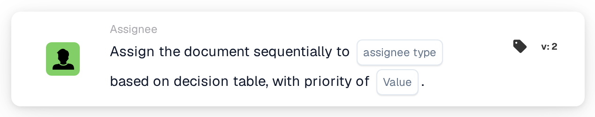
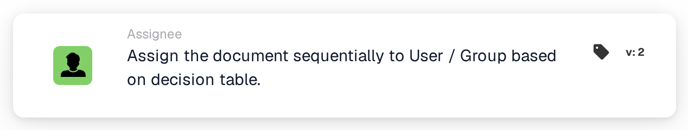

# Assign Sequentially to User/Group

<figure><figcaption>
Version 2
</figcaption></figure>

<figure><figcaption>
Assign the document sequentially to User / Group based on decision table. — Version 2
</figcaption></figure>



**Video:** Card: Assign sequentially based on a decision table · 0:44 · [Captions (WebVTT)](https://docbits-videos.fra1.cdn.digitaloceanspaces.com/settings-assistant/card-assign-sequential-dt/v1/en.vtt)

Transcript

**Assign sequentially based on a decision table** · [0:00](https://docbits-videos.fra1.cdn.digitaloceanspaces.com/settings-assistant/card-assign-sequential-dt/v1/en.mp4#t=0.25)

The card Assign sequentially based on a decision table gives the document to the users and groups a decision table returned, one after the other. The card has no settings: everything comes from the table.

**What the card needs** · [0:14](https://docbits-videos.fra1.cdn.digitaloceanspaces.com/settings-assistant/card-assign-sequential-dt/v1/en.mp4#t=14.283)

It needs a decision table card before it that stores its returned data. It takes every user and group the table returned, and the lowest priority gets the document first. Rows without a priority count as priority one. If the table returned nobody, the card takes its error exit.

**Example: two approvers in turn** · [0:32](https://docbits-videos.fra1.cdn.digitaloceanspaces.com/settings-assistant/card-assign-sequential-dt/v1/en.mp4#t=32.65)

For example, the table Example approvers returns two approvers with priority one and two. The invoice goes to the first one, and after the approval to the second.

## **Purpose**

The "**Assign the Document Sequentially to User/Group Based on Decision Table**" workflow card dynamically assigns documents to either a user or a group, depending on the decision table's evaluation. This ensures that documents are routed appropriately based on predefined rules.

## **Components of the Card**

1. **Priority (Value)**
   * **Description**: Specifies the priority level for assignments, where lower numbers represent higher priority.
   * **Detail**: A numeric input field where the priority value can be set to control the sequence of assignment.

## **Functionality**

* **Decision Table Evaluation**:\
  The decision table evaluates predefined conditions to decide whether the document is assigned to a user or a group.
* **Document Assignment**:
  * If the decision table returns a user, the document is assigned directly to that user.
  * If the decision table returns a group, the document is assigned to the group sequentially, respecting the specified priority value.

## **Setup and Configuration**

1. Add the **Assign the Document Sequentially** card to your workflow.
2. Configure the **Priority (Value)** field:
   * Enter a numeric value to set the assignment priority.
3. Save and activate the workflow to apply the configuration.

## **Conclusion**

The "**Assign the Document Sequentially to User/Group Based on Decision Table**" workflow card ensures efficient and dynamic document routing. By leveraging decision table logic and priority values, the card facilitates accurate assignment to either a user or a group, streamlining document workflows.

<!-- workflow-card-practical-example-20261021 -->

## Practical example

**When to use:** Use a decision table to select a prioritized document assignee.

**Configuration:** Configure a matching demo decision-table rule returning the intended user or group, then select that table on the card.

**Expected result and counterexample:** The returned assignee is used for sequential document assignment. With no matching return, do not assume a default assignee; inspect the result and configured fallback behavior of this version.

This is an illustrative configuration and expected outcome. Use fields, users and groups configured in your test organization; it is not a claim that this example was executed.
