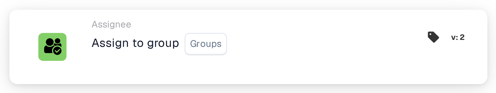
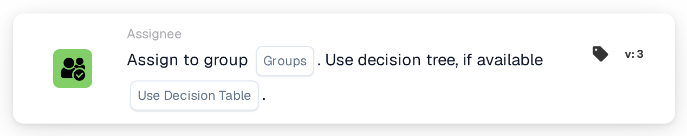

# Assign to group

<figure><figcaption>
Version 2
</figcaption></figure>

<figure><figcaption>
Version 3
</figcaption></figure>



**Video:** Card: Assign document to a group · 0:50 · [Captions (WebVTT)](https://docbits-videos.fra1.cdn.digitaloceanspaces.com/settings-assistant/card-assign-group/v1/en.vtt)

Transcript

**Assign document to a group** · [0:00](https://docbits-videos.fra1.cdn.digitaloceanspaces.com/settings-assistant/card-assign-group/v1/en.mp4#t=0.25)

The card Assign to group gives the document to a group: choose the group, for example Accounts payable. Version three, chosen with the version label, adds a second setting: whether a decision table may choose the group instead.

**Use decision tree: the table's group first** · [0:21](https://docbits-videos.fra1.cdn.digitaloceanspaces.com/settings-assistant/card-assign-group/v1/en.mp4#t=21.683)

With the decision tree switched on, the card takes the group that a decision table card earlier in the workflow returned. If the table returned no group, the group on the card gets the document. Version two always assigns the group on the card.

**Example: group from the table, fallback on the card** · [0:38](https://docbits-videos.fra1.cdn.digitaloceanspaces.com/settings-assistant/card-assign-group/v1/en.mp4#t=38.683)

For example, a decision table returns the group for the supplier, and the assign card uses it. When the table finds no group, Accounts payable gets the invoice.

## Purpose:

The **"Assign to Group"** workflow card facilitates the assignment of documents to a specific **group** within the system. This ensures that the document is processed by the appropriate team, streamlining workflow. Enhanced in later versions, it introduces decision tree functionality for dynamic group assignment.

## Components of the Card:

1. **Groups**
   * **Description:** Specifies the **group** to which the document will be assigned.
   * **Detail:** Selected from a dropdown list of available **groups**.

## **Additional Components in Version 3**

1. **Decision Tree (Version 3 Only)**
   * **Description:** Allows the use of a decision tree to dynamically determine the **group** to which the document should be assigned.
   * **Options:**
     * **True:** Enables decision tree processing.
     * **False:** Disables decision tree processing.

## Functionality:

* **Condition Evaluation:** The card only executes its action if both the **"When"** and **"And"** evaluate as true.
* **Document Assignment:** Assigns the document to the selected **group**. In **Version 3**, the **decision tree** determines the target group dynamically if enabled.

## Setup and Configuration:

* **Select Group:** Choose the **group** from the dropdown list to assign the document.
* **Use Decision Tree (Version 3 Only):** Enable this option if the **decision tree** should be used for dynamic assignment.

## Conclusion:

The **"Assign to Group"** workflow card automates document assignment to predefined **groups**, enhancing team coordination. **Version 3** introduces the ability to dynamically assign groups based on decision tree logic.

<!-- workflow-card-practical-example-20261021 -->

## Practical example

**When to use:** Put a document into a shared review queue.

**Configuration:** Select configured group `Demo Finance`.

**Expected result and counterexample:** The document is assigned to the selected group. This is document assignment, not a promise that an additional task or email is created.

This is an illustrative configuration and expected outcome. Use fields, users and groups configured in your test organization; it is not a claim that this example was executed.
