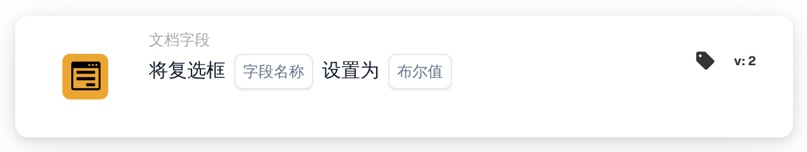

# 将复选框设为

<figure><figcaption>
版本 2
</figcaption></figure>



**视频:** 卡片: 设置复选框 · 0:40 · [字幕 (WebVTT)](https://docbits-videos.fra1.cdn.digitaloceanspaces.com/settings-assistant/card-set-checkbox/v1/zh.vtt)

文字稿

**设置复选框** · [0:00](https://docbits-videos.fra1.cdn.digitaloceanspaces.com/settings-assistant/card-set-checkbox/v1/zh.mp4#t=0.25)

设置复选框卡片会勾选或取消勾选文档的复选框字段。选择字段，例如 Special handling，以及是否勾选。

**勾选或不勾选，然后保存** · [0:16](https://docbits-videos.fra1.cdn.digitaloceanspaces.com/settings-assistant/card-set-checkbox/v1/zh.mp4#t=16.75)

卡片写入该值并保存文档，即使复选框之前为空。如果字段不是复选框，例如金额，卡片会走它的错误路径。要把复选框切换为相反的值，请使用反转复选框卡片。

**示例：勾选 Special handling** · [0:31](https://docbits-videos.fra1.cdn.digitaloceanspaces.com/settings-assistant/card-set-checkbox/v1/zh.mp4#t=31.583)

例如，供应商需要特殊处理时，Workflow 勾选 Special handling，验证人员会在文档上看到它。

## **用途：**

此工作流卡片旨在根据 **“当”** 和 **“还有”** 部分中定义的条件，将复选框字段设为指定值（true 或 false）。当满足特定条件时，它可以简单有效地自动更新复选框，从而简化文档处理流程。

## **卡片组成部分：**

1. **字段名称：**
   * **说明**：指定要设置复选框的字段。
   * **详细信息**：通过字段名称标识需要更新的复选框字段。
2. **布尔值**
   * **说明**：当 **哪里** 和 **And 部分**中的条件均为 true 时，定义复选框字段要设置的值。
   * **选项**：
     * **True**：满足条件时，复选框将设为 **true**。
     * **False**：满足条件时，复选框将设为 **false**。

## **功能：**

* **条件评估**：系统会评估 **“当”** 和 **“还有”** 中的条件。
* **执行操作**：如果 **“当”** 和 **“And 部分”**的评估结果均为 true，复选框字段将更新为指定值（true 或 false）。如果任一条件为 false，则不会执行任何操作，复选框保持原样。

## **设置和配置：**

要配置此卡片，用户需要：

1. **指定目标复选框字段**，条件满足时该字段将设为 true 或 false。
2. **选择要设置的值（true 或 false）**，以便在评估条件后应用于复选框。
3. 仅当 **“当”** 和 **“And 部分”**中的条件评估结果均为 true 时，卡片才会执行操作。

## **结论：**

**“Set Checkbox”** 工作流卡片是一种简单有效的自动化工具，可根据特定条件更新复选框字段。确保 **“当”** 和 **“And 部分”**均满足条件后，它便能帮助用户自动化流程、减少人工干预，使文档处理更加顺畅高效。

<!-- workflow-card-practical-example-20261021 -->

## 实际例子

**何时使用：** 使用显式标志标记成功的验证。

**配置：** 选择复选框字段`review_complete`并将其设置为`true`。

**预期结果及反例：** 该字段变为选中状态。当您需要清除标志时，在单独的测试中使用 `false` 运行操作。

这是说明性配置和预期结果。使用测试组织中配置的字段、用户和组；这并不是说这个例子已经被执行了。
