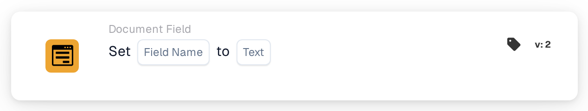

# Set to

<figure><figcaption>
Version 2
</figcaption></figure>



**Video:** Card: Set field to text · 0:40 · [Captions (WebVTT)](https://docbits-videos.fra1.cdn.digitaloceanspaces.com/settings-assistant/card-set-field-text/v1/en.vtt)

Transcript

**Set field to text** · [0:00](https://docbits-videos.fra1.cdn.digitaloceanspaces.com/settings-assistant/card-set-field-text/v1/en.mp4#t=0.25)

The card Set field to text writes a text into a field of the document. Choose the field, for example Notes, and type the text.

**The text replaces the old value** · [0:16](https://docbits-videos.fra1.cdn.digitaloceanspaces.com/settings-assistant/card-set-field-text/v1/en.mp4#t=16.516)

The text replaces what the field held before, and the document is saved with it. If the document cannot be saved, the card takes its error exit.

**Example: the reason in Notes** · [0:28](https://docbits-videos.fra1.cdn.digitaloceanspaces.com/settings-assistant/card-set-field-text/v1/en.mp4#t=28.883)

For example, when the unit price check fails, the card writes Check the unit price into Notes. The validator sees at once why the document stopped.

## **Purpose:**

This workflow card is designed to automatically set a specified field in the document to a predefined text value based on the conditions defined in the **"When"** and **"And."** It allows users to streamline data entry by ensuring fields are populated with consistent values when certain criteria are met.

## **Components of the Card:**

1. **Field Name**
   * **Description**: Specifies the field that will be updated with the text value.
   * **Detail**: The field selected will be updated with the specified text value if the conditions in the **"When"** and **"And"** are met.
2. **Text**
   * **Description**: Defines the text value that will be set in the target field when the conditions evaluate as true.
   * **Detail**: This can be a custom message, status, or predefined value that the user wishes to write into the field. The text should align with the field's expected input format (e.g., alphanumeric, date, or other types of textual information).

## **Functionality:**

* **Condition Evaluation**: The system evaluates the conditions in the **"When"** and **"And"**:
  * If **both conditions are true**, the actions defined in the **"Then Section"** will be executed. Specifically, the target field (Field Name) will be populated with the specified text.
  * If **either the "When" or the "And" section is false**, no action is taken, and the field remains unchanged. The **Then Section** actions are skipped entirely if either condition is false.
* **Action Execution**: If both conditions in the **"When"** and **"And"** are met, the system automatically populates the specified field with the chosen text value. If the conditions are not met, no changes are made to the field.

## **Setup and Configuration:**

To set up this card:

1. **Select the field** (Field Name) that will be updated with the text value. The available fields in the document are listed for selection.
2. **Specify the text value** that will be written into the target field when the conditions are true.
3. The action will only execute if both the **"When"** and **"And"** conditions evaluate to true.

## **Conclusion:**

The **"Set Field to Text"** workflow card offers a straightforward way to automate the population of text values into specific document fields based on predefined conditions. This reduces manual data entry and ensures consistency in document processing, making it a useful tool for automating workflows and enhancing efficiency.

<!-- workflow-card-practical-example-20261021 -->

## Practical example

**When to use:** Write a routing result into a document field.

**Configuration:** Select text field `routing_result` and set the text to `manual review`.

**Expected result and counterexample:** The field contains exactly `manual review`. A subsequent equals condition can use that value; it is a document field rather than an organization variable.

This is an illustrative configuration and expected outcome. Use fields, users and groups configured in your test organization; it is not a claim that this example was executed.
