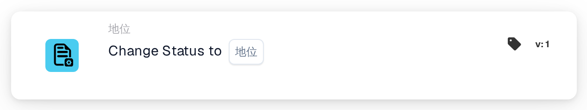
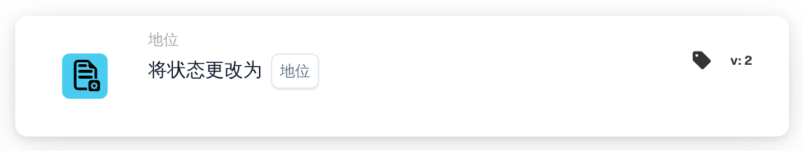
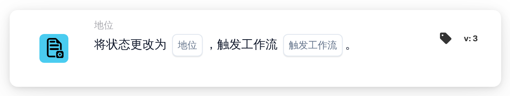

# 将状态更改为

<figure><figcaption>
版本 1
</figcaption></figure>

<figure><figcaption>
版本 2
</figcaption></figure>

<figure><figcaption>
版本 3
</figcaption></figure>

## 用途

**将状态更改为** 卡片用于为文档设置新状态，例如将文档送去审批，或将其标记为被拒绝。您可以在 Workflow 设计器中的 **然后 → 状态** 下找到它。

## 设置

### 状态

文档获得的状态。可选值：

| 状态 | 含义 |
| --- | --- |
| **错误** | 文档被标记为有错误。 |
| **被拒绝** | 文档被拒绝。 |
| **准备验证** | 文档等待用户在验证中检查。 |
| **待批准** | 文档等待批准。 |
| **等待第二次批准** | 文档等待第二次批准。 |
| **已归档** | 文档被移入归档。恢复后，它会重新获得之前的状态。 |
| **已完成** | 文档处理已完成。 |
| **已导出** | 文档已导出，但仍保持打开状态，例如以便仍可将其退回审批。 |

设置状态并不会执行该状态背后的步骤。例如，**等待第二次批准** 并不表示已有人完成了第一次批准。

### 触发工作流（仅版本 3）

决定此次状态更改是否可以启动 Workflow。

* **假：** 此次状态更改不会启动任何 Workflow。除非另一个 Workflow 需要在新状态下继续处理该文档，否则请使用此值。
* **真：** DocBits 会启动条件与文档新状态匹配的 Workflow。它们在当前 Workflow 结束后启动。卡片不会等待它们，也不会显示它们是否成功；请查看 Workflow 日志。

请始终选择一个值。选择 **真** 时，请确保包含此卡片的 Workflow 本身不匹配新状态，否则它会第二次运行。请参阅[更改状态而不重新启动 Workflow](../../../masterclass/status-and-reentry.md)。

## 卡片版本

| 版本 | 设置 | 更改后是否启动 Workflow |
| --- | --- | --- |
| **1** | 状态 | 是，始终启动 |
| **2** | 状态 | 是，始终启动 |
| **3** | 状态、触发工作流 | 仅当 **触发工作流** = **真** 时 |

版本 1 和版本 2 的工作方式相同。版本 3 新增了 **触发工作流**，因此您可以决定新状态是否启动其他 Workflow。新的 Workflow 请使用版本 3。如果将现有卡片从版本 3 切换回旧版本，**触发工作流** 将不再生效，每次状态更改都可能再次启动 Workflow。

## 须知

* **状态相同，不起作用。** 如果文档已经具有所选状态，则不会发生任何变化，也不会启动任何 Workflow。
* **已归档从不启动 Workflow**，在任何版本中都是如此。
* **不影响 Webhook。** 无论 **触发工作流** 选择什么值，都会发送状态更改的 Webhook。
* **更改可能被拒绝。** 如果您的组织锁定了已完成的文档，则 **已完成** 的文档只能更改为 **已归档** 或 **错误**。其他任何更改都会被拒绝，状态保持不变，Workflow 日志中会显示错误。
* **测试只是模拟。** 在 Workflow 设计器的卡片测试或 Advanced Test 中，后续卡片会看到新状态，但状态不会被保存，也不会启动任何 Workflow。

## 示例

**目标：** 检查完成后，将发票送去审批。

1. 条件：**文档类型** 为 _发票_，且 **文档状态** **是** **准备验证**。
2. **将状态更改为**（版本 3）：**状态** = **待批准**，**触发工作流** = **假**。

**结果：** 发票变为 **待批准** 并等待批准。此次更改不会启动其他 Workflow，而且由于文档不再处于 **准备验证** 状态，此 Workflow 也不会再次运行。
