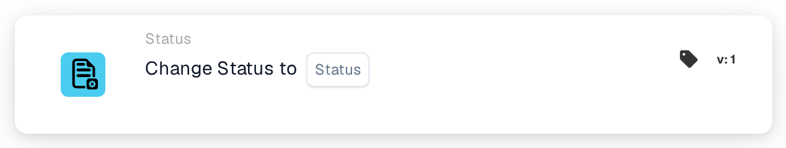
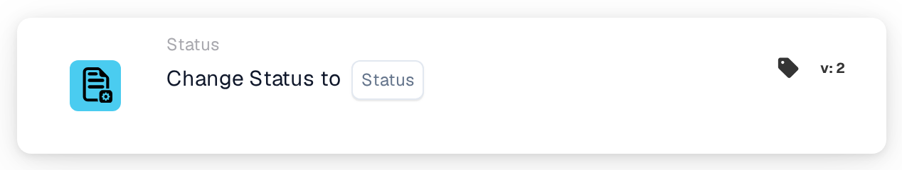
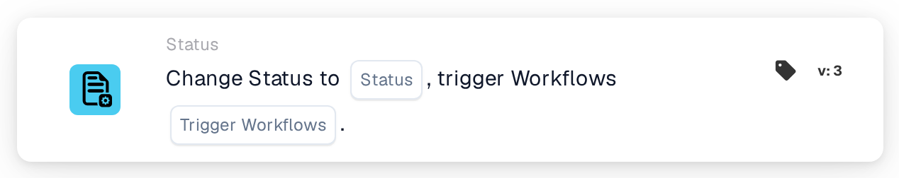

# Change Status to

<figure><figcaption>
Version 1
</figcaption></figure>

<figure><figcaption>
Version 2
</figcaption></figure>

<figure><figcaption>
Version 3
</figcaption></figure>

## Purpose

The **Change Status to** card sets the document to a new status, for example to send it on to approval or to mark it as rejected. You find it in the workflow designer under **Then → Status**.



**Video:** Change status card and loop prevention · 0:44 · [Captions (WebVTT)](https://docbits-videos.fra1.cdn.digitaloceanspaces.com/settings-assistant/workflow-status-change/v1/en.vtt)

Transcript

**Change status** · [0:00](https://docbits-videos.fra1.cdn.digitaloceanspaces.com/settings-assistant/workflow-status-change/v1/en.mp4#t=0.25)

The card Change status sets the document to a new status, for example Rejected.

**Trigger workflows** · [0:10](https://docbits-videos.fra1.cdn.digitaloceanspaces.com/settings-assistant/workflow-status-change/v1/en.mp4#t=10.116)

Trigger workflows decides what happens next. When it is on and the new status is one that starts workflows, such as Ready for validation, the workflows run again for this document.

**Off: no loop** · [0:23](https://docbits-videos.fra1.cdn.digitaloceanspaces.com/settings-assistant/workflow-status-change/v1/en.mp4#t=23.05)

If a workflow sets a status that starts the same workflow again, it can run in a loop. Switch trigger workflows off when the status change should not start any workflows.

**Example: reject, no new start** · [0:35](https://docbits-videos.fra1.cdn.digitaloceanspaces.com/settings-assistant/workflow-status-change/v1/en.mp4#t=35.416)

For example: a check fails, this card sets the status to Rejected with trigger workflows off, so nothing starts again.

## Settings

### Status

The status the document gets. You can choose:

| Status | Meaning |
| --- | --- |
| **Error** | The document is marked as having an error. |
| **Rejected** | The document is rejected. |
| **Ready for validation** | The document waits for a user to check it in validation. |
| **Pending Approval** | The document waits for approval. |
| **Pending second approval** | The document waits for the second approval. |
| **Archived** | The document is moved to the archive. When it is restored, it gets its previous status back. |
| **Finished** | Processing of the document is complete. |
| **Exported** | The document has been exported but stays open, for example so that it can still be sent back for approval. |

Setting a status does not carry out the step behind it. For example, **Pending second approval** does not mean that someone gave the first approval.

### Trigger Workflows (version 3 only)

Decides whether the status change may start workflows.

* **false:** no workflow is started by this status change. Use this unless another workflow should continue with the document in its new status.
* **true:** DocBits starts the workflows whose conditions match the document in its new status. They start after the current workflow has finished. The card does not wait for them and does not show whether they succeeded; see the workflow logs.

Always choose a value. With **true**, make sure the workflow that contains this card does not match the new status itself, or it runs a second time. See [Change status without restarting your workflow](../../../workflow-learning-path/status-and-reentry.md).

## Card versions

| Version | Settings | Starts workflows after the change |
| --- | --- | --- |
| **1** | Status | Yes, always |
| **2** | Status | Yes, always |
| **3** | Status, Trigger Workflows | Only with **Trigger Workflows** = **true** |

Versions 1 and 2 work the same way. Version 3 adds **Trigger Workflows**, so you can decide whether the new status starts other workflows. Use version 3 for new workflows. If you switch an existing card from version 3 back to an older version, **Trigger Workflows** no longer applies and every status change can start workflows again.

## Good to know

* **Same status, no effect.** If the document already has the chosen status, nothing changes and no workflow starts.
* **Archived never starts workflows**, in any version.
* **Webhooks are not affected.** Webhooks for status changes are sent whatever you choose for **Trigger Workflows**.
* **A change can be refused.** If your organization locks finished documents, a **Finished** document can only be moved to **Archived** or **Error**. Any other change is refused, the status stays as it was, and the workflow log shows an error.
* **Tests only simulate.** In a card test or Advanced Test in the workflow designer, the following cards see the new status, but the status is not saved and no workflow is started.

## Example

**Goal:** after the checks, send an invoice to approval.

1. Conditions: **Document type** is _Invoice_ and **Document status** **Is** **Ready for validation**.
2. **Change Status to** (version 3): **Status** = **Pending Approval**, **Trigger Workflows** = **false**.

**Result:** the invoice moves to **Pending Approval** and waits for approval. No other workflow is started by the change, and this workflow does not run again because the document is no longer **Ready for validation**.
