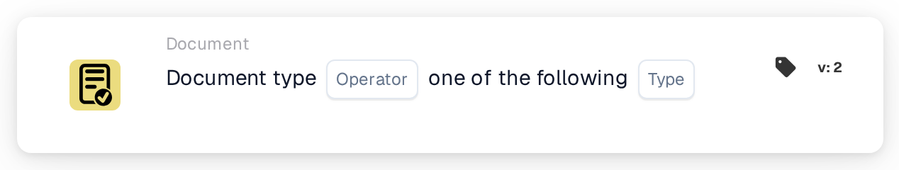

# Document Type One of

<figure><figcaption>
Version 2
</figcaption></figure>



**Video:** Card: Document type: one of a list · 0:33 · [Captions (WebVTT)](https://docbits-videos.fra1.cdn.digitaloceanspaces.com/settings-assistant/card-doc-type-list/v1/en.vtt)

Transcript

**Document type: one of a list** · [0:00](https://docbits-videos.fra1.cdn.digitaloceanspaces.com/settings-assistant/card-doc-type-list/v1/en.mp4#t=0.25)

The card Document type one of the following checks the type of a document against a list. Choose is or is not, and then one or more document types. Is passes when the document's type is in the list, is not when it is not.

**Example: invoices and credit notes** · [0:18](https://docbits-videos.fra1.cdn.digitaloceanspaces.com/settings-assistant/card-doc-type-list/v1/en.mp4#t=18.116)

For example, one workflow for invoices and credit notes: Document type is one of Invoice and Credit note as the When card, then the assign card. Other documents do not start this workflow.

## **Purpose:**

This DocBits card ensures the correct classification of a document by verifying if it matches any of the specified document types. This is useful for situations where a document could belong to more than one category, allowing for broader validation and automated handling.

## **Functionality:**

* **Multiple Document Type Validation:** This card allows users to check if a document matches any of a set of specified document types, ensuring flexible categorization for more complex document workflows.
* **Operator:** Users can define conditions to validate the document against multiple types. Available operators include:
  * **Is:** Confirms that the document matches one of the specified document types.
  * **Is Not:** Ensures that the document does not match any of the selected document types.
* **Document Types:** Users can select from multiple supported document types, including:
  * **Invoice:** Financial records submitted for payment.
  * **Debit Note:** Documents indicating an adjustment that increases the amount owed.
  * **Credit Note:** Documents indicating a reduction in the amount owed.
  * **Purchase Order:** Documents detailing a buyer’s order.
  * **Order Confirmation:** Documents that confirm an order has been accepted.
  * **Advance Shipment Notice:** Documents notifying of an upcoming shipment.

## **Usage:**

This card is ideal for document managers and administrators who need to ensure that documents are categorized into one of several types. It is especially useful for document workflows where a document may be classified under multiple categories, improving automation and classification accuracy.

## **Example Scenario:**

* A user uploads a document that could be either an "Invoice" or "Debit Note." Using the "Is" operator, the card confirms that the document matches one of the selected types, allowing the system to apply the appropriate rules and categorization.

By using the "Multiple Document Type Validation" card, organizations can enhance workflow flexibility, automate categorization, and ensure that documents are properly handled even when multiple types are applicable.
