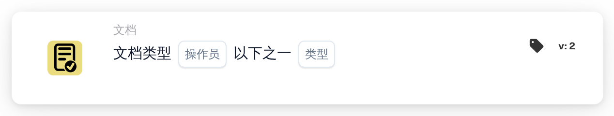

# 文档类型之一

<figure><figcaption>
版本 2
</figcaption></figure>



**视频:** 卡片: 文档类型：列表中之一 · 0:29 · [字幕 (WebVTT)](https://docbits-videos.fra1.cdn.digitaloceanspaces.com/settings-assistant/card-doc-type-list/v1/zh.vtt)

文字稿

**文档类型：列表中之一** · [0:00](https://docbits-videos.fra1.cdn.digitaloceanspaces.com/settings-assistant/card-doc-type-list/v1/zh.mp4#t=0.25)

文档类型以下之一卡把文档的类型与一个列表进行比较。选择是或不是，然后选择一个或多个文档类型。类型在列表中时，是成立；不在列表中时，不是成立。

**示例：发票和贷项通知单** · [0:17](https://docbits-videos.fra1.cdn.digitaloceanspaces.com/settings-assistant/card-doc-type-list/v1/zh.mp4#t=17.55)

例如，发票和贷项通知单共用一个 Workflow：当卡为“文档类型是发票、贷项通知单之一”，再接分配卡。其他文档不会启动它。

## **用途：**

这张 DocBits 卡片通过验证文档是否符合指定的任一文档类型，确保文档分类正确。当文档可能属于多个类别时，这张卡片尤其有用，可支持更广泛的验证和自动化处理。

## **功能：**

* **多种文档类型验证：**这张卡片允许用户检查文档是否符合一组指定文档类型中的任意一种，从而灵活地对更复杂的文档工作流进行分类。
* **运算符：**用户可以定义条件，根据多种类型验证文档。可用运算符包括：
  * **是：**确认文档符合指定文档类型之一。
  * **不是：**确保文档不符合所选的任何文档类型。
* **文档类型：**用户可以从多种受支持的文档类型中进行选择，包括：
  * **发票：**提交用于付款的财务记录。
  * **借项通知单：**表示应付金额增加的文档。
  * **贷项通知单：**表示应付金额减少的文档。
  * **采购订单：**详细说明买方订单的文档。
  * **订单确认：**确认订单已被接受的文档。
  * **发货通知：**通知即将发货的文档。

## **用法：**

这张卡片适用于需要确保文档被归入多种类型之一的文档管理人员和管理员。它对于文档可能被归入多个类别的工作流尤其有用，可提高自动化程度和分类准确性。

## **示例场景：**

* 用户上传了一份可能是“发票”或“借项通知单”的文档。使用“是”运算符后，这张卡片会确认文档符合所选类型之一，从而让系统应用适当的规则并进行分类。

通过使用“多种文档类型验证”卡片，组织可以提高工作流的灵活性、实现分类自动化，并确保即使适用多种类型，文档也能得到妥善处理。
