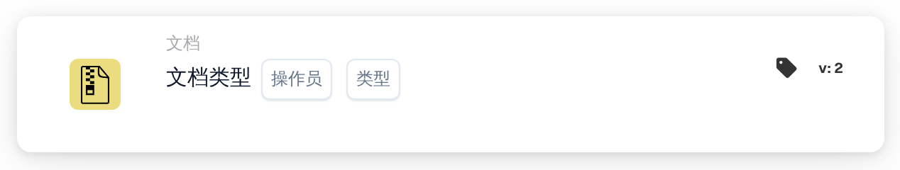

# 文档类型操作

<figure><figcaption>
版本 1
</figcaption></figure>

<figure><figcaption>
版本 2
</figcaption></figure>



**视频:** 卡片: 文档类型 是 / 不是 · 0:30 · [字幕 (WebVTT)](https://docbits-videos.fra1.cdn.digitaloceanspaces.com/settings-assistant/card-doc-type/v1/zh.vtt)

文字稿

**文档类型 是 / 不是** · [0:00](https://docbits-videos.fra1.cdn.digitaloceanspaces.com/settings-assistant/card-doc-type/v1/zh.mp4#t=0.25)

文档类型卡检查文档的类型。选择是或不是，然后选择类型，例如发票。不是会匹配除所选类型之外的所有类型。

**示例：只处理发票** · [0:17](https://docbits-videos.fra1.cdn.digitaloceanspaces.com/settings-assistant/card-doc-type/v1/zh.mp4#t=17.183)

例如，一个只处理发票的 Workflow：把“文档类型是发票”作为当卡，然后接一张分配卡。对于贷项通知单、报价单或订单，这个 Workflow 不会启动。

## **用途：**

此工作流卡片专用于对按类型分类的文档执行预定义操作。它简化了 ERP 系统中各种文档的处理流程，确保每种类型的文档都按照其独特要求和组织政策进行处理。

## **功能：**

* **文档类型验证**：此卡片会验证文档是否符合特定类型，帮助用户确认文档的分类。
* **运算符**：用户可以设置条件来确定文档类型。可用的运算符包括：
  * **是**：确认文档与指定的文档类型相符。
  * **不是**：确认文档与指定的文档类型不符。
* **文档类型**：支持的文档类型包括：
  * **发票**
  * **借记单**
  * **贷项通知单**
  * **采购订单**
  * **订单确认**
  * **预先发货通知**

## **使用方法**：

此卡片适用于需要确保文档正确分类以便简化处理流程的文档管理员和管理人员。验证文档类型有助于提升工作流自动化水平、执行针对文档的操作，并保持记录井然有序。

## **示例场景**：

* 用户上传了一份标记为“借记单”的文档。使用“是”运算符后，卡片确认该文档确实是“借记单”，系统便可应用相关处理规则并对其进行适当分类。

部署“文档类型”卡片后，组织可以自动执行文档分类，确保文档处理方式一致，并提高文档管理工作流的效率。
