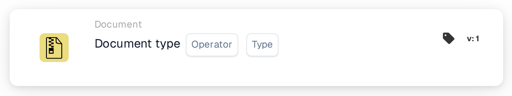

# Document Type Operation

<figure><figcaption>
Version 1
</figcaption></figure>

<figure><figcaption>
Version 2
</figcaption></figure>



**Video:** Card: Document type is / is not · 0:31 · [Captions (WebVTT)](https://docbits-videos.fra1.cdn.digitaloceanspaces.com/settings-assistant/card-doc-type/v1/en.vtt)

Transcript

**Document type is / is not** · [0:00](https://docbits-videos.fra1.cdn.digitaloceanspaces.com/settings-assistant/card-doc-type/v1/en.mp4#t=0.25)

The card Document type checks the type of a document. Choose is or is not, and then the type, for example Invoice. Is not matches every type except the one you choose.

**Example: only invoices** · [0:17](https://docbits-videos.fra1.cdn.digitaloceanspaces.com/settings-assistant/card-doc-type/v1/en.mp4#t=17.216)

For example, a workflow only for invoices: Document type is Invoice as the When card, then an assign card. For credit notes, quotes or orders, this workflow does not start.

## **Purpose:**

This workflow card is specifically designed to perform predefined operations on documents categorized by type. It streamlines the handling of various document forms within an ERP system, ensuring that each type is processed according to its unique requirements and organizational policies.

## **Functionality:**

* **Document Type Validation**: This card verifies if a document matches a particular type, enabling users to confirm its categorization.
* **Operator**: Users can set conditions to determine the document's type. Available operators include:
  * **Is**: Confirms that the document matches the specified document type.
  * **Is Not**: Ensures that the document does not match the specified document type.
* **Document Types**: Supported document types include:
  * **Invoice**
  * **Debit Note**
  * **Credit Note**
  * **Purchase Order**
  * **Order Confirmation**
  * **Advance Shipment Notice**

## **Usage**:

This card is useful for document managers and administrators who need to ensure that documents are correctly classified for streamlined processing. Validating document types enhances workflow automation, enables document-specific actions, and keeps records organized.

## **Example Scenario**:

* A user uploads a document labeled as a "Debit Note." Using the "Is" operator, the card confirms that the document type is indeed "Debit Note," allowing the system to apply relevant processing rules and categorize it appropriately.

By deploying the "Document Type" card, organizations can automate document classification, ensure consistency in document handling, and improve the efficiency of document management workflows.
