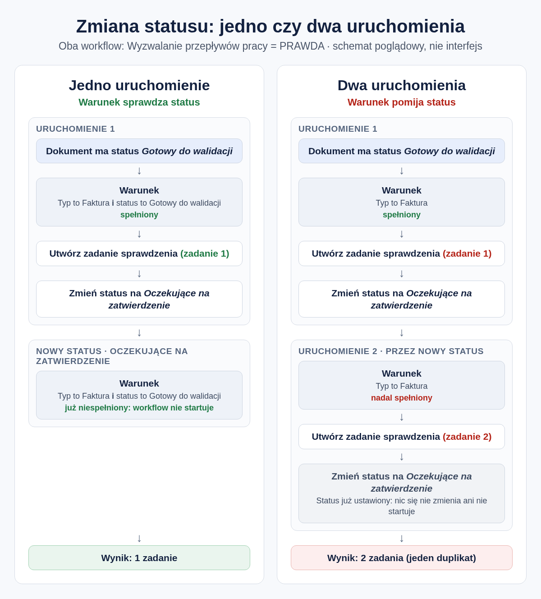

# Zmiana statusu bez ponownego uruchamiania Workflow

Gdy dokument otrzymuje nowy status, DocBits uruchamia Workflow przeznaczone dla tego statusu. Może to być także Workflow, który właśnie zmienił status. Jeśli jego warunki nadal są spełnione, uruchamia się ponownie i tworzy drugie zadanie lub drugi eksport.

Ta strona pokazuje, jak skonfigurować Workflow, aby każdy dokument przechodził przez niego tylko raz.

## Najważniejsze ustawienie

Karta [Zmień status na](../then/status/change-status-to.md) ustawia nowy status. Jej ustawienie **Wyzwalanie przepływów pracy** decyduje, czy ta zmiana statusu może uruchamiać Workflow:

* **FAŁSZ:** żaden Workflow nie zostaje uruchomiony. Używaj tej wartości, chyba że inny Workflow ma dalej przetwarzać dokument.
* **PRAWDA:** DocBits uruchamia Workflow, których warunki pasują do dokumentu w nowym statusie. Może to być także Workflow, który dokonał zmiany.

Strona karty opisuje wszystkie statusy i wersje karty.

## Które Workflow uruchamiają się po zmianie statusu

Gdy **Wyzwalanie przepływów pracy** ma wartość **PRAWDA**, DocBits sprawdza każdy włączony Workflow i jego warunki dotyczące typu i statusu dokumentu, na przykład kartę **Status dokumentu**. Workflow uruchamia się, jeśli dokument z nowym statusem spełnia te warunki.

Workflow, który nie sprawdza statusu, pasuje do **każdego** statusu. Jeśli więc sam zmienia status, nowy status uruchamia go ponownie.

Zmiana statusu dokumentu na status, który już ma, nic nie robi: status pozostaje bez zmian i żaden Workflow się nie uruchamia.

## Przykład: jedno uruchomienie czy dwa

Zasada: gdy Workflow wykona swoje zadanie, jego własne warunki nie mogą już być spełnione.

<figure><figcaption>
Ten sam workflow z warunkiem na status i bez niego
</figcaption></figure>

Po prawej Workflow uruchamia się drugi raz i tworzy zduplikowane zadanie. Zatrzymuje się tylko dlatego, że druga zmiana statusu ustawia status, który dokument już ma.

**Dwa Workflow mogą uruchamiać się nawzajem.** Jeśli jeden Workflow ustawia **Oczekujące na zatwierdzenie**, a drugi przywraca dokument do statusu **Gotowy do walidacji**, oba z wartością **PRAWDA**, będą się wzajemnie uruchamiać. Dodaj w każdym Workflow warunek na status, od którego zaczyna, i używaj **PRAWDA** tylko tam, gdzie jest to potrzebne.

## Konfiguracja krok po kroku

1. **Użyj wersji 3 karty Zmień status na.** Starsze wersje nie mają ustawienia **Wyzwalanie przepływów pracy** (zobacz [Wersje karty](../then/status/change-status-to.md#wersje-karty)).
2. **Sprawdź status początkowy.** Dodaj kartę **I** **Status dokumentu** (w **I → Status**) i ustaw ją na **Jest** **Gotowy do walidacji**. Zobacz [Stan statusu pojedynczego dokumentu](../and/status/single-document-status-condition.md). Jeśli sam status nie mówi, czy krok został wykonany, sprawdź też pole, które Workflow wypełnia po zakończeniu.
3. **Dodaj akcję**, na przykład utworzenie zadania lub eksport dokumentu.
4. **Dodaj kartę Zmień status na** i wybierz następny status, na przykład **Oczekujące na zatwierdzenie**.
5. **Wybierz wartość Wyzwalanie przepływów pracy.** Zacznij od **FAŁSZ**. Wybierz **PRAWDA** tylko wtedy, gdy inny Workflow ma dalej przetwarzać dokument w nowym statusie.
6. **Wypróbuj to na prawdziwym dokumencie.** Sprawdź, czy powstało dokładnie jedno zadanie lub jeden eksport i czy dokument ma nowy status.


Testy w projektancie Workflow tylko symulują zmianę statusu. Status nie jest zapisywany i żaden inny Workflow się nie uruchamia. Aby zobaczyć rzeczywiste działanie, użyj prawdziwego dokumentu.


## Wbudowana ochrona

DocBits ogranicza szkody, gdy Workflow uruchamiają się nawzajem raz za razem:

* **Jedno uruchomienie Workflow naraz na dokument.** Uruchomienia dla tego samego dokumentu czekają na siebie, a każde widzi dokument w stanie, w jakim zostawiło go poprzednie.
* **Limit uruchomień.** Domyślnie ten sam Workflow uruchamia się na jednym dokumencie najwyżej 50 razy. Potem DocBits przestaje go uruchamiać dla tego dokumentu.

Te limity w końcu zatrzymują powtórzenia, ale do tego czasu może już powstać wiele zadań lub eksportów. Zapobiega temu dopiero warunek na status. Jeśli duplikat byłby poważnym problemem, sprawdź go także przed wykonaniem akcji, na przykład czy dla dokumentu istnieje już otwarte zadanie.

## Powiązane strony

* [Zmień status na](../then/status/change-status-to.md): karta, jej statusy i wersje
* [Stan statusu pojedynczego dokumentu](../and/status/single-document-status-condition.md): sprawdzanie statusu dokumentu w warunku
* [Kiedy uruchamia się mój workflow?](../workflow-execution-model.md)
* [Przegląd ścieżki nauki](../workflow-learning-path.md)
